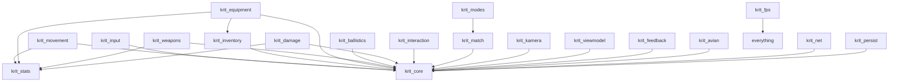

# Krit FPS: Crate Architecture Plan

> Status: **proposal, revision 2**, targeting Bevy 0.19, `bevy_enhanced_input` (BEI) 0.26 and
> avian3d 0.7. This document defines how the workspace is split into crates, what each crate owns,
> and the exact contracts that cross every crate boundary.
>
> Revision 2 folds in the template research in [`docs/research/`](research/) (see §13). The
> largest changes are the intent shape (§6.1), the schedule anchors around physics (§4), authority
> and resimulation (§4.2), new determinism rules (§8), and several decisions moved out of §12.

## 1. Goals

1. **Use it whole.** `krit_fps` (the facade) plus `KritFpsPlugins` gives a working FPS sandbox.
   That covers moving, looking, picking up and firing a weapon, dealing damage, dying and respawning
   in a deathmatch.
2. **Use it piece by piece.** Any domain crate can be used alone, or replaced with a game's own
   implementation, without forking the others. A developer who wants their own movement keeps
   Krit's weapons, damage and match flow untouched.
3. **Support many first-person games**, not only arena shooters. Examples are Quake-likes,
   tactical/military shooters, extraction games, immersive sims, horror games and single-player
   campaigns.
4. **Be ready for networking from day one.** Simulation is deterministic, runs on a fixed tick, and
   keeps all of its state in components. A lightyear or replicon integration should be *additive*
   and should not require a rewrite.

## 2. Architectural principles

These come from the research into Bevy, Lyra, GAS, ShooterGame, Source/Quake, Unity DOTS, Unity FPS
Sample, Godot and Overwatch. Every crate below follows them.

| # | Principle | Origin |
|---|---|---|
| P1 | **Intent is the only gameplay input.** Simulation reads plain intent components and never reads devices or BEI. Players, AI bots, replays and network prediction all drive the same code. The intent carries **absolute** aim and **held** buttons only, so it is safe to repeat, drop or resend; edges are derived inside simulation. | Source `CUserCmd`, Q3 `usercmd_t`, Unity FPS Sample `UserCommand`, DOTS player→character |
| P2 | **Simulation and presentation are separate.** Simulation runs in the fixed schedule and is headless-safe. Camera feel, view models, VFX, audio and HUD only *read* simulation state and never write it. | Overwatch, lightyear rollback rules |
| P3 | **Intent flows down; facts flow up as messages.** Fire intent → `ShotRequest` → `HitResult` → `DamageRequest` → `DamageApplied` → `Died`. Every arrow is a seam where a stage can be replaced. | Overwatch deferment, DOTS shot buffers, Q3 `PM_Weapon` → `FireWeapon` |
| P4 | **Aim belongs to the character, not the camera.** `ViewAngles` lives on the character and is what shots use. The camera copies it and adds visual-only offsets. | Source, DOTS `ViewPitchDegrees`, GoldGdt gimbals. (bevy_ahoy does the *opposite*: its camera is authoritative. See §10.) |
| P5 | **Player and Character are separate entities.** The persistent player (team, score, loadout choice, network input stream) lives on the Player. The Character (body) can be destroyed and respawned. | Lyra PlayerState/Pawn, DOTS `ControlledCharacter`, ShooterGame `AShooterPlayerState` |
| P6 | **Compose, don't inherit.** A weapon is an entity made of `FireMode`, `Magazine`, `SpreadModel` and similar components. A `Hitscan` or `Projectile` marker component picks which systems process it. | DOTS weapons vs ShooterGame/Source hierarchies, COGITO component nodes |
| P7 | **Stats are a base value plus a list of modifiers, recomputed when the inputs change.** Never mutate base data. Resources such as `Health` and `Magazine` are *state*, not stats; their caps (`MaxHealth`) are stats. | Lyra/GAS attributes; GAS/Epic guidance that ammo is not an attribute |
| P8 | **Rules are policies that systems query.** Friendly fire, whether damage is allowed, and spawn choice are resources or gate components. No crate contains `if mode == SnD` checks. | Source `CGameRules`, Lyra phase/team subsystems |
| P9 | **Physics sits behind a trait, and movement owns its algorithm.** Core logic uses trace-shaped queries (`cast_shape`, `contents`, `depenetrate`); backends implement them. Collide-and-slide, step-up and ground snap live in `krit_movement`, so swapping backends does not change how movement feels. | Q3 `pmove_t` trace callbacks, Source `CGameMovement`, bevy-tnua integration layer |
| P10 | **Every crate ships a `PluginGroup` of fine-grained plugins and public `SystemSet`s.** This lets users run `.disable::<X>()`, `.set(...)`, `remove_systems_in_set`, and order their own systems against ours. | Bevy `DefaultPlugins`, bevy_ahoy, tnua |
| P11 | **State is truth; events are hints.** Any fact a late joiner, a reconnecting client or a rolled-back client must see (dead, last damage, carried flag) is stored as tick-stamped component state. Messages and events are a convenience and must be safe to miss or replay. | Halo: Reach networking, Unity FPS Sample `HealthStateData`/`DamageHistoryData` |
| P12 | **Simulation knows its authority, not its transport.** Systems that must only run on the authority (damage, death, spawning, scoring) are gated by a core run condition. Domain crates never import a networking crate. | replicon "disconnected = authority", DOTS server-only systems, Epic "never predict damage or death" |

## 3. Crate map

```
krit_fps                         facade: features, KritFpsPlugins, prelude
│
├── krit_core                    contracts: ids, intents, messages, sets, gates, authority, physics traits
├── krit_stats                   generic StatId + Modifier + recompute
│
├── krit_input                   BEI → intent bridge                       (sim-adjacent)
├── krit_movement                KCC algorithm, movement state machine, profiles (simulation)
├── krit_inventory               items, containers, ammo pools, pickups    (simulation)
├── krit_equipment               equip/holster, active item, intent routing (simulation)
├── krit_weapons                 fire control, ammo, reload, spread, recoil (simulation)
├── krit_ballistics              hitscan, projectiles, penetration, AoE, hitboxes (simulation)
├── krit_damage                  health/armor/shield pipeline, life state, attribution (simulation)
├── krit_interaction             focus, verbs, hold-to-use, interactables  (simulation)
├── krit_match                   phases, teams, score, spawns, respawn     (simulation)
│   └── krit_modes               TDM / FFA / CTF / Domination / S&D / Objectives … (feature-gated)
│
├── krit_kamera                  camera rig, FOV, bob/shake/kick, camera mode stack (presentation)
├── krit_viewmodel               view-model render layer & weapon sway     (presentation, render deps)
├── krit_feedback                hitmarkers, killfeed, damage indicators, HUD read models (presentation)
│
├── krit_avian                   avian3d backend for krit_core physics traits
├── krit_ahoy       (M1 only)    bevy_ahoy adapter standing in for krit_movement
├── krit_net        (later)      lightyear/replicon integration, lag compensation history
└── krit_persist    (later)      save/load of world and campaign state
```

The existing crates fit into this map: `krit_input` stays as it is (with changes described in §7),
and `krit_kamera` stays as the presentation camera.

### 3.1 Dependency graph



**The one hard rule:** apart from the explicit exceptions below, domain crates depend only on
`krit_core` and `krit_stats`, never on each other. All communication between domains goes through
`krit_core` types.

| Allowed sibling edge | Why |
|---|---|
| `krit_equipment → krit_inventory` | Equipment works on inventory items. Lyra layers them the same way. Inventory knows nothing about equipment. |
| `krit_modes → krit_match` | Modes are thin rule plugins built on the match framework. |
| `krit_avian / krit_ahoy / krit_net / krit_persist → krit_core` only | Backends implement core traits and do not reach into domain crates. Domain crates expose backend hook sets instead. |

**How `krit_net` and `krit_persist` find domain components without importing them.** Each domain
crate tags the components it owns with a reflected marker from core, `#[reflect(SimState)]`, carrying
a `SimStateClass` (see §5.1). The backend walks the `TypeRegistry` and registers every tagged type.
This keeps the edge `krit_net → krit_core` honest. A game that needs a hand-tuned registration can
still do it in its own app, or the facade can do it under the `net` feature.

Not allowed (each would break the ability to swap that crate):

- weapons → ballistics, because firing must not know how hits are resolved;
- ballistics → damage, because hits must not know how health works;
- damage → match, because death must not know about scoring;
- interaction → inventory or stats, because requirements are vetoes (see §5.10);
- anything in simulation → kamera, viewmodel or feedback.

### 3.2 Bevy dependency tiers

| Tier | Crates | Bevy deps allowed |
|---|---|---|
| Logic | core, stats, input, movement, inventory, equipment, weapons, ballistics, damage, interaction, match, modes | `bevy_app`, `bevy_ecs`, `bevy_math`, `bevy_reflect`, `bevy_transform`, `bevy_time`, `bevy_platform` (+ `bevy_asset` for definition assets) |
| Presentation | kamera, feedback | add `bevy_camera` |
| Render | viewmodel | add `bevy_render`, `bevy_camera`, `bevy_light` |
| Backend | avian, net, persist | add `avian3d`, `lightyear` / `bevy_replicon`, `serde` |

Logic crates must build and pass tests with **no renderer and no physics engine**. CI should enforce
this with `cargo test -p krit_weapons` and similar per-crate runs.

Each crate has a `reflect` feature (on by default) that calls `register_type` explicitly, as BEI
does. Bevy's Reflect auto-registration is an opt-in cargo feature on the `bevy` crate and is not
active when only subcrates are used.

## 4. Schedule & ordering backbone (owned by `krit_core`)

Every crate places its systems in one shared, public set chain. That way crates that never import
each other still run in the right order.

```rust
/// Simulation. Split into two parent sets so a physics backend can step in between.
#[derive(SystemSet, Debug, Clone, PartialEq, Eq, Hash)]
pub enum KritSimPhase {
    /// Intent → Movement. Runs before the physics step.
    PrePhysics,
    /// Equipment → Despawn. Runs after the physics step and writeback,
    /// so traces see this tick's poses.
    PostPhysics,
}

#[derive(SystemSet, Debug, Clone, PartialEq, Eq, Hash)]
pub enum KritSimSystems {
    // ---- PrePhysics ----
    /// Copy/validate intents for this tick; derive button edges from `PrevButtons`;
    /// apply forced/disabled buttons; reset and apply gates (freeze time, dead, menus)
    Intent,
    /// Spawn requests from last tick's Rules are realised here, at the start of the tick
    Spawn,
    /// ViewAngles from the intent's absolute aim + `ViewAngleOffset`; recoil recovery
    Aim,
    /// Moving platforms, doors and other kinematic movers (before characters ride them)
    Movers,
    /// Character movement (KCC)
    Movement,
    // ---- PostPhysics ----
    /// Equipment changes, intent routing to the active item
    Equipment,
    /// Weapon state machines -> ShotRequest
    Weapons,
    /// ShotRequest + projectiles -> HitResult -> DamageRequest
    Ballistics,
    /// DamageRequest -> DamageApplied / Died
    Damage,
    /// Interaction progress
    Interaction,
    /// Match rules: scoring, phase transitions, spawn requests
    Rules,
    /// Despawning of characters and items, cleanup
    Despawn,
}

/// Presentation (Update / PostUpdate, never in the sim schedule)
#[derive(SystemSet, Debug, Clone, PartialEq, Eq, Hash)]
pub enum KritViewSystems { SyncFromSim, CameraEffects, ViewModel, Feedback }
```

- `KritCorePlugin { sim_schedule: Interned<dyn ScheduleLabel> }` chains these sets in the order
  above. The default is `FixedUpdate` when no backend is installed. `krit_avian` moves the chain to
  `FixedPostUpdate` and orders `PrePhysics.before(PhysicsSystems::First)` and
  `PostPhysics.after(PhysicsSystems::Writeback)`. This matches where bevy_ahoy, avian, lightyear lag
  compensation and replicon's tick already run.
- **Convention:** hits on tick N resolve against the *post-step* poses of tick N, on client and
  server alike.
- Users gate the whole simulation with
  `configure_sets(sim_schedule, KritSimPhase::PrePhysics.run_if(in_state(MyState::Playing)))` (and
  the same for `PostPhysics`). Krit never defines the game's top-level `States`.
- Inside each crate, sub-sets are public (for example `WeaponSystems::{FireControl, Reload, Spread, Recoil}`)
  so individual behaviours can be removed with `App::remove_systems_in_set` or have systems inserted
  between them.
- **Bridge between frame rate and tick rate**: `krit_input` writes the latest absolute aim every
  frame and ORs button state into a *latched* held mask, so a tap shorter than one tick still lands
  on a tick. The latch clears in `RunFixedMainLoopSystems::AfterFixedMainLoop`, and only if a fixed
  tick actually ran that frame (the bevy_ahoy pattern). This fixes the double-tick bug described in
  §7.
- **Iteration order:** wherever the order of entities affects results (spawn selection, damage
  application, projectile resolution), systems sort by `SimId`, never by `Entity` or query order,
  because those differ between client and server.

### 4.1 Message vs Event vs Component: which mechanism for which contract

| Use | Mechanism | Examples |
|---|---|---|
| Per-tick state another domain reads, and durable facts (P11) | **Component** on the entity | `CharacterIntent`, `ViewAngles`, `ActionGates`, `WeaponStats`, `Health`, `LifeState::Dead { at_tick, killer }`, `LastDamageTaken` |
| Pipeline handoff between sim stages, and sim reacting to sim | **`Message`** (buffered, read in order by the next set) | `ShotRequest`, `HitResult`, `DamageRequest`, `DamageApplied`, `Died` |
| Discrete facts *game code and presentation* want to react to per entity | **`EntityEvent`** (observers, optionally propagating up `ChildOf`) | `Died`, `Landed`, `WeaponFired`, `ReloadFinished`, `Equipped`, `InteractCompleted` |

- Pipeline stages use `Message` because observers have no ordering between them, and because a
  replaced stage should only need to read one queue and write the next.
- **Krit simulation crates never react to simulation facts through observers.** Rollback replays
  observers, so an observer that spawns or mutates state (for example drop-on-death) would run twice.
  Sim crates read the ordered `Message` instead. Observers are for game code and presentation.
- Facts are *also* triggered as `EntityEvent`s where game code commonly wants `On<Died>`-style
  observers. A small helper in core (`emit_fact`) writes the message and triggers the event together,
  and skips the trigger while resimulating (§4.2).

### 4.2 Authority and resimulation

`krit_core` owns two resources and their run conditions. Without `krit_net` both have fixed values, so
single-player code pays nothing.

```rust
#[derive(Resource, Clone, Copy, PartialEq, Eq, Default, Reflect)]
pub enum SimAuthority { #[default] Standalone, Server, Client }

/// Set by krit_net while re-running already-simulated ticks during rollback.
#[derive(Resource, Clone, Copy, Default, Reflect)]
pub struct SimReplay { pub resimulating: bool }

pub fn has_authority(a: Res<SimAuthority>) -> bool { *a != SimAuthority::Client }
pub fn first_time_simulated(r: Res<SimReplay>) -> bool { !r.resimulating }
```

- Server-only work runs under `has_authority`: the `Damage`, `Rules`, `Spawn` and `Despawn` sets,
  and the damage-emitting systems in `Ballistics`. Clients still predict movement, weapons, ammo and
  projectiles, and see damage and death when the server state arrives (P11).
- Anything that must not repeat during rollback (spawns of non-predicted entities, `EntityEvent`
  triggers, hit queries whose results are kept) uses `first_time_simulated`. This is Source's
  `IsFirstTimePredicted` and the FPS Sample's `lastHitCheckTick`.

## 5. Crate-by-crate specification

Every crate has the same layout:

- `XPlugins` (a `PluginGroup`) made up of fine-grained `pub` plugins;
- a `prelude`;
- `XSystems` sets;
- components that are `Default + Clone + Reflect` (BSN/`FromTemplate` friendly), with `MapEntities`
  on any component that holds an `Entity`, and `PartialEq` on any component that is `SimState`;
- `serialize` and `reflect` features.

### 5.1 `krit_core`: contracts

**Owns:** only types, traits, sets and tiny pure helpers. It has no gameplay systems except the set
configuration, edge derivation and generic gate application.

| Module | Contents |
|---|---|
| `tick` | `SimTick(u32)` resource, incremented in `KritSimSystems::Intent`. Every message carries a tick. `krit_net` aliases it to the network tick rather than running two counters. |
| `entity` | `Player`, `Character`, the relationship `Controls(Entity)` ↔ `ControlledBy`, `Owner` / `Instigator` relationship for spawned things (projectiles, grenades). `SimId(u64)`: a network-stable id assigned by the authority, used for keys and ordering. `PersistentId` for authored level entities. |
| `intent` | `CharacterIntent` (see §6.1), `Buttons` bitflags (held), `PrevButtons` and `ButtonEdges` (derived in sim), `ItemIntent`, `CharacterIntent::inert()` |
| `aim` | `ViewAngles { yaw, pitch }`, `ViewAngleOffset` (sim-forced facing on spawn/teleport), `AimRecoil { pitch, yaw }` (aim-affecting, additive), `EyeHeight`, `AimRay { origin, dir }` helper that includes `AimRecoil` |
| `gates` | `ActionGates` as a component: block bits (`MOVE`, `LOOK`, `FIRE`, `ADS`, `SPRINT`, `INTERACT`, `SWITCH`, `RELOAD`, plus game-defined bits), and `forced` / `disabled` `Buttons` masks applied to the intent in `Intent`. Domains *contribute*; consumers *query*. A debug build records which plugin set each bit. Cancel rules live in `ActionRules` (§5.6). |
| `authority` | `SimAuthority`, `SimReplay`, `has_authority`, `first_time_simulated` (§4.2) |
| `team` | `TeamId`, `Team` component, the `TeamRelations` resource trait (`relation(a, b) -> Relation::{Self_, Friendly, Neutral, Hostile}`) with a default impl |
| `combat` | `ShotRequest`, `HitResult`, `HitZone`, `Hurtbox { owner, zone, multiplier }`, `DamageRequest`, `DamageApplied`, `Died`, `DamageTypeId`, `DamageFlags`, `ImpactEvent`, `HitConfirmed` |
| `physics` | `SpatialQueryBackend` trait (`cast_ray`, `cast_shape`, `overlap`, `contents(point) -> ContentsFlags`, with layer filters), the KCC-facing `CollisionQuery` trait (`cast_shape`, `depenetrate`, `intersections`, `contents`, `surface(entity) -> SurfaceInfo`), `KritLayer::{World, Character, Hurtbox, Projectile, Interactable, PlayerClip}` |
| `rng` | `SimRng::for_shot(tick, shooter: SimId, shot_index)` and `SimRng::for_stream(tick, stream: SimId, salt)`: seeded, deterministic, predictable. Never seeded from `Entity`. |
| `curve` | `Curve1` piecewise-linear curve, shared by spread heat, falloff and stat curves |
| `noise` | `NoiseEvent { origin, loudness, kind, instigator }`, written by movement, weapons and impacts for AI and stealth |
| `sim_state` | `#[reflect(SimState)]` marker with `SimStateClass::{OwnerPredicted, Predicted, Interpolated, Replicated, ServerOnly, Derived}` and optional owner-only fields. Read by `krit_net` and `krit_persist`. |
| `sets` | `KritSimPhase`, `KritSimSystems`, `KritViewSystems`, `KritCorePlugin`, `emit_fact` |

**Customization:** you would swap backend implementations, not this crate. Any game needs it, even
one that uses only a single Krit crate.

### 5.2 `krit_stats`: modifiers

**Owns:**
- `StatId`: an interned id or label, extensible;
- `Modifier { stat, op: Add | Mul | Override, value, priority, condition: Option<ConditionId> }`,
  stored as `Modifiers` on the source entity (an attachment, perk, equipped item or status effect);
- `ModifierSourceOf(target)` relationship;
- `StackPolicy` per `StatId` (`Stack`, `HighestOnly`, `LowestOnly`), so two identical slows do not
  stack unless the stat says so;
- a generic `Stat<T>` recompute pattern. A domain declares `BaseX` + `X` (computed) and registers
  which `StatId`s feed which fields.

**Aggregation formula (normative):**
1. If any `Override` applies, the one with the highest `priority` wins (ties broken by source
   `SimId`), and the rest are ignored.
2. Otherwise `value = (base + Σ Add) × Π Mul`. Multipliers **multiply**: two ×0.5 slows give ×0.25,
   not ×0 as in GAS's additive multipliers.
3. Sources are folded in a stable order: `(priority, source SimId)`. The result is clamped to the
   stat's declared range.

**Resources vs stats:** `Health`, `Shield`, `Stamina` and `Magazine` are state, not stats. Their caps
(`MaxHealth`, `MaxShield`) are stats. Each resource declares a `CapChangePolicy` (`KeepAbsolute`,
`KeepRatio`, `Clamp`) for what happens when its cap changes.

**Player-level modifiers:** a source attached to a Player (a perk, a campaign upgrade) forwards to
whichever Character the Player currently `Controls`, and re-attaches on respawn.

**Consumes:** `Modifiers` changes and relationship add/remove events.

**Produces:** recomputed stat components (`WeaponStats`, `MovementStats`, `HealthStats`) whenever a
source is added, removed or changed. Stats are `SimStateClass::Derived`: never replicated, always
recomputed.

**Why a crate of its own:** movement (weight, ADS slowdown), weapons (attachments) and damage (armor
perks) all need it. Putting it in core would make core opinionated, and putting it in weapons would
make movement depend on weapons.

### 5.3 `krit_input`: device → intent bridge

**Owns:**
- the BEI `InputAction` types (`Movement`, `Jump`, `Crouch`, `Sprint`, `RotateCamera`, `Fire`,
  `AltFire`/`Aim`, `Reload`, `Interact`, `InteractAlt`, `Confirm`, `Cancel`, `SwitchSlot(n)`,
  `NextItem`, `PrevItem`, `Melee`, `Throw`, `Lean`);
- default input contexts and bindings, including a policy for one gamepad button shared by reload and
  interact;
- `InputSettings` (sensitivity, invert, ADS sensitivity mode, toggle-vs-hold per action);
- the client-side aim accumulator: `aim = clamp(aim + look_delta × sensitivity)`, kept on the
  Character as `LocalAim` (not sim state);
- frame-to-tick button latching (§4);
- `InputGlyphs`, a read model naming the current binding for each action, for prompts.

**Consumes:** BEI `Action<T>` component values for continuous axes (read in a system), and BEI
events for discrete actions.

**Produces:** writes `CharacterIntent` on the **Character**, with absolute aim and held buttons. In a
networked game the per-tick command is sent from the Player (P5) and routed to the Character (§5.16).
Toggle/hold is already resolved into "wants crouch" state.

**Plugins:**
- `KritInputActions`: the action types plus contexts;
- `KritInputAccumulation`: frame-rate aim accumulation and button latching, the default;
- `KritInputPerTick`: evaluates BEI in `FixedPreUpdate`, for networked games;
- `KritInputSettings`.

**Customization:** replace the whole crate with your own `CharacterIntent` writer, for example
leafwing, a bot or a replay. No other Krit crate imports `krit_input`.

**Boundary:** this is the *only* crate that depends on `bevy_enhanced_input`. Items push their own
input contexts on equip by listening to `krit_equipment`'s `Equipped` event in an *input-side*
observer, rather than equipment importing BEI. The UE5 First Person template does the same with its
weapon-owned `FireMappingContext`.

**Server-forced aim:** when simulation changes `ViewAngleOffset` (spawn, teleport, scripted look),
`krit_input` rebases `LocalAim` so that the next intent continues from the new facing. This is Q3's
`delta_angles` / Source's `fixangle`.

### 5.4 `krit_movement`: character motion

**Owns:**
- `CharacterController` (tuning parameters, hull shape: capsule or cylinder);
- `MovementProfile` (an asset or component) with explicit, named parameters: gravity, ground and air
  acceleration, `air_wishspeed_cap`, friction, stop speed, `accel_model`
  (`QuakeProjection | Proper | Arcade`), jump speed and `jump_mode`
  (`RequireRelease | AutoHop | Buffered`), `skip_friction_on_jump_tick`, step height and
  `step_rule`, max walkable slope, ground snap distance, crouch timings, `crouch_in_air`
  (`ShrinkTop | TuckLegs`) and knockback friction lock. Presets: `Quake`, `Source`, `Arcade`,
  `Tactical`, `Immersive`. Reference values are in
  [`research/source-quake-lineage.md` §7.2](research/source-quake-lineage.md);
- `MovementState`, the state-machine enum (`Ground`, `Air`, `Crouch`, `Slide`, `Prone`, `Ladder`,
  `Swim`, `Mantle`, `Attached { seat }`, `Noclip`), extensible through a `CustomMovementState` hook;
- `KinematicState` (velocity, grounded, ground normal, ground entity, `last_step_height`, timers such
  as coyote time);
- `Stamina`;
- `MovementStats`, computed through `krit_stats`;
- capsule height changes;
- the Aim stage: `ViewAngles = intent.aim + ViewAngleOffset`, pitch clamped, and `AimRecoil`
  recovery. `AimRecoil` is never folded into `ViewAngles`; `AimRay` adds it.

**The collide-and-slide algorithm is owned here**, not in the backend (P9). It is a port of the
Quake/Source `TryPlayerMove` / `ClipVelocity` / `StepMove` / `StayOnGround` family (and of
bevy_ahoy's version of it) written against `CollisionQuery`. The per-tick order is part of the
contract, so replacement crates can match it:

> jump check → friction (skipped on the jump tick if the profile says so) → accelerate → slide/step
> → categorize ground → second half of gravity → fall check.

The API has three tiers, following the Unity Character Controller package:
1. **Library steps** (`ground_probe`, `slide`, `step_up`, `snap_down`, `depenetrate`) that a custom
   controller can call;
2. **Policy hooks** (`CustomMovementState`, `GroundingPolicy`) for game rules;
3. **A velocity slot** the game may write before the slide, for fully custom motion.

`fn step(state, intent, stats, &impl CollisionQuery, dt) -> (state, MoveOutput)` remains pure, which
makes it unit-testable and rollback-safe. Unit tests check known numbers: jump apex ≈ `v²/2g`, top
ground speed converging to the profile cap, and positive strafe gain only when `air_wishspeed_cap`
is set.

**Consumes:**
- `CharacterIntent`: move, jump, crouch, sprint and aim;
- `ActionGates`;
- `MovementStats` modifiers from equipment;
- `ExternalImpulse` (knockback from explosions, jump pads);
- mover velocities from `KritSimSystems::Movers` (moving platforms; platform yaw is added to
  `ViewAngleOffset`).

**Produces:**
- position and velocity, which the backend writes to its own body (avian `Position` /
  `LinearVelocity`). Movement does **not** write `Transform`; that is presentation, interpolated;
- `ViewAngles` (yaw/pitch, with pitch clamped);
- `MovementSpreadFactor`, a 0..1 value that weapons read;
- `ActionGates` contributions (no ADS while sprinting or on a ladder);
- `Landed { fall_speed }`, `Jumped` and `StateChanged` facts;
- `CharacterPush { other, impulse }` for dynamic bodies the character walks into;
- `NoiseEvent` for footsteps and landings;
- a `DamageRequest` for fall damage (type `Fall`).

**Plugins:** `MovementCore`, `MovementLook`, `MovementCrouch`, `MovementSprint`, `MovementSlide`,
`MovementLadder`, `MovementSwim`, `MovementMantle`, `MovementStamina`, `FallDamage`. Each can be
disabled on its own.

**Customization:**
- pick a profile;
- disable features;
- add custom states with a hook trait, or call the library steps from your own controller;
- or replace the crate. Anything that writes body position, `ViewAngles` and `MovementSpreadFactor`
  satisfies the boundary. For M1, `krit_ahoy` is such an adapter (see §9, §10).

### 5.5 `krit_inventory`: what you carry

**Owns:**
- `Inventory` on any entity: by default on the **Character** (lost with the body, dropped by
  policy), on a container, a corpse or a vendor. `PersistentInventory` is an opt-in on the **Player**
  for campaigns and extraction stashes; weapons still live on the body, and persistent pools and
  stashes live on the Player;
- `InventorySlots` layout (`Primary`, `Secondary`, `Melee`, `Lethal`, `Tactical`, `Gadget`, quickslots,
  or a custom/grid layout);
- items as entities linked through the `InInventory(owner)` ↔ `InventoryItems` relationship;
- `ItemDefinition` assets, identified by a stable `ItemDefId` (never by display name), with optional
  "fragment" components (Lyra-style): `Equippable`, `Stackable`, `AmmoType`, `Pickup`, `Consumable`,
  `Key`, `GridSize`, `Charge` (batteries, flashlights), `Currency`;
- definitions are immutable; per-instance state (`Magazine`, `Charge`, durability) lives on the item
  entity;
- `AmmoPool` keyed by ammo type;
- pickup, drop and transfer systems, `DuplicatePickupPolicy` (`Reject`, `ConvertToAmmo`, `Stack`),
  `LootTable` and `LoadoutDefinition` assets.

**Consumes:**
- `PickupRequest`, from interaction or overlap;
- `TransferRequest` between inventories (containers, looting);
- `GrantLoadout { player, loadout }`, from match spawn;
- `DropRequest`, and the `Died` **message** for drop-on-death, gated by `DropOnDeath` (§4.1: not an
  observer).

**Produces:**
- `ItemAdded`, `ItemRemoved`, `AmmoChanged` and `PickupDenied { reason }` (so a refused pickup is not
  consumed);
- the item entity graph that equipment reads.

**Boundary:** it knows nothing about equipping or firing. An item is just an entity with a definition.

### 5.6 `krit_equipment`: what you are holding

**Owns:**
- `EquipmentSlots` on the Character, holding the active slot and the last slot for quick-switch;
- the `EquippedBy(character)` ↔ `Equipment` relationship;
- the `ActiveItem` marker;
- the switch state machine (`Holstering` → `Equipping`, using `equip_time` / `holster_time` from
  stats);
- `HolsterRequest { restore_after }`, for carrying physics props, climbing and scripted sequences;
- attachment entities as `AttachedTo(item)`, which are also `krit_stats` modifier sources;
- the `ViewSocket` entity under the character's eye, which items are parented to, and a sim-side
  `MuzzleOffset` per item used as the projectile launch point (§5.8);
- `ActionRules`, a data table of `(action, blocks, cancels)` rows evaluated each tick, for example
  sprint cancels reload, firing cancels sprint, damage cancels a hold-to-use. This is the cancel half
  that `ActionGates` lacks (Lyra `AbilityTagRelationshipMapping`, FPS Sample `canInterrupt`).

**Consumes:**
- `CharacterIntent` (switch, next, prev, last);
- `ActionGates` (`SWITCH`);
- inventory relationships.

**Produces:**
- **Intent routing.** Each tick, the active item gets an `ItemIntent { primary, secondary, reload,
  melee, … }` with held buttons and edges copied from the holder, as in the DOTS sample. Items never
  look up their holder's intent themselves.
- `Equipped`, `Holstered` and `ActiveItemChanged` facts.
- `ActionGates` contributions: no fire while switching.
- `MovementStats` modifiers from the active item's weight.

**Boundary:**
- Weapons do not depend on equipment. A weapon is just an entity holding `ItemIntent`, `ViewSocket`
  parenting and an `Owner`.
- Equipment works for non-weapon items too (flashlight, medkit, scanner, keycard, pickaxe). This
  matters for horror and immersive-sim games; COGITO equips them all through the same path.

### 5.7 `krit_weapons`: deciding to shoot

**Owns** per-weapon-entity components:
- `WeaponState` machine: `Idle`, `Firing`, `Cooldown`, `Reloading { phase }`, `Charging`, `Cooking`;
- `FireMode` (`Semi`, `Auto`, `Burst { n, delay }`, `Charge { min, max }`, `Cycle` for pump/bolt),
  plus a `FireModeSelector`;
- `FireRate` (RPM) with a **sub-tick accumulator**, so 1200 RPM at 60 Hz produces several shots per
  tick. A fresh press resets the schedule so idle time cannot bank shots (Source `ItemPostFrame`);
- `Magazine`, `Chamber` and `AmmoSource` (`Infinite`, `OwnerPool(ammo_types)` accepting several ammo
  types, `Internal`, `Regen { rate, delay }`);
- `Heat` (overheat weapons) as an optional component;
- `ReloadSpec` (tactical vs empty, per-shell, and a commit point given as data rather than as an
  animation event). Tools may bake animation lengths into `ReloadSpec` and `equip_time` at asset
  build time;
- `SpreadModel`: per-stance base spread, Lyra-style heat curves (`Curve1` for spread-by-heat,
  heat-per-shot and cooldown rate), recovery delay, centre-bias exponent and first-shot accuracy.
  Driven only by simulation inputs (`MovementSpreadFactor`, `AdsState`), never by the camera;
- `RecoilModel`, which is either `Pattern(Vec<Vec2>)` (CS-style) or `Random { … }`, plus recovery;
- `AdsState` (0..1 progress);
- `Melee` and `Throwable` (cook, fuse) as separate optional components;
- `WeaponStats`, computed through `krit_stats`;
- `WeaponDefinition` assets.

**Per-tick order** inside `WeaponSystems`, from Source's `ItemPostFrame`:
1. busy (switching, holstered) → nothing fires;
2. reload completion;
3. secondary (may block primary);
4. primary (fresh press resets the schedule; empty → `DryFire`, then auto-reload or switch by policy);
5. reload start;
6. idle (spread and recoil recovery).

**Consumes:**
- `ItemIntent`;
- the owner's `ActionGates`, `MovementSpreadFactor` and `ViewAngles`/`AimRecoil`/`EyeHeight` (read
  through `Owner`);
- `WeaponStats`;
- the owner's ammo pool, read through `krit_core`'s `AmmoProvider` trait so that it never imports
  inventory.

**Produces:**
- `ShotRequest` messages, one per shot (pellets are inside the request), carrying a snapshot of the
  stats ballistics needs so a projectile that lands later keeps the stats it was fired with;
- `AimRecoil` deltas on the owner, which affect aim;
- `WeaponFired { shot_count_total }`, a cumulative counter that presentation and remote clients use
  to recreate cosmetics;
- `ReloadStarted`, `ReloadFinished`, `DryFire`, `FireModeChanged` and `AdsChanged`;
- `NoiseEvent` for shots;
- an `ActionGates` contribution (no sprint while ADS, if the profile says so);
- `CurrentSpread`, a read model for the crosshair.

**Plugins:** `WeaponFireControl`, `WeaponAmmo`, `WeaponReload`, `WeaponSpread`, `WeaponRecoil`,
`WeaponAds`, `WeaponMelee`, `WeaponThrowables`, `WeaponHeat`.

**Boundary:**
- It *never* traces rays, spawns bullets or touches health. Its job ends at `ShotRequest`.
- Melee produces a `ShotRequest` with `ShotShape::Sweep { … }`.
- Throwables produce a `ShotRequest` with a `ProjectileSpec`.
- This means ballistics owns *all* spatial hit logic.

### 5.8 `krit_ballistics`: resolving shots

**Owns:**
- the `BallisticProfile` asset: `Hitscan { range, radius }`, `Projectile { speed, gravity, drag,
  lifetime, fuse }` or `Hybrid { hitscan_until }`, plus pellets, penetration power, ricochet rules,
  damage, a falloff `Curve1` and an `explosion: Option<ExplosionSpec>`;
- projectile entities (`Projectile`, `ProjectileState`, `Instigator`), keyed by `ShotId` so a
  client-predicted projectile can be matched to the server's (lightyear `PreSpawned`, replicon
  `Signature`);
- `PenetrationMaterial` / `SurfaceMaterial` components on colliders;
- explosion overlap and occlusion;
- `HurtboxPose` sources: hurtbox poses are driven from simulation state (stance, `ViewAngles`), never
  from animation, because the headless server does not animate;
- the lag-compensation *query hook* (`RewindProvider` trait in core, implemented by `krit_net`).

**Resolution rules (normative):**
- **Hitscan order:** trace the world first, then trace hurtboxes clipped to the world hit distance.
  Only hurtboxes are rewound.
- **Self-hits:** the shooter's own hurtboxes are ignored by default (`IgnoreInstigator`).
- **Projectile launch:** aim from the eye, launch from the eye plus the item's sim-side
  `MuzzleOffset`. If the eye-to-muzzle segment is blocked, launch from the eye.
- **Zone multipliers** are geometric and applied here. Explosions skip zone multipliers and damage
  each victim once, and a direct hit does not also take full splash unless the profile says so.
- **Explosions** check occlusion and falloff by default.
- Damage-emitting systems run under `has_authority`; clients may still trace for predicted
  hitmarkers and impacts (§5.14).

**Consumes:**
- `ShotRequest`;
- `SpatialQueryBackend`;
- `Hurtbox` components (defined in core);
- `SimRng::for_shot`, for deterministic spread.

**Produces:**
- `HitResult` for every hit, including penetrations, keyed by `(shot_id, pellet, penetration)` for
  de-duplication;
- `ImpactEvent` (point, normal, material), for decals and VFX, with the same key;
- a `DamageRequest` for every damaging hit. The amount already includes range falloff and the
  geometric zone multiplier, because ballistics is the only stage that knows distance and zone.
  Pellets are grouped by `shot_id`;
- `ExternalImpulse` for knockback;
- `NoiseEvent` for impacts.

**Plugins:** `Hitscan`, `Projectiles`, `Penetration`, `Ricochet`, `Explosions`, `HitboxDebug`.

**Boundary:**
- Ballistics only *requests* damage.
- Games without health (paintball scores, physics puzzles, tag) can consume `HitResult` directly and
  never install `krit_damage`.

### 5.9 `krit_damage`: taking hits

**Owns:**
- `Health`, `Armor { absorb, durability }` and `Shield { regen_delay, regen_rate }`, on the
  **Character**;
- `LifeState` (`Alive`, `Downed { bleedout }`, `Dying { until }`, `Dead { at_tick, killer }`).
  `Dying` gives death animations and ragdoll handoff a sim-side window before despawn;
- `Invulnerable { until }` for spawn protection;
- `DamageLedger`, for attribution and assists (`AssistPolicy { window, min_damage }`), and
  `LastHitBy { instigator, at_tick }`, so environmental kills (falling, kill volumes) credit the last
  attacker within a window;
- `LastDamageTaken` and `LastDamageDealt`, tick-stamped read models for hit reactions and indicators
  (P11);
- `DamageResistances` per `DamageTypeId`;
- `SelfDamagePolicy { scale, knockback_scale }` for rocket jumping;
- `HealthStats`, through `krit_stats`.

**Consumes:**
- `DamageRequest` from *any* source (ballistics, fall, zone, kill volume, environment, game code);
- `TeamRelations` + `FriendlyFirePolicy` (a resource in core, set by match);
- `HealRequest`;
- `ReviveRequest`, from interaction.

**Produces:**
- `DamageApplied { request, to_shield, to_armor, to_health, lethal }`;
- `Downed`, `Revived` and `Died { victim, killer, assisters, cause }`;
- `HitConfirmed { shot_id, shooter, victim, zone, amount, flags, lethal }`, sent back to the instigator
  for hitmarkers and damage numbers;
- `ActionGates` blocks while downed, dying or dead.

**Pipeline:** an ordered `DamagePipelineSystems::{Validate, Resist, Knockback, Policy, Absorb, Apply,
Resolve}` chain:
- `Validate` checks invulnerability and life state;
- `Resist` applies type resistances and target-side multipliers (armor on a zone, for example);
- `Knockback` emits the `ExternalImpulse` from `DamageRequest.force`. It runs **before** the
  friendly-fire veto and applies `SelfDamagePolicy.knockback_scale`, which keeps rocket jumps working
  with friendly fire off (Q3 ordering);
- `Policy` applies friendly fire (`FORCE_FRIENDLY_FIRE` bypasses it), `SelfDamagePolicy.scale` and
  match gates;
- `Absorb` handles shield, then armor;
- `Apply` changes health;
- `Resolve` handles death, downed state and attribution.

The whole pipeline runs under `has_authority` (P12). A game inserts its own stage with
`.in_set(DamagePipelineSystems::Resist)`. Tarkov-style per-limb health is a replacement for `Apply`
that reads `HitZone`.

**Boundary:**
- Damage is the **single source of truth for kills**. Killfeed, score, XP and AI all read `Died` or
  `LifeState`.
- It does not despawn characters; that is the job of match/lifecycle.
- Props and destructibles without `krit_match` installed still die: `DeathPolicy` on the entity
  (`Despawn`, `Keep`, `ReplaceWith(scene)`) is handled here.

### 5.10 `krit_interaction`: use / hold-to-use

**Owns:**
- `Interactor` (range, focus query from `AimRay`): a ray first, then a forgiving shape cast, then a
  walk up `ChildOf` to the nearest `Interactable` (Source's use search);
- `Interactable` with one or more `InteractionVerb { button: Interact | InteractAlt, prompt_key,
  mode: Press | Hold { duration } | Toggle | Continuous, max_users }`. Availability, duration and
  prompt text can change with object state;
- `InteractionFocus` (the read model for the prompt UI);
- hold-progress state, with cancel rules (move, out of range, damage, fire, target state changed, for
  example the downed player died), stored in sim, never in a HUD timer.

**Requirements and costs** use an attempt/veto pattern: interaction emits `InteractAttempt`; any crate
may answer with `InteractVeto { reason }` in the same tick (missing key, stat too low). On success,
`InteractCompleted` lets those crates charge costs. This keeps interaction free of inventory and stats
imports.

**Consumes:** `CharacterIntent.buttons` (`INTERACT`, `INTERACT_ALT`), `ViewAngles`/`EyeHeight`,
`SpatialQueryBackend`, `ActionGates` and `InteractVeto`.

**Produces:** `InteractAttempt`, `InteractStarted`, `InteractCompleted` and `InteractCancelled`, as
messages and as `EntityEvent`s on *both* the interactable and the interactor.

**Boundary:** doors, pickups (`PickupRequest`), revives (`ReviveRequest`), carrying physics props and
objective plant/defuse are small adapters in the crates that care about them. Interaction knows about
none of them.

### 5.11 `krit_match`: match flow

**Owns:**
- `MatchPhase` as Bevy `States` with `SubStates`: `WaitingForPlayers`, `Warmup`, `PreRound`,
  `InRound`, `RoundEnd`, `PostMatch`. Systems that join a phase late use phase-active run conditions,
  not only `OnEnter`;
- `MatchExperience`, an asset that bundles a mode's plugins' run conditions, rules, loadouts and
  character archetype, so one build can host several modes (Lyra experiences);
- `CharacterArchetype`, an asset naming the components and definitions a spawned Character gets
  (Lyra `PawnData`);
- `Teams` / roster, assigning `Team` to Players before spawn: least-populated team, ties broken by
  `SimRng`;
- `Scoreboard` (per-Player `Score` components, plus a team score resource);
- `SpawnPoint { team, weight, bots_allowed }` and the `SpawnSelector` trait. The default filters by
  team and occupancy, prefers the farthest half from the player's death point and from enemies, then
  picks with `SimRng`. `SpawnExhaustion` (`Queue`, `Telefrag`, `Overlap`) decides what happens when
  every point is blocked;
- `RespawnPolicy` (`Timer`, `Wave` or `None`); respawn timers are `RespawnAt { tick }` components on
  the Player (P11), not messages;
- `RespawnInputLatch`: a freshly spawned Character ignores buttons held through the spawn until they
  are released (Q3 `PMF_RESPAWNED`);
- `PickupSpawner { definition, respawn_ticks }`, which re-checks overlapping players on respawn;
- `OutOfWorld { kill_height }`, which emits a `DamageRequest` of type `World`;
- `MatchRules` (score limit, time limit, rounds);
- `FriendlyFirePolicy`, written to the core resource.

**Consumes:** `Died`, player join/leave, and objective events from modes.

**Produces:**
- `SpawnCharacter { player, point, archetype, loadout }`, realised in `KritSimSystems::Spawn` at the
  start of the next tick, which then sends `GrantLoadout`;
- `DespawnCharacter`, realised in `Despawn` after `LifeState::Dying` ends; the corpse can be handed
  off to a presentation-only ragdoll;
- `PhaseChanged` and `MatchEnded { result }`;
- `ActionGates` blocks during freeze time and post-match.

All of `Rules`, `Spawn` and `Despawn` run under `has_authority`.

**Boundary:** match never touches health, weapons or movement directly. It changes the world only
through gates, policies and spawn/loadout requests.

**`krit_modes`:** each mode is a feature-gated plugin made of rule systems in `KritSimSystems::Rules`
plus objective components:
- `Deathmatch` / `TeamDeathmatch`;
- `CaptureTheFlag`, using interaction plus carry;
- `Domination`, with capture zones;
- `SearchAndDestroy`;
- `Elimination`;
- `Survival` / `Waves`, for single-player and co-op;
- `Objectives`, a generic objective list (reach, collect, interact, kill target) for single-player
  campaigns.

Single-player campaigns usually use `krit_match` only for spawns, respawn and objectives, or skip it.

### 5.12 `krit_kamera`: the first-person view (presentation)

**Owns:**
- `ControllerCameraOf` ↔ `ControllerCamera` (already exists);
- a `CameraModeStack` that blends between modes (`FirstPerson`, `ThirdPerson { offset }`,
  `Spectate { target }`, `DeathCam`, `Free`, `Attached`) by weight, as Lyra's camera stack does;
- `FovController` (base FOV, ADS FOV × `AdsState`, sprint FOV);
- additive effect layers:
  - `HeadBob`, with an accessibility toggle;
  - `LandingDip`;
  - `StepSmoothing`, from `KinematicState.last_step_height` (Q3 `CG_StepOffset`);
  - `CameraShake { trauma }`;
  - `ViewKick`, the *visual* recoil spring, separate from `AimRecoil`;
  - `LeanRoll`;
  - crouch eye-height smoothing;
- `CameraSettings`, which includes motion-reduction options.

**Displayed aim:** the camera shows `ViewAngles + AimRecoil + (LocalAim − intent.aim)`, that is,
the simulated aim plus the mouse movement that has not reached a tick yet. Mouse look therefore
updates every frame, while shots still use the tick's `ViewAngles`. On a remote or headless view the
pending term is zero.

**Consumes:** `ViewAngles`, `AimRecoil`, `LocalAim`, `EyeHeight` and the character `Transform`
(interpolated); `MovementState`, `KinematicState`, `Landed`, `WeaponFired`, `AdsState`,
`LastDamageTaken` and `LifeState`.

**Produces:** only the camera `Transform` and `Projection` FOV. Nothing in simulation reads them.

**Customization:** each effect is its own plugin, and camera modes are pluggable.

### 5.13 `krit_viewmodel`: arms and weapon rendering (presentation, render deps)

**Owns:**
- the view-model camera (separate `RenderLayers`, its own FOV, clears depth only, following Bevy's
  `first_person_view_model` example), with scene lights mirrored onto the view-model layer as Foxtrot
  does;
- `ViewModel` for each item entity, with its mesh/scene handle;
- sway, bob and recoil animation driven from sim facts;
- `MuzzleSocket`, for tracers;
- third-person ↔ first-person mesh visibility.

**Consumes:** `ActiveItemChanged`, `WeaponFired` (the counter), `ReloadStarted`, `AdsState`,
`ViewAngles` and `CurrentSpread`.

**Boundary:** shots trace from the **eye**, never from the view-model muzzle. The muzzle is used for
tracers only. (The sim-side `MuzzleOffset` in §5.6 is separate data.)

**Known limitation:** the two-camera approach loses shadows cast on and by the view model. Unreal
5.5+ instead renders first-person primitives with their own FOV from a single camera. Whether Bevy can
do the same is an open question (§12).

### 5.14 `krit_feedback`: hitmarkers, killfeed, HUD data (presentation)

**Owns** read-model resources and components:
- `HudHealth`, `HudAmmo`, `HudCrosshair` (spread), `HudInteractionPrompt`, `HudObjective`,
  `HudMatchTimer`, `HudHints` (a hint/message channel);
- `Killfeed` (a ring buffer);
- `DamageIndicators` (direction to `DamageRequest.reported_origin`);
- `HitmarkerQueue` with two tiers: **predicted** markers from the client's own `HitResult`, which are
  confirmed or dropped when the matching `HitConfirmed { shot_id }` arrives (Lyra's flow), and
  **confirmed-only** markers. `HitmarkerPolicy` picks one;
- a `TickEdge` helper that detects changes in tick-stamped state (`LastDamageTaken`,
  `LifeState::Dead { at_tick }`) and ignores stamps older than a cutoff, so re-entering view does not
  replay old effects;
- audio/VFX cues: one-shot cues driven by counters, and stateful cues driven by component presence so
  late joiners see them, with hierarchical cue ids and a 1P/3P perspective flag.

**Consumes:** facts and state from every domain, read-only. HUD state can always be rebuilt from
components (P11); events only make it faster.

**Boundary:**
- It does **not** draw UI. Games bind these read models to `bevy_ui`, egui or a custom HUD.
- An optional `krit_feedback/ui_example` feature adds a minimal debug HUD.

### 5.15 `krit_avian`: physics backend

**Owns:**
- the implementation of `SpatialQueryBackend` on a `SystemParam`, wrapping `SpatialQuery`;
- the `CollisionQuery` primitives (`cast_shape`, `depenetrate`, `intersections`, `contents`,
  `surface`) that `krit_movement`'s algorithm calls. It does **not** own the slide algorithm (P9);
- writing movement output to avian `Position` / `LinearVelocity`;
- mapping `KritLayer` to avian `CollisionLayers`;
- `register_required_components_with` (Character → `RigidBody::Kinematic` + `Collider` from the
  controller's hull shape, `Hurtbox` → `Sensor` collider);
- placing `KritSimPhase::PrePhysics` / `PostPhysics` around `PhysicsSystems` (§4);
- gating simulation while physics is paused.

**Boundary:** this is the only crate that imports avian. A `krit_rapier` backend could be added
later without touching any logic crate, and because the slide algorithm is in `krit_movement`,
movement would feel the same on it.

### 5.16 `krit_net` (later): networking integration

**Owns:**
- registration of every `#[reflect(SimState)]` component by `SimStateClass` (§3.1); nothing is listed
  by hand;
- setting `SimAuthority` and `SimReplay`, and assigning `SimId`s on the authority;
- the input-replication plugin: lightyear's native inputs with `ActionState<CharacterIntent>` (not
  its BEI integration, which would put `krit_input` on the server). The command stream lives on the
  **Player** so it survives respawns, and is routed to the controlled Character each tick (DOTS
  `FirstPersonPlayerCommands`). A missing tick repeats the last command, which is safe because the
  intent is absolute (P1);
- a simulation filter so remote characters are not stepped from stale intents (DOTS `Simulate`);
- prespawn keys for predicted projectiles derived from `ShotId`;
- the lag-compensation history ring buffer of `Hurtbox` poses, implementing `RewindProvider`, with a
  `LagCompPolicy`:
  - rewind to `ShotRequest.view_time` (tick + interpolation fraction);
  - clamp to `max_rewind` (default about 220 ms, as Overwatch; Source allows up to 1 s);
  - never rewind across a death or a teleport;
  - a swept-bounds broadphase before rewinding, so only plausible targets are rewound;
  - return historical hurtbox shapes rather than moving entities and restoring them;
  - optional validation of client-reported hits (direction re-derived from `SimRng::for_shot`, a
    bounded leeway) for co-op games that choose `HitAuthority::ClientWithValidation`;
- per-client priority and relevance hooks, and a bandwidth/rollback profiler.

**Prediction scope:** movement, aim, weapons, ammo and projectiles are predicted for the owner.
Damage, death, spawning and scoring are never predicted (P12).

**Latency placement:** for each action the plugin documents where latency goes (shooter, target or
nobody), following Halo: Reach's "lag can only be placed": hits are favour-the-shooter within
`max_rewind`; damage and death are seen one round trip late by the shooter; movement is predicted.

**Boundary:** domain crates are unaware of networking. They only follow the rules in §8 and tag their
state with `SimState`.

### 5.17 `krit_persist` (later): save and load

**Owns:**
- `PersistentId` assignment for authored level entities;
- per-level state (entities updated in place by `PersistentId`, dynamic entities re-created from
  their definitions, tombstones for authored entities destroyed or picked up) and campaign state
  (Player, `PersistentInventory`, `WorldFlags`) saved separately, as COGITO does;
- a `WorldFlags` resource: free-form designer flags;
- a versioned, data-only save format built from `#[reflect(SimState)]` components marked
  persistable. Saves never contain executable content (COGITO's `.res` saves can).

**Boundary:** like `krit_net`, it depends only on `krit_core` and reads the type registry.

### 5.18 `krit_fps`: facade

```toml
[features]
default = ["input", "movement", "kamera", "inventory", "equipment", "weapons",
           "ballistics", "damage", "interaction", "match", "modes-deathmatch", "feedback", "avian"]
viewmodel = ["dep:krit_viewmodel"]
net       = ["dep:krit_net"]
persist   = ["dep:krit_persist"]
ahoy      = ["dep:krit_ahoy"]   # M1 movement adapter
assets    = ["krit_core/assets", …]   # RON loaders for definition assets
serialize = ["krit_core/serialize", …]
modes-ctf = ["krit_modes/ctf"]   # etc.
```

- `KritFpsPlugins` is a `PluginGroup` that adds each enabled crate's group, in order, after
  `KritCorePlugin`.
- Startup work runs in public `KritStartupSystems` sets rather than plugin-priority hooks.
- `krit_fps::prelude::*` re-exports each crate's prelude.
- Crates are also re-exported as modules (`krit_fps::weapons::…`) so that users of the facade never
  add the subcrates manually.

## 6. Boundary contracts (the barrier points)

This section is the authoritative list of every type that crosses a crate boundary. All of them live
in `krit_core` unless noted. Field lists are indicative; the tick and entity fields are mandatory.

### 6.1 Input → simulation

```rust
/// On the Character. Written by krit_input, bots, replays, or the network layer.
/// Safe to repeat, drop or resend: aim is absolute and buttons are held state.
#[derive(Component, Clone, Default, Reflect, PartialEq)]
pub struct CharacterIntent {
    pub move_axis: Vec2,          // local X/Z, length ≤ 1
    pub aim: ViewAngles,          // absolute yaw/pitch, sensitivity already applied, pre-offset
    pub buttons: Buttons,         // held state, latched so sub-tick taps are not lost
    pub select: Option<SlotSelect>,
    pub view_time: ViewTime,      // the tick + fraction the client was displaying (lag comp)
}
bitflags! { pub struct Buttons: u32 { JUMP, CROUCH, SPRINT, PRIMARY, SECONDARY, RELOAD,
            INTERACT, INTERACT_ALT, CONFIRM, CANCEL, MELEE, THROW, LEAN_L, LEAN_R, FIRE_MODE, … } }

/// Sim state on the Character; edges are derived from it in KritSimSystems::Intent.
#[derive(Component, Clone, Default, Reflect, PartialEq)]
pub struct PrevButtons(pub Buttons);
pub struct ButtonEdges { pub pressed: Buttons, pub released: Buttons }
```

Bots write `CharacterIntent` directly. They use `ViewAngles` as their absolute aim.

| Boundary | Direction | Contract | Mechanism |
|---|---|---|---|
| input → movement / equipment / interaction | write → read | `CharacterIntent` | Component on Character, written before `KritSimSystems::Intent` |
| sim (Intent) → all action-takers | derive → read | `ButtonEdges` | Computed from `CharacterIntent.buttons` and `PrevButtons`, after `forced`/`disabled` masks |
| equipment → weapons (and any item) | write → read | `ItemIntent { buttons, edges, … }` | Component on the active item entity, written in `Equipment` |
| any → all action-takers | contribute → query | `ActionGates` | Component on Character; reset each tick in `Intent`, then blocks are ORed by providers, read by consumers |
| equipment → all action-takers | evaluate → apply | `ActionRules` | Cancels running actions per the rules table |

### 6.2 Aim

| Boundary | Contract | Notes |
|---|---|---|
| intent → aim stage | `CharacterIntent.aim` | Absolute. The aim stage computes `ViewAngles = aim + ViewAngleOffset`, pitch clamped. |
| sim → input | `ViewAngleOffset` | Server-forced facing. `krit_input` rebases `LocalAim` when it changes. |
| movement → weapons, ballistics, interaction, kamera | `ViewAngles { yaw, pitch }`, `EyeHeight(f32)` | Simulation state on the Character. `AimRay::from(&Transform, &ViewAngles, &AimRecoil, &EyeHeight)` is the one shared helper. |
| weapons → aim | `AimRecoil { pitch, yaw }` | Weapons *add*; the aim stage decays it. It is an additive offset that `AimRay` includes and is never folded into `ViewAngles`, because the next intent would overwrite it. Games that want recoil to move the player's view permanently fold it into `LocalAim` on the client. |
| weapons → kamera | `WeaponFired` + `RecoilModel` read | The visual `ViewKick` channel. It is presentation only and kept separate from `AimRecoil` (CS "aim punch" vs "view punch"). |

### 6.3 Weapons → ballistics → damage

```rust
#[derive(Message, Clone)]
pub struct ShotRequest {
    pub tick: u32,
    pub shot_id: ShotId,              // (shooter SimId, weapon SimId, cumulative shot index)
    pub instigator: Entity,           // the Player (credit survives the body)
    pub shooter: Entity,              // the Character that fired
    pub weapon: Entity,
    pub ray: AimRay,                  // from the eye, including AimRecoil
    pub launch_offset: Option<Vec3>,  // sim-side MuzzleOffset, for projectiles
    pub view_time: ViewTime,          // from the intent, for lag compensation
    pub spread: f32,                  // cone half-angle, radians
    pub pellets: u8,
    pub shape: ShotShape,             // Ray | Sweep{radius} | Projectile(spec)
    pub profile: Handle<BallisticProfile>,
    pub stats: ShotStats,             // snapshot of damage/range modifiers at fire time
}

#[derive(Message, Clone)]
pub struct HitResult {
    pub tick: u32, pub shot_id: ShotId, pub pellet: u8,
    pub target: Option<Entity>,       // Hurtbox owner (root), None for world
    pub hurtbox: Option<Entity>,
    pub point: Vec3, pub normal: Dir3, pub distance: f32,
    pub zone: HitZone, pub material: Option<SurfaceMaterialId>,
    pub penetrations: u8,             // (shot_id, pellet, penetrations) is the de-dup key
}

#[derive(Message, Clone)]
pub struct DamageRequest {
    pub tick: u32,
    pub target: Entity,
    pub instigator: Option<Entity>,   // who gets credit: the Player
    pub inflictor: Option<Entity>,    // what dealt it (projectile, grenade, zone)
    pub weapon: Option<Entity>,
    pub base_amount: f32,             // before falloff and multipliers
    pub amount: f32,                  // post-falloff, post-geometric-zone-multiplier
    pub damage_type: DamageTypeId,
    pub zone: HitZone,
    pub point: Option<Vec3>,
    pub direction: Option<Dir3>,
    pub reported_origin: Option<Vec3>,// where the HUD indicator should point
    pub source_distance: Option<f32>,
    pub force: Option<Vec3>,          // knockback impulse, separate from amount
    pub flags: DamageFlags,           // HEADSHOT | PENETRATED | EXPLOSIVE | SELF | IGNORE_ARMOR |
                                      // FORCE_FRIENDLY_FIRE | NO_KNOCKBACK …
    pub group: Option<ShotId>,        // pellet aggregation
}
```

| Boundary | Contract | Ownership rule |
|---|---|---|
| weapons → ballistics | `ShotRequest` | Weapons decide *that* a shot happens; ballistics decides *what it hits*. |
| ballistics → damage | `DamageRequest` | Range falloff and the geometric zone multiplier are applied in ballistics, which is the only stage that knows distance. Type resistances, target-side multipliers, armor and friendly fire are applied in damage. |
| ballistics → presentation | `HitResult`, `ImpactEvent` | Decals, impact VFX, tracers and predicted hitmarkers. |
| any → damage | `DamageRequest` | Fall, zone, kill volume, environment, scripted and melee damage all use the same door. |
| ballistics ↔ damage hitboxes | `Hurtbox { owner, zone, multiplier }` (core) | Ballistics hits hurtboxes; damage owns the `Health` on `owner`. They are on separate collision layers from the movement capsule. |
| ballistics ↔ net | `RewindProvider` (core) | Rewinds hurtboxes to `ShotRequest.view_time` within `LagCompPolicy`. |

### 6.4 Damage → everything else

| Contract | Consumers |
|---|---|
| `DamageApplied` | kamera (flinch), feedback (indicators), AI perception |
| `HitConfirmed` | feedback (confirms predicted hitmarkers by `shot_id`; damage numbers) |
| `Died { victim, killer, assisters, cause: DamageRequest }` (message) | match (score, respawn), inventory (drop on death); both read the message, not an observer |
| `Died` (`EntityEvent`) | game code, kamera (death cam), feedback (killfeed) |
| `LifeState`, `LastDamageTaken`, `LastDamageDealt` components | gates, AI, match (alive counts), feedback (rebuild after join or rollback) |

### 6.5 Inventory ↔ equipment ↔ weapons

| Boundary | Contract |
|---|---|
| inventory → equipment | `InInventory` relationship, `Equippable { slot }` fragment, `ItemAdded`/`ItemRemoved` |
| equipment → item (weapon or other) | `EquippedBy` relationship, `ActiveItem` marker, `ItemIntent`, parent = `ViewSocket`, `MuzzleOffset` |
| item → holder stats | `Modifiers` on the item and its attachments, through `krit_stats` (`ModifierSourceOf(holder)` while equipped) |
| weapons → ammo storage | `AmmoProvider` trait (core): `take(owner, ammo_types, n) -> (ammo_type, n_taken)`, `available(…)`. `krit_inventory` implements it for `AmmoPool`. Weapons fall back to `Magazine`-only when nothing is installed. |

### 6.6 Match ↔ simulation

| Boundary | Contract |
|---|---|
| match → lifecycle | `SpawnCharacter { player, transform, archetype, loadout }` (realised in `Spawn`), `DespawnCharacter` (realised in `Despawn`) |
| match → inventory | `GrantLoadout { player_or_character, loadout: Handle<LoadoutDefinition> }` |
| match → all | `ActionGates` blocks (freeze time), `FriendlyFirePolicy`, `TeamRelations` resources |
| damage → match | `Died` message, `LifeState` |
| interaction → modes | `InteractCompleted` on objective entities |
| match → Player | `RespawnAt { tick }` component |

### 6.7 Physics

| Boundary | Contract |
|---|---|
| logic crates → backend | `SpatialQueryBackend` (`cast_ray`, `cast_shape`, `overlap`, `contents`, filters by `KritLayer`), `CollisionQuery` primitives for the KCC (`cast_shape`, `depenetrate`, `intersections`, `contents`, `surface`) |
| movement → backend | position and velocity output, written by the backend to its body |
| backend → logic | `register_required_components_with` for colliders/bodies; placement of `KritSimPhase` around the physics step |

## 7. Changes needed in the existing code

1. **`AccumulatedInput` becomes `krit_core::CharacterIntent`.** `krit_input` keeps the BEI actions and
   the observers for discrete actions, but writes the core type. This removes the dependency on
   `bevy_enhanced_input` from every other crate.
2. **Fix the input-clearing bug.** `clear_accumulated_input` runs in `FixedPostUpdate`. If two fixed
   ticks run in one frame, the second tick sees empty input, and the second jump or crouch press is
   lost (or the movement axis disappears). With the new intent shape this mostly goes away: aim is
   absolute and buttons are held state, so a second tick in the same frame sees the same intent,
   and edges come from `PrevButtons`, so they fire exactly once. The only clearing left is the tap
   latch, which clears in `RunFixedMainLoopSystems::AfterFixedMainLoop` and only if a fixed tick
   actually ran (the `bevy_ahoy` pattern).
3. **Continuous axes (look, move) should be read from `Action<T>` in a system, not accumulated in an
   `On<Fire<_>>` observer.** Observers have no defined order, and the current `last_movement` drops
   intermediate samples. Look deltas are **summed** into `LocalAim` every frame. Keep observers for
   discrete actions only.
4. **`krit_kamera::rotate_camera` is split.** Accumulating look into absolute aim moves to
   `krit_input` (`LocalAim` → `CharacterIntent.aim`). Writing `ViewAngles` moves to
   `krit_movement`'s aim stage. `krit_kamera` then *copies* `ViewAngles` plus the pending look
   (§5.12) into the camera transform in `KritViewSystems::SyncFromSim`. This fixes the P4 violation
   (camera `Transform` written directly from input, so the server or a bot would have no aim and
   camera shake would leak into shot direction) without limiting mouse look to the tick rate. The
   `on_add` snap hook stays.
5. **Cargo.toml typo:** `bevy_app = { version = "0.19", default-featuers = false }` should be
   `default-features`. As written, `bevy_app`'s default features are silently turned on.
6. Add `bevy_time` and `bevy_platform` to `[workspace.dependencies]` (fixed timestep and hashing), and
   remove the placeholder `add` fn in `src/lib.rs` once the facade exists.
7. **Pin Bevy 0.19 for M0–M1.** Bevy 0.20 shipped on 2026-10-08; `examples/fps_view` breaks on it
   (BSN `template_value` was removed, and `On<Add, A>` becomes `On<Add<A>>`), and avian's 0.8 line
   renames APIs that bevy_ahoy uses. Plan the 0.20 migration as its own step after M1.

## 8. Rules for staying deterministic and rollback-safe

Every simulation crate follows these rules from the start, so `krit_net` can be added later.

**Ticks and state**
- All simulation runs in the configurable sim schedule, uses `Time<Fixed>`, and stamps messages with
  `SimTick`.
- **All simulation state is in components on entities**, including timers, cooldowns, accumulators,
  RNG cursors and state machines. Never use `Local<T>` or resources for per-entity simulation state.
- Separate *state* (predicted and replicated) from *derived* data (recomputed). Examples: `WeaponStats`
  is derived; `Magazine` is state. Tag every state component `#[reflect(SimState)]` with its class.
- Predicted components implement `PartialEq` (or a tolerance compare), so the network layer can
  detect mispredictions.
- Durable facts are stored as tick-stamped state (P11); events are hints.

**Keys, randomness and order**
- Randomness comes only from `SimRng`, keyed by `SimId` and ticks, never by `Entity`.
- Anything that must match between client and server (shot ids, projectile prespawn keys, sort
  order) uses `SimId`.
- Systems whose results depend on iteration order sort by `SimId`.
- Known trade-off: predictable spread lets a cheating client compensate for it (as with Q3 seeding
  from the command number). Server-side resolution limits the damage; games that care can move spread
  seeding to the server and accept unpredicted spread.

**Side effects and replay**
- Simulation systems produce **no side effects** (sound, VFX, despawn-with-effects). They emit
  messages or events, and presentation handles them in a way that is safe to replay. Cosmetics read
  cumulative counters (`WeaponFired.shot_count_total`, the DOTS pattern) so replays don't duplicate
  effects. Counters are initialised when an entity is first seen, so re-entering view does not replay
  old shots.
- Krit sim crates never mutate state from observers on sim facts; they read `Message`s (§4.1).
- `EntityEvent` triggers, non-predicted spawns and stored hit queries run only when
  `first_time_simulated` (§4.2).
- Messages that can be produced more than once for the same fact (`HitResult`, `ImpactEvent`,
  `WeaponFired`) carry a de-duplication key.

**Authority**
- Damage, death, spawning, despawning and scoring run only under `has_authority` (P12).

**Data, not animation**
- Every component with an `Entity` field derives `MapEntities`.
- Timings come from data (`ReloadSpec`, `equip_time`), never from animation callbacks, because the
  headless server has no animations. Hurtbox poses come from simulation state for the same reason.
- If the network layer quantizes state (positions, velocities, angles), the sim step quantizes
  identically on both sides. Q3's velocity rounding under a variable timestep produced the 125 fps
  jump advantage.

## 9. How the pieces combine: example configurations

| Game | Crates used | Notes |
|---|---|---|
| Arena shooter (Quake-like) | full facade, `MovementProfile::Quake`, `modes-deathmatch` | Projectiles with `Explosions` + `ExternalImpulse` + `SelfDamagePolicy` give rocket jumps. |
| Tactical shooter (CS-like) | facade, `RecoilModel::Pattern`, `modes-sd`, `RespawnPolicy::None`, `Penetration` | Buy menu: write `GrantLoadout` from your UI. |
| Extraction / Tarkov-like | facade, replace `DamagePipelineSystems::Apply` with per-limb health, grid `InventorySlots`, `MovementStamina`, `PersistentInventory` stash | Inventory on Character, with drop-on-death; containers and corpses are inventories. |
| Immersive sim / horror | input, movement, kamera, viewmodel, inventory, equipment, interaction, damage, persist | No match, no weapons. A flashlight is an equippable item with `ItemIntent` and `Charge`. Doors and keys use interaction verbs and vetoes. |
| Single-player campaign | facade, `modes-objectives`, persist | `PersistentInventory` on the Player, `WorldFlags` for story state. |
| Paintball / laser tag | input, movement, kamera, weapons, ballistics, match | No `krit_damage`; a mode scores directly from `HitResult`. |
| Movement-only (walking sim / platformer) | input, movement, kamera | `krit_core` + `krit_stats` still compile in, at negligible cost. |
| Custom movement (e.g. bevy_ahoy) | facade with `movement` disabled + `ahoy` feature | The adapter writes `ViewAngles`, `EyeHeight` and `MovementSpreadFactor` from ahoy's components. Single-player only (see §10). |

## 10. Prior art we should account for

- **bevy_ahoy 0.2** (janhohenheim): a Source-style KCC on Bevy 0.19, BEI 0.26 and avian 0.7. Unlike
  Krit, the **camera** is its source of truth, copied into `CharacterLook` before each tick. As a
  dependency it needs BEI, ticks input buffers with frame time, writes `Transform`, emits no events and
  runs some systems in hard-coded schedules. **Decision:** ship an optional single-player
  `krit_ahoy` adapter for M1, and port ahoy's algorithm onto `CollisionQuery` inside `krit_movement`
  from M2. Ahoy's calls into avian define the `CollisionQuery` surface.
- **bevy-tnua**: the reference for the physics integration layer and its backend crates, which
  `krit_core::physics` + `krit_avian` copies. Krit does not depend on tnua (a floating dynamic body).
- **lightyear 0.30** (on replicon 0.44): repeats the last input when one is missing, which is why the
  intent is absolute (P1); replays observers during rollback (§4.1); runs lag compensation in
  `FixedPostUpdate` (§4).
- **Lyra**: inventory/equipment/weapon layering, item fragments, experiences (`MatchExperience`),
  `PawnData` (`CharacterArchetype`), the camera mode stack, heat-based spread, the hit-confirmation
  flow, and the phase and team subsystems. Lyra's camera-driven traces and client-authoritative hits
  are not copied.
- **GAS / GASShooter**: base/current attributes, effect aggregation (whose additive multipliers Krit
  rejects), tag relationship tables (`ActionRules`), cues split into one-shot and stateful.
- **ShooterGame / UE5 First Person template**: the derived weapon state, the Player state that
  survives death, the item-owned input context, the `IShooterWeaponHolder` interface. Its
  client-authoritative hit check is an anti-pattern.
- **Unity DOTS OnlineFPS**: intent routed to the active weapon entity, the shot event buffer between
  firing and resolution, marker-selected resolvers, cumulative shot counters for cosmetics, the
  command stream on the Player, the `Simulate` filter, the three-tier character controller API.
- **Unity FPS Sample (2018)**: absolute-angle `UserCommand`, held buttons only, tick-stamped death and
  damage state, `canRunWith`/`canInterrupt` ability arbitration, spawn at tick start.
- **Source/Quake**: the pure `pmove` step with injected trace, the slide/step/snap algorithm,
  `CTakeDamageInfo` (inflictor ≠ attacker ≠ weapon, force, reported position), rules as a queried
  policy, `IsFirstTimePredicted`, `ItemPostFrame` ordering, lag-compensation limits.
- **Overwatch, VALORANT, Halo: Reach**: few systems touch netcode, singleton components as resources,
  deferment, "never predict damage or death", rewind limits, server-side hurtbox poses without
  animation, "lag can only be placed", replicated state as truth.
- **COGITO (Godot)**: component composition, one equip path for every item, interaction verbs,
  attributes, the split between level and campaign saves. Its definition assets that hold runtime state
  and its executable save format are not copied.

## 11. Suggested build order

1. **M0 – Backbone:** `krit_core` (sets and phases, tick, `SimId`, intent with edge derivation, aim,
   gates, authority, physics traits, `SimState`), `krit_stats` (with the aggregation formula),
   refactor `krit_input` and `krit_kamera` as described in §7, and the `krit_avian` spatial query.
2. **M1 – Walk around:** `krit_ahoy` adapter, `krit_kamera` effects and displayed aim, and the facade
   with an example.
3. **M2 – Own the movement:** `krit_movement` (the ported algorithm on `CollisionQuery`, profiles,
   tests against known numbers), then the Bevy 0.20 migration.
4. **M3 – Shoot things:** `krit_weapons` (fire control, ammo, reload, spread, recoil), `krit_ballistics`
   (hitscan, then projectiles), and `krit_damage`.
5. **M4 – Carry things:** `krit_inventory`, `krit_equipment` (with `ActionRules`), `krit_interaction`
   (pickups, verbs).
6. **M5 – Play a match:** `krit_match`, `krit_modes` (deathmatch, TDM), `krit_feedback`.
7. **M6 – Look good:** `krit_viewmodel`.
8. **M7 – Network:** `krit_net`, plus lag compensation.
9. **M8 – Persist:** `krit_persist`, `modes-objectives`.

## 12. Open questions

**Decided in revision 2** (kept here for the record):
- *Movement:* M1 uses a `krit_ahoy` adapter; from M2 `krit_movement` owns a port of the algorithm
  (§10).
- *Where inventory lives by default:* the Character, with `PersistentInventory` on the Player as an
  opt-in (§5.5). Lyra, ShooterGame, GASShooter, DOTS and FPS Sample all support this.
- *Definition assets:* ship RON loaders behind the `assets` feature now; item definitions need
  cross-asset references and inline lists that BSN does not cover yet. Components stay
  `Default + Clone + Reflect` so BSN works later.
- *0.19 API names:* `SubStates`, `#[states(scoped_entities)]` and `DespawnOnExit` are stable from
  0.18 through 0.20. Reflect auto-registration is opt-in, so explicit `register_type` stays (§3.2).
- *Look delta vs absolute aim:* absolute (§6.1).

**Still open:**
- **Status effects:** timed effects with duration, periodic ticks, stacking, immunity and removal on
  death. Proposal: effects as entities with tick-based lifetimes that are `krit_stats` modifier
  sources, either inside `krit_stats` or a new `krit_effects` crate. Systemic spreading (fire, wet,
  electric) for immersive sims builds on this.
- **Pre-fire targeting:** lock-on, aim assist and the interaction focus all need spatial queries
  before any shot exists, but weapons never trace. Options: a read-only targeting query in core, or a
  small targeting stage. Related: a `Targetable { aim_point }` component for AI and aim assist.
- **Hit authority default:** server resolution with rewind (proposed default), or
  `ClientWithValidation` for co-op. Make it a `HitAuthority` policy either way.
- **Default hitmarker policy:** predicted-then-confirmed (proposed) or confirmed-only.
- **Tick rate:** 64 Hz default? VALORANT runs 128 Hz; Overwatch 63 Hz.
- **Rollback scope:** does hit detection re-run on rollback (DOTS: no), and are projectiles
  lag-compensated (DOTS: no; FPS Sample: yes, for their whole flight)?
- **Player/Character merge:** may a game merge the two entities as an optimisation, and what breaks?
- **Killcam / replay:** a second world fed from recorded intents, or recorded state?
- **View-model shadows:** can Bevy render first-person primitives with their own FOV from a single
  camera, as Unreal 5.5+ does?
- **Default character shape:** cylinder or capsule (parry handles capsules poorly in some casts).

## 13. Research

Each file maps one template or reference architecture onto this plan, with agreements, divergences and
gaps.

| File | Subject |
|---|---|
| [`unreal-lyra.md`](research/unreal-lyra.md) | Unreal Lyra Starter Game (UE 5.8 source) |
| [`unreal-shootergame-fp-template.md`](research/unreal-shootergame-fp-template.md) | UE4 ShooterGame and the UE5 First Person template |
| [`unreal-gas-shooter.md`](research/unreal-gas-shooter.md) | Gameplay Ability System and GASShooter |
| [`unity-dots-online-fps.md`](research/unity-dots-online-fps.md) | Unity DOTS OnlineFPS and Netcode for Entities |
| [`unity-fps-microgame-and-fpssample.md`](research/unity-fps-microgame-and-fpssample.md) | Unity FPS Microgame, Starter Assets and FPS Sample |
| [`source-quake-lineage.md`](research/source-quake-lineage.md) | Quake, Quake III and Source SDK 2013 |
| [`bevy-ecosystem.md`](research/bevy-ecosystem.md) | Foxtrot, bevy_ahoy, tnua, bevy_fps_controller, lightyear, replicon, BEI |
| [`godot-fps-templates.md`](research/godot-fps-templates.md) | COGITO, GoldGdt and other Godot templates |
| [`networked-shooter-architectures.md`](research/networked-shooter-architectures.md) | Overwatch, VALORANT, Halo: Reach, Rocket League, Gambetta, Fiedler |
