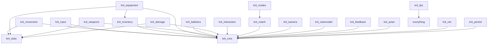

# Krit FPS: Crate Architecture Plan

> Status: **proposal, revision 2**, targeting Bevy 0.19, `bevy_enhanced_input` (BEI) 0.26 and
> avian3d 0.7. This document defines how the workspace is split into crates, what each crate owns,
> and the exact contracts that cross every crate boundary.
>
> Revision 2 folds in the template research in [`docs/research/`](research/) (see §13). The
> largest changes are the intent shape (§6.1), the schedule anchors around physics (§4), authority
> and resimulation (§4.2), new determinism rules (§8), and several decisions moved out of §12.

## 1. Goals

1. **Use it whole.** `krit_fps` (the facade) plus `KritFpsPlugins` gives a working FPS sandbox.
   That covers moving, looking, picking up and firing a weapon, dealing damage, dying and respawning
   in a deathmatch.
2. **Use it piece by piece.** Any domain crate can be used alone, or replaced with a game's own
   implementation, without forking the others. A developer who wants their own movement keeps
   Krit's weapons, damage and match flow untouched.
3. **Support many first-person games**, not only arena shooters. Examples are Quake-likes,
   tactical/military shooters, extraction games, immersive sims, horror games and single-player
   campaigns.
4. **Be ready for networking from day one.** Simulation is deterministic, runs on a fixed tick, and
   keeps all of its state in components. A lightyear or replicon integration should be *additive*
   and should not require a rewrite.

## 2. Architectural principles

These come from the research into Bevy, Lyra, GAS, ShooterGame, Source/Quake, Unity DOTS, Unity FPS
Sample, Godot and Overwatch. Every crate below follows them.

| # | Principle | Origin |
|---|---|---|
| P1 | **Intent is the only gameplay input.** Simulation reads plain intent components and never reads devices or BEI. Players, AI bots, replays and network prediction all drive the same code. The intent carries **absolute** aim and **held** buttons only, so it is safe to repeat, drop or resend; edges are derived inside simulation. | Source `CUserCmd`, Q3 `usercmd_t`, Unity FPS Sample `UserCommand`, DOTS player→character |
| P2 | **Simulation and presentation are separate.** Simulation runs in the fixed schedule and is headless-safe. Camera feel, view models, VFX, audio and HUD only *read* simulation state and never write it. | Overwatch, lightyear rollback rules |
| P3 | **Intent flows down; facts flow up as messages.** Fire intent → `ShotRequest` → `HitResult` → `DamageRequest` → `DamageApplied` → `Died`. Every arrow is a seam where a stage can be replaced. | Overwatch deferment, DOTS shot buffers, Q3 `PM_Weapon` → `FireWeapon` |
| P4 | **Aim belongs to the character, not the camera.** `ViewAngles` lives on the character and is what shots use. The camera copies it and adds visual-only offsets. | Source, DOTS `ViewPitchDegrees`, GoldGdt gimbals. (bevy_ahoy does the *opposite*: its camera is authoritative. See §10.) |
| P5 | **Player and Character are separate entities.** The persistent player (team, score, loadout choice, network input stream) lives on the Player. The Character (body) can be destroyed and respawned. | Lyra PlayerState/Pawn, DOTS `ControlledCharacter`, ShooterGame `AShooterPlayerState` |
| P6 | **Compose, don't inherit.** A weapon is an entity made of `FireMode`, `Magazine`, `SpreadModel` and similar components. A `Hitscan` or `Projectile` marker component picks which systems process it. | DOTS weapons vs ShooterGame/Source hierarchies, COGITO component nodes |
| P7 | **Stats are a base value plus a list of modifiers, recomputed when the inputs change.** Never mutate base data. Resources such as `Health` and `Magazine` are *state*, not stats; their caps (`MaxHealth`) are stats. | Lyra/GAS attributes; GAS/Epic guidance that ammo is not an attribute |
| P8 | **Rules are policies that systems query.** Friendly fire, whether damage is allowed, and spawn choice are resources or gate components. No crate contains `if mode == SnD` checks. | Source `CGameRules`, Lyra phase/team subsystems |
| P9 | **Physics sits behind a trait, and movement owns its algorithm.** Core logic uses trace-shaped queries (`cast_shape`, `contents`, `depenetrate`); backends implement them. Collide-and-slide, step-up and ground snap live in `krit_movement`, so swapping backends does not change how movement feels. | Q3 `pmove_t` trace callbacks, Source `CGameMovement`, bevy-tnua integration layer |
| P10 | **Every crate ships a `PluginGroup` of fine-grained plugins and public `SystemSet`s.** This lets users run `.disable::<X>()`, `.set(...)`, `remove_systems_in_set`, and order their own systems against ours. | Bevy `DefaultPlugins`, bevy_ahoy, tnua |
| P11 | **State is truth; events are hints.** Any fact a late joiner, a reconnecting client or a rolled-back client must see (dead, last damage, carried flag) is stored as tick-stamped component state. Messages and events are a convenience and must be safe to miss or replay. | Halo: Reach networking, Unity FPS Sample `HealthStateData`/`DamageHistoryData` |
| P12 | **Simulation knows its authority, not its transport.** Systems that must only run on the authority (damage, death, spawning, scoring) are gated by a core run condition. Domain crates never import a networking crate. | replicon "disconnected = authority", DOTS server-only systems, Epic "never predict damage or death" |

## 3. Crate map

```
krit_fps                         facade: features, KritFpsPlugins, prelude
│
├── krit_core                    contracts: ids, intents, messages, sets, gates, authority, physics traits
├── krit_stats                   generic StatId + Modifier + recompute
│
├── krit_input                   BEI → intent bridge                       (sim-adjacent)
├── krit_movement                KCC algorithm, movement state machine, profiles (simulation)
├── krit_inventory               items, containers, ammo pools, pickups    (simulation)
├── krit_equipment               equip/holster, active item, intent routing (simulation)
├── krit_weapons                 fire control, ammo, reload, spread, recoil (simulation)
├── krit_ballistics              hitscan, projectiles, penetration, AoE, hitboxes (simulation)
├── krit_damage                  health/armor/shield pipeline, life state, attribution (simulation)
├── krit_interaction             focus, verbs, hold-to-use, interactables  (simulation)
├── krit_match                   phases, teams, score, spawns, respawn     (simulation)
│   └── krit_modes               TDM / FFA / CTF / Domination / S&D / Objectives … (feature-gated)
│
├── krit_kamera                  camera rig, FOV, bob/shake/kick, camera mode stack (presentation)
├── krit_viewmodel               view-model render layer & weapon sway     (presentation, render deps)
├── krit_feedback                hitmarkers, killfeed, damage indicators, HUD read models (presentation)
│
├── krit_avian                   avian3d backend for krit_core physics traits
├── krit_ahoy       (M1 only)    bevy_ahoy adapter standing in for krit_movement
├── krit_net        (later)      lightyear/replicon integration, lag compensation history
└── krit_persist    (later)      save/load of world and campaign state
```

The existing crates fit into this map: `krit_input` stays as it is (with changes described in §7),
and `krit_kamera` stays as the presentation camera.

### 3.1 Dependency graph



**The one hard rule:** apart from the explicit exceptions below, domain crates depend only on
`krit_core` and `krit_stats`, never on each other. All communication between domains goes through
`krit_core` types.

| Allowed sibling edge | Why |
|---|---|
| `krit_equipment → krit_inventory` | Equipment works on inventory items. Lyra layers them the same way. Inventory knows nothing about equipment. |
| `krit_modes → krit_match` | Modes are thin rule plugins built on the match framework. |
| `krit_avian / krit_ahoy / krit_net / krit_persist → krit_core` only | Backends implement core traits and do not reach into domain crates. Domain crates expose backend hook sets instead. |

**How `krit_net` and `krit_persist` find domain components without importing them.** Each domain
crate tags the components it owns with a reflected marker from core, `#[reflect(SimState)]`, carrying
a `SimStateClass` (see §5.1). The backend walks the `TypeRegistry` and registers every tagged type.
This keeps the edge `krit_net → krit_core` honest. A game that needs a hand-tuned registration can
still do it in its own app, or the facade can do it under the `net` feature.

Not allowed (each would break the ability to swap that crate):

- weapons → ballistics, because firing must not know how hits are resolved;
- ballistics → damage, because hits must not know how health works;
- damage → match, because death must not know about scoring;
- interaction → inventory or stats, because requirements are vetoes (see §5.10);
- anything in simulation → kamera, viewmodel or feedback.

### 3.2 Bevy dependency tiers

| Tier | Crates | Bevy deps allowed |
|---|---|---|
| Logic | core, stats, input, movement, inventory, equipment, weapons, ballistics, damage, interaction, match, modes | `bevy_app`, `bevy_ecs`, `bevy_math`, `bevy_reflect`, `bevy_transform`, `bevy_time`, `bevy_platform` (+ `bevy_asset` for definition assets) |
| Presentation | kamera, feedback | add `bevy_camera` |
| Render | viewmodel | add `bevy_render`, `bevy_camera`, `bevy_light` |
| Backend | avian, net, persist | add `avian3d`, `lightyear` / `bevy_replicon`, `serde` |

Logic crates must build and pass tests with **no renderer and no physics engine**. CI should enforce
this with `cargo test -p krit_weapons` and similar per-crate runs.

Each crate has a `reflect` feature (on by default) that calls `register_type` explicitly, as BEI
does. Bevy's Reflect auto-registration is an opt-in cargo feature on the `bevy` crate and is not
active when only subcrates are used.

## 4. Schedule & ordering backbone (owned by `krit_core`)

Every crate places its systems in one shared, public set chain. That way crates that never import
each other still run in the right order.

```rust
/// Simulation. Split into two parent sets so a physics backend can step in between.
#[derive(SystemSet, Debug, Clone, PartialEq, Eq, Hash)]
pub enum KritSimPhase {
    /// Intent → Movement. Runs before the physics step.
    PrePhysics,
    /// Equipment → Despawn. Runs after the physics step and writeback,
    /// so traces see this tick's poses.
    PostPhysics,
}

#[derive(SystemSet, Debug, Clone, PartialEq, Eq, Hash)]
pub enum KritSimSystems {
    // ---- PrePhysics ----
    /// Copy/validate intents for this tick; derive button edges from `PrevButtons`;
    /// apply forced/disabled buttons; reset and apply gates (freeze time, dead, menus)
    Intent,
    /// Spawn requests from last tick's Rules are realised here, at the start of the tick
    Spawn,
    /// ViewAngles from the intent's absolute aim + `ViewAngleOffset`; recoil recovery
    Aim,
    /// Moving platforms, doors and other kinematic movers (before characters ride them)
    Movers,
    /// Character movement (KCC)
    Movement,
    // ---- PostPhysics ----
    /// Equipment changes, intent routing to the active item
    Equipment,
    /// Weapon state machines -> ShotRequest
    Weapons,
    /// ShotRequest + projectiles -> HitResult -> DamageRequest
    Ballistics,
    /// DamageRequest -> DamageApplied / Died
    Damage,
    /// Interaction progress
    Interaction,
    /// Match rules: scoring, phase transitions, spawn requests
    Rules,
    /// Despawning of characters and items, cleanup
    Despawn,
}

/// Presentation (Update / PostUpdate, never in the sim schedule)
#[derive(SystemSet, Debug, Clone, PartialEq, Eq, Hash)]
pub enum KritViewSystems { SyncFromSim, CameraEffects, ViewModel, Feedback }
```

- `KritCorePlugin { sim_schedule: Interned<dyn ScheduleLabel> }` chains these sets in the order
  above. The default is `FixedUpdate` when no backend is installed. `krit_avian` moves the chain to
  `FixedPostUpdate` and orders `PrePhysics.before(PhysicsSystems::First)` and
  `PostPhysics.after(PhysicsSystems::Writeback)`. This matches where bevy_ahoy, avian, lightyear lag
  compensation and replicon's tick already run.
- **Convention:** hits on tick N resolve against the *post-step* poses of tick N, on client and
  server alike.
- Users gate the whole simulation with
  `configure_sets(sim_schedule, KritSimPhase::PrePhysics.run_if(in_state(MyState::Playing)))` (and
  the same for `PostPhysics`). Krit never defines the game's top-level `States`.
- Inside each crate, sub-sets are public (for example `WeaponSystems::{FireControl, Reload, Spread, Recoil}`)
  so individual behaviours can be removed with `App::remove_systems_in_set` or have systems inserted
  between them.
- **Bridge between frame rate and tick rate**: `krit_input` sums look input into `LocalAim` every
  frame and copies it, quantized, into `CharacterIntent.aim` at the start of each tick (§5.3,
  §6.2). It also ORs button state into a *latched* held mask, so a tap shorter than one tick still lands
  on a tick. The latch clears in `RunFixedMainLoopSystems::AfterFixedMainLoop`, and only if a fixed
  tick actually ran that frame (the bevy_ahoy pattern). This fixes the double-tick bug described in
  §7.
- **Iteration order:** wherever the order of entities affects results (spawn selection, damage
  application, projectile resolution), systems sort by `SimId`, never by `Entity` or query order,
  because those differ between client and server.

### 4.1 Message vs Event vs Component: which mechanism for which contract

| Use | Mechanism | Examples |
|---|---|---|
| Per-tick state another domain reads, and durable facts (P11) | **Component** on the entity | `CharacterIntent`, `ViewAngles`, `ActionGates`, `WeaponStats`, `Health`, `LifeState::Dead { at_tick, killer }`, `LastDamageTaken` |
| Pipeline handoff between sim stages, and sim reacting to sim | **`Message`** (buffered, read in order by the next set) | `ShotRequest`, `HitResult`, `DamageRequest`, `DamageApplied`, `Died` |
| Discrete facts *game code and presentation* want to react to per entity | **`EntityEvent`** (observers, optionally propagating up `ChildOf`) | `Died`, `Landed`, `WeaponFired`, `ReloadFinished`, `Equipped`, `InteractCompleted` |

- Pipeline stages use `Message` because observers have no ordering between them, and because a
  replaced stage should only need to read one queue and write the next.
- **Krit simulation crates never react to simulation facts through observers.** Rollback replays
  observers, so an observer that spawns or mutates state (for example drop-on-death) would run twice.
  Sim crates read the ordered `Message` instead. Observers are for game code and presentation.
- Facts are *also* triggered as `EntityEvent`s where game code commonly wants `On<Died>`-style
  observers. A small helper in core (`emit_fact`) writes the message and triggers the event together,
  and skips the trigger while resimulating (§4.2).

### 4.2 Authority and resimulation

`krit_core` owns two resources and their run conditions. Without `krit_net` both have fixed values, so
single-player code pays nothing.

```rust
#[derive(Resource, Clone, Copy, PartialEq, Eq, Default, Reflect)]
pub enum SimAuthority { #[default] Standalone, Server, Client }

/// Set by krit_net while re-running already-simulated ticks during rollback.
#[derive(Resource, Clone, Copy, Default, Reflect)]
pub struct SimReplay { pub resimulating: bool }

pub fn has_authority(a: Res<SimAuthority>) -> bool { *a != SimAuthority::Client }
pub fn first_time_simulated(r: Res<SimReplay>) -> bool { !r.resimulating }
```

- Server-only work runs under `has_authority`: the `Damage`, `Rules`, `Spawn` and `Despawn` sets,
  and the damage-emitting systems in `Ballistics`. Clients still predict movement, weapons, ammo and
  projectiles, and see damage and death when the server state arrives (P11).
- Anything that must not repeat during rollback (spawns of non-predicted entities, `EntityEvent`
  triggers, hit queries whose results are kept) uses `first_time_simulated`. This is Source's
  `IsFirstTimePredicted` and the FPS Sample's `lastHitCheckTick`.

## 5. Crate-by-crate specification

Every crate has the same layout:

- `XPlugins` (a `PluginGroup`) made up of fine-grained `pub` plugins;
- a `prelude`;
- `XSystems` sets;
- components that are `Default + Clone + Reflect` (BSN/`FromTemplate` friendly), with `MapEntities`
  on any component that holds an `Entity`, and `PartialEq` on any component that is `SimState`;
- `serialize` and `reflect` features.

Each crate's specification lives in its own file under [`crates/`](crates/):

| § | Crate | Role |
|---|---|---|
| 5.1 | [`krit_core`](crates/krit_core.md) | contracts |
| 5.2 | [`krit_stats`](crates/krit_stats.md) | modifiers |
| 5.3 | [`krit_input`](crates/krit_input.md) | device → intent bridge |
| 5.4 | [`krit_movement`](crates/krit_movement.md) | character motion |
| 5.5 | [`krit_inventory`](crates/krit_inventory.md) | what you carry |
| 5.6 | [`krit_equipment`](crates/krit_equipment.md) | what you are holding |
| 5.7 | [`krit_weapons`](crates/krit_weapons.md) | deciding to shoot |
| 5.8 | [`krit_ballistics`](crates/krit_ballistics.md) | resolving shots |
| 5.9 | [`krit_damage`](crates/krit_damage.md) | taking hits |
| 5.10 | [`krit_interaction`](crates/krit_interaction.md) | use / hold-to-use |
| 5.11 | [`krit_match`](crates/krit_match.md) | match flow (includes `krit_modes`) |
| 5.12 | [`krit_kamera`](crates/krit_kamera.md) | the first-person view (presentation) |
| 5.13 | [`krit_viewmodel`](crates/krit_viewmodel.md) | arms and weapon rendering (presentation, render deps) |
| 5.14 | [`krit_feedback`](crates/krit_feedback.md) | hitmarkers, killfeed, HUD data (presentation) |
| 5.15 | [`krit_avian`](crates/krit_avian.md) | physics backend |
| 5.16 | [`krit_net`](crates/krit_net.md) | networking integration (later) |
| 5.17 | [`krit_persist`](crates/krit_persist.md) | save and load (later) |
| 5.18 | [`krit_fps`](crates/krit_fps.md) | facade |

## 6. Boundary contracts (the barrier points)

This section is the authoritative list of every type that crosses a crate boundary. All of them live
in `krit_core` unless noted. Field lists are indicative; the tick and entity fields are mandatory.

### 6.1 Input → simulation

```rust
/// On the Character. Written by krit_input, bots, replays, or the network layer.
/// Safe to repeat, drop or resend: aim is absolute and buttons are held state.
#[derive(Component, Clone, Default, Reflect, PartialEq)]
pub struct CharacterIntent {
    pub move_axis: Vec2,          // local X/Z, length ≤ 1
    pub aim: ViewAngles,          // absolute; u32 yaw, i32 pitch (§6.2.1); sensitivity applied, pre-offset
    pub buttons: Buttons,         // held state, latched so sub-tick taps are not lost
    pub select: Option<SlotSelect>,
    pub view_time: ViewTime,      // the tick + fraction the client was displaying (lag comp)
}
bitflags! { pub struct Buttons: u32 { JUMP, CROUCH, SPRINT, PRIMARY, SECONDARY, RELOAD,
            INTERACT, INTERACT_ALT, CONFIRM, CANCEL, MELEE, THROW, LEAN_L, LEAN_R, FIRE_MODE, … } }

/// Sim state on the Character; edges are derived from it in KritSimSystems::Intent.
#[derive(Component, Clone, Default, Reflect, PartialEq)]
pub struct PrevButtons(pub Buttons);
pub struct ButtonEdges { pub pressed: Buttons, pub released: Buttons }
```

Bots write `CharacterIntent` directly and have no `LocalAim`. `intent.aim` is pre-offset, so a bot
that wants to face `target` writes `intent.aim = target − ViewAngleOffset`.

| Boundary | Direction | Contract | Mechanism |
|---|---|---|---|
| input → movement / equipment / interaction | write → read | `CharacterIntent` | Component on Character, written before `KritSimSystems::Intent` |
| sim (Intent) → all action-takers | derive → read | `ButtonEdges` | Computed from `CharacterIntent.buttons` and `PrevButtons`, after `forced`/`disabled` masks |
| equipment → weapons (and any item) | write → read | `ItemIntent { buttons, edges, … }` | Component on the active item entity, written in `Equipment` |
| any → all action-takers | contribute → query | `ActionGates` | Component on Character; reset each tick in `Intent`, then blocks are ORed by providers, read by consumers |
| equipment → all action-takers | evaluate → apply | `ActionRules` | Cancels running actions per the rules table |

### 6.2 Aim

Aim is built in layers. Each layer has exactly one writer, and nothing folds a lower layer back
into a higher one:

```
 client, every frame             sim, every tick                        presentation, every frame
 ───────────────────             ───────────────                        ─────────────────────────
 look delta × sensitivity
         │ summed
         ▼
 LocalAim (f32) ──quantize──▶ CharacterIntent.aim
         │                             │
         │                             ▼
         │                ViewAngles = clamp(intent.aim + ViewAngleOffset)
         │                             │
         │                             ├─ + AimRecoil ──▶ AimRay (shots, traces, interaction)
         │                             ▼
         └──── pending = LocalAim − intent.aim ────▶ camera = ViewAngles + AimRecoil + pending
                                                                    + ViewKick + shake + lean …
```

| Layer | Holds | Written by | Lifetime |
|---|---|---|---|
| `LocalAim` | The player's own accumulated look input, at full precision | `krit_input` only (client) | Permanent. Only look input changes it |
| `CharacterIntent.aim` | `LocalAim` quantized, absolute | `krit_input`, bots, replays, the network layer | Absolute, so safe to repeat, drop or resend |
| `ViewAngleOffset` | Facing that the *simulation* imposes: spawn and teleport facing, scripted looks, platform yaw | Simulation only | Permanent until the sim changes it again. It never holds input and never decays |
| `ViewAngles` | The character's actual facing | `krit_movement`'s aim stage | Recomputed from scratch every tick; never accumulated |
| `AimRecoil` | Weapon offsets that affect shots | Weapons add; the aim stage decays it | Temporary; decays to 0 |
| `ViewKick`, shake, lean, bob | Visual-only offsets | `krit_kamera` | Temporary; never read by the sim |

**Why input and offsets stay separate.** If recoil or effects were folded into `LocalAim`, they
would become permanent the moment they reached an intent, and decaying them would mean subtracting
them from player input again. Keeping input in `LocalAim` and every temporary offset in its own
layer lets offsets decay toward 0 on their own while the player's aim stays exactly where they put
it. Because the intent is absolute and the aim stage recomputes `ViewAngles` from scratch every tick,
rollback and resimulation never accumulate anything.

**Forced facing (Q3's `delta_angles`).** The simulation cannot write the client's `LocalAim`, so it
writes the difference instead: to face the character toward `target`, it sets
`ViewAngleOffset = target − intent.aim`. Later input keeps moving on from the new facing, and
`krit_input` never rebases `LocalAim`. `ViewAngleOffset` is `OwnerPredicted` sim state, so the
owning client has it for its pitch clamp and displayed aim.

**Pitch clamp.** The aim stage clamps `ViewAngles.pitch` to `±PITCH_LIMIT`. `krit_input` clamps
`LocalAim.pitch` against the same limit *in `ViewAngles` space*
(`clamp(pitch + offset.pitch) − offset.pitch`). That way, pushing the mouse past the limit doesn't
leave a dead zone the player has to move back through, and the client's view matches the sim's.

**Yaw wrap.** `LocalAim.yaw` wraps so an `f32` doesn't lose precision after many turns. Every
difference between angles (`pending`, `target − intent.aim`) uses the shortest signed angle.

#### 6.2.1 Angle units: 2³² per turn, `u32` yaw and `i32` pitch

`ViewAngles`, `CharacterIntent.aim` and `ViewAngleOffset` store each angle as a 32-bit **binary
angle**: one full turn is 2³² units, so `1 << 30` is 90°. The unit is the same for both fields. Only
the signedness differs, because only yaw goes round a circle:

| Field | Type | Range | Arithmetic |
|---|---|---|---|
| `yaw` | `u32` | the whole turn; `0` is 0°, `1 << 31` is 180° | wraps: `wrapping_add`, `wrapping_sub` |
| `pitch` | `i32` | `±PITCH_LIMIT`, just under ±90°; `0` is level | never wraps: `saturating_add`, then `clamp` |

`LocalAim` stays `f32` radians, because it has to accumulate mouse motion finer than any stored unit.
Its yaw wraps to [0, 2π) and its pitch is clamped. `AimRecoil` also stays `f32` radians. It is small,
it decays, and it is only ever added at the float stage (`AimRay`, camera).

```rust
pub const TURN: f64 = 4_294_967_296.0;            // 2^32 units per full turn
/// Just under 90°, so the aim never points straight up or down.
pub const PITCH_LIMIT: i32 = ((FRAC_PI_2 - 0.01) / TAU * TURN) as i32;

// Conversions go through f64: an f32 cannot fill 32 bits.
fn yaw_to_units(rad: f32) -> u32 { ((rad as f64 / TAU).rem_euclid(1.0) * TURN) as u64 as u32 }
fn pitch_to_units(rad: f32) -> i32 { (rad as f64 / TAU * TURN) as i64 as i32 }  // no rem_euclid
fn yaw_to_radians(units: u32) -> f32 { (units as f64 / TURN * TAU) as f32 }
fn pitch_to_radians(units: i32) -> f32 { (units as f64 / TURN * TAU) as f32 }
fn yaw_delta(a: u32, b: u32) -> i32 { a.wrapping_sub(b) as i32 }   // shortest signed difference

// Aim stage:
// yaw   = intent.aim.yaw.wrapping_add(offset.yaw)
// pitch = intent.aim.pitch.saturating_add(offset.pitch).clamp(-PITCH_LIMIT, PITCH_LIMIT)
```

**Why an integer at all.** The intent is a simulation input. Client and server must step from
bit-identical values (§8), and an integer is identical everywhere by construction. For yaw, integers
also wrap for free: `wrapping_add` handles yaw passing 360°, and `wrapping_sub(..) as i32` gives the
shortest signed difference, which the pending term, forced facing and bot aim all need.

**Why pitch is `i32`, not `u32`.** Pitch is always clamped, so it never needs to wrap, and storing it
as wrapping `u32` causes bugs:
- a downward pitch would be stored as a value near 2³². Clamping that as unsigned sends it to the
  top of the range, so looking slightly down snaps the aim to vertical;
- `aim + offset` overflows when the offset is positive and the aim points down;
- converting to radians gives [0, 2π), so differences that cross level are off by a full turn.

Storing `i32` makes all of this plain signed arithmetic. `ViewAngleOffset.pitch` is a signed change,
`saturating_add` cannot overflow, a plain `clamp(-PITCH_LIMIT, PITCH_LIMIT)` is correct, and `0`
(and therefore `#[derive(Default)]`) means level. Do not convert pitch with `rem_euclid`. That is
exactly what turns −0.05 rad into a value near 2³².

**One shared limit.** `PITCH_LIMIT` lives in `krit_core::aim` and is used by `krit_input` (as
radians, for `LocalAim`), by the aim stage, and by the camera's display clamp. If the limits differ,
a forced pitch offset can push `ViewAngles` past what the camera shows, and shots leave the
crosshair. Keeping the limit just under 90° also keeps `AimRay` from pointing straight up or down,
where yaw would stop having any effect.

**Why 32 bits, not Quake 3's 16.** The rounding error is at most half a unit:

| | One unit | Worst-case error | At 100 m | 20× scope at 1080p (~3° vertical FOV) |
|---|---|---|---|---|
| `u16` (2¹⁶/turn) | 0.0055° | 0.0027° | ~5 mm | ~1 px |
| 32-bit (2³²/turn) | 8.4×10⁻⁸° | 4.2×10⁻⁸° | ~0.07 µm | ~10⁻⁵ px |

The camera draws `LocalAim` at full precision, but shots use the quantized `ViewAngles`, so any
rounding error shows up as the crosshair disagreeing with the shot. With `u16`, that's under a pixel
in normal play but around a pixel under extreme zoom, and very low sensitivity makes the simulated
aim move in visible steps. 32 bits is finer than an `f32` angle can resolve (near π an `f32`
resolves ~1.4×10⁻⁵°). That makes `LocalAim` itself the precision limit, so quantization adds no
measurable error. The cost is 2 bytes per angle per command, about 0.8 KB/s of client upload at
64 Hz with 3× redundancy. Q3 chose 16 bits for 1999 modem bandwidth. Source sends user-command
angles as full floats.

**Why not `f32` radians.** Sending an `f32` unchanged would also arrive bit-identical, so `f32`
would work. But it gives up free wrapping: every add and subtract would need explicit wrap code,
and an `f32` yaw near ±π has the coarsest precision of the whole range. A fixed binary angle has
the same precision at every heading.

**Where `u16` still fits.** `krit_net` may replicate *other* players' `ViewAngles` at 16 bits. Remote
angles are only used to draw remote characters, and the server does hit detection against its own
full-precision values. That compression belongs in the replication layer; the sim types stay 32-bit.

**Converting back to floats.** `to_radians` and the trig in `AimRay` run in the simulation. The
integer angle is exact, but `sin`/`cos` can differ between platforms. If clients and servers on
different platforms must agree bit for bit, `AimRay` needs a deterministic math implementation
(for example `libm`).

| Boundary | Contract | Notes |
|---|---|---|
| input → intent | `LocalAim` → `CharacterIntent.aim` | In `FixedPreUpdate`, so `intent.aim` always equals the aim of the latest simulated tick. Quantizing only here lets sub-unit mouse motion accumulate instead of being dropped. |
| intent → aim stage | `CharacterIntent.aim` | Absolute and pre-offset. The aim stage computes `ViewAngles = clamp(aim + ViewAngleOffset)`. |
| sim → sim | `ViewAngleOffset` | Written only by the simulation (spawn, teleport, scripted look, movers). Read by the aim stage, and by `krit_input` for the pitch clamp only. |
| movement → weapons, ballistics, interaction, kamera | `ViewAngles { yaw, pitch }`, `EyeHeight(f32)` | Simulation state on the Character. `AimRay::from(&Transform, &ViewAngles, &AimRecoil, &EyeHeight)` is the one shared helper. |
| weapons → aim | `AimRecoil { pitch, yaw }` | Weapons *add*; the aim stage decays it. It is an additive offset that `AimRay` includes and is never folded into `ViewAngles`, because the next intent would overwrite it. Games that want recoil to move the view permanently add it to `ViewAngleOffset` in the simulation. That keeps it deterministic and out of player input. |
| weapons → kamera | `WeaponFired` + `RecoilModel` read | The visual `ViewKick` channel. It is presentation only and kept separate from `AimRecoil` (CS "aim punch" vs "view punch"). |
| input + sim → kamera | `LocalAim`, `CharacterIntent.aim`, `ViewAngles`, `AimRecoil` | Displayed aim; see §5.12. |

### 6.3 Weapons → ballistics → damage

```rust
#[derive(Message, Clone)]
pub struct ShotRequest {
    pub tick: u32,
    pub shot_id: ShotId,              // (shooter SimId, weapon SimId, cumulative shot index)
    pub instigator: Entity,           // the Player (credit survives the body)
    pub shooter: Entity,              // the Character that fired
    pub weapon: Entity,
    pub ray: AimRay,                  // from the eye, including AimRecoil
    pub launch_offset: Option<Vec3>,  // sim-side MuzzleOffset, for projectiles
    pub view_time: ViewTime,          // from the intent, for lag compensation
    pub spread: f32,                  // cone half-angle, radians
    pub pellets: u8,
    pub shape: ShotShape,             // Ray | Sweep{radius} | Projectile(spec)
    pub profile: Handle<BallisticProfile>,
    pub stats: ShotStats,             // snapshot of damage/range modifiers at fire time
}

#[derive(Message, Clone)]
pub struct HitResult {
    pub tick: u32, pub shot_id: ShotId, pub pellet: u8,
    pub target: Option<Entity>,       // Hurtbox owner (root), None for world
    pub hurtbox: Option<Entity>,
    pub point: Vec3, pub normal: Dir3, pub distance: f32,
    pub zone: HitZone, pub material: Option<SurfaceMaterialId>,
    pub penetrations: u8,             // (shot_id, pellet, penetrations) is the de-dup key
}

#[derive(Message, Clone)]
pub struct DamageRequest {
    pub tick: u32,
    pub target: Entity,
    pub instigator: Option<Entity>,   // who gets credit: the Player
    pub inflictor: Option<Entity>,    // what dealt it (projectile, grenade, zone)
    pub weapon: Option<Entity>,
    pub base_amount: f32,             // before falloff and multipliers
    pub amount: f32,                  // post-falloff, post-geometric-zone-multiplier
    pub damage_type: DamageTypeId,
    pub zone: HitZone,
    pub point: Option<Vec3>,
    pub direction: Option<Dir3>,
    pub reported_origin: Option<Vec3>,// where the HUD indicator should point
    pub source_distance: Option<f32>,
    pub force: Option<Vec3>,          // knockback impulse, separate from amount
    pub flags: DamageFlags,           // HEADSHOT | PENETRATED | EXPLOSIVE | SELF | IGNORE_ARMOR |
                                      // FORCE_FRIENDLY_FIRE | NO_KNOCKBACK …
    pub group: Option<ShotId>,        // pellet aggregation
}
```

| Boundary | Contract | Ownership rule |
|---|---|---|
| weapons → ballistics | `ShotRequest` | Weapons decide *that* a shot happens; ballistics decides *what it hits*. |
| ballistics → damage | `DamageRequest` | Range falloff and the geometric zone multiplier are applied in ballistics, which is the only stage that knows distance. Type resistances, target-side multipliers, armor and friendly fire are applied in damage. |
| ballistics → presentation | `HitResult`, `ImpactEvent` | Decals, impact VFX, tracers and predicted hitmarkers. |
| any → damage | `DamageRequest` | Fall, zone, kill volume, environment, scripted and melee damage all use the same door. |
| ballistics ↔ damage hitboxes | `Hurtbox { owner, zone, multiplier }` (core) | Ballistics hits hurtboxes; damage owns the `Health` on `owner`. They are on separate collision layers from the movement capsule. |
| ballistics ↔ net | `RewindProvider` (core) | Rewinds hurtboxes to `ShotRequest.view_time` within `LagCompPolicy`. |

### 6.4 Damage → everything else

| Contract | Consumers |
|---|---|
| `DamageApplied` | kamera (flinch), feedback (indicators), AI perception |
| `HitConfirmed` | feedback (confirms predicted hitmarkers by `shot_id`; damage numbers) |
| `Died { victim, killer, assisters, cause: DamageRequest }` (message) | match (score, respawn), inventory (drop on death); both read the message, not an observer |
| `Died` (`EntityEvent`) | game code, kamera (death cam), feedback (killfeed) |
| `LifeState`, `LastDamageTaken`, `LastDamageDealt` components | gates, AI, match (alive counts), feedback (rebuild after join or rollback) |

### 6.5 Inventory ↔ equipment ↔ weapons

| Boundary | Contract |
|---|---|
| inventory → equipment | `InInventory` relationship, `Equippable { slot }` fragment, `ItemAdded`/`ItemRemoved` |
| equipment → item (weapon or other) | `EquippedBy` relationship, `ActiveItem` marker, `ItemIntent`, parent = `ViewSocket`, `MuzzleOffset` |
| item → holder stats | `Modifiers` on the item and its attachments, through `krit_stats` (`ModifierSourceOf(holder)` while equipped) |
| weapons → ammo storage | `AmmoProvider` trait (core): `take(owner, ammo_types, n) -> (ammo_type, n_taken)`, `available(…)`. `krit_inventory` implements it for `AmmoPool`. Weapons fall back to `Magazine`-only when nothing is installed. |

### 6.6 Match ↔ simulation

| Boundary | Contract |
|---|---|
| match → lifecycle | `SpawnCharacter { player, transform, archetype, loadout }` (realised in `Spawn`), `DespawnCharacter` (realised in `Despawn`) |
| match → inventory | `GrantLoadout { player_or_character, loadout: Handle<LoadoutDefinition> }` |
| match → all | `ActionGates` blocks (freeze time), `FriendlyFirePolicy`, `TeamRelations` resources |
| damage → match | `Died` message, `LifeState` |
| interaction → modes | `InteractCompleted` on objective entities |
| match → Player | `RespawnAt { tick }` component |

### 6.7 Physics

| Boundary | Contract |
|---|---|
| logic crates → backend | `SpatialQueryBackend` (`cast_ray`, `cast_shape`, `overlap`, `contents`, filters by `KritLayer`), `CollisionQuery` primitives for the KCC (`cast_shape`, `depenetrate`, `intersections`, `contents`, `surface`) |
| movement → backend | position and velocity output, written by the backend to its body |
| backend → logic | `register_required_components_with` for colliders/bodies; placement of `KritSimPhase` around the physics step |

## 7. Changes needed in the existing code

1. **`AccumulatedInput` becomes `krit_core::CharacterIntent`.** `krit_input` keeps the BEI actions and
   the observers for discrete actions, but writes the core type. This removes the dependency on
   `bevy_enhanced_input` from every other crate.
2. **Fix the input-clearing bug.** `clear_accumulated_input` runs in `FixedPostUpdate`. If two fixed
   ticks run in one frame, the second tick sees empty input, and the second jump or crouch press is
   lost (or the movement axis disappears). With the new intent shape this mostly goes away: aim is
   absolute and buttons are held state, so a second tick in the same frame sees the same intent,
   and edges come from `PrevButtons`, so they fire exactly once. The only clearing left is the tap
   latch, which clears in `RunFixedMainLoopSystems::AfterFixedMainLoop` and only if a fixed tick
   actually ran (the `bevy_ahoy` pattern).
3. **Continuous axes (look, move) should be read from `Action<T>` in a system, not accumulated in an
   `On<Fire<_>>` observer.** Observers have no defined order, and the current `last_movement` drops
   intermediate samples. Look deltas are **summed** into `LocalAim` every frame. Keep observers for
   discrete actions only.
4. **`krit_kamera::rotate_camera` is split.** Accumulating look into absolute aim moves to
   `krit_input` (`LocalAim` → `CharacterIntent.aim`). Writing `ViewAngles` moves to
   `krit_movement`'s aim stage. `krit_kamera` then *copies* `ViewAngles` plus the pending look
   (§5.12) into the camera transform in `KritViewSystems::SyncFromSim`. This fixes the P4 violation
   (camera `Transform` written directly from input, so the server or a bot would have no aim and
   camera shake would leak into shot direction) without limiting mouse look to the tick rate. The
   `on_add` snap hook stays.
5. **Cargo.toml typo:** `bevy_app = { version = "0.19", default-featuers = false }` should be
   `default-features`. As written, `bevy_app`'s default features are silently turned on.
6. Add `bevy_time` and `bevy_platform` to `[workspace.dependencies]` (fixed timestep and hashing), and
   remove the placeholder `add` fn in `src/lib.rs` once the facade exists.
7. **Pin Bevy 0.19 for M0–M1.** Bevy 0.20 shipped on 2026-10-08; `examples/fps_view` breaks on it
   (BSN `template_value` was removed, and `On<Add, A>` becomes `On<Add<A>>`), and avian's 0.8 line
   renames APIs that bevy_ahoy uses. Plan the 0.20 migration as its own step after M1.

## 8. Rules for staying deterministic and rollback-safe

Every simulation crate follows these rules from the start, so `krit_net` can be added later.

**Ticks and state**
- All simulation runs in the configurable sim schedule, uses `Time<Fixed>`, and stamps messages with
  `SimTick`.
- **All simulation state is in components on entities**, including timers, cooldowns, accumulators,
  RNG cursors and state machines. Never use `Local<T>` or resources for per-entity simulation state.
- Separate *state* (predicted and replicated) from *derived* data (recomputed). Examples: `WeaponStats`
  is derived; `Magazine` is state. Tag every state component `#[reflect(SimState)]` with its class.
- Predicted components implement `PartialEq` (or a tolerance compare), so the network layer can
  detect mispredictions.
- Durable facts are stored as tick-stamped state (P11); events are hints.

**Keys, randomness and order**
- Randomness comes only from `SimRng`, keyed by `SimId` and ticks, never by `Entity`.
- Anything that must match between client and server (shot ids, projectile prespawn keys, sort
  order) uses `SimId`.
- Systems whose results depend on iteration order sort by `SimId`.
- Known trade-off: predictable spread lets a cheating client compensate for it (as with Q3 seeding
  from the command number). Server-side resolution limits the damage; games that care can move spread
  seeding to the server and accept unpredicted spread.

**Side effects and replay**
- Simulation systems produce **no side effects** (sound, VFX, despawn-with-effects). They emit
  messages or events, and presentation handles them in a way that is safe to replay. Cosmetics read
  cumulative counters (`WeaponFired.shot_count_total`, the DOTS pattern) so replays don't duplicate
  effects. Counters are initialised when an entity is first seen, so re-entering view does not replay
  old shots.
- Krit sim crates never mutate state from observers on sim facts; they read `Message`s (§4.1).
- `EntityEvent` triggers, non-predicted spawns and stored hit queries run only when
  `first_time_simulated` (§4.2).
- Messages that can be produced more than once for the same fact (`HitResult`, `ImpactEvent`,
  `WeaponFired`) carry a de-duplication key.

**Authority**
- Damage, death, spawning, despawning and scoring run only under `has_authority` (P12).

**Data, not animation**
- Every component with an `Entity` field derives `MapEntities`.
- Timings come from data (`ReloadSpec`, `equip_time`), never from animation callbacks, because the
  headless server has no animations. Hurtbox poses come from simulation state for the same reason.
- If the network layer quantizes state (positions, velocities, angles), the sim step quantizes
  identically on both sides. Q3's velocity rounding under a variable timestep produced the 125 fps
  jump advantage.

## 9. How the pieces combine: example configurations

| Game | Crates used | Notes |
|---|---|---|
| Arena shooter (Quake-like) | full facade, `MovementProfile::Quake`, `modes-deathmatch` | Projectiles with `Explosions` + `ExternalImpulse` + `SelfDamagePolicy` give rocket jumps. |
| Tactical shooter (CS-like) | facade, `RecoilModel::Pattern`, `modes-sd`, `RespawnPolicy::None`, `Penetration` | Buy menu: write `GrantLoadout` from your UI. |
| Extraction / Tarkov-like | facade, replace `DamagePipelineSystems::Apply` with per-limb health, grid `InventorySlots`, `MovementStamina`, `PersistentInventory` stash | Inventory on Character, with drop-on-death; containers and corpses are inventories. |
| Immersive sim / horror | input, movement, kamera, viewmodel, inventory, equipment, interaction, damage, persist | No match, no weapons. A flashlight is an equippable item with `ItemIntent` and `Charge`. Doors and keys use interaction verbs and vetoes. |
| Single-player campaign | facade, `modes-objectives`, persist | `PersistentInventory` on the Player, `WorldFlags` for story state. |
| Paintball / laser tag | input, movement, kamera, weapons, ballistics, match | No `krit_damage`; a mode scores directly from `HitResult`. |
| Movement-only (walking sim / platformer) | input, movement, kamera | `krit_core` + `krit_stats` still compile in, at negligible cost. |
| Custom movement (e.g. bevy_ahoy) | facade with `movement` disabled + `ahoy` feature | The adapter writes `ViewAngles`, `EyeHeight` and `MovementSpreadFactor` from ahoy's components. Single-player only (see §10). |

## 10. Prior art we should account for

- **bevy_ahoy 0.2** (janhohenheim): a Source-style KCC on Bevy 0.19, BEI 0.26 and avian 0.7. Unlike
  Krit, the **camera** is its source of truth, copied into `CharacterLook` before each tick. As a
  dependency it needs BEI, ticks input buffers with frame time, writes `Transform`, emits no events and
  runs some systems in hard-coded schedules. **Decision:** ship an optional single-player
  `krit_ahoy` adapter for M1, and port ahoy's algorithm onto `CollisionQuery` inside `krit_movement`
  from M2. Ahoy's calls into avian define the `CollisionQuery` surface.
- **bevy-tnua**: the reference for the physics integration layer and its backend crates, which
  `krit_core::physics` + `krit_avian` copies. Krit does not depend on tnua (a floating dynamic body).
- **lightyear 0.30** (on replicon 0.44): repeats the last input when one is missing, which is why the
  intent is absolute (P1); replays observers during rollback (§4.1); runs lag compensation in
  `FixedPostUpdate` (§4).
- **Lyra**: inventory/equipment/weapon layering, item fragments, experiences (`MatchExperience`),
  `PawnData` (`CharacterArchetype`), the camera mode stack, heat-based spread, the hit-confirmation
  flow, and the phase and team subsystems. Lyra's camera-driven traces and client-authoritative hits
  are not copied.
- **GAS / GASShooter**: base/current attributes, effect aggregation (whose additive multipliers Krit
  rejects), tag relationship tables (`ActionRules`), cues split into one-shot and stateful.
- **ShooterGame / UE5 First Person template**: the derived weapon state, the Player state that
  survives death, the item-owned input context, the `IShooterWeaponHolder` interface. Its
  client-authoritative hit check is an anti-pattern.
- **Unity DOTS OnlineFPS**: intent routed to the active weapon entity, the shot event buffer between
  firing and resolution, marker-selected resolvers, cumulative shot counters for cosmetics, the
  command stream on the Player, the `Simulate` filter, the three-tier character controller API.
- **Unity FPS Sample (2018)**: absolute-angle `UserCommand`, held buttons only, tick-stamped death and
  damage state, `canRunWith`/`canInterrupt` ability arbitration, spawn at tick start.
- **Source/Quake**: the pure `pmove` step with injected trace, the slide/step/snap algorithm,
  `CTakeDamageInfo` (inflictor ≠ attacker ≠ weapon, force, reported position), rules as a queried
  policy, `IsFirstTimePredicted`, `ItemPostFrame` ordering, lag-compensation limits.
- **Overwatch, VALORANT, Halo: Reach**: few systems touch netcode, singleton components as resources,
  deferment, "never predict damage or death", rewind limits, server-side hurtbox poses without
  animation, "lag can only be placed", replicated state as truth.
- **COGITO (Godot)**: component composition, one equip path for every item, interaction verbs,
  attributes, the split between level and campaign saves. Its definition assets that hold runtime state
  and its executable save format are not copied.

## 11. Suggested build order

1. **M0 – Backbone:** `krit_core` (sets and phases, tick, `SimId`, intent with edge derivation, aim,
   gates, authority, physics traits, `SimState`), `krit_stats` (with the aggregation formula),
   refactor `krit_input` and `krit_kamera` as described in §7, and the `krit_avian` spatial query.
2. **M1 – Walk around:** `krit_ahoy` adapter, `krit_kamera` effects and displayed aim, and the facade
   with an example.
3. **M2 – Own the movement:** `krit_movement` (the ported algorithm on `CollisionQuery`, profiles,
   tests against known numbers), then the Bevy 0.20 migration.
4. **M3 – Shoot things:** `krit_weapons` (fire control, ammo, reload, spread, recoil), `krit_ballistics`
   (hitscan, then projectiles), and `krit_damage`.
5. **M4 – Carry things:** `krit_inventory`, `krit_equipment` (with `ActionRules`), `krit_interaction`
   (pickups, verbs).
6. **M5 – Play a match:** `krit_match`, `krit_modes` (deathmatch, TDM), `krit_feedback`.
7. **M6 – Look good:** `krit_viewmodel`.
8. **M7 – Network:** `krit_net`, plus lag compensation.
9. **M8 – Persist:** `krit_persist`, `modes-objectives`.

## 12. Open questions

**Decided in revision 2** (kept here for the record):
- *Movement:* M1 uses a `krit_ahoy` adapter; from M2 `krit_movement` owns a port of the algorithm
  (§10).
- *Where inventory lives by default:* the Character, with `PersistentInventory` on the Player as an
  opt-in (§5.5). Lyra, ShooterGame, GASShooter, DOTS and FPS Sample all support this.
- *Definition assets:* ship RON loaders behind the `assets` feature now; item definitions need
  cross-asset references and inline lists that BSN does not cover yet. Components stay
  `Default + Clone + Reflect` so BSN works later.
- *0.19 API names:* `SubStates`, `#[states(scoped_entities)]` and `DespawnOnExit` are stable from
  0.18 through 0.20. Reflect auto-registration is opt-in, so explicit `register_type` stays (§3.2).
- *Look delta vs absolute aim:* absolute (§6.1).

**Still open:**
- **Status effects:** timed effects with duration, periodic ticks, stacking, immunity and removal on
  death. Proposal: effects as entities with tick-based lifetimes that are `krit_stats` modifier
  sources, either inside `krit_stats` or a new `krit_effects` crate. Systemic spreading (fire, wet,
  electric) for immersive sims builds on this.
- **Pre-fire targeting:** lock-on, aim assist and the interaction focus all need spatial queries
  before any shot exists, but weapons never trace. Options: a read-only targeting query in core, or a
  small targeting stage. Related: a `Targetable { aim_point }` component for AI and aim assist.
- **Hit authority default:** server resolution with rewind (proposed default), or
  `ClientWithValidation` for co-op. Make it a `HitAuthority` policy either way.
- **Default hitmarker policy:** predicted-then-confirmed (proposed) or confirmed-only.
- **Tick rate:** 64 Hz default? VALORANT runs 128 Hz; Overwatch 63 Hz.
- **Rollback scope:** does hit detection re-run on rollback (DOTS: no), and are projectiles
  lag-compensated (DOTS: no; FPS Sample: yes, for their whole flight)?
- **Player/Character merge:** may a game merge the two entities as an optimisation, and what breaks?
- **Killcam / replay:** a second world fed from recorded intents, or recorded state?
- **View-model shadows:** can Bevy render first-person primitives with their own FOV from a single
  camera, as Unreal 5.5+ does?
- **Default character shape:** cylinder or capsule (parry handles capsules poorly in some casts).

## 13. Research

Each file maps one template or reference architecture onto this plan, with agreements, divergences and
gaps.

| File | Subject |
|---|---|
| [`unreal-lyra.md`](research/unreal-lyra.md) | Unreal Lyra Starter Game (UE 5.8 source) |
| [`unreal-shootergame-fp-template.md`](research/unreal-shootergame-fp-template.md) | UE4 ShooterGame and the UE5 First Person template |
| [`unreal-gas-shooter.md`](research/unreal-gas-shooter.md) | Gameplay Ability System and GASShooter |
| [`unity-dots-online-fps.md`](research/unity-dots-online-fps.md) | Unity DOTS OnlineFPS and Netcode for Entities |
| [`unity-fps-microgame-and-fpssample.md`](research/unity-fps-microgame-and-fpssample.md) | Unity FPS Microgame, Starter Assets and FPS Sample |
| [`source-quake-lineage.md`](research/source-quake-lineage.md) | Quake, Quake III and Source SDK 2013 |
| [`bevy-ecosystem.md`](research/bevy-ecosystem.md) | Foxtrot, bevy_ahoy, tnua, bevy_fps_controller, lightyear, replicon, BEI |
| [`godot-fps-templates.md`](research/godot-fps-templates.md) | COGITO, GoldGdt and other Godot templates |
| [`networked-shooter-architectures.md`](research/networked-shooter-architectures.md) | Overwatch, VALORANT, Halo: Reach, Rocket League, Gambetta, Fiedler |
