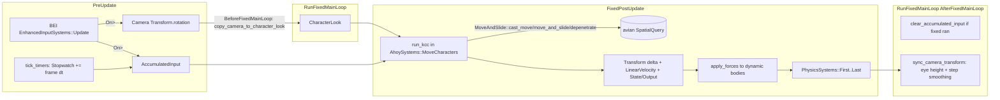
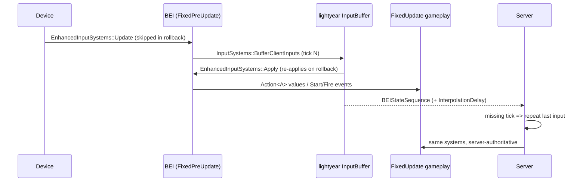
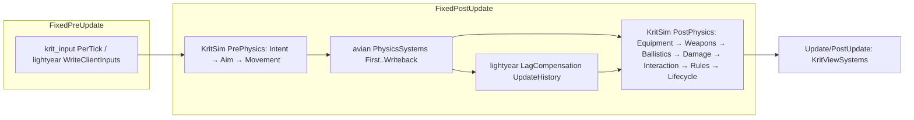

# Research: The Bevy FPS Ecosystem vs. the Krit Plan

> Scope: Foxtrot, bevy_ahoy, bevy-tnua (+ avian integration), avian3d's KCC examples,
> bevy_fps_controller, bevy_enhanced_input (BEI), lightyear (FPS / avian / BEI examples),
> bevy_replicon, and Bevy's official `first_person_view_model` and `physics_in_fixed_timestep`
> examples. Compared against `docs/architecture.md` (P1–P10, §3–§12).
>
> Method: source read from each repo's default branch (tarballs fetched 2026-10-11), cross-checked
> with crates.io versions and the Bevy 0.20 release notes / migration guide. Every API named below
> was seen in source; line-level claims cite the file. "HEAD" = default branch at fetch time.

---

## 1. Overview

| Project | Latest release (crates.io) | Bevy | Physics / input | Last push | Status |
|---|---|---|---|---|---|
| **Foxtrot** (janhohenheim/foxtrot) | not a crate | **0.18** | avian3d 0.6-rc, BEI 0.23, bevy_ahoy 0.1-rc | 2026-02-23 | Reference "mega-example", ~5.8k LOC; **lagging two Bevy versions** |
| **bevy_ahoy** | 0.2.0 (2026-08-06) | 0.19 | avian3d 0.7, BEI 0.26 (hard deps) | 2026-08-06 | Active, single maintainer; "fork it" policy |
| **bevy-tnua** | 0.32.0 (2026-06-22); `bevy-tnua-avian3d` 0.12.1 | 0.19 | avian2d/3d, rapier2d/3d via integration crates | 2026-10-09 | Active, mature (multiple redesigns, latest "Schemes" in 0.27) |
| **avian3d** | 0.7.0 (2026-06-20); HEAD is 0.8.0-dev | 0.19 | — | 2026-10-10 | Active; ships `MoveAndSlide` KCC primitives + 2 KCC examples |
| **bevy_fps_controller** (qhdwight) | 19.0.0 (2026-08-20) | 0.19 | avian3d 0.7 *or* bevy_rapier3d 0.36 (features) | 2026-10-10 | Active, small (~630 LOC per backend) |
| **bevy_enhanced_input** (simgine) | 0.26.0 (2026-06-19) | 0.19 (**HEAD already on 0.20**) | — | 2026-10-10 | Active; HEAD has unreleased Apply/Trigger split |
| **lightyear** | 0.30.1 (2026-09-16) | 0.19 | avian2d/3d integration, BEI / leafwing / native inputs; built on replicon 0.44 | 2026-10-02 | Active; most complete Bevy netcode |
| **bevy_replicon** (simgine) | 0.44.3 (2026-10-06) | 0.19 (0.41–0.44) | I/O-agnostic | 2026-10-11 | Active; server-authoritative replication, **no built-in prediction** |
| Bevy examples `camera/first_person_view_model.rs`, `movement/physics_in_fixed_timestep.rs` | v0.19.0 / v0.20.0 (identical) | — | — | — | Canonical patterns |

**Bevy 0.20 shipped 2026-10-08.** None of the third-party crates above has a 0.20 release yet (BEI HEAD
is ported). See §7.4 for the risk this creates.

---

## 2. Structure per project

### 2.1 bevy_ahoy 0.2 (closest prior art; cited by the plan as the origin of P4/P10/§4 bridge)

Module layout (`src/`): `lib.rs` (components, `AhoyPlugins`, `AhoySystems`), `kcc.rs` (1.6k LOC,
the whole controller), `input.rs`, `camera.rs`, `water.rs`, `dynamics.rs` (push dynamic bodies),
`fixed_update_utils.rs`, `pickup_glue.rs` (feature `pickup` → `avian_pickup`).

- **PluginGroup:** `AhoyPlugins { schedule: Interned<dyn ScheduleLabel> }`, default `FixedPostUpdate`,
  composed of `AhoySchedulePlugin`, `AhoyCameraPlugin`, `AhoyInputPlugin`, `AhoyKccPlugin`,
  `AhoyWaterPlugin`, `AhoyFixedUpdateUtilsPlugin`, `AhoyDynamicPlugin` (+ `AvianPickupPlugin`,
  `AhoyPickupGluePlugin`). (README still says `AhoyPlugin::default()` — doc drift.)
- **Sets:** `AhoySystems::{MoveCharacters, ApplyForcesToDynamicRigidBodies}` chained and
  `.before(PhysicsSystems::First)` in the configured schedule — i.e. the KCC runs *inside*
  `FixedPostUpdate`, immediately before avian's step.
- **Schedule leaks:** despite the configurable schedule, `update_water` is hard-coded to `FixedUpdate`,
  `spin_character_look` to `Update`, `setup_collider` to `PreUpdate`, `tick_timers` to `PreUpdate`.
- **Components:** `CharacterController` (≈50 tuning fields; `#[require]`s `AccumulatedInput`,
  `CharacterControllerState`, `CharacterControllerDerivedProps`, `CharacterControllerOutput`,
  `TranslationInterpolation`, `RigidBody::Kinematic`, `WaterState`, `CustomPositionIntegration`,
  `SpeculativeMargin::ZERO`, `CollidingEntities`), `CharacterLook { yaw, pitch }`,
  `CharacterControllerState` (orientation, platform vel/ang-vel, `grounded: Option<MoveHitData>`,
  `crouching`, `Stopwatch`es for last ground/tac/step-up/step-down, crane/mantle state),
  `CharacterControllerOutput { mantle, touching_entities }` (explicitly "transient outputs").
- **Camera:** `CharacterControllerCameraOf` ↔ `CharacterControllerCamera` relationship (Krit's
  `ControllerCameraOf` is a near copy, including the `on_add` transform snap).

Key observation: **in ahoy the camera transform is the source of truth for look**; `CharacterLook` is
copied *from* the camera each frame before the fixed loop (`camera.rs: copy_camera_to_character_look`),
then copied back in `Update` after platform spin. P4 in the Krit plan cites ahoy's `CharacterLook` as
an origin, but ahoy actually implements the *opposite* direction (camera → character).

### 2.2 Foxtrot (Bevy 0.18; game, not library)

- Module-per-concern with `pub(super) fn plugin(app: &mut App)` functions (no `Plugin` structs, no
  `PluginGroup`). Top level: `screens`, `menus`, `gameplay::{player, npc, crosshair, level}`, `props`,
  `third_party::{avian3d, bevy_ahoy, bevy_enhanced_input, bevy_trenchbroom, ...}` (one file per
  dependency that adds/configures it), `theme`, `audio`, `dev_tools`.
- **Sets:** a single app-wide `PostPhysicsAppSystems::{TickTimers, ChangeUi, PlaySounds,
  PlayAnimations, Update}` chained in `Update`; a `PausableSystems` set gated on `Pause(false)`.
- **States:** `Screen::{Splash, Title, Loading, Gameplay}` with `#[states(scoped_entities)]`;
  `LoadingScreen` is a `#[derive(SubStates)] #[source(Screen = Screen::Loading)]`; `Menu` state;
  `Pause(bool)` state; `DespawnOnExit(..)` everywhere. Pausing calls `Time<Virtual>::pause()`, which
  also halts `FixedMain` (and therefore ahoy + avian).
- **Movement:** entirely delegated to `AhoyPlugins::default()`; player gets `CharacterController`,
  `RigidBody::Kinematic`, `Collider::cylinder(0.5, 1.8)`, `CollisionLayers`.
- **Cameras:** a `PlayerCamera` parent (with `CharacterControllerCameraOf`, `AvianPickupActor`,
  spatial audio listener) and two children: world camera (`CameraOrder::World`, user FOV resource
  `WorldModelFov`, layers `DEFAULT|PARTICLES|GIZMO3`) and view-model camera (`CameraOrder::ViewModel`,
  fixed 62° FOV "whatever FOV we set in the animation software", layer `VIEW_MODEL`). A `RenderLayer`
  bitflags type converts to `RenderLayers`. Observers on `Add` of `PointLight`/`SpotLight`/
  `DirectionalLight` put **every light on both layers**; view-model meshes get `NotShadowCaster`.
- **Input gating:** `BlocksInput(HashSet<TypeId>)` resource — any system inserts its own `TypeId`
  to block; when non-empty the `PlayerInputContext` and its `Actions<..>` are *removed*.
  `CrosshairState { wants_square, wants_invisible, wants_free_cursor: HashSet<TypeId> }` works the
  same way for UI/cursor.
- **Interaction:** dialogue opportunity = `SpatialQuery::cast_ray` from the camera `GlobalTransform`
  in `Update`, stored in an `InteractionPrompt` component; `On<Start<Interact>>` observer starts Yarn.
- **Audio:** `play_jump_grunt` etc. poll `CharacterControllerState.grounded` with `Local<bool>`
  ("TODO: use actual observer") because ahoy emits no events.

### 2.3 bevy-tnua 0.32

- Crate split: `bevy-tnua` (logic), `bevy-tnua-physics-integration-layer` (backend contract; updates
  rarely), `bevy-tnua-avian3d/2d`, `bevy-tnua-rapier3d/2d`, `bevy-tnua-macros`.
- **Integration contract** (documented in `physics-integration-layer/src/lib.rs`): backend plugin
  `Tnua<Engine>Plugin::new(schedule)` must (a) gate `TnuaSystems` while physics is paused, (b) fill
  `TnuaRigidBodyTracker`, `TnuaProximitySensor`, `TnuaGhostSensor`, `TnuaObstacleRadar` in
  `TnuaPipelineSystems::Sensors`, (c) apply `TnuaMotor` in `TnuaPipelineSystems::Motors`,
  (d) implement `TnuaSpatialExt` on a `SystemParam` (`fetch_collider_data`, `project_point`,
  `cast_ray`, `can_interact`), (e) run in the same schedule as the physics engine.
- **Control model (0.27+ "Schemes"):** user enum `#[derive(TnuaScheme)] #[scheme(basis = TnuaBuiltinWalk)]
  enum ControlScheme { Jump(TnuaBuiltinJump), Crouch(..), Dash(..) }`. Each frame user code sets
  `controller.basis = TnuaBuiltinWalk { desired_motion, desired_forward }` and *feeds* actions
  (`controller.action(ControlScheme::Jump(..))`) in `TnuaUserControlsSystems`; an action is
  level-triggered ("must be fed as long as the player holds the button").
- **Config as asset:** `TnuaConfig::<S>(Handle<SConfig>)` — generated config struct per scheme,
  serde-(de)serializable, loadable from files; `#[scheme(config_ext = ..)]` adds user fields.
- **Networking:** `TnuaController` is fully `Serialize`/`Deserialize` (0.27/0.28 changelog: "should be
  synchronizable with networking plugins").
- **Body model:** *floating dynamic* rigid body (spring holds it at `float_height`), not kinematic.

### 2.4 avian3d 0.7 KCC primitives and examples

- `avian3d::character_controller::move_and_slide::MoveAndSlide<'w,'s>` (a `SystemParam` wrapping
  `SpatialQuery` + collider query + `PhysicsLengthUnit`) with `move_and_slide(shape, pos, rot, vel, dt,
  &MoveAndSlideConfig, &SpatialQueryFilter, |hit| -> MoveAndSlideHitResponse)`, `cast_move`,
  `depenetrate`, `depenetrate_intersections`, `intersections`, `project_velocity`.
  `MoveAndSlideConfig { move_and_slide_iterations, depenetration_iterations, max_depenetration_error,
  penetration_rejection_threshold, skin_width, planes, .. }` is `Reflect` + serde.
- Default physics schedule is `FixedPostUpdate`; `PhysicsSystems::{First, Prepare, StepSimulation,
  Writeback, Last}`.
- `examples/kinematic_character_3d`: input systems in `PreUpdate` write a `MovementAction` **Message**;
  `FixedUpdate` chain `update_grounded → apply_gravity → movement → apply_movement_damping →
  move_and_slide → apply_forces_to_dynamic_bodies`; slope logic is in the hit callback (decompose
  velocity into normal / horizontal-tangent / vertical-tangent; block climbing steep slopes, block
  slipping on walkable ones).
- `examples/move_and_slide_3d.rs`: `FixedUpdate (player_movement, run_move_and_slide).chain()`,
  camera in `Update`.

### 2.5 bevy_fps_controller 19.0

- One file per backend (`controller_avian.rs`, `controller_rapier.rs`) behind features; single
  `FpsControllerPlugin` (no group, no public sets).
- Schedule: `RunFixedMainLoop` `BeforeFixedMainLoop` → `fps_controller_input`, `fps_controller_look`;
  `FixedPreUpdate` → `set_fixed_time_step_flag, fps_controller_move, fps_controller_update_collider`;
  `AfterFixedMainLoop` → `clear_input.run_if(did_fixed_timestep_run_this_frame), fps_controller_render`
  (manual lerp by `Time<Fixed>::overstep_fraction()`). (ahoy's README claim that it "does not
  integrate with fixed update" is stale.)
- `LogicalPlayer` (physics body: **`RigidBody::Dynamic`, `LockedAxes::ROTATION_LOCKED`,
  `GravityScale(0.0)`**, velocity driven manually) and `RenderPlayer { logical_entity }` (camera).
- `FpsControllerInput { fly, sprint, jump, crouch, pitch, yaw, movement }` — **absolute yaw/pitch**
  accumulated on the input side; `FpsController` holds tuning *and* `KeyCode` bindings *and* state.
- Source tricks worth noting: friction skipped on the first ground tick (`ground_tick >= 1`) to allow
  bunny hopping; ground found by a laterally shrunk shape cast; "step offset only works for cylinders".

### 2.6 bevy_enhanced_input 0.26 (patterns relevant to FPS)

- Contexts are components; actions are entities (`Actions<C>` / `ActionOf<C>`), spawned via
  `actions!(C[(Action::<A>::new(), Bindings::spawn(..), modifiers.., conditions..)])`.
- `add_input_context::<C>()` evaluates in `PreUpdate`; **`add_input_context_to::<FixedPreUpdate, C>()`**
  evaluates per fixed tick so `Start`/`Complete` fire once per tick (doc on `InputContextAppExt`).
- `EnhancedInputSystems::{Prepare, Update, Apply, Trigger}` (HEAD; 0.26 has Prepare/Update/Apply —
  the Apply/Trigger split is unreleased).
- Push (`On<Start<A>>`, `On<Fire<A>>`, `On<Complete<A>>`) vs pull (`Action<A>` component value /
  `TriggerState`) APIs, documented as equally valid.
- Useful pieces: `ContextPriority<C>`, `ContextActivity<C>` (toggle without despawning actions),
  `ActionSettings { consume_input, require_reset, .. }`, conditions `Press`, `Hold`, `Tap`,
  `Toggle` (0.24), `Chord`, `BlockBy`, `Cooldown`, `Flick`; modifiers `Scale`, `DeadZone`,
  `AccumulateBy`, `SmoothNudge`, `DeltaScale`; `ActionMock` and `ExternallyMocked` for driving actions
  without devices; `Binding::Custom` + `CustomInputs` (0.25).
- HEAD changelog: "Capture input that is pressed and released within a single frame" — i.e. in 0.26
  a sub-frame tap can be missed.
- `reflect` feature (0.24+): libraries should depend with `default-features = false` and re-export.

### 2.7 lightyear 0.30 (FPS, avian_3d, bevy_enhanced_inputs examples)

- Crates: `lightyear_inputs` (+ `_bei`, `_leafwing`, `_native`), `lightyear_prediction`,
  `lightyear_interpolation`, `lightyear_frame_interpolation`, `lightyear_avian{2d,3d}` (feature
  `lag_compensation`), `lightyear_deterministic_replication`, transports. Built on replicon 0.44.
- **Protocol registration:** `app.component::<Position>().replicate().predict()
  .add_linear_interpolation().add_correction()`, `.with_rollback_condition(fn)`.
- **Avian mode:** `LightyearAvianPlugin { replication_mode: AvianReplicationMode::Position {
  sync_to_transform: false }, .. }` and `PhysicsPlugins::default().build().disable::<PhysicsTransformPlugin>()`
  — `Position`/`Rotation` are the predicted sim state; `FrameInterpolate` smooths, Transform is visual.
- **Inputs:** gameplay systems in `FixedUpdate` read input state; **missing ticks repeat the last
  stored input** (`input_buffer.rs`: "Policy: a missing tick repeats the last stored action", plus a
  `decay_tick` hook for prediction past the buffer).
  - BEI integration (`lightyear_inputs_bei::InputPlugin<C>`): forces `add_input_context_to::<FixedPreUpdate, C>()`,
    chains `EnhancedInputSystems::Update.run_if(not(is_in_rollback)) → InputSystems::BufferClientInputs
    → EnhancedInputSystems::Apply`, marks remote actions `ExternallyMocked`, replicates the BEI *action
    entities* and sends `BEIStateSequence` diffs. During rollback the buffered state is re-applied
    **and BEI events re-trigger**.
  - Native inputs (`lightyear_inputs_native`): any `Serialize + Clone + PartialEq + Reflect +
    MapEntities + Debug` type `A`, written into `ActionState<A>` in `InputSystems::WriteClientInputs`
    (`FixedPreUpdate`). Requires a "no input" default to distinguish from a missing packet.
- **FPS example** (2D top-down, leafwing): bullets are **pre-spawned** in the predicted timeline with a
  hash of `(PeerId, Tick)`; server matches the replicated entity. Hits on interpolated targets use
  `LagCompensationPlugin` + `LagCompensationHistory` on the target + `LagCompensationSpatialQuery`
  (`cast_ray(InterpolationDelay, ..)`), run in `FixedPostUpdate` in `LagCompensationSystems::Collisions`
  `.after(PhysicsSystems::StepSimulation)`. The client's `InterpolationDelay` arrives inside every
  input message (`InputConfig { lag_compensation: true }`).

### 2.8 bevy_replicon 0.44

- `RepliconPlugins`; `app.replicate::<C>()` rules; `Replicated` marker; `ClientState`/`ServerState`
  states; `ServerTick` incremented in `FixedPostUpdate` (configurable `ServerPlugin::tick_schedule`).
- Messages: `add_client_message::<E>(Channel)` → server reads `FromClient<E>`; `add_server_message`
  → `ToClients<E>`; event/trigger variants; `add_mapped_*` for entity-bearing payloads.
- **Single-player/listen-server abstraction:** "Use `ClientState::Disconnected` for systems that require
  server authority … this basically means 'run when not a client'"; in singleplayer client messages are
  re-emitted locally as `FromClient<E>` with `ClientId::Server`.
- `Signature` component to match client-predicted spawns (projectiles) with replicated ones.
- No prediction/rollback built in; points to `bevy_rewind` (and unmaintained `bevy_replicon_snap`,
  `bevy_timewarp`).

### 2.9 Bevy official examples (v0.19.0 = v0.20.0 text)

- `first_person_view_model.rs`: `Player` parent with two `Camera3d` children; world model camera FOV
  90° (user-adjustable), view-model camera `order: 1`, FOV 70°, `RenderLayers::layer(1)`; arm mesh
  on layer 1 with `NotShadowCaster`; light on `RenderLayers::from_layers(&[0, 1])`. Look reads
  `AccumulatedMouseMotion` × `CameraSensitivity` (not × dt), pitch clamp `FRAC_PI_2 - 0.01`.
- `physics_in_fixed_timestep.rs`: `AccumulatedInput` written in `BeforeFixedMainLoop`, consumed in
  `FixedUpdate`, cleared in `AfterFixedMainLoop` `.run_if(did_fixed_timestep_run_this_frame)`;
  rotate camera *before* the fixed loop (sim needs it), translate camera *after* (needs sim result);
  manual `PhysicalTranslation`/`PreviousPhysicalTranslation` interpolation.

---

## 3. Subsystem deep-dives

### 3.1 Input

| | Source of input | Where accumulated | Cleared | Look representation |
|---|---|---|---|---|
| ahoy | BEI `On<Fire<_>>` observers | `AccumulatedInput` (`last_movement: Option<Vec2>` overwrite; `jumped/tac/craned/mantled/climbdown: Option<Stopwatch>`) | `AfterFixedMainLoop`, gated; buffered-press stopwatches survive the clear and are ticked with **frame** `Time` in `PreUpdate` | Camera rotation (deltas applied to camera transform) |
| Foxtrot | ahoy actions + own `Interact`; one key bound to 5 actions with `consume_input: false` | ahoy | ahoy | ahoy; `Scale::splat(0.07)` on mouse, separate `CameraSensitivity` resource appears unused by the look path |
| fps_controller | raw `ButtonInput<KeyCode>` + `MouseMotion` messages | `FpsControllerInput` (OR-ed bools) | `AfterFixedMainLoop`, gated | **Absolute** yaw/pitch in the input struct |
| avian example | `PreUpdate` systems → `MovementAction` messages | message queue | consumed by first `FixedUpdate` that reads | n/a |
| lightyear | BEI / leafwing / native, sampled in `FixedPreUpdate` | per-tick `InputBuffer` | per tick | whatever the input type carries |
| Bevy example | `RunFixedMainLoop::BeforeFixedMainLoop` | `AccumulatedInput` | `AfterFixedMainLoop`, gated | camera rotation before the loop |

Takeaways:
1. Everyone who handles multi-tick frames correctly uses the **"did fixed run this frame" gated clear in
   `AfterFixedMainLoop`** (Bevy example, ahoy, fps_controller). Krit's §7.2 fix is consensus.
2. Nobody except lightyear evaluates input *per tick*; frame accumulation is the single-player default.
3. ahoy's own `last_movement` overwrite + observer accumulation is exactly what Krit §7.3 calls a bug;
   ahoy never fixed it.
4. Under lightyear's "repeat last input on missing tick" policy, **deltas and edges are unsafe**:
   a repeated `look_delta` rotates twice, a repeated `pressed: JUMP` jumps twice. Absolute angles
   (fps_controller, Source `CUserCmd.viewangles`) and level-triggered buttons (tnua's "feed while held")
   are repeat-safe.

### 3.2 Movement / character controller

| | Body | Algorithm | Ground detection | Step-up | Slopes | Extras |
|---|---|---|---|---|---|---|
| ahoy | Kinematic, `CustomPositionIntegration`, `SpeculativeMargin::ZERO` | Quake/CS:S: depenetrate → `update_grounded` → crouch → gravity half-step → wish vel → (crane/mantle) or (jump, friction, ground/air/water move) → re-ground → climbdown → gravity half-step | `cast_move` down by `ground_distance` (extended by platform down-velocity), walkable if `normal.y >= min_walk_cos` (40°) | `step_move`: slide direct; reset; cast up `step_size`; check `min_step_ledge_space` ahead; slide; cast down; require walkable; keep whichever went further in XZ; `snap_to_ground` for step-down | `MoveAndSlideConfig.planes` gets ground normal pushed | coyote time, jump buffer, crouch w/ headroom check (compound-offset collider), tac (wall kick), crane/mantle/climbdown, water levels, moving platforms (linear + angular, look spin), surface `Friction`, push dynamic bodies |
| tnua | Dynamic, floating spring | basis (walk) + actions; motors apply impulses/accels | proximity sensor ray (or `Tnua<Backend>SensorShape`) | implicit (float height absorbs steps) | basis config | jump shaping, dash, crouch, climb, wall-slide, knockback, air-action counters, ghost platforms, obstacle radar |
| avian example | Kinematic | gravity/damping/move_and_slide; slope handling via velocity decomposition in hit callback | `update_grounded` shape cast | none | hit-callback climb/slip rules | push dynamic bodies |
| fps_controller | **Dynamic**, rotation-locked, gravity 0, velocity overwritten | Source accel/friction; physics solver resolves collisions | laterally-shrunk shape cast down | experimental, cylinder only | traction normal cutoff | noclip, b-hop friction skip, crouch height lerp |

KCC design consensus: **kinematic + collide-and-slide (avian `MoveAndSlide`) + shape-cast grounding +
explicit step/snap** is the FPS norm; dynamic bodies (tnua, fps_controller) trade precision and
rollback cost (whole-physics rollback) for physical interaction. ahoy notes "Parry is not very good at
capsules — use a cylinder", and fps_controller's step offset is cylinder-only.

### 3.3 Camera / view model

- All three FPS references (Bevy example, Foxtrot, plan §5.13) use **two cameras + `RenderLayers`**:
  world camera (layer 0, user FOV) and view-model camera (layer 1, fixed FOV from DCC, higher
  `order`). Foxtrot adds: a third UI camera (`CameraOrder::Ui`), a `PARTICLES` and `GIZMO3` layer,
  `Hdr`/tonemapping/exposure/env-map duplicated on both cameras (must match or the arms look
  different), TAA/deferred on the world camera only, FXAA on the view model, and **automatic
  dual-layer assignment for every light** via `On<Add, PointLight|SpotLight|DirectionalLight>`.
- ahoy's `sync_camera_transform` is the only reference with **step smoothing**: XZ snaps, Y uses
  `smooth_nudge` with a fast decay while `last_step_up/down` is recent, and a teleport threshold.
  It runs in `RunFixedMainLoop` after `TransformEasingSystems::UpdateEasingTick` and must compute eye
  height from the *standing* collider because crouch swaps colliders without moving the transform.
- fps_controller interpolates manually with `overstep_fraction()`; ahoy/Foxtrot rely on avian's
  `bevy_transform_interpolation` (`TranslationInterpolation`/`TransformInterpolation`); lightyear uses
  `FrameInterpolate` on `Position`.

### 3.4 Weapons, damage

None of the Bevy projects ship weapons or a damage model. The only shooting reference is lightyear's
FPS example: predicted, pre-spawned projectile entities (hash of shooter + tick), server-side hit
detection with lag compensation, score as a replicated component. Foxtrot's only "combat-like"
mechanic is physics prop throwing via `avian_pickup` (actor = camera entity). **Krit's
weapons/ballistics/damage layering has no ecosystem competitor** — the plan's DOTS/Lyra/Source
sources remain the right references there.

### 3.5 Interaction

- Foxtrot: ray from camera `GlobalTransform` in `Update` → `InteractionPrompt` component → BEI
  `On<Start<Interact>>` → effect; blocking via `BlocksInput`/`CrosshairState` TypeId sets.
- ahoy/avian_pickup: pull/hold/throw via `AvianPickupInput` messages, actor is the camera.
- Both are presentation-anchored (camera), which breaks on a headless server. Krit's
  `krit_interaction` from `AimRay` in the sim schedule is the networking-correct version.

### 3.6 Game state, levels, UI

- Foxtrot is the only one with game flow: `Screen` states, `LoadingScreen` sub-states (assets →
  shader precompile → level spawn), `Menu`/`Pause` states, `DespawnOnExit`, TrenchBroom levels via
  `bevy_trenchbroom` (also ahoy's examples), settings menu with resources (`WorldModelFov`,
  `CameraSensitivity`). Pause = `Time<Virtual>::pause()` (stops fixed loop + physics + ahoy).
- No library defines game states — consistent with Krit's "Krit never defines the game's top-level
  `States`" (§4).

### 3.7 Networking readiness

| | Fixed tick | State in components | Serializable | Deterministic timers | Entity mapping | Cosmetic side-effects separated |
|---|---|---|---|---|---|---|
| ahoy | yes (fixed main loop required) | yes | `serialize` feature on most components | **no** — input buffers ticked with frame time in `PreUpdate` | `MapEntities` derived on `CharacterLook` (no entity fields) but **not** on `CharacterControllerState` (`grounded: Option<MoveHitData>` holds an `Entity`) | n/a (no events) |
| tnua | configurable | yes | yes (0.27+) | `Timer`/`Stopwatch` ticked inside the configured schedule | — | animating helper reads state |
| fps_controller | yes | partly (`previous_translation`, bindings in same component) | no | ground_tick counter (good) | — | — |
| lightyear | yes | yes | yes | tick-based | `MapEntities` required on inputs | rollback re-triggers BEI events |

---

## 4. Mapping to the Krit plan

Legend: **A** = agreement, **D** = divergence, **G** = gap in Krit (or theirs), with a recommendation
to *depend*, *wrap*, *copy pattern*, or *reimplement*.

| Their concept | Krit crate / type / principle | A/D/G | Recommendation |
|---|---|---|---|
| ahoy `AhoyPlugins { schedule }`, fine-grained plugins, public `AhoySystems` | P10, `KritCorePlugin { sim_schedule }` | A | Copy pattern (already planned). Avoid ahoy's leaks: *every* sim system must use the configured schedule. |
| ahoy KCC in `FixedPostUpdate` `.before(PhysicsSystems::First)` | §4 `KritSimSystems` all in `FixedUpdate` | **D** | See §6.1: Krit needs a pre-physics and a post-physics anchor. |
| ahoy `AccumulatedInput` + gated clear in `AfterFixedMainLoop` | §4 bridge, §7.2 | A | Copy (Krit's fix). Don't copy ahoy's frame-time `Stopwatch` buffers or `last_movement` overwrite. |
| ahoy `CharacterLook` copied **from camera** | P4 `ViewAngles` on character, camera copies | **D** | Krit's direction is right for server/bots; but see §6.2 for zero-latency look without camera ownership. |
| ahoy `CharacterController` (~50 flat fields) | `CharacterController` + `MovementProfile` asset | A | Split tuning into profile asset (tnua's `TnuaConfig<S>(Handle)` precedent). |
| ahoy `CharacterControllerState` / `CharacterControllerOutput` split (state vs transient) | `KinematicState` / §8 state-vs-derived | A | Adopt the explicit *Output* component (contacts, mantle info) as a non-replicated read model. |
| ahoy `touching_entities` + `AhoyDynamicPlugin` pushing bodies | — | **G** | Add `KinematicContacts` output to `krit_movement`; pushing dynamic bodies belongs in `krit_avian`. |
| ahoy water / `WaterLevel::{Feet, Waist, Head}` | `MovementSwim` | A/G | Krit needs a backend-neutral "volume" query (`SpatialQueryBackend::overlap` + `MovementVolume` component). |
| ahoy step smoothing (`last_step_up/down` stopwatches) | `krit_kamera` crouch smoothing | **G** | Expose `StepOffset`/`Stepped { height }` from movement so kamera can smooth steps. |
| ahoy moving platforms incl. angular → look spin | — | **G** | Add `GroundMotion { linear, angular, entity }` to `KinematicState`; decide how platform yaw composes with input-owned angles (§12). |
| ahoy crouch: compound-offset crouch collider, headroom check | capsule height changes | A | Copy algorithm; keep collider swap in backend. |
| ahoy "cylinders over capsules" | `krit_avian`: Character → capsule | **D** | Default to cylinder (or make shape an enum, default cylinder). |
| ahoy no events ("Roadmap: Events") → Foxtrot polls with `Local<bool>` | `Landed`, `Jumped`, `StateChanged` `EntityEvent`s, §4.1 | A (Krit ahead) | Keep; this is a concrete weakness of ahoy. |
| ahoy pickup (avian_pickup) | `krit_interaction` / `krit_inventory` | **G** | Physics-prop carry (HL2-style) is missing from Krit; immersive sims need it. Optional `krit_avian` feature or `krit_carry`. |
| tnua physics-integration-layer + `TnuaSpatialExt` SystemParam trait | P9, `SpatialQueryBackend`, `krit_avian` | A | Copy pattern (already the plan's source). Note tnua's rule "backend gates the umbrella set when physics is paused". |
| tnua `TnuaPipelineSystems::{Sensors, Logic, Motors}` | `KritSimSystems::Movement` | A/G | Split `MovementSystems::{Sense, Decide, Apply}` so backends own Sense/Apply and logic stays pure. |
| tnua `TnuaScheme` enum (basis + typed actions, payloads) | `MovementState` + `CustomMovementState` hook | D | Tnua's typed enum is compile-time extensible only by the *game*; Krit's hook-trait is better for a library with optional plugins. Borrow tnua's "action lifecycle directive" idea for `Mantle`/`Slide`. |
| tnua level-triggered action feeding | `Buttons` held + edges | A/D | Supports making buttons level-triggered (see §6.3). |
| tnua serializable controller | §8 rules | A | — |
| tnua dynamic floating body | KCC | D | **Do not depend.** At most a community `krit_tnua` adapter for third-person/platformer games. |
| fps_controller `FpsControllerInput { pitch, yaw }` absolute | `CharacterIntent.look_delta` | **D** | fps_controller (and Source) are right for networking; switch to absolute angles (§6.2). |
| fps_controller `LogicalPlayer` / `RenderPlayer` | P2, P5 | A | Krit's Character + camera-entity split is the same idea. |
| fps_controller bindings inside controller component | P1 | D (Krit better) | — |
| fps_controller b-hop friction skip on first ground tick | `MovementProfile::Quake` | A | Copy as a profile flag. **Do not depend.** |
| avian `MoveAndSlide` + `MoveAndSlideConfig` | `krit_avian` `CollisionQuery` | A | **Depend** (inside `krit_avian` only). |
| avian example input as `Message` from `PreUpdate` | P1 intent component | D | Krit's component is better: a message is drained by the first tick of a multi-tick frame. |
| avian example slope decomposition in hit callback | `krit_movement` step fn | A | Expose a hit-response hook in `CollisionQuery::move_and_slide`. |
| BEI `add_input_context_to::<FixedPreUpdate, C>` | `KritInputPerTick` | A | — |
| BEI `Toggle`, `Hold`, `Press` conditions | `InputSettings` toggle-vs-hold | A/G | Implement toggle/hold as BEI conditions swapped at bind time instead of custom logic in krit_input. |
| BEI `ContextActivity<C>` / `ContextPriority<C>` | items push contexts on `Equipped` | A | Prefer `ContextActivity` over Foxtrot's remove/re-insert of the context. |
| BEI `ActionMock` / `ExternallyMocked` (ahoy README: "treat player and NPC input the same way") | P1 bots write `CharacterIntent` | D | Krit better: bots/servers need no BEI. Keep mocks for *testing* `krit_input` only. |
| lightyear BEI `InputPlugin<C>` (replicates BEI action entities) | `krit_net` input replication | **D** | Use `lightyear_inputs_native` with `ActionState<CharacterIntent>`; replicating BEI state would force `krit_input` onto the server and violate P1's boundary. |
| lightyear missing-tick-repeats-last policy | `CharacterIntent { look_delta, pressed, released }` | **D** | Must change §6.1 (§6.2–6.3 below). |
| lightyear `LagCompensationHistory` + `LagCompensationSpatialQuery` + `InterpolationDelay` | `RewindProvider` (core), `krit_net` history | A/G | Shape is right; `ShotRequest` must carry the shooter's view timing (§6.4). Runs post-physics. |
| lightyear `PreSpawned` hash / replicon `Signature` | `ShotId`, `SimRng::for_shot` | A | Derive the prespawn hash from `ShotId` (`krit_ballistics` projectiles, `krit_inventory` drops). |
| lightyear `AvianReplicationMode::Position`, `disable::<PhysicsTransformPlugin>()` | `krit_movement` "Produces: Transform" | **D** | Sim must write the backend's canonical pose, not `Transform` (§6.5). |
| replicon `ClientState::Disconnected` = "has authority" | P8 policies | **G** | Add `SimAuthority` run-condition/resource in `krit_core` for server-only stages. |
| replicon `ServerTick` in `FixedPostUpdate` | `SimTick` in `Intent` | A | Let `krit_net` alias `SimTick` to the net tick rather than run two counters. |
| Foxtrot `RenderLayer` bitflags, `CameraOrder` enum, light dual-layer observer, `NotShadowCaster` | `krit_viewmodel` | A/G | Ship the light observer and a `KritRenderLayers` const set; document that HDR/tonemapping/exposure must match on both cameras. |
| Foxtrot `BlocksInput` / `CrosshairState` keyed-by-`TypeId` sets | `ActionGates` bitflags | D | Different domain: per-tick ORed gates are rollback-safe sim state; reason-keyed persistent sets suit *presentation* (cursor lock, menus). Offer the latter in `krit_input` (`InputBlockers`) for UI. |
| Foxtrot `PostPhysicsAppSystems` in `Update`, `PausableSystems` | `KritViewSystems` | A | — |
| Foxtrot `Screen`/`SubStates`/`DespawnOnExit`, `Time<Virtual>::pause()` | "Krit never defines States", §12 | A | Answers §12 (see §6.8). |
| Foxtrot camera-ray interaction in `Update` | `krit_interaction` from `AimRay` in sim | D (Krit better) | — |
| Bevy `first_person_view_model` | `krit_viewmodel` | A | — |
| Bevy `physics_in_fixed_timestep` | §4 bridge | A | — |

### 4.1 Should Krit depend on, wrap, or reimplement?

| Project | Verdict | Reasoning |
|---|---|---|
| **avian3d `MoveAndSlide`** | **Depend** (in `krit_avian` only) | It is the primitive every avian KCC (ahoy, avian examples) builds on; MIT/Apache; maintained by the physics author. |
| **bevy_ahoy** | **Wrap for M1 only (`krit_ahoy` adapter, optional); reimplement for M2+** | Wrap is feasible: `input::AccumulatedInput` and `CharacterLook` are public with public fields, so an adapter can write them from `CharacterIntent`/`ViewAngles` before `AhoySystems::MoveCharacters` without binding ahoy's BEI actions and without `CharacterControllerCameraOf` (the camera→look copy only queries entities with `CharacterControllerCamera`). It can read `CharacterControllerState`/`standing_view_height`/`crouch_view_height` to fill `EyeHeight`, `KinematicState`. But ahoy is unsuitable as the long-term `krit_movement`: hard dependency on BEI (P1/§5.3 boundary: "only crate that depends on BEI"), frame-time input buffers (breaks §8), writes `Transform` (§6.5), no events, schedule leaks, `grounded` entity not mapped, and an explicit "deep configurability: fork it instead" non-goal. **Port the algorithm** (`run_kcc`, `step_move`, `snap_to_ground`, `update_grounded`, crouch/headroom, friction/accelerate) onto Krit's `CollisionQuery` — it only uses `move_and_slide`, `cast_move`, `depenetrate`, `intersections` plus per-collider friction/velocity reads, which defines the trait surface (§6.6). Keep attribution (MIT/Apache). |
| **bevy-tnua** | **Do not depend; copy the integration-layer pattern** | Dynamic floating body, own action model; would make `krit_movement` a thin shell and still need adapters for `ViewAngles`/`MovementSpreadFactor`. A community `krit_tnua` adapter (writes `TnuaController` from `CharacterIntent`) fits §9's "custom movement" row. |
| **bevy_fps_controller** | **Do not depend** | Dynamic body, bindings baked in, no sets/groups, single-entity assumptions (`Single<&mut FpsControllerInput>` in `clear_input`). Use as a reference for absolute look input and b-hop friction. |
| **BEI** | **Depend** (only `krit_input`) | Already planned; disable default features and re-export a `reflect` feature (BEI 0.24 guidance). |
| **lightyear** | **Depend in `krit_net`**, via **native inputs** | Only Bevy option with prediction + rollback + lag compensation + avian integration. Native `ActionState<CharacterIntent>` matches P1 exactly. |
| **bevy_replicon** | **Optional second backend** (`krit_net_replicon`) later | No prediction; would need `bevy_rewind` or own rollback. Its `Disconnected = authority` and `Signature` ideas should shape `krit_core` regardless. |
| **Foxtrot** | **Reference only** | A game; on Bevy 0.18; patterns for cameras/layers/states/menus. |

---

## 5. Where the ecosystem agrees with the plan

- **P1 (intent only):** tnua (user code writes basis/actions, controller never reads devices),
  lightyear native inputs (gameplay reads `ActionState<A>` only), Bevy's `AccumulatedInput`. The
  avian example and fps_controller violate it and are visibly harder to network/test.
- **P2 (sim vs presentation):** every reference puts movement in the fixed loop and camera/visuals
  in `Update`/`RunFixedMainLoop` after the loop (Bevy example, ahoy `sync_camera_transform`,
  fps_controller `fps_controller_render`, Foxtrot `PostPhysicsAppSystems`). lightyear goes further:
  `Transform` is purely visual.
- **P4 (aim on the character):** fps_controller (`FpsController.yaw/pitch` on the logical body),
  lightyear (rotation is predicted sim state). ahoy stores `CharacterLook` on the character too, even
  though it sources it from the camera.
- **P5 (Player vs Character):** lightyear's per-client `ClientOf` entity (holding `InterpolationDelay`)
  vs the replicated player entity, and fps_controller's Logical/Render split, are the same separation.
- **P9 (physics behind a trait):** tnua's integration layer is the direct precedent and has survived
  five Bevy versions with two backends — strong evidence the seam is worth its cost.
- **P10 (PluginGroup + public sets + configurable schedule):** ahoy, tnua, avian, BEI all expose
  `::new(schedule)` and public sets.
- **§4 bridge** (gated clear in `AfterFixedMainLoop`): Bevy example, ahoy, fps_controller.
- **§4.1 Messages for pipelines, EntityEvents for facts:** avian uses messages (`MovementAction`,
  `AvianPickupInput`); BEI uses entity-targeted events for facts. Foxtrot's `Local<bool>` polling shows
  the cost of having no fact events.
- **§8 rollback rules:** lightyear's docs and the BEI integration (events re-trigger on rollback)
  confirm "no side effects in sim; cosmetics from cumulative counters".
- **§5.13 view model:** Bevy example + Foxtrot match exactly (two cameras, layer 1, fixed FOV,
  `NotShadowCaster`, lights on both layers).
- **§3 "Krit never defines top-level States":** no library in the ecosystem does; Foxtrot (a game) does.

---

## 6. Where it runs counter — and who is right

### 6.1 Schedule placement relative to physics (Krit plan is under-specified)

ahoy runs its KCC in `FixedPostUpdate` *before* `PhysicsSystems::First`; avian steps in
`FixedPostUpdate`; lightyear's lag-compensated hit detection runs in `FixedPostUpdate`
`.after(PhysicsSystems::StepSimulation)`; replicon's tick increments in `FixedPostUpdate`. Krit puts
the whole `KritSimSystems` chain in one `sim_schedule` (default `FixedUpdate`). Consequences:

- `Ballistics` in `FixedUpdate` queries the spatial structure *before* this tick's physics/writeback,
  i.e. against last tick's collider poses, while `Movement` has already moved characters. Shots then
  resolve against a mix of moved shooters (eye from `Transform`/`ViewAngles`) and un-synced hurtbox
  colliders.
- With `krit_avian`'s KCC writing poses in `FixedUpdate`, avian's `Prepare` will sync them, fine — but
  kinematic platforms moved by physics are a tick behind the KCC.

**Better argument: the ecosystem.** Recommendation for `krit_core`: keep one ordered chain but give it
**two anchors**, e.g. `KritCorePlugin { pre_physics: FixedPostUpdate.before(PhysicsSystems::First)
for Intent..Movement, post_physics: FixedPostUpdate.after(PhysicsSystems::Writeback) for
Equipment..Lifecycle }`, configured by `krit_avian` (core stays physics-agnostic by exposing
`KritSimSystems::PrePhysics`/`PostPhysics` parent sets that the backend orders). Document the chosen
"hits resolve against post-step poses of tick N" convention because client and server must match.

### 6.2 Look: delta vs absolute, camera vs character

- ahoy: camera is authoritative (zero-latency mouse look, but no server/bot aim).
- Krit P4: character `ViewAngles` integrated from `look_delta` in `KritSimSystems::Aim` — correct
  ownership, but (a) look only updates on ticks, adding up to one tick of mouse latency unless the
  camera adds the not-yet-consumed delta, and (b) deltas are not repeat-safe under lightyear.
- fps_controller / Source: absolute angles in the input; sim copies them.

**Better argument: fps_controller/Source.** Change §6.1 to carry `view_angles: ViewAngles` (absolute,
pitch-clamped, written every frame by `krit_input`) instead of `look_delta`. The sim's Aim stage sets
`ViewAngles = intent.view_angles` and applies `AimRecoil` as a separate additive offset (CS "aim punch";
final aim = `ViewAngles + AimRecoil`), so recoil never fights the input writer. `krit_kamera` reads the
*latest* intent angles each frame for zero-latency look and falls back to `ViewAngles` for
remote/spectated characters. P4 still holds: the authoritative aim lives on the Character.

### 6.3 Button edges in the intent

`CharacterIntent.pressed/released` edges are lost or duplicated under (a) frames with zero ticks
(already noted in §7.2) and (b) lightyear's repeat-last-input policy (duplicated). tnua feeds actions
level-triggered. **Recommendation:** intents carry only held state plus *cumulative press counters*
(`jump_presses: u8` wrapping, the Unity NetCode `InputEvent` approach); the sim derives edges by
comparing to a `PrevIntent`/`ConsumedPresses` component (state, therefore rollback-safe). Jump/coyote
buffers become tick counts, not `Stopwatch`es ticked with frame time (ahoy's approach is
non-deterministic).

### 6.4 Lag compensation inputs

lightyear needs the shooter's `InterpolationDelay` (sent with every input) to rewind. Krit's
`ShotRequest { tick, .. }` has only the sim tick. **Gap:** add `view: ViewTiming { tick, interp_delay
/ overstep }` to `ShotRequest` (filled by `krit_net`'s input plugin into a `ClientViewTiming`
component on the Character; zero offline), and make `RewindProvider::cast_ray(&ViewTiming, ray, ..)`.

### 6.5 What the KCC writes

ahoy writes a `Transform` delta; Krit §5.4 says movement "Produces: `Transform` and velocity";
lightyear's FPS example makes `Position` the predicted state and disables avian's transform sync.
Writing `Transform` from sim fights `FrameInterpolate`/rollback correction. **Recommendation:** the
pure `step()` returns position/velocity in `KinematicState`; `krit_avian` writes avian `Position`
(+ `LinearVelocity`) in its Apply stage; `Transform` is only ever written by the backend sync or
interpolation. Logic crates never write `Transform` of simulated bodies (add to §8).

### 6.6 How much the KCC should be configurable

ahoy argues against deep configurability ("fork it"). Krit's goal 3 (many FPS genres) and goal 2
(piece by piece) need configuration, but ahoy's point stands for the *algorithm*: Krit should expose
profiles + disable-able feature plugins (already planned) and keep the core step small, rather than
dozens of behaviour flags. Concretely, define `CollisionQuery` as exactly what ahoy needs:
`cast_move(shape, pos, rot, motion, skin, filter) -> Option<Hit>`, `move_and_slide(.., on_hit)`,
`depenetrate(..) -> Vec3`, `intersections(.., cb)`, `surface(entity) -> SurfaceInfo { friction,
linear_vel, angular_vel, com }`.

### 6.7 Bots via BEI mocks vs intent

ahoy's README praises BEI mocking for NPCs. Krit P1 routes bots through `CharacterIntent`. **Krit is
right:** headless servers in lightyear disable `EnhancedInputSystems::Update` entirely
(`run_if(never)` without the client feature), so bot control through BEI mocks would need
`ExternallyMocked` plumbing; writing the intent directly is simpler and backend-free.

### 6.8 §12 Open questions informed

- **Movement:** adapter for M1 (`krit_ahoy`, feature-gated, single-player only), own KCC ported from
  ahoy for M2+ (§4.1).
- **Unverified 0.19 names:** Foxtrot (0.18) uses `#[derive(SubStates)]`, `#[source(Screen =
  Screen::Loading)]`, `#[states(scoped_entities)]`, `DespawnOnExit`, `app.add_sub_state::<T>()`; the
  0.20 notes still reference `DespawnOnExit`. These names are stable across 0.18–0.20.
- **Reflect auto-registration:** Foxtrot explicitly enables Bevy's `reflect_auto_register` cargo
  feature on the `bevy` crate — it is opt-in at the app level, so subcrate-only consumers cannot rely on
  it. Keep explicit `register_type` in each Krit plugin, and mirror BEI: a `reflect` feature on every
  Krit crate.

---

## 7. Ideas worth adopting / gaps in the plan

### 7.1 Concrete additions by crate

- **krit_core**
  - `KritSimSystems::{PrePhysics, PostPhysics}` parent sets (§6.1).
  - `SimAuthority` resource/run condition (`Authoritative | Predicting | Replica`), replicon's
    "`Disconnected` = authority" idea; `Damage::Resolve`, `Rules`, `Lifecycle` default to authority-only.
  - `CharacterIntent { move_axis, view_angles, buttons, press_counters, switch_to }` (§6.2–6.3).
  - `ViewTiming` in `ShotRequest`; `RewindProvider` takes it (§6.4).
  - `PrespawnKey` helper derived from `ShotId` for lightyear `PreSpawned` / replicon `Signature`.
  - Rule in §8: logic crates never write `Transform` of simulated bodies (§6.5).
- **krit_input**
  - `KritInputPerTick` should call `add_input_context_to::<FixedPreUpdate, C>()` (as lightyear does).
  - Use BEI `Toggle`/`Hold` conditions for toggle-vs-hold settings; `ContextActivity` for equip
    contexts; `consume_input: false` when one key feeds several actions (Foxtrot binds Space to
    Jump/Tac/Crane/Mantle/SwimUp).
  - `InputBlockers` (reason-keyed set, Foxtrot's `BlocksInput`) for menus/dialogue — presentation
    side, separate from sim `ActionGates`.
  - Depend on BEI with `default-features = false`; re-export `reflect`.
- **krit_movement**
  - `KinematicContacts` output (ahoy `touching_entities`), `GroundMotion` (platform linear/angular),
    `Stepped { height }` event or `StepOffset` read model for camera smoothing.
  - `MovementSystems::{Sense, Decide, Apply}` (tnua) so `krit_avian` owns Sense/Apply.
  - Tick-based coyote/jump/mantle buffers.
  - `MovementProfile` as an asset with serde (tnua `TnuaConfig` precedent).
- **krit_avian**
  - `CollisionQuery` over `MoveAndSlide` (§6.6); default character shape cylinder; push-dynamic-bodies
    plugin (ahoy `AhoyDynamicPlugin`); gate all Krit sim sets while `Time<Physics>` is paused (tnua
    integration rule); optional physics-prop carry (`avian_pickup`) feature.
  - `krit_ahoy` (separate, optional) adapter crate for M1.
- **krit_kamera**
  - Step-up/down smoothing and teleport threshold (ahoy `sync_camera_transform`); place it after
    the transform-easing set; compute eye height from standing shape when crouch swaps colliders.
- **krit_viewmodel**
  - Light dual-layer observer; `KritRenderLayers` consts; doc that HDR/tonemapping/exposure/env-map
    must match on both cameras; view-model FOV comes from asset/DCC, never from user FOV.
- **krit_net**
  - lightyear native inputs (`ActionState<CharacterIntent>` written in `WriteClientInputs`), not the
    BEI integration; register `Position`/`Rotation`/`LinearVelocity`/`KinematicState`/`ViewAngles`
    with `.predict()` and rollback conditions; `LagCompensationHistory` on hurtbox colliders.

### 7.2 Things Krit already does better than the ecosystem (keep)

Intent component as the only input (vs ahoy/BEI coupling), fact events for movement (ahoy has none),
character-owned aim (vs ahoy), sim-side interaction (vs Foxtrot), per-tick ORed gates (vs global
`HashSet<TypeId>` resource), explicit `MapEntities` rule (ahoy misses it), weapons/ballistics/damage
layering (no Bevy competitor).

### 7.3 Things the ecosystem has that Krit lacks entirely

Physics-prop carry/throw (ahoy/Foxtrot via avian_pickup), surf/tac/crane/mantle tech (ahoy), water
levels (ahoy), moving platforms with angular velocity (ahoy), ghost/one-way platforms (tnua),
obstacle radar for context actions like climb/vault (tnua `TnuaObstacleRadar`), navmesh integration
for bots (Foxtrot `bevy_landmass`), level editor pipeline (TrenchBroom via `bevy_trenchbroom`).
Only the first three matter for M1–M3; radar is a good model for `MovementMantle` ledge detection.

### 7.4 Bevy-version / API risks

- **Bevy 0.20 released 2026-10-08.** Krit targets 0.19; avian3d 0.7, ahoy 0.2, tnua 0.32, lightyear 0.30,
  replicon 0.44 are all 0.19. BEI HEAD is already on 0.20 (unreleased).
- 0.20 breaking changes that hit current Krit code: BSN `template_value()` removed and entity lists
  use `--` (used in `examples/fps_view/src/main.rs`); `On<Add, A>` → `On<Add<A>>`;
  `NextState::set_if_neq` → `set_if_different`; "many" query iterators return `Result`. BEI HEAD uses
  `On<Discard<..>>` lifecycle observers, which suggests further lifecycle renames to check when porting.
- avian 0.8-dev (HEAD): `f32` feature removed (ahoy enables `features = ["f32"]`),
  `SpeculativeMargin` → `SpeculativeCcd` (ahoy requires `SpeculativeMargin::ZERO`), `Scalar`→`Real`,
  `Vector`→`RVector`; examples use `.real()`/`.f32()` conversions. Any `krit_avian`/`krit_ahoy` code
  should isolate these names.
- BEI 0.26 → next: `EnhancedInputSystems::Apply` split into `Apply` + `Trigger`; any Krit ordering
  "after BEI" should target `Trigger` once released. Sub-frame taps are captured only after 0.26.
- Foxtrot is on 0.18/BEI 0.23/ahoy 0.1-rc: do not copy code verbatim (`On<Add, T>` forms, BEI API).
- **Recommendation:** pin 0.19 for M0–M1; schedule the 0.20 bump once avian 0.8, BEI 0.27 and
  lightyear 0.31 publish. Use 0.20's `ScheduleBuildSettings.shuffle_seed` (debug) in CI to catch
  missing ordering between Krit sets, and consider `chain_weak()` for presentation sets.

---

## 8. Pitfalls / lessons

1. **Plugin schedule leaks.** ahoy accepts a schedule but hard-codes `FixedUpdate`/`Update`/`PreUpdate`
   for water, look spin, collider setup and input timers. Every Krit sim system must use the
   configured anchor; add a test that runs the sim in a custom schedule.
2. **Frame-time inside the sim.** ahoy's input-buffer `Stopwatch`es tick in `PreUpdate` with frame
   `Time`; deterministic replay breaks. Use ticks.
3. **Observers for continuous axes.** ahoy (and current `krit_input`) overwrite `last_movement` per
   `Fire`; intermediate samples lost. Read `Action<T>` values in a system.
4. **Messages as frame→tick input.** The avian example's `MovementAction` messages get drained by the
   first of several ticks in one frame.
5. **Repeat-last-input semantics.** Deltas and edges double-apply under lightyear packet loss (§6.2–6.3).
6. **Rollback re-triggers observers.** lightyear re-applies BEI state and events re-fire; any `On<Start<_>>`
   with side effects (sound, spawn) duplicates. Keep side effects out of input observers.
7. **Capsules in parry.** ahoy recommends cylinders; fps_controller's step offset is cylinder-only.
8. **Crouch collider swap doesn't move the transform.** ahoy computes eye height from the standing
   collider; Krit's `EyeHeight` must be relative to a stable reference.
9. **Entity fields without `MapEntities`.** ahoy's `CharacterControllerState.grounded` holds an
   `Entity`; replicating it would desync. Krit's §5 rule catches this — add a CI lint/test.
10. **Polling instead of events.** Foxtrot detects jumps by polling `grounded` with `Local<bool>`;
    misses multi-tick transitions and isn't per-entity. Krit's `Landed`/`Jumped` events avoid it.
11. **Matching camera settings.** Two cameras with different HDR/exposure/tonemapping make the view
    model look wrong; lights need both layers (Foxtrot automates it).
12. **Dynamic-body controllers and rollback.** tnua/fps_controller/lightyear avian_3d use dynamic
    bodies; predicting them requires rolling back the whole physics world. A kinematic KCC with a pure
    step only needs its own state.
13. **Doc drift.** ahoy README (`AhoyPlugin::default()` vs `AhoyPlugins`), ahoy's stale claim about
    fps_controller, Foxtrot comments calling ahoy "Tnua", and Krit's own §4 citation of ahoy for P4.
    Keep doctests (Krit already uses them) and re-verify cited prior art before relying on it.
14. **Global singletons in libraries.** fps_controller's `clear_input` takes `Single<&mut
    FpsControllerInput>` (breaks with two players); Foxtrot asserts exactly one `Player`. Krit's
    systems must iterate all Characters (split-screen, bots, server).

---

## 9. Sources

Repositories (source read at HEAD, 2026-10-11):
- Foxtrot — https://github.com/janhohenheim/foxtrot (`src/main.rs`, `src/gameplay/player/{mod,input,camera,movement_sound}.rs`, `src/gameplay/player/dialogue/mod.rs`, `src/gameplay/crosshair/mod.rs`, `src/screens/{mod,gameplay}.rs`, `src/screens/loading/mod.rs`, `src/menus/pause.rs`, `src/third_party/{avian3d,bevy_ahoy}.rs`, `Cargo.toml`)
- bevy_ahoy — https://github.com/janhohenheim/bevy_ahoy (`readme.md`, `src/lib.rs`, `src/kcc.rs`, `src/input.rs`, `src/camera.rs`, `src/water.rs`, `src/dynamics.rs`, `src/fixed_update_utils.rs`); https://crates.io/crates/bevy_ahoy ; https://docs.rs/bevy_ahoy
- bevy-tnua — https://github.com/idanarye/bevy-tnua (`src/lib.rs`, `src/controller.rs`, `src/basis_action_traits.rs`, `physics-integration-layer/src/{lib,spatial_ext}.rs`, `CHANGELOG.md`, `avian3d/Cargo.toml`, `demos/src/bin/shooter_like.rs`); https://crates.io/crates/bevy-tnua ; https://crates.io/crates/bevy-tnua-avian3d
- avian — https://github.com/avianphysics/avian (`src/character_controller/move_and_slide.rs`, `src/schedule/mod.rs`, `src/lib.rs`, `crates/avian3d/examples/kinematic_character_3d/plugin.rs`, `crates/avian3d/examples/move_and_slide_3d.rs`, `migration-guides/0.7-to-main.md`); https://crates.io/crates/avian3d ; https://github.com/avianphysics/avian/pull/894
- bevy_fps_controller — https://github.com/qhdwight/bevy_fps_controller (`src/controller_avian.rs`, `examples/minimal_avian.rs`, `Cargo.toml`)
- bevy_enhanced_input — https://github.com/simgine/bevy_enhanced_input (`src/lib.rs`, `src/context.rs`, `CHANGELOG.md`); https://docs.rs/bevy_enhanced_input/0.26.0
- lightyear — https://github.com/cBournhonesque/lightyear (`examples/fps/{README.md,src/protocol.rs,src/shared.rs,src/server.rs}`, `examples/avian_3d/src/shared.rs`, `examples/bevy_enhanced_inputs/src/*`, `crates/inputs/input_bei/src/plugin.rs`, `crates/inputs/inputs_native/src/lib.rs`, `crates/inputs/inputs/src/input_buffer.rs`, `crates/integration/avian/src/lag_compensation/query.rs`)
- bevy_replicon — https://github.com/simgine/bevy_replicon (`README.md`, `src/lib.rs` crate docs); https://docs.rs/bevy_replicon
- Bevy examples — https://github.com/bevyengine/bevy/blob/v0.19.0/examples/camera/first_person_view_model.rs ; https://github.com/bevyengine/bevy/blob/v0.19.0/examples/movement/physics_in_fixed_timestep.rs (identical at v0.20.0)

Release notes / registries:
- Bevy 0.20 release notes — https://bevy.org/news/bevy-0-20/
- Bevy 0.19 → 0.20 migration guide — https://bevy.org/learn/migration-guides/0-19-to-0-20/
- crates.io API (versions/dates) — https://crates.io/api/v1/crates/{bevy,avian3d,bevy_enhanced_input,bevy-tnua,bevy-tnua-avian3d,bevy_ahoy,bevy_fps_controller,lightyear,bevy_replicon}
- Background cited by those projects — Quake movement doc https://github.com/myria666/qMovementDoc ; Valve lag compensation https://developer.valvesoftware.com/wiki/Lag_Compensation ; Gambetta https://gabrielgambetta.com/lag-compensation.html
