# Godot FPS templates and frameworks: research for Krit

> Scope: COGITO, plus the most-used Godot 4 FPS controller and template projects. We read the
> GDScript source (shallow clones, October 2026) and checked it against `docs/architecture.md`. We
> looked hardest at goal 3 (immersive sims, horror, single-player campaigns) and at the crates
> `krit_interaction`, `krit_inventory`, `krit_equipment`, `krit_damage`, `krit_stats` and persistence.

## 1. Overview

| Project | Version / commit | Godot | Kind | Why it matters for Krit |
|---|---|---|---|---|
| **COGITO** (Philip Drobar and contributors) | `plugin.cfg` `1.2.0-rc`, `main` @ `676be6d` (2026-10-10). v1.1.6 is the last tagged release. | 4.6 | Immersive-sim template: player controller, interaction, attributes, grid inventory, wieldables, save/load, quests, NPC stealth AI | The only large, maintained, *single-player / immersive-sim* first-person framework in Godot. It is the reference for goal 3. |
| **SimpleFPSController** (Majikayo Games) | `main` @ `da3e71e` (2026-02-07), CC0 | 4.3 | Quake/CS:S movement plus a `WeaponManager` with weapons defined as `Resource`s | A popular tutorial-backed arena controller. It shows the "weapon = `.tres`" pattern and its pitfalls. |
| **GoldGdt** (ratmarrow) | plugin `version="3"`, `main` @ `fc63ac5` (2025-06-24) | 4.x | GoldSrc (Half-Life) movement add-on split into Controls / Move / Body / View / Camera nodes | The cleanest *decomposition* of a first-person character in Godot. The README notes that it is superseded by `goldsrc-character-controller`. |
| **Godot multiplayer FPS templates**: TheDahoom `FPS-Multiplayer-Template` (4.3) and Danikakes `Godot-Multiplayer-FPS-Template` (4.1) | `main` HEADs | 4.1–4.3 | ENet and high-level multiplayer (`set_multiplayer_authority`, `@rpc`) | Godot has **no official multiplayer FPS demo**. `godot-demo-projects/networking` has only bomber, pong and WebRTC/WebSocket samples. These two community templates show the default idioms, and those idioms are a cautionary tale. |
| *Sidebar*: Kenney **Starter-Kit-FPS** | `main` (4.6) | 4.6 | Minimal FPS: `Weapon` resource, hitscan, enemies | It is a counter-example to Majikayo, because its weapon `.tres` holds pure definition data with no runtime state. |

The **existence checks** turned up the following:

- `github.com/Phazorknight/Cogito` now returns "Repository not found". The canonical home is
  **Codeberg** (`codeberg.org/Phazorknight/Cogito`) and the Godot Asset Store.
- We found no project actually called "Quality FPS". `ColormaticStudios/quality-godot-first-person`
  is a controller only, so we did not review it.
- Other templates exist: AxelReviron `Godot-FPS-Template`, bukkbeek `GodotFPS-Template`, Jeh3no
  `Godot-simple-FPS-weapon-system` and Whimfoome `godot-FirstPersonStarter`. They are smaller
  variants of the same patterns.

COGITO makes up most of the codebase surveyed: about 26k lines of GDScript, against roughly 1k in
Majikayo, 850 in GoldGdt and under 500 each in the multiplayer templates.

## 2. Structure

### 2.1 COGITO layout (`addons/cogito/`)

```
cogito_plugin.gd          registers autoloads: CogitoGlobals, CogitoGameConfig, CogitoSceneManager,
                          CogitoQuestManager, MenuTemplateManager, InputRouter (+ Audio, InputHelper)
CogitoObjects/            "actors": cogito_player_{simple,advanced}.gd (1.4k / 2.2k lines),
                          cogito_object.gd (generic prop), cogito_door, switch, keypad, button,
                          container, lootable_container, sittable, security_camera, projectile, vendor…
Components/               child-node components (the composition layer)
  Interactions/           InteractionComponent (base) → Basic, Hold, Dual, Pickup, ExtendedPickup,
                          Carryable, Lock, Lockpick, Readable, Spinner, Backpack, Custom
  Attributes/             CogitoAttribute (base) → Health, Stamina, Sanity, Oxygen, Visibility, LightMeter
  AutoConsumes/           auto-use consumables at an attribute threshold
  HitboxComponent, ImpactAttributeDamage, LootComponent, Lightzone, Safezone, AutoPickUpZone,
  CurrencyCheckComponent, Properties/cogito_properties.gd (systemic wet/fire/electric), UI/…
InventoryPD/              CogitoInventory (Resource), InventorySlotPD, CustomResources/*ItemPD,
                          Items/*.tres (item definitions), quickslots, loot generator, UiScenes/
Wieldables/               wieldable_{toy_pistol, laser_rifle, pickaxe, throwable, flashlight, consumable}.gd
Scripts/                  cogito_wieldable.gd (base), interaction_raycast.gd, player_hud_manager.gd,
                          input_router.gd, object_noise.gd, hazard_zone.gd, cogito_world_state.gd…
SceneManagement/          cogito_scene_manager.gd, cogito_{player,scene}_state.gd (save files)
QuestSystem/              CogitoQuest (Resource), quest manager autoload
CogitoNPC/                NavigationAgent NPC, state machine, sight/hearing detection
addons/godot_state_charts (third-party, drives the advanced player's movement states)
```

The player scene composes `CharacterBody3D` (`CogitoPlayerAdvanced`) with these children:

- `Body/Neck/Head/Eyes/Camera`;
- `PlayerInteractionComponent`, which owns the interaction raycast, carrying and the wieldable
  container;
- attribute nodes;
- `StateChart`;
- `FootstepPlayer`;
- the HUD.

Most cross-node wiring is done in the editor as `@export` node references, or found at runtime with
`find_children("", "InteractionComponent", true)`.

### 2.2 COGITO data flow: interact / fire → hit → damage → death

```mermaid
flowchart TD
    subgraph Input
      EV[InputEvent] --> IR[InputRouter autoload<br/>top-of-stack Callable]
      IR --> PL[CogitoPlayer.on_input<br/>mouse → rotate Body/Head nodes directly]
      PL --> PIC[PlayerInteractionComponent.on_input]
    end
    subgraph Focus
      RC[InteractionRayCast._process<br/>ray, then ShapeCast nearest to hotspot<br/>filter: group 'interactable'] -- interactable_seen --> PIC
      PIC -- interactive_object_detected(interaction_nodes) --> HUD[PlayerHudManager<br/>builds one prompt per InteractionComponent]
    end
    PIC -- "'interact'/'interact2' pressed:<br/>match node.input_map_action" --> IC[InteractionComponent.interact]
    IC -- attribute check / key check --> OBJ[parent.interact&#40;&#41; e.g. door.open_door]
    OBJ -- object_state_updated(text) --> IC
    IC -- HoldInteraction --> HOLD[HUD hold_ui Timer<br/>progress lives in UI]
    HOLD -- timeout --> OBJ
    PIC -- action_primary --> W[CogitoWieldable.action_primary<br/>gate: animation_player.is_playing&#40;&#41;]
    W -- item.subtract&#40;1&#41; --> ITEM[WieldableItemPD.charge_current<br/>&#40;on the Resource&#41;]
    W -- camera ray → muzzle ray<br/>or spawn pooled RigidBody --> HIT{collider.has_signal<br/>'damage_received'?}
    HIT -- CogitoProperties SOFT/SOFT rules --> DR[collider.damage_received.emit<br/>&#40;amount, inflictor, dir, pos&#41;]
    DR --> HB[HitboxComponent.damage]
    HB --> HA[CogitoHealthAttribute.subtract]
    HA -- attribute_changed --> UI[HUD bars / damage overlay]
    HA -- attribute_reached_zero --> DEATH[death signal<br/>sound, spawn_on_death, destroy_on_death]
    DEATH --> PD[player._on_death → death screen → load slot]
```



### 2.3 Majikayo SimpleFPSController

```
FPSController/FPSController.gd   CharacterBody3D: Quake/CS air-accel, stairs snap, ladder, water,
                                 noclip, crouch, headbob, recoil (target/current lerp), health
FPSController/InteractableComponent.gd  child node: interacted / interacted_by_character signals
weapon_manager/weapon_manager.gd  Node3D: view/world model instancing, anim queue + finished callbacks,
                                 muzzle flash, tracers, recoil "heat" over spray_pattern Curve2D
weapon_manager/weapon_resource.gd      WeaponResource (Resource): defs + runtime state + fire logic
weapon_manager/projectile_weapon_resource.gd / melee_weapon_resource.gd  subclasses
weapon_manager/<deagle|p90|rpg|knife|grenade>/*.tres   weapon definitions
```



```mermaid
flowchart LR
    UI[_unhandled_input 'shoot'] --> TD[WeaponResource.trigger_down setter]
    TD --> FS[fire_shot&#40;&#41;<br/>Time.get_ticks_msec rate check]
    FS --> RC[bullet_raycast rotated by player.current_recoil]
    RC --> TDm[obj.take_damage&#40;damage&#41; duck-typed]
    RC --> IMP[RigidBody.apply_impulse]
    FS --> REC[WeaponManager.apply_recoil → player.add_recoil<br/>rotates body + camera in _process]
    TDm --> HP[FPSController.health -= dmg]
```

### 2.4 GoldGdt

The `Pawn` scene has these parts:

- `GoldGdt_Pawn`, the root (`@tool`). It can set the view yaw and pitch in the editor.
- `GoldGdt_Controls` (`Node`). It reads `Input` in `_physics_process` and builds `move_dir`. Mouse
  events are applied straight to `View`.
- `GoldGdt_Move` (`Node`). It holds pure velocity math: `_accelerate`, `_airaccelerate`, `_friction`,
  `_jump` and bhop caps.
- `GoldGdt_Body` (`CharacterBody3D`, top-level). It uses a box hull, its own `_cast_trace` (ported
  from Q_Move), `_move_step` and duck/unduck traces.
- `GoldGdt_View` (`Node`). It drives the `horizontal_view` (yaw) and `vertical_view` (pitch) gimbals,
  and a `camera_mount` for bob and roll only.
- `GoldGdt_Camera` (`Node3D`, top-level). It interpolates between physics ticks using
  `Engine.get_physics_interpolation_fraction()`.
- `PlayerParameters` (`Resource`). Every tunable lives here, in GoldSrc units converted to metres.

### 2.5 Godot multiplayer FPS templates

```mermaid
sequenceDiagram
    participant A as Shooter peer (authority of own player)
    participant B as Victim peer (authority of victim node)
    A->>A: raycast from own camera (client-side, unvalidated)
    A->>B: hit_player.recieve_damage.rpc_id(victim_authority)  [@rpc("any_peer")]
    B->>B: health -= 1; if <= 0 → respawn at random spawn
    A-->>All: play_shoot_effects.rpc() [@rpc("call_local")]
```

Each player node is named after its peer id. `_enter_tree` calls
`set_multiplayer_authority(name.to_int())`. Movement is client-authoritative and replicated with a
`MultiplayerSynchronizer`. Danikakes adds teams, chat, spawners and RigidBody holding, all through
`@rpc("any_peer", "call_local")`.

## 3. Subsystem deep-dives

### 3.1 Input

- **COGITO `InputRouter`** (autoload) holds an input stack of `Callable`s. Only the top handler gets
  `_input` events. Modal UIs (keypad, readable, inventory, lockpick minigame) `push` their handler and
  `pop` it on close, and `Input.flush_buffered_events()` runs on every change. There is also
  `player.is_showing_ui`, which interaction components respect through `ignore_open_gui`.
- COGITO has a gamepad workaround: reload and interact share a button, so "reload only if
  `interactable == null`" (`PlayerInteractionComponent.on_input`). This is a contextual-action
  conflict, and it is resolved ad hoc.
- Bindings are Godot InputMap action strings. Interaction components reference them by string
  (`input_map_action = "interact2"`), and `DynamicInputIcon` turns the bound key into an icon for
  prompts.
- **No intent layer anywhere.** Every project reads `Input`/`InputEvent` inside the actor:
  - in COGITO, the controller, the wieldables (`Input.is_action_pressed("action_primary")` inside
    `wieldable_laser_rifle._physics_process`) and `CarryableComponent._input`;
  - in Majikayo, the controller and the weapon manager.

  The nearest thing is **GoldGdt**, which gathers `movement_input`, `jump_on` and `duck_on` into
  fields in one `Controls` node before `_act_on_input()`. That is an intent struct in all but name,
  though it is not a separate component that a bot could write.
- **Frame vs tick:**
  - All four projects apply mouse look per input event, at frame rate, directly to node rotations.
  - GoldGdt disables `Input.set_use_accumulated_input`. It gathers movement in `_physics_process`
    but resets `mouse_input` in `_process`.
  - Majikayo runs `update_recoil`, interaction and controller look in `_process`.

### 3.2 Movement and character

- **COGITO** ships two controllers, `CogitoPlayerSimple` and `CogitoPlayerAdvanced`, behind an
  `@abstract class_name CogitoPlayer extends CharacterBody3D`.
- The advanced controller uses **godot-state-charts**:
  - parallel regions `MovingState` and `BodyPostureState`;
  - states Grounded/Idle/Walking/Sprinting/Sliding/Sneaking/Sitting/Rolling/Airborne/Jumping/FreeFall/
    LadderClimbing/Swimming/LedgeClimbing.
- Features include stair stepping (`test_motion` based), ledge mantle, swim (body and head
  in-water checks, oxygen), ladders, **sitting** (sittables with a look-marker clamp and a navmesh
  exit search), slide, free-look (neck yaw ±120° without turning the body), fall damage and
  external forces (`apply_external_force`, `override_gravity`).
- State membership drives gating. `no_interaction_states` and `no_pause_menu_states` are exported
  `NodePath` lists, and `state_entered`/`state_exited` flip `is_in_interaction_state` and
  `is_in_unpausable_state`.
- **Majikayo** is a single 542-line script:
  - Source air-accel (`air_cap`, `air_accel`) with `clip_velocity` for surfing;
  - it toggles `MOTION_MODE_FLOATING` on steep walls;
  - stairs snap up and down via `body_test_motion`;
  - ladder, water and noclip;
  - it pushes rigid bodies.
- **GoldGdt**:
  - Move math is separate from collision (`Body`).
  - The hull is a **box** (32×72×32 Hammer units) with its own shape-cast traces.
  - Units are documented as Hammer inches converted to metres.
  - `BunnyhopCapMode` is data.
  - Jolt is recommended. "Stop on Slope" is toggled per move to stop jitter.

### 3.3 Camera and aim

- **COGITO**:
  - Mouse rotates `body` (yaw) and `head` (pitch) nodes in `on_input`.
  - The camera *is* the aim. Shots and interaction rays use
    `get_viewport().get_camera_3d().project_ray_normal(viewport/2)`.
  - Headbob is on an `AnimationPlayer` on `Eyes`.
  - ADS works by the wieldable tweening `camera.fov` itself.
- **Majikayo**:
  - Recoil is a spring (`target_recoil` → `current_recoil` lerps). It **rotates the body and camera**,
    which is aim-affecting, and the bullet `RayCast3D` is further rotated by `current_recoil`.
  - Third-person orbit modes are supported.
  - View models are rendered through a "clip and FOV" shader rather than a second camera.
- **GoldGdt** has the best separation:
  - The yaw/pitch **gimbal** nodes are the authoritative view.
  - `camera_mount` takes visual-only bob and roll.
  - The `Camera` is `top_level` and interpolated between physics ticks.

  This is P4 plus P2 expressed in nodes.

### 3.4 Inventory and equipment (COGITO)

- `CogitoInventory extends Resource` holds:
  - `inventory_slots: Array[InventorySlotPD]` and `inventory_size: Vector2i`;
  - a `grid` flag for RE4-style multi-cell items (`item_size`, `rotate()`);
  - `assigned_quickslots`;
  - a cached `valid_inventory_state` for rolling back a drag that cannot be placed.
- Its signals are `inventory_updated`, `picked_up_new_inventory_item` and
  `unbind_quickslot_by_index`.
- **Items are a Resource class hierarchy:**
  - `InventoryItemPD` is the base;
  - subclasses are `WieldableItemPD`, `ConsumableItemPD`, `AmmoItemPD`, `KeyItemPD`, `CombinableItemPD`
    and `CurrencyItemPD`;
  - base fields are `name`, `description`, `icon`, `is_stackable`, `stack_size`, `is_droppable`,
    `is_unique`, `drop_scene` (path), `item_size`, sounds, and `can_auto_slot`/`slot_number`.
- **Definition and instance are mixed.** `WieldableItemPD` holds `charge_max` (definition) next to
  `charge_current` and `current_ammo_type` (instance). The base holds `rotated` and
  `is_being_wielded` (instance). Item `.tres` files set `resource_local_to_scene = true`, and slots
  are `duplicate()`d, so each placed pickup gets its own copy.
- **Item identity is by `name` string**: `find_slots(target: String)` and
  `InventorySlotPD.can_merge_with` compare `inventory_item.name`, which are localization keys.
  Doors compare by resource reference instead (`slot_data.inventory_item == item`). The project uses
  two identity schemes.
- **Containers** (`cogito_container`, `lootable_container`, `loot_drop_container`) carry their own
  `CogitoInventory`. The group `external_inventory` blocks "use" from inside them. Loot tables are
  `.tres` (`BaseLootTable`, `LootDropEntry`).
- **Equipment** is not a separate system. `PlayerInteractionComponent` holds `equipped_wieldable_item`
  and `equipped_wieldable_node`. Equipping works like this:
  1. `WieldableItemPD.use(player)` toggles `take_out`/`put_away`.
  2. That calls `change_wieldable_to`.
  3. `change_wieldable_to` plays the unequip animation, **awaits a timer of the animation length**,
     frees the node, instances `wieldable_scene` under `wieldable_container`, awaits the equip
     animation, and only then clears `is_changing_wieldables`.
- Carrying a physics object auto-holsters the wieldable and re-equips it afterwards. The
  `setup_wieldable_to_auto_equip` and `auto_equip_last_wieldable` code is some of the most fragile in
  the codebase.

### 3.5 Weapons

- **COGITO wieldables** are scenes with a script that extends `CogitoWieldable`. The interface is
  `equip`, `unequip`, `action_primary(item, is_released)`, `action_secondary(is_released)`,
  `reload`, `change_ammo` and `set_ammo_type`. The six shipped wieldables cover these cases:

| Wieldable | Mechanism |
|---|---|
| `toy_pistol` | Spawns a projectile from a pool of 50 pre-instanced projectiles per ammo type. Fire rate is gated by "animation is playing". Its comment says: *"This enforces fire rate."* |
| `laser_rifle` | Full-auto hitscan with `firing_delay` in `_physics_process`. It ray-casts from the camera to get a point, then from the muzzle toward that point; the second ray does the hit test. Draws a laser ray and decals. |
| `pickaxe` | Melee hit. |
| `throwable` | Darts, which are `CogitoProjectile` RigidBodies that can stick with a `PinJoint3D` and be picked up again after `pick_up_delay`. |
| `flashlight` | `charge_current` drains while on; recharged with battery items. |
| `consumable` | Animated "drink" wieldable. |

- **Ammo:**
  - `ammo_types: Array[AmmoItemPD]` per weapon, cycled by `change_ammo_type`;
  - switching **unloads** the magazine back into the inventory;
  - `AmmoItemPD.reload_amount` lets one item refill N charge (a battery);
  - reload walks the inventory slots and drains stacks.
- **Majikayo `WeaponResource`**:
  - definition fields: slot and priority, view/world models with offsets, `hold_style`, animation
    names, sounds, `damage`, `magazine_capacity`, `auto_fire`, `max_fire_rate_ms`, `spray_pattern:
    Curve2D`;
  - **runtime state on the same resource**: `current_ammo`, `reserve_ammo`, `trigger_down`,
    `is_equipped`, `last_fire_time`, `num_shots_fired`;
  - firing logic as methods;
  - fire rate uses wall-clock `Time.get_ticks_msec()`;
  - reload completes on the view-model animation's *finished callback* (`play_anim(reload_anim,
    reload, cancel_cb)`);
  - subclasses `ProjectileWeaponResource` and `MeleeWeaponResource` override `fire_shot`.
- **Kenney `Weapon`** is a pure definition: model, `cooldown`, `max_distance`, `damage`, `spread`,
  `shot_count`, knockback ranges, sound and crosshair. The player holds `weapon_index`, and no state
  sits on the resource.

### 3.6 Hit detection

- COGITO and Majikayo use Godot `RayCast3D` nodes or `direct_space_state.intersect_ray`. Projectiles
  are `RigidBody3D` with `body_entered`.
- No project has **hurtboxes separate from the movement collider**, hit zones, penetration or lag
  compensation.
- Hit targets are found by **duck typing**:
  - `collider.has_signal("damage_received")` in COGITO;
  - `obj.has_method("take_damage")` in Majikayo;
  - `str(collider).contains("CharacterBody3D")` in TheDahoom.
- COGITO's `CogitoProjectile._on_body_entered` computes the hit direction relative to
  `CogitoSceneManager._current_player_node` and flags it in a comment: *"This is hacky TODO needs to
  be fixed for Multiplayer support"*.

### 3.7 Damage and attributes (COGITO)

- `CogitoAttribute extends Node` has:
  - `attribute_name` (a lowercase id), `display_name`, `color` and `icon`;
  - `value_max` and `value_start`;
  - `is_locked`, `dont_save_current_value`;
  - `attribute_visibility {Hud, Hud_and_Interface, Interface_Only, Hidden}`.
- `value_current` is a setter that clamps the value and emits `attribute_changed(name, cur, max,
  has_increased)`. It also emits **`attribute_reached_zero` every time a set leaves it ≤ 0**, which
  is level-triggered rather than edge-triggered.
- The player collects attributes into `player_attributes: Dictionary` (name → node). Other code
  changes them through `increase_attribute(name, value, ValueType.CURRENT|MAX)` and
  `decrease_attribute`.
- The subclasses are:
  - **Health**: sounds, `destroy_on_death: Array[NodePath]`, `spawn_on_death: Array[PackedScene]`,
    and a `death` signal;
  - **Stamina**: regen delay and rate, sprint/jump exhaustion and slope-scaled drain. It polls
    `player.is_in_sprinting_state()` in `_process`;
  - **Sanity**, **Oxygen**, **Visibility** (stealth, fed by `LightzoneComponent` areas) and
    **LightMeter**.
- **Damage entry** is a `damage_received(amount, inflictor, dir, pos)` signal on the actor root.
  `HitboxComponent` connects to it, then:
  - subtracts from its `health_attribute`;
  - spawns hit FX;
  - applies an impulse or knockback;
  - emits `got_hit`.
- There are no damage types, no instigator credit and no armor.
- Other damage sources:
  - `ImpactAttributeDamage`: a RigidBody takes damage on hard collisions;
  - `CogitoObject`: thrown props deal velocity×mass-scaled damage and can damage themselves;
  - `hazard_zone.gd`: drains or recovers a named attribute per second;
  - burning from `CogitoProperties`.
- **Systemic properties** (`CogitoProperties`) define:
  - bitflags `CONDUCTIVE | FLAMMABLE | WET` and material `SOFT`;
  - reaction timers (an object must touch fire for `reaction_threshold_time` to ignite);
  - signals `has_ignited`, `has_become_wet` and `deal_burn_damage`.

  Projectiles consult them, so a SOFT projectile does no damage to a non-SOFT target. The README
  labels this "very WIP".
- **AutoConsume** watches an attribute and consumes the first matching consumable from the inventory
  at a threshold. With a threshold of 0 it hooks `attribute_reached_zero`, which makes an
  "emergency injector" a revive.

### 3.8 Interaction (COGITO)

- **Focus** comes from `InteractionRayCast` (`RayCast3D`) in `_process`:
  1. It takes the ray's collider if that collider is in group `interactable`.
  2. Otherwise it runs a `ShapeCast3D` and picks the collider **nearest to a "hotspot" moved to the
     ray hit point**. This gives forgiving targeting.
  3. It emits `interactable_seen` and `interactable_unseen`.
- **Interactables:**
  - `CogitoObject._ready()` adds itself to groups `interactable` and `Persist`.
  - It caches `interaction_nodes = find_children("", "InteractionComponent", true)`, so one object
    can have **several verbs**: for example a door with `BasicInteraction` on `interact` (open/close)
    and `LockInteraction` on `interact2` (lock/unlock with key or lockpick).
- **`InteractionComponent` base fields:**
  - `input_map_action`, `interaction_text`, `is_disabled`, `ignore_open_gui`,
    `disable_interaction_in_air`;
  - **attribute checks**: `attribute_check {NONE, FAIL_MESSAGE, HIDE_INTERACTION}`,
    `attribute_to_check`, `min_value_to_pass`, pass/fail messages, and `attribute_effects:
    Array[ConsumableEffect]`, a cost applied on success such as stamina to lift.
- **Dispatch:**
  1. `PlayerInteractionComponent._handle_interaction(action)` finds the first enabled component whose
     `input_map_action` matches.
  2. It calls `node.interact(self)`.
  3. The component calls `parent.interact(...)` (duck-typed with `has_method`).
  4. The parent emits `object_state_updated(new_text)`, so the prompt text follows state
     ("Open" ↔ "Close").
  5. Dual and ExtendedPickup interactions `await node.interaction_complete` before rebuilding the
     prompts.
- **Hold-to-use is driven by the HUD.** `HoldInteraction.interact` calls
  `hud.hold_ui.start_holding(self)`. `UiHoldComponent` owns the `Timer`, polls distance in
  `_process` to cancel, detects release in `_unhandled_input` (a quick press on a `DualInteraction`)
  and calls `parent_node.interact()` on timeout. The rule logic lives in UI.
- **Carry and throw:** `CarryableComponent` holds a RigidBody at `carryable_position` and rotates it
  with input. Throw force = `clamp(mass × throw_power_mass_multiplier, 0, max_throw_power)`, with a
  stamina cost above a threshold and "drop instead" when exhausted.
- Other interactables include readables, keypads, a spinner (valve wheel), sittables, vendors
  (currency check), pressure plates, snap slots, security cameras, lockpicking (a minigame scene) and
  `AutoPickUpZone`.

### 3.9 Game flow, save/load, quests (COGITO)

- **Autoload singletons**:
  - `CogitoSceneManager` holds `_current_player_node`, `_active_slot`, `_current_world_dict`,
    `_player_state` and `_scene_state`;
  - `CogitoQuestManager`, `CogitoGlobals` and `InputRouter`.

  Many systems use `CogitoSceneManager._current_player_node` as a fallback target. `ConsumableEffect`,
  `WieldableItemPD.use` and the laser rifle's `wielding_rid` all do this, which assumes exactly one
  player.
- **Two-tier save** under `user://<state_dir>/<slot>/`:
  1. **Player state** (`CogitoPlayerSimpleState`/`AdvancedState`, a `Resource` with `version: int`).
     It holds:
     - inventory, quickslots and wieldable charges;
     - transforms of body/neck/head/eyes/camera, velocity and sitting state;
     - `player_attributes: Dictionary` (name → `Vector2(cur, max)`) and currencies;
     - `world_dictionary`, a free-form global flags dictionary that is also on the scene manager;
     - interaction-component state (the equipped wieldable);
     - quests (active, completed, failed, progression);
     - a screenshot and timestamp for the slot UI.

     It travels with the player across scenes.
  2. **Scene state** (`CogitoSceneState`, one file per scene). It has two lists:
     - `saved_nodes`: every node in group **`Persist`** that is an instanced scene. Each entry is its
       `save()` dict, made of `filename` (scene path), `parent` path, pos/rot, rigid-body velocities
       and arbitrary keys. On load, the manager **frees all `Persist` nodes and re-instantiates
       them** from `filename`, then `set()`s every remaining key and defers `set_state()`.
     - `saved_states`: nodes in group `save_object_state` that are **mutated in place by
       `node_path`** (doors, switches) and never re-instantiated.
- Files are written with `ResourceSaver.save(self, "...res")` and loaded with
  `ResourceLoader.load(..., CACHE_MODE_IGNORE)`.
- Scene transitions use `load_next_scene(target, connector_name, slot, load_mode)`. Slot saves are
  copied into a temp area on transition (`copy_slot_saves_to_temp`/`copy_temp_saves_to_slot`), and
  there is an autosave.
- **Quests** are `CogitoQuest` resources (name, title, descriptions per state, counter/goal, flags,
  audio). The manager moves them between Available, Active, Completed and Failed groups and emits
  `quest_activated`, `quest_updated`, `quest_completed` and `quest_failed`.

### 3.10 UI and feedback

- `CogitoPlayerHudManager` connects to player and PIC signals:
  - `interactive_object_detected(interaction_nodes)` → it builds one `UiPromptComponent` per
    interaction component, with an input glyph from `DynamicInputIcon` and the text;
  - `hint_prompt(icon, text)` → toasts (`send_hint` is called from everywhere: "Out of bullets.",
    "Can't equip item while carrying.", the key hint on a locked door);
  - `updated_wieldable_data(item, ammo_in_inventory, ammo_item)` → the ammo HUD;
  - `update_crosshair(visible)` → hides the crosshair on ADS;
  - attribute signals → bars. These are auto-instantiated per attribute with `attribute_visibility`,
    plus optional "fixed" stamina and oxygen bars.
- There is a damage overlay tween and an interaction crosshair swap.
- Majikayo and Kenney HUDs read player fields every frame or through a single `health_updated`
  signal.

### 3.11 Stealth and NPC perception (COGITO)

- `ObjectNoise` is a temporary `Area3D` sphere on collision layer 10, with `magnitude`, `duration`
  and `NoiseType {Impact, Footstep}`. Footsteps and thrown-object impacts spawn one.
- `HearingDetection` builds suspicion through a `Curve`, decays over time and leads to investigation.
- `SightDetection` reads the player's `Visibility` attribute, which light zones set.

### 3.12 Networking

- COGITO, Majikayo and GoldGdt have none. COGITO is explicitly single-player (see its TODOs).
- The multiplayer templates use these idioms:
  - client authority over one's own player node;
  - **shooter-side hit detection**;
  - `@rpc("any_peer") func recieve_damage/take_damage` invoked with `rpc_id(victim_authority)`.

  Any peer can call damage on anyone, with no server validation, no lag compensation and no
  prediction or reconciliation.
- Godot's `MultiplayerSynchronizer` replicates properties. Built-in prediction and interpolation are
  still only a proposal (godot-proposals #7280).

## 4. Mapping to the Krit plan

| Their concept | Krit crate / type / principle | Verdict |
|---|---|---|
| Child "component" nodes found by class (`find_children("", "InteractionComponent")`), groups as tags (`interactable`, `Persist`, `Player`, `external_inventory`) | ECS components and marker components; P6 | **Agreement** in spirit. ECS does it natively, with no tree walks and no `has_method` duck typing. |
| Godot signals (`damage_received`, `attribute_changed`, `object_state_updated`) | `EntityEvent`/observers for facts, `Message` for pipeline; §4.1 | **Agreement** on facts. COGITO's synchronous re-entrant signals and `await` chains are the failure mode that §4.1's "Messages for ordered stages" avoids. |
| `InputRouter` push/pop stack + `is_showing_ui` | BEI contexts in `krit_input`; `ActionGates` (`INTERACT`, `FIRE` …) | **Agreement.** Gap: no named "UI modal open" gate and no contextual-button policy (reload vs interact). |
| Actors read `Input` directly; GoldGdt `Controls` fields | `CharacterIntent`; P1 | **Divergence.** Krit is right; GoldGdt is the nearest Godot analogue. |
| `PlayerParameters` `.tres` (GoldGdt), exported tunables (COGITO, Majikayo) | `MovementProfile` asset; §5.4 | **Agreement.** |
| GoldGdt Move (math) / Body (traces) split, ported Q_Move traces | pure `step()` + `CollisionQuery`; P9 | **Agreement.** GoldGdt still calls `direct_space_state` inline. Box hull vs Krit's capsule default: **Gap** (offer a hull shape in the profile). |
| State-chart movement states; `no_interaction_states` lists | `MovementState` + `ActionGates` contributions | **Agreement.** Gap: Seated/Attached, LedgeClimb, Roll, FreeLook. |
| Camera node rotation = aim (COGITO, Majikayo, multiplayer templates) | `ViewAngles` on character; P4 | **Divergence.** Krit is right. GoldGdt's gimbal/mount/camera split matches P4+P2. |
| Majikayo recoil rotates the body+camera (aim) *and* offsets the ray | `AimRecoil` (aim) vs `ViewKick` (visual); §6.2 | **Agreement** that recoil affects aim. Krit separates the visual channel, which Majikayo does not. |
| ADS by tweening `camera.fov` in the weapon script | `AdsState` (sim) → `FovController` (kamera); P2 | **Divergence.** Krit is right. |
| `CogitoInventory` Resource, slots, grid, quickslots, containers | `krit_inventory` (`Inventory`, `InventorySlots`, `InInventory`) | **Agreement** on layout. **Gap**: inventories on arbitrary entities (containers, corpses), transfers, quickslots, currencies. |
| `InventoryItemPD` subclass tree (Wieldable/Consumable/Ammo/Key/Combinable/Currency) | `ItemDefinition` + fragments (`Equippable`, `Stackable`, `AmmoType`, `Pickup`) | **Agreement** with Krit's fragment approach, which is better. COGITO's inheritance forces `has_method("is_ammo_item")` checks. Gaps: `Consumable { effects }`, `Key`, `Combinable`, `Unique`, `NotDroppable`, `GridSize`. |
| Def+instance on one Resource, `resource_local_to_scene`, `duplicate()` | Immutable definition asset + per-item-entity state components; §8 "state vs derived" | **Divergence**, and Krit is right. |
| Item identity by `name` string / by resource ref | `Handle<ItemDefinition>` (implied) | **Gap**: Krit should name a stable `ItemDefId` for saves and network. |
| `WieldableItemPD.use()` → `PlayerInteractionComponent.change_wieldable_to` with animation awaits | `krit_equipment` switch state machine with `equip_time`/`holster_time` from stats | **Divergence**. Krit's data timings are right for net. COGITO's authoring convenience is worth a bake step (§7). |
| `CogitoWieldable` per-type scripts (pistol, rifle, pickaxe, flashlight…) | `krit_weapons` components + `Hitscan`/`Projectile` markers; P6 | **Agreement** that non-weapons are equippable. Krit's composition is better than per-script duplication of ADS and reload. |
| `charge_current`/`charge_max` (magazine == flashlight battery) | `Magazine`, `AmmoSource` | **Gap**: a generic `Charge` / drain-over-time for non-weapon items. |
| `ammo_types[]` + unload on switch | `AmmoSource::OwnerPool(ammo_type)` | **Gap**: multiple accepted ammo types per weapon. |
| Fire rate = "animation is playing"; Majikayo uses `Time.get_ticks_msec` | `FireRate` sub-tick accumulator on `SimTick` | **Divergence.** Krit is right. |
| Camera-ray → muzzle-ray hit test (laser rifle) | Shots trace from the eye; muzzle only for tracers; §5.13 | **Divergence**. Krit's choice is better for competitive play. Immersive sims sometimes want muzzle occlusion, so make it a policy. |
| `damage_received(amount, inflictor, dir, pos)` signal → `HitboxComponent` → `HealthAttribute.subtract` | `DamageRequest` → pipeline → `DamageApplied` / `Died`; §5.9, §6.3 | **Agreement** on a single door. Krit adds what COGITO lacks: instigator, type, zone and ordered stages. |
| `CogitoAttribute` (generic current/max, Health/Stamina/Sanity/Oxygen/Visibility) | `Health` (damage), `Stamina` (movement), `krit_stats` modifiers | **Gap**: there is no generic *pool/vital* type for sanity, oxygen, battery, hunger or visibility. |
| `ValueType.MAX` consumables mutate `value_max` directly | P7 modifiers, never mutate base | **Divergence.** Krit is right; it should be a permanent `Modifier`. |
| `attribute_reached_zero` level-triggered; `death` signal | `LifeState` transition → `Died` once | **Agreement.** Krit's edge-triggered state is better. |
| `AutoConsume` at threshold (revive by injector) | `DamagePipelineSystems::Resolve` insertion point | **Agreement**, since the pipeline can host it. Ship it as an example. |
| `CogitoProperties` (wet/flammable/conductive, reaction timers) | `DamageTypeId`, `DamageResistances`, modifier sources | **Gap**: systemic status effects (state that spreads on contact and ticks damage). |
| Impact damage from thrown/fast props; hazard zones | "any → damage" `DamageRequest` door | **Agreement**. Gap: a collision-impact adapter in `krit_avian`. |
| `spawn_on_death` / `destroy_on_death` on any health holder | Damage doesn't despawn; match/lifecycle does (characters) | **Gap**: lifecycle for non-character destructibles in single-player games without `krit_match`. |
| `InteractionRayCast` ray, then shapecast nearest to hotspot | `Interactor` focus ray from `AimRay` | **Gap**: forgiving shape fallback. |
| Multiple `InteractionComponent`s per object, each bound to an input action | `Interactable { prompt_key, hold_duration, conditions }` (one per entity) | **Gap**: multiple verbs per entity. |
| Attribute checks + `attribute_effects` costs; key/lockpick checks in `LockInteraction` | `conditions` (unspecified) | **Gap**: a requirement and cost model that does not make interaction depend on inventory or stats. |
| Hold progress in HUD `Timer`; cancel on distance | Hold-progress state in sim with cancel rules (move, damage, fire); P2 | **Agreement** with Krit, whose design is better. Add "focus lost / out of range" cancel. |
| `object_state_updated(text)` → prompt text follows state | `InteractionFocus` read model | **Gap**: per-verb dynamic prompt keys. |
| `CarryableComponent` (hold, rotate, throw by mass, stamina cost) | — | **Gap**: physics carry is a core immersive-sim verb. |
| `ObjectNoise` (footstep and impact), hearing suspicion, light-zone visibility | `NoiseEvent` from movement only | **Gap**: noise from weapons and impacts; a visibility/light read model. |
| `send_hint(icon, text)` toasts | `krit_feedback` read models | **Gap**: a generic hint/message channel. |
| HUD prompts with input glyphs (`DynamicInputIcon`) | `HudInteractionPrompt`; `krit_input` owns bindings | **Gap**: binding-glyph lookup must come from `krit_input`. |
| `CogitoSceneManager` + Player/Scene state files, `Persist` group, `world_dict`, slots, autosave | `serialize` feature only; §12 | **Gap (largest)**: persistence. |
| `_current_player_node` global fallback | P5 Player/Character entities, `Instigator`/`Owner` relationships | **Divergence.** Krit is right. |
| Quests as resources + manager | — (match/modes is MP-oriented) | Out of scope. Krit facts should be enough to drive an external quest crate. |
| `@rpc("any_peer") take_damage` shooter-side hits | Server-authoritative pipeline, `RewindProvider`, §8 | **Divergence.** Krit is far better. |

## 5. Where these projects agree with the plan

- **P6 Compose, don't inherit.** COGITO is Godot's best argument for composition. A prop becomes
  interactable, damageable, carryable, flammable or lootable by adding child component nodes
  (`InteractionComponent`, `HitboxComponent`, `CarryableComponent`, `CogitoProperties`,
  `LootComponent`), and these are discovered at `_ready`. That is exactly how Krit marker components
  work, minus the tree walk. Where COGITO falls back to inheritance (item and wieldable class trees),
  it pays in duplication and `has_method` checks. That supports P6.
- **P3 Facts flow up as events.** Every COGITO subsystem talks through signals. Interaction to HUD
  uses `interactive_object_detected` and `hint_prompt`. Attribute to HUD and death uses
  `attribute_changed` and `attribute_reached_zero`. Inventory to UI uses `inventory_updated`. This is
  the `EntityEvent`/observer half of §4.1. COGITO's `damage_received` signal on the target is a
  single damage door, as in §6.3: "any → damage".
- **P8 Gates and policies.** The advanced player's `no_interaction_states` and `no_pause_menu_states`
  are state-contributed gates, and `ignore_open_gui` is a UI gate. Both are `ActionGates` in Krit's
  terms.
- **§5.6 Equipment works for non-weapon items too.** COGITO's equip slot holds a flashlight, a
  "drink" consumable, a pickaxe and darts through the same path as guns. This confirms the §9 row
  for "Immersive sim / horror".
- **§5.10 Interaction knows nothing about doors.** COGITO's generic components call `parent.interact()`
  and do not care what the parent is. Pickups are just another interaction component, as Krit's
  "tiny observer adapters" propose.
- **§5.4 and P9.** GoldGdt separates movement math (`GoldGdt_Move`) from collision traces
  (`GoldGdt_Body._cast_trace`, ported from Q_Move). Its tunables live in one `PlayerParameters`
  resource. This matches Krit's pure `step` with an injected `CollisionQuery` and
  `MovementProfile` assets.
- **P4 and P2 in GoldGdt.** GoldGdt keeps the authoritative look gimbals (`horizontal_view` and
  `vertical_view`) apart from the visual-only `camera_mount` (bob/roll) and from the top-level
  `Camera`, which is interpolated between physics ticks. That is the same three-way split as
  `ViewAngles` → `krit_kamera` effect layers → interpolated camera.
- **§5.8 data-defined weapons.** Kenney's `Weapon` resource (cooldown, spread, shot_count, damage,
  knockback) and Majikayo's `spray_pattern: Curve2D` support `WeaponDefinition` assets and
  `RecoilModel::Pattern`.
- **§5.5 grid inventories.** COGITO's grid inventory (`item_size`, rotation) and containers support
  the "custom/grid layout" option. The §9 row for extraction games also expects them.

## 6. Where they run counter, and which side has the better argument

1. **Timings from animations (COGITO and Majikayo) vs timings from data (§8).** COGITO gates fire
   rate on `animation_player.is_playing()` and awaits animation length when switching weapons.
   Majikayo commits reload on the animation-finished callback.
   - *Their argument:* designers retime by editing the animation, and visuals and logic can never
     drift apart.
   - *Krit's argument:* a headless server has no animations, rollback must replay timings, and a
     dropped or blended animation must not change gameplay.
   - **Krit wins**, but the designer convenience is real. Bake animation lengths into `ReloadSpec`
     and `equip_time` at asset-build time (§7.6) rather than reading them at runtime.
2. **Camera as aim (all except GoldGdt) vs P4.** COGITO rotates `Body`/`Head` nodes from
   `InputEvent`s and aims through `viewport.get_camera_3d()`. That breaks for AI wielders
   (`npc_wieldable.gd` re-implements firing), for a second player and for any camera effect.
   **Krit wins.**
3. **Definition and instance on one Resource (COGITO, Majikayo) vs immutable definitions plus state
   components.** Majikayo's `current_ammo` lives on the shared `deagle.tres`, so two players with the
   same weapon share ammo unless the resource is duplicated. COGITO needs `resource_local_to_scene`
   and `duplicate()` everywhere, and its save system has to special-case `item_charge`. **Krit wins
   clearly.** Kenney's pure-definition `Weapon` shows the right Godot pattern too.
4. **Shots from the muzzle (COGITO laser rifle) vs shots from the eye (§5.13).** COGITO's
   camera-then-muzzle double ray means a gun barrel poking past cover can be blocked by a wall the
   crosshair does not touch. That is realistic, but it feels inconsistent. Krit's eye trace is
   standard for shooters. **Krit wins for the default**, but a sim or horror game may want muzzle
   occlusion. Offer it as an opt-in ballistics policy (§7.10) instead of rejecting it.
5. **UI drives rules (COGITO hold-to-use) vs P2.** COGITO's hold progress, its release detection and
   its range-cancel all live in `UiHoldComponent`. Hide the HUD and hold interactions stop working.
   **Krit wins**, since `krit_interaction` owns hold progress in sim.
6. **Global "current player" singletons vs P5.** `CogitoSceneManager._current_player_node` is the
   fallback target for consumables, wieldables and projectile direction. That bakes in single-player,
   and the code admits it ("needs to be fixed for Multiplayer support"). **Krit wins.** Single-player
   games lose nothing by having explicit `Instigator`/`Owner` relationships.
7. **Client-authoritative damage (multiplayer templates) vs §6.3 and §8.** `@rpc("any_peer")
   take_damage` lets any client kill anyone. **Krit wins decisively.** This is the strongest evidence
   that Godot's default high-level multiplayer idioms do not scale to shooters, and that P1/P3
   intent-and-request seams matter even for small games.
8. **Inheritance item types vs fragments.** COGITO's `InventoryItemPD` subclasses force one item to
   be one kind. A wieldable cannot also be a consumable or a key without a new subclass, so you get
   `has_method("is_ammo_item")` and `has_method("discard_after_use")` probes. **Krit's
   Lyra-style fragments win.**
9. **COGITO's better argument: tolerance for designer-authored state.** COGITO's `save_object_state`
   nodes are restored **by node path, in place**: doors keep their editor-placed identity and are
   not re-instantiated. Its `world_dict` gives designers a place for global flags. Krit's plan has
   no story for "entity authored in a level that must be found again on load". COGITO is ahead here,
   and Krit should adopt the idea (§7.1).
10. **COGITO's better argument: multiple verbs per object, each with its own binding.** Krit's single
    `Interactable` cannot express "E to open, hold F to lock". **COGITO wins.** Adopt §7.2.

## 7. Ideas worth adopting, and gaps in the plan

Each item names the Krit crate it affects. Items 7.1–7.4 matter most for goal 3.

### 7.1 Persistence (new crate `krit_persist`, or a `krit_core::persist` module plus a facade feature). This informs §12.

COGITO's design suggests a model of **three scopes and two identity kinds**.

**Scopes:**
- *Campaign/player scope*: follows the `Player` across levels (P5). This covers inventory, vitals,
  quests and global flags.
- *Level scope*: one snapshot per level.
- *Settings*: out of scope.

**Identity:**
- **Authored entities** are placed in a level or scene and restored *in place*. They need a stable
  `PersistentId(u64 or string)` assigned at authoring time. This is COGITO's `save_object_state`
  restored by `node_path`; Krit should not depend on hierarchy paths.
- **Dynamic entities** are spawned at runtime (dropped items, thrown props, spawned loot) and are
  re-spawned from a definition. Save `{ def_id, components… }`. This is COGITO's `Persist` group
  with `filename`.
- Keep a **tombstone list** of authored entities destroyed or picked up, so a pickup taken before a
  save does not reappear. COGITO gets this by freeing all `Persist` nodes and re-instancing the saved
  ones. That works only because every persistable is re-instanced, which costs a lot for big levels.

**Mechanism:**
- Add a `Persist` marker plus a registry of *which components to save*: reflect plus serde, opt-in
  per type through a `PersistComponent` trait or `#[reflect(Persist)]`.
- Krit's existing rules already help. §8 "all state in components" and "state vs derived"
  (`WeaponStats` derived, `Magazine` state) define exactly what to save. Save state; recompute derived
  data after load (COGITO's `set_state()` hook ≈ an `OnLoaded` event).
- Add `MapEntities` (already required) for entity references across a save.
- Add a `WorldFlags` resource (string → value). COGITO's `world_dict` shows designers need it.
- Version the format. COGITO has `version: int` but no migration.

**Formats:** do **not** copy COGITO's `ResourceSaver` `.res` approach. Godot resources can embed
scripts, so loading untrusted saves is a code-execution risk. Krit should use plain data (RON or
bincode via serde).

**Hooks:**
- A `SaveRequested`/`LoadRequested` message, plus `Saving`/`Loaded` events so that domains rebuild
  caches.
- `LifeState::Dead` in single-player should be able to trigger "load last checkpoint" without
  `krit_match`.

### 7.2 Interaction verbs, requirements and costs (`krit_interaction`)

- **Multiple verbs per entity.** Make each verb its own child entity (`InteractionVerb { action:
  InteractSlot, prompt_key, hold: Option<f32> }` with `VerbOf(target)`), or use a
  `SmallVec<[Verb; N]>`. `CharacterIntent` needs more than one interact button:
  `Buttons::{INTERACT, INTERACT_ALT}` at minimum, or `interact: Option<InteractSlot>`.
- **Requirements without dependencies.** Krit's `krit_interaction` must not import inventory or
  stats. Use an **attempt/veto** pattern:
  1. Interaction emits `InteractAttempt { interactor, verb }` in an ordered sub-set
     (`InteractionSystems::Check`).
  2. Adapters in other crates write `InteractionVeto { reason_key }` or "pass". Examples are
     `RequiresItem(ItemDefId)` and `ConsumesItem` checked by `krit_inventory`, and `RequiresStat {
     stat, min }` checked by `krit_stats`.
  3. Interaction completes or fails in the next stage.

  COGITO's `AttributeCheck::HIDE_INTERACTION` maps to a **visibility** veto that also feeds
  `InteractionFocus`.
- **Costs on success.** COGITO's `attribute_effects` is a cost such as stamina to lift. Model it as
  messages emitted on `InteractCompleted`, for example `PoolChangeRequest`.
- **Dynamic prompts.** Each verb carries its `prompt_key`. State-owning adapters (a door) update the
  key when state changes. `InteractionFocus` is then a list of `(verb, slot, prompt_key, hold,
  vetoed_reason)`.
- **Focus.** Use a ray first, then a forgiving shape cast scored by distance to the ray hit point
  (COGITO's "hotspot"). Expose this as `FocusStrategy::{Ray, RayThenShape { radius }}`.
- **Cancel rules.** Add *focus lost / out of range* to the existing move/damage/fire cancels.
- **Flags.** Add `allow_in_air` and `allow_while_ui_open` as per-verb gates, mapping COGITO's
  `disable_interaction_in_air` and `ignore_open_gui`.

### 7.3 Generic vitals/pools (`krit_stats`, or a small `krit_vitals`)

Immersive sims and horror need many current/max pools: sanity, oxygen, battery, hunger, noise
meter, visibility. COGITO's `CogitoAttribute` is that abstraction. The Krit plan scatters pools
(`Health` in damage, `Stamina` in movement) and has none for the rest.

- **Proposal:** `Pool<Tag>` or `Vital { id: StatId, current }`, where *max* is a `krit_stats`
  computed stat. P7 then holds: "+10 max HP" potions become permanent `Modifier`s rather than
  COGITO's direct `value_max +=`.
- Add a `PoolChangeRequest { target, pool, delta, kind }` message and edge-triggered `PoolDepleted`
  / `PoolRefilled` events.
- Add optional `Regen { delay, rate }` and `Drain { rate }` components.
- `Health` could be a pool with the damage pipeline in front of it. `Stamina` stays in movement but
  could reuse the same type.
- Put display metadata in the `StatId` registry: COGITO's `attribute_visibility {Hud, Interface,
  Hidden}`, color and icon key. `krit_feedback` can then auto-build bars as COGITO's HUD does.

### 7.4 Physics carry and throw (`krit_interaction` adapter, plus a backend hook in `krit_avian`)

- Carrying props is a core immersive-sim and horror verb, and the plan does not cover it.
- Needs:
  - a `Carrying(entity)` relationship on the character;
  - a hold-point target (velocity drive or joint, implemented in `krit_avian` behind a trait);
  - throw impulse = `min(mass × k, max)`;
  - an optional stamina cost through `PoolChangeRequest`;
  - an `ActionGates` contribution (no `FIRE`/`SWITCH` while carrying, per policy).
- Equipment needs a **`HolsterRequest { restore_after: bool }`** so that carrying can put the weapon
  away and bring it back. COGITO's ad-hoc `auto_equip_last_wieldable` shows this must be a
  first-class equipment feature.

### 7.5 Inventory beyond the player (`krit_inventory`)

- **Inventories on any entity**: containers, corpses, vendors. Add `TransferRequest { from, to, item,
  qty }`, `TakeAll`, and `LootTable` assets that generate items when a container is first opened.
  COGITO's `cogito_loot_generator` and `LootTable_*.tres` do the generation.
- **Stable `ItemDefId`.** Use it for stacking, saves, keys and network. Never match by display name,
  which is the COGITO bug class.
- **More fragments:**
  - `Consumable { effects: Vec<Effect> }` (data list, as with COGITO `ConsumableEffect`);
  - `KeyItem { discard_after_use }`;
  - `Combinable { with: ItemDefId, result: ItemDefId }`;
  - `Unique`, `NotDroppable`, `GridSize { w, h, rotatable }`;
  - `Currency` (a counter rather than a stack).
- **Quickslots / hotbar** binding inventory items to `SlotSelect`. This differs from the fixed
  `EquipmentSlots`.
- **Auto-use at threshold** (COGITO `AutoConsume`). Ship it as an example observer on
  `PoolDepleted`, or as a `DamagePipelineSystems::Resolve` stage ("revive by injector").

### 7.6 Equipment and weapons (`krit_equipment`, `krit_weapons`)

- **A generic `Charge` component** with drain policies (`PerUse(n)`, `PerSecondWhileOn`). It serves
  flashlights, scanners and batteries, and today's `Magazine` covers only weapons.
- **Multiple accepted ammo types** per weapon. Add `AcceptedAmmo(Vec<AmmoTypeId>)` with
  `current_index`, an unload-on-switch policy and `reload_amount` per ammo item (battery = N charge).
- **Animation-length baking.** Provide a tool or asset processor that reads clip lengths and writes
  them into `ReloadSpec` and `equip_time`. Designers keep COGITO's ergonomics, and Krit keeps §8
  determinism.
- **ADS through `AdsState` only.** COGITO's per-weapon FOV tweens show why: the ADS code is
  duplicated in the pistol and the rifle.

### 7.7 Systemic status effects (new `krit_effects`/`krit_status`, built on `krit_stats` and `krit_damage`)

- Status entities have:
  - a `StatusOf(target)` relationship;
  - duration and tick;
  - `Modifiers` (already planned as "status effect" sources in §5.2);
  - a periodic `DamageRequest` (burning);
  - **contact propagation rules**, as in COGITO's `CogitoProperties`: wet blocks ignite, fire
    spreads to flammable after `reaction_threshold_time`, electricity spreads through conductive.
- Material flags (`SOFT`, and so on) belong in `DamageResistances` or a `MaterialTags` component that
  ballistics reads.

### 7.8 Non-character lifecycle (`krit_damage`, or a small lifecycle module outside `krit_match`)

- COGITO's `spawn_on_death` and `destroy_on_death` on any health holder are common in single-player
  games: breakable crates, explosive barrels.
- Krit says damage never despawns and match/lifecycle does. That is fine for characters, but games
  without `krit_match` need a `DeathPolicy { despawn: bool, spawn: Vec<DefId> }` for props.
- Add a physics **impact damage** adapter in `krit_avian` (thrown props deal velocity × mass damage
  via `DamageRequest`, with an `inflictor` and an `instigator` taken from the thrower).

### 7.9 Stealth signals (`krit_core` contracts; producers in movement, weapons and avian)

- Promote `NoiseEvent { origin, radius/magnitude, kind: Footstep|Impact|Gunshot|Voice, instigator }`
  to `krit_core`. Producers:
  - movement (footsteps, already planned);
  - weapons (from `WeaponFired` and a per-weapon loudness stat);
  - physics impacts (thrown objects; COGITO's distraction mechanic).
- Add a `LightExposure(f32)` read model for visibility-based stealth. Krit only needs the
  *contract*; AI perception stays in the game.

### 7.10 Smaller items

- **`krit_input`:**
  - a `UiModal` gate source, giving COGITO's `InputRouter` stack via BEI context priority plus
    `ActionGates`;
  - a **contextual action policy** for shared bindings (reload vs interact on one pad button). For
    example, `krit_equipment` drops `ItemIntent.reload` on the tick when `InteractionFocus` has a
    verb bound to the same physical button. This must be data-driven, not COGITO's
    `InputHelper.device_index` hack.
- **`krit_input` → `krit_feedback`:** a `BindingGlyph` read model, because only `krit_input` knows
  BEI bindings. COGITO's `DynamicInputIcon` shows that prompts need it.
- **`krit_feedback`:** a `HintMessage { player, icon_key, text_key, args }` event and a ring buffer.
  COGITO calls `send_hint` from about 40 places; it is the immersive-sim "message log".
- **`krit_movement`:**
  - `MovementState::Attached { to, look_clamp }` for seats, turrets, vehicles and cutscenes
    (COGITO sittables);
  - `LedgeClimb` and `Roll`;
  - a `FreeLook` offset added to the camera only, not to `ViewAngles` (COGITO neck ±120°);
  - a hull shape choice (box for GoldSrc feel, capsule default) in `MovementProfile`;
  - GoldGdt's documented unit conversions as preset docs.
- **`krit_ballistics`:** `ShotOrigin::{Eye, EyeWithMuzzleOcclusion}`, an opt-in policy covering
  COGITO's camera-then-muzzle ray. Also a `Sticky` projectile option (darts that pin and can be
  picked up again).
- **§12 definition assets.** COGITO relies heavily on nested inline sub-resources: `Array[ConsumableEffect]`
  inside an item, and `ammo_types` referencing other item `.tres`. Krit's RON asset format must
  support:
  - (a) cross-asset references by path or id;
  - (b) inline polymorphic lists. Use reflect-able enums or `Box<dyn Reflect>` fragments.

  That argues for the RON loader now, not waiting for BSN.
- **§12 inventory default.** COGITO keeps inventory on the player *and* carries it across levels in
  player state. That matches the "Player" (P5) side for campaigns. The plan proposes the Character.
  Recommendation: keep the Character default for arena/extraction, but have the facade's
  "campaign" preset turn on `PersistentInventory`, and document that persistence snapshots the
  Player.

## 8. Pitfalls and lessons

1. **Mutable state on shared definition resources** causes shared ammo (Majikayo), and needs
   `resource_local_to_scene` and `duplicate()` discipline and save special-cases (COGITO). Keep
   definitions immutable and put state on entities.
2. **Name-string identity** (`inventory_item.name == target`) breaks when names are localization
   keys or two items share a name. Use stable ids.
3. **Animation-gated logic** means fire rate is animation length, equip waits on
   `current_animation_length`, and reload commits on an animation callback. These fail headless and
   under rollback, and a change to an animation clip silently changes balance.
4. **Rules in UI** (hold progress in a HUD `Timer`) mean hiding or replacing the HUD breaks gameplay.
5. **"The player" singleton fallbacks** (`_current_player_node`) spread through items, effects and
   projectiles. They block co-op, AI wielders and replays. COGITO's NPCs need a separate
   `npc_wieldable.gd`.
6. **Duck typing** (`has_method`, `has_signal`, `str(collider).contains("CharacterBody3D")`) hides
   contracts. ECS queries on explicit components are the fix.
7. **Level-triggered death** (`attribute_reached_zero` on every set ≤ 0) leads to repeated death
   effects. Use edge-triggered `LifeState` transitions.
8. **`await` chains in interaction and equipment** (`await node.interaction_complete`, awaiting
   unequip animations) create re-entrancy bugs. COGITO needs `is_changing_wieldables` and quickslot
   "interrupt timers" to paper over input arriving mid-await. Krit's explicit state machines
   (`Holstering` → `Equipping`) avoid them.
9. **Saving engine resources** (`ResourceSaver` `.res`) is convenient, but it allows code execution
   from save files and couples saves to script class layout. Use data-only formats with versions and
   migrations.
10. **Re-instancing every persistable on load** is simple and catches destroyed objects, but it costs
    O(level) and loses editor-placed identity. Combine stable ids for authored entities, respawn for
    dynamic ones, and tombstones.
11. **Client-authoritative damage RPCs** are the default Godot pattern and are trivially cheatable.
    Krit's request → server pipeline is the necessary shape even for "casual" multiplayer.
12. **Frame-rate look and recoil** (`_process`/`_input` in every project) is fine for single-player
    feel, but it is not reproducible. Krit's accumulate-then-tick (§4, §7.2–7.3 of the plan) keeps
    the feel and stays deterministic. GoldGdt shows the interpolated-camera half of the fix.
13. **Scope creep in the player script.** COGITO's `cogito_player_advanced.gd` is 2,243 lines
    covering movement, sitting, ladders, swim, pause menu, inventory toggling and attribute APIs.
    Krit's per-feature plugins (`MovementLadder`, `MovementSwim` …) are the antidote. Keep "sit" and
    "carry" out of the KCC core.

## 9. Sources

- COGITO repository (Codeberg, canonical): https://codeberg.org/Phazorknight/Cogito
  - Wiki: https://codeberg.org/Phazorknight/Cogito/wiki
  - Releases: https://codeberg.org/Phazorknight/Cogito/releases
  - Files read (paths under `addons/cogito/`):
    - `Components/Interactions/{InteractionComponent,BasicInteraction,HoldInteraction,DualInteraction,LockInteraction,PickupComponent,CarryableComponent}.gd`
    - `Components/PlayerInteractionComponent.gd`
    - `Components/Attributes/{cogito_attribute,cogito_health_attribute,cogito_stamina_attribute}.gd`
    - `Components/{HitboxComponent,ImpactAttributeDamage}.gd`
    - `Components/AutoConsumes/auto_consume.gd`
    - `Components/Properties/cogito_properties.gd`
    - `Components/UI/UI_HoldComponent.gd`
    - `CogitoObjects/{cogito_object,cogito_player,cogito_player_advanced,cogito_projectile,cogito_door}.gd`
    - `InventoryPD/cogito_inventory.gd`
    - `InventoryPD/CustomResources/{InventoryItemPD,WieldableItemPD,InventorySlotPD,ConsumableEffect,ConsumableItemPD,AmmoItemPD}.gd`
    - `InventoryPD/Items/Cogito_Pistol.tres`
    - `Scripts/{cogito_wieldable,interaction_raycast,input_router,player_hud_manager,object_noise,hazard_zone,cogito_world_state}.gd`
    - `Wieldables/{wieldable_toy_pistol,wieldable_laser_rifle}.gd`
    - `SceneManagement/{cogito_scene_manager,cogito_scene_state,cogito_player_state,cogito_player_simple_state}.gd`
    - `QuestSystem/{cogito_quest_manager.gd,CustomResources/cogito_quest.gd}`
    - `CogitoNPC/detection/hearing_detection.gd`
    - `cogito_plugin.gd`, `plugin.cfg`
  - Old GitHub URL (now 404): https://github.com/Phazorknight/Cogito
  - Godot Forum announcement: https://forum.godotengine.org/t/cogito-first-person-immersive-sim-template-for-godot-4/34515
- godot-state-charts (used by COGITO): https://github.com/derkork/godot-statecharts
- Majikayo SimpleFPSController: https://github.com/majikayogames/SimpleFPSController
  - Files: `FPSController/FPSController.gd`, `FPSController/InteractableComponent.gd`,
    `FPSController/weapon_manager/{weapon_manager,weapon_resource,projectile_weapon_resource}.gd`
  - Tutorial playlist: https://www.youtube.com/playlist?list=PLbuK0gG93AsHID1DDD1nt4YHcdOmJvWW1
- GoldGdt: https://github.com/ratmarrow/GoldGdt
  - Files: `addons/GoldGdt/src/{GoldGdt_Controls,GoldGdt_Move,GoldGdt_Body,GoldGdt_View,GoldGdt_Camera,GoldGdt_Pawn,PlayerParameters}.gd`
  - Successor: https://github.com/ratmarrow/goldsrc-character-controller
  - Trace code attribution: https://github.com/Btan2/Q_Move
- Kenney Starter Kit FPS: https://github.com/KenneyNL/Starter-Kit-FPS (`scripts/weapon.gd`, `objects/player.gd`)
- TheDahoom FPS-Multiplayer-Template: https://github.com/TheDahoom/FPS-Multiplayer-Template (`scripts/player.gd`, `scripts/world.gd`)
- Danikakes Godot-Multiplayer-FPS-Template: https://github.com/Danikakes/Godot-Multiplayer-FPS-Template (`assets/players/player.gd`)
- Godot demo projects (no FPS / multiplayer FPS demo present): https://github.com/godotengine/godot-demo-projects
- Godot scene replication article: https://godotengine.org/article/multiplayer-in-godot-4-0-scene-replication/
- Prediction/interpolation proposal: https://github.com/godotengine/godot-proposals/issues/7280
- Other templates found but not reviewed in depth:
  - https://github.com/AxelReviron/Godot-FPS-Template
  - https://github.com/bukkbeek/GodotFPS-Template
  - https://github.com/Jeh3no/Godot-simple-FPS-weapon-system
  - https://github.com/Whimfoome/godot-FirstPersonStarter
