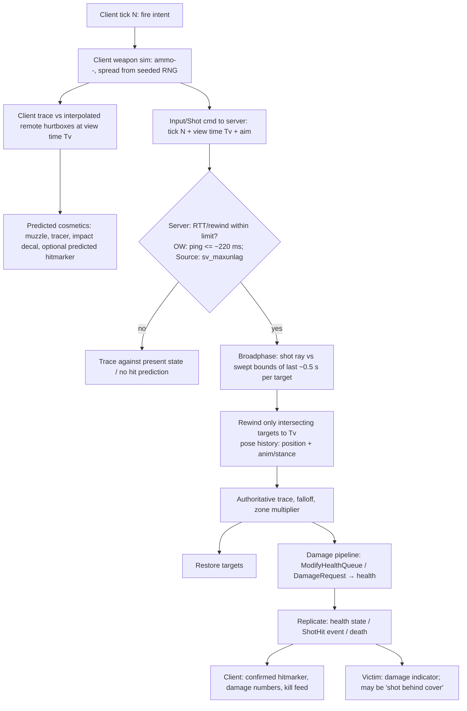

# Research: Production ECS / Networked Shooter Architectures

> Scope: public talks and write-ups on how shipped shooters organize gameplay state, systems and
> netcode. They are reference architectures to check `docs/architecture.md` against, not templates
> to copy. Main sources: Overwatch (GDC 2017), VALORANT (Riot tech blog, 2020), Halo: Reach
> (GDC 2011), Destiny (GDC 2015), Rocket League (GDC 2018), Valve Source, Glenn Fiedler and Gabriel
> Gambetta.
>
> **Citation discipline.** Text in quotation marks is quoted from the linked page, or from a
> secondary write-up that says it is quoting the talk; the source is named. Everything else is a
> paraphrase. Several Overwatch details come only from secondary summaries (some machine-translated
> from Chinese). They are marked *(secondary)*, and where sources disagree this document says so.

---

## 1. Overview

| Source | What it covers | Links |
|---|---|---|
| **Overwatch Gameplay Architecture and Netcode**, Timothy Ford (Blizzard), GDC 2017 | Strict ECS rules: components hold no logic, systems hold no state. Covers singleton components, utility functions, deferment, fixed 16 ms command frames, input redundancy, time dilation, partial rollback through `MovementState`, server rewind for hits with a swept-volume broadphase, the high-ping cutoff, and the killcam running in a second world. | [GDC Vault](https://gdcvault.com/play/1024001/-Overwatch-Gameplay-Architecture-and), [YouTube](https://www.youtube.com/watch?v=W3aieHjyNvw) |
| Overwatch "Let's Talk Netcode" developer update (Ford and Orwig, Apr 2016) | "Favor the shooter", update rates, and the opt-in high-bandwidth custom games. | [YouTube](https://www.youtube.com/watch?v=EqtNUFxgm38), [GamingBolt summary](https://gamingbolt.com/overwatch-developer-update-discusses-netcode-techniques-and-much-more) |
| **Peeking into VALORANT's Netcode** (Riot, 2020) | Breaks peeker's advantage into its parts. Covers 128 Hz fixed-step movement, mapping client moves to server ticks, repeating the last input when a move is missing, server rewind with limits, and design-side mitigations such as hit tagging and shoulder-before-head peeking. | [riotgames.com](https://www.riotgames.com/en/news/peeking-valorants-netcode) |
| **VALORANT's 128-Tick Servers** (Riot tech blog, 2020) | The 2.34 ms server frame budget, cost by subsystem, replacing polled property replication with RPC/event push, amortized server animation, and the pose history used for rewind. | [riotgames.com](https://www.riotgames.com/en/news/valorants-128-tick-servers) |
| **I Shot You First: Networking the Gameplay of Halo: Reach**, David Aldridge (Bungie), GDC 2011 | Three replication protocols (state, events, control) and per-client priority scoring. Main idea: lag "can only be placed". Includes design changes made for networking (armor lock, assassinations, ragdolls) and bandwidth tooling. | [GDC Vault](https://www.gdcvault.com/play/1014345/I-Shot-You-First-Networking), [Archive](https://archive.org/details/youtube-h47zZrqjgLc), [Wolfire summary](https://www.wolfire.com/blog/2011/03/gdc-session-summary-halo-networking/), [Edgegap summary](https://edgegap.com/blog/game-backend-deep-dive-halo-reach-netcode-host-migration) |
| **Shared World Shooter: Destiny's Networked Mission Architecture**, Justin Truman, GDC 2015 | Splits authority: peer "physics hosts" run combat and movement, while a thin cloud "activity host" running at about 10 Hz holds mission and script facts. | [GDC Vault](https://gdcvault.com/play/1022247/Shared-World-Shooter-Destiny-s), [YouTube](https://www.youtube.com/watch?v=Iryq1WA3bzw) |
| **It IS Rocket Science! The Physics of Rocket League Detailed**, Jared Cone (Psyonix), GDC 2018 | 120 Hz Bullet physics. The client predicts everything (ball and other cars), the server buffers inputs and repeats the last one when the buffer runs dry, and the client resimulates the whole world on correction. | [GDC Vault](https://www.gdcvault.com/play/1024972/It-IS-Rocket-Science-The), [slides PDF](https://media.gdcvault.com/gdc2018/presentations/Cone_Jared_It_Is_Rocket.pdf), [Psyonix dev reply](https://devtrackers.gg/rocket-league/p/bb42f194-rocket-league-netcode-question-is-your-local-client-constantly-extrapolating-the-ball-other-players) |
| Valve: **Source Multiplayer Networking** and **Lag Compensation** (Yahn Bernier, 2001) | Usercmds, interpolation delay (100 ms by default), and the rewind-time formula. | [Valve wiki](https://developer.valvesoftware.com/wiki/Source_Multiplayer_Networking), [Lag Compensation](https://developer.valvesoftware.com/wiki/Lag_Compensation) |
| **Gabriel Gambetta, Fast-Paced Multiplayer** (parts I–IV) | Client-server model, prediction and reconciliation, entity interpolation, lag compensation. | [I](https://www.gabrielgambetta.com/client-server-game-architecture.html), [II](https://www.gabrielgambetta.com/client-side-prediction-server-reconciliation.html), [III](https://www.gabrielgambetta.com/entity-interpolation.html), [IV](https://www.gabrielgambetta.com/lag-compensation.html) |
| **Glenn Fiedler, Gaffer on Games** | QuakeWorld prediction history, rewind and replay, Fix Your Timestep, and the trade-offs between deterministic lockstep, snapshot interpolation and state sync. | [What every programmer…](https://gafferongames.com/post/what_every_programmer_needs_to_know_about_game_networking/), [Fix Your Timestep](https://gafferongames.com/post/fix_your_timestep/), [Networked Physics series](https://gafferongames.com/categories/networked-physics/) |
| lightyear (Bevy) | The prediction and rollback, interpolation, `PreSpawned` and lag-compensation (`LagCompensationHistory`, `LagCompensationSpatialQuery`) features that Krit would use. | [GitHub](https://github.com/cBournhonesque/lightyear), [lightyear_avian2d docs](https://docs.rs/lightyear_avian2d/latest/lightyear_avian2d/) |

---

## 2. Structure

### 2.1 Overwatch: ECS with very little netcode surface

- **Entity**: an ID that groups components. **Component**: data with no functions. **System**: behavior
  with no state. Ford's definition, as quoted in the
  [mo4tech translation](https://www.mo4tech.com/overwatchs-architecture-is-designed-to-synchronize-with-the-web.html):
  "Components are used to store game state without any behaviors. System has behavior but no state."
- **Scale**: about 46 client systems and about 103 component types. **Only three systems** contain
  gameplay netcode: *movement*, *weapon* and *StateScript* (the ability scripting VM)
  ([Edgegap](https://edgegap.com/blog/game-backend-deep-dive-overwatch-2016-netcode-architecture-rollback)).
  Every other system is unaware of networking.
- **Singleton components**: about **40%** of component types are singletons that live on a world-level
  entity, not inside systems. This keeps systems stateless and lets a second world, such as the
  killcam, carry its own copy. Examples *(secondary)*:
  - `SingletonInput`: device state that the movement and command systems read.
  - Connection: per-session network state, used for example for AFK detection.
  - Contact: a queue of pending impact effects.
  - Sources: [codingnow](https://blog.codingnow.com/2017/06/overwatch_ecs.html),
    [lfzxb](https://www.lfzxb.top/ow-gdc-gameplay-architecture-and-netcode/index.html).
- **Utility functions**: shared logic, such as a hostility check between two entities, goes into free
  functions. A utility function must either be pure, or be called from very few call sites when it has
  side effects. Paraphrased principle: complexity stays low when a behavior's side effects happen at a
  single call site.
- **Deferment**: when a behavior triggers expensive or side-effecting work, record a request and let
  one system resolve the whole batch later in the frame. Example: impact effects go into the Contact
  singleton, and a resolve system handles them in one place, with LOD, z-fighting avoidance and
  budgets. The Edgegap write-up quotes: "Behaviors are much less complex if they are expressed in a
  single call site in which all major behavioral side effects are localized."
- **Damage** goes through `ModifyHealthQueue`, a per-entity component listing incoming damage and
  healing. Only the server writes it *(secondary)*.
- **Killcam/replay**: a second ECS world (the "replay admin") is fed 8–12 s of recorded server network
  data as if it were arriving live. Systems do not know they are replaying *(secondary,
  [lfzxb](https://www.lfzxb.top/ow-gdc-gameplay-architecture-and-netcode/index.html))*.
- **Cost of discipline**: establishing the ECS rules took about 1.5 years, and code that broke the
  rules remained the main source of bugs
  ([Edgegap](https://edgegap.com/blog/game-backend-deep-dive-overwatch-2016-netcode-architecture-rollback)).

### 2.2 VALORANT (Unreal, heavily customized)

- The server is authoritative. Movement and physics run at a **fixed 128 Hz**, independent of render
  rate. A 60 FPS client runs several ticks per frame. A 144 FPS client interpolates between ticks.
- The server maps each client's timeline onto its own (Riot's example: "client A's update #239 maps to
  server update #400") and queues moves into those slots. A missing move is filled by continuing the
  last input.
- Server frame budget: 7.8125 ms per tick, three games per core, minus OS overhead, leaves **2.34 ms**.
  Riot reached under 2 ms. The biggest saving came from replacing polled property replication with
  pushed RPCs. Riot's example: a `ShotHit` event carries the damage value and clients compute health
  locally. They describe the change as "100x to 10000x" faster in specific cases.
- The server keeps a **history of positions and animation states** for rewinding shots. To save cost,
  it animates every 4th frame and lerps in between, and it turns server animation off during buy phase.

### 2.3 Halo: Reach (host-client, 16 players)

- There are three replication protocols ([Edgegap](https://edgegap.com/blog/game-backend-deep-dive-halo-reach-netcode-host-migration)):
  1. **State data**: "eventually, the most current value will arrive. It does not guarantee any
     intermediate values." This covers position, health and timers, and is the source of truth.
  2. **Events**: no delivery guarantee. They carry context, such as *why* health dropped.
  3. **Control data**: a sub-sampled controller stream of "around 20 bits per player", sent to the host
     and reflected back to other clients to improve prediction.
- A **prioritization** engine scores every object for every client, based on distance, screen
  presence, threat and recent interaction. Player-owned grenades get a priority boost. Total bandwidth
  is 250 kbps for 16 players.
- Guiding principle (quoted by Edgegap): "If you have host adjudication occurring, you will have lag
  somewhere… It cannot be eliminated. It can only be placed."

### 2.4 Destiny (hybrid)

- Peer "physics hosts" run combat, AI and movement close to the players.
- A thin cloud **activity host** running at about **10 Hz** keeps only the discrete facts that mission
  scripts need: whether a squad spawned, enemies remaining, objective flags. It is small enough to run
  about 5,000 instances per 40-core server (per the GDC 2015 talk summary).
- Lesson for Krit: *rules and match flow* can be separated from *combat simulation* and can even run
  on a different authority or at a different rate.

### 2.5 Rocket League

- Server-authoritative Bullet physics at a fixed 120 Hz. The client runs ahead of the server and
  **predicts everything**: its own car, the ball, and other cars, using their last known inputs.
- The server buffers each client's inputs. When the buffer is empty, it "will repeat the last known
  inputs". When a late input arrives, it is queued normally and does not trigger a resimulation
  ([Psyonix dev](https://devtrackers.gg/rocket-league/p/bb42f194-rocket-league-netcode-question-is-your-local-client-constantly-extrapolating-the-ball-other-players)).
- On correction, the client rolls the whole physics world back and resimulates it. This only works
  because the world is small and the physics is cheap.

### 2.6 Canonical tick (synthesis of Overwatch, VALORANT, Source and Gambetta)

```mermaid
sequenceDiagram
    autonumber
    participant Dev as Devices (frame rate)
    participant C as Client sim (predicted, ahead by ~RTT/2 + buffer)
    participant P as Client presentation
    participant S as Server sim (authoritative tick T)
    participant R as Remote clients

    Dev->>C: sample input for command frame N (as late as possible)
    C->>C: store Input[N] in ring buffer
    C->>S: send Inputs[ack+1..N] (sliding window, redundant)
    C->>C: simulate tick N (movement, aim, weapon state) and save predicted state[N]
    C-->>P: predicted local state + interpolated remotes (render at T_remote - interp delay)
    S->>S: input buffer: pop Input[N] (repeat last if missing; ask client to dilate time if starved)
    S->>S: simulate tick N (movement, weapons, hit rewind, damage, rules)
    S->>C: snapshot / deltas @ N (+ ack N, + buffer health)
    S->>R: snapshot (prioritized per client)
    C->>C: compare confirmed[N] vs predicted[N]
    alt mismatch
        C->>C: restore confirmed[N], resimulate N+1..now with stored inputs
    else match
        C->>C: discard history ≤ N (no rollback)
    end
    C-->>P: smooth visual correction (position error decays over frames)
```

Notes:
- Overwatch rolls back **only when there is a mismatch**, and **only the predicted components**
  (`MovementState`, weapon, StateScript) *(secondary)*.
- Rocket League rolls back the whole world.
- lightyear does mismatch-triggered rollback per component, so it sits closer to Overwatch.

### 2.7 Hit-registration path (Overwatch / VALORANT / Source style)



---

## 3. Subsystem deep-dives

### 3.1 Input and commands

- **Overwatch**
  - Input is sampled as late as possible for each 16 ms command frame.
  - Every packet carries all inputs since the last acknowledged command frame (a **sliding window**),
    so a lost packet costs nothing as long as a later one arrives.
  - The server keeps a small input buffer. If it starves, it tells the client to **dilate time**: the
    client simulates at about 15.2 ms per frame instead of 16 ms, so it sends commands faster and
    refills the buffer, then returns to normal. The tick count is unchanged; only wall-clock spacing
    changes.
  - Sources: [Edgegap](https://edgegap.com/blog/game-backend-deep-dive-overwatch-2016-netcode-architecture-rollback),
    [codingnow](https://blog.codingnow.com/2017/06/overwatch_ecs.html).
- **VALORANT and Rocket League**: when an input is missing, the server **repeats the last input**.
  VALORANT also maps client ticks onto server ticks explicitly.
- **Source**:
  - The input unit is the `CUserCmd`, which carries **absolute view angles**, buttons and the
    movement axis.
  - Repeating or replaying a usercmd is idempotent for aim.
  - Source's lag compensation rewinds to `command time = server time − packet latency − client
    interpolation` ([Valve wiki](https://developer.valvesoftware.com/wiki/Source_Multiplayer_Networking)).
- **Halo: Reach**: about 20 bits of *control data* per player is also relayed to other clients, so they
  can predict remote players better than with position alone.

### 3.2 Movement prediction

- All four studios predict the local player's movement with the **same code** on client and server,
  running on a fixed step. Overwatch calls this "determinism", but it means the same build producing
  the same result for the same inputs, not cross-platform lockstep.
- VALORANT gives the reason directly: a client running 30 Hz physics "will slowly drift from a server
  running its physics at 128hz".
- **Remote players**:
  - Overwatch, VALORANT and Source **interpolate** remote players, about 100 ms in the past in Source.
  - Rocket League **predicts** remote players by extrapolating with their last input, because physical
    contact between cars and the ball must line up.
  - FPS games choose interpolation plus lag compensation. Contact-heavy physics games choose
    predict-everything.
- **Corrections**: VALORANT applies corrections only to the affected player's view. Smoothing hides
  the snap (Gambetta II).
- **Server-applied effects** such as Overwatch stuns, VALORANT hit-tag slows and knockback cannot be
  predicted by the victim, so they are the main cause of corrections. Overwatch names
  "player influence (like stuns)" as the case that triggers rollback
  ([Edgegap](https://edgegap.com/blog/game-backend-deep-dive-overwatch-2016-netcode-architecture-rollback)).

### 3.3 Weapons and fire

- Overwatch **predicts all abilities and weapons by default**, and teams opt out case by case.
  **Rockets are predicted** too, and a misprediction can make a rocket visibly vanish.
- Halo: Reach uses a **split-phase** grenade:
  - the throw animation is predicted on button press;
  - the grenade *object* is created when the host confirms it;
  - this hides up to about 150–200 ms, because the player is watching the crosshair, not the hand.
- VALORANT uses design rather than prediction: shooting while moving is inaccurate, and stopping takes
  time. This shrinks the window in which a peeker's advantage turns into a kill.

### 3.4 Hit registration and lag compensation

- **Rewind target**:
  - Gambetta: the client sends "the exact timestamp of your shot, and the exact aim of the weapon".
  - VALORANT: the server rewinds "to what you were looking at when you pulled the trigger".
- **Broadphase**: Overwatch tests the ray against a bounding volume of each entity's movement over
  about the last 0.5 s, and rewinds only the entities it intersects (doors and platforms are not
  rewound).
- **What gets rewound**: VALORANT rewinds positions **and animation state**, so hitbox pose history is
  part of the history buffer.
- **Limits**:
  - Overwatch turns hit prediction off above about **220 ms** RTT and falls back to extrapolation, so
    that victims are not pulled back from behind cover.
  - VALORANT limits rewind distance.
  - Source caps rewind with `sv_maxunlag`, 1 s by default.
- **Fairness trade-off** (Gambetta IV): the defender sometimes "got behind a wall, and *then* got shot".
  This is accepted in exchange for the shooter's precision ("favor the shooter").

### 3.5 Damage authority

- **Overwatch**: damage and death are **not** predicted. The talk's line is roughly "some clients are
  jerks", per Edgegap; the lfzxb translation renders it as clients being liars. `ModifyHealthQueue` is
  written only on the server.
- **VALORANT**: the server is authoritative, but it *pushes* `ShotHit { damage }` events and clients
  compute health locally. Authority stays on the server, and replication is event-shaped.
- **Halo: Reach**: health is *state data*, which is authoritative. Events explain why it changed.
- **Unclear: whether Overwatch predicts impact cosmetics.** Edgegap and codingnow describe the client
  predicting the hit and the server only correcting a mismatch. The lfzxb translation says hit effects
  wait for the server. Both agree that damage numbers and death come from the server. Treat predicted
  impact cosmetics as a per-game choice.

### 3.6 Death and respawn

- **Halo: Reach**:
  - Ragdolls are **not networked**; only the initial death state is synced, and each client simulates
    the ragdoll locally.
  - Together with full over-penetration (bullets pass through bodies with no side effect), this saved
    about 10–12% of bandwidth.
  - Assassination animations use about 0.75 s of visual-only interpolation to hide position error.
- **Overwatch**: death is not predicted.
- **Overwatch killcam**:
  - It runs in a separate world fed with recorded server data.
  - Death presentation is therefore a *replay of authoritative facts*, not a branch of the live
    simulation.

### 3.7 Match flow

- **Destiny** puts mission and objective state in a 10 Hz authority separate from combat. This shows
  rules and match flow consume a *trickle of facts*: spawned, killed, captured.
- **VALORANT** turns off server animation during buy phase. The match phase changes how much simulation
  the server needs to run.
- **Halo: Reach** turns armor-lock activation on early on the host, by the measured RTT, so that what
  the client sees lines up with what it expects. Rules can deliberately move latency onto whoever is
  least likely to notice it.

### 3.8 Presentation and feedback

- Every source keeps cosmetics on the *predicting* client (muzzle flash, sound, tracer), and keeps
  *outcome* feedback (damage numbers, kill confirmation) on the authority's answer.
- Overwatch defers impact effects into a single resolve system (Contact). This system also enforces
  budgets and LOD, so presentation can throttle without touching simulation.
- Halo: Reach sends cosmetic events once, unreliably. Losing one is acceptable because state carries the
  truth.

### 3.9 Tick rate and determinism

| Game | Sim tick | Notes |
|---|---|---|
| Overwatch | 16 ms (about 60 Hz); 7 ms option for tournaments | Command-frame based; client ahead by about RTT/2 + 1 frame |
| VALORANT | 128 Hz | 2.34 ms server budget; client interpolates at render rate |
| Rocket League | 120 Hz | Whole-world physics rollback |
| Destiny activity host | about 10 Hz | Script and rule state only |
| Source (CS:GO era) | 64 / 128 Hz | Interp 100 ms; usercmd per tick |

All of them need **same-build reproducibility** for prediction. None of these shooters relies on
cross-platform bitwise lockstep.

### 3.10 Bandwidth and relevancy

- **Halo: Reach**:
  - per-client priority scoring with graceful degradation, so low-priority objects update less often
    instead of stalling everything;
  - a six-week investment in a bandwidth profiler built into the replay system;
  - a one-line fix to idle-grenade priority freed about 20% of bandwidth.
- **VALORANT**: moving from polled properties to pushed events was the biggest CPU win.
- **Halo: Reach and VALORANT both**: design changes (not networking ragdolls, server animation off
  during buy phase) saved more than protocol tuning.

---

## 4. Mapping to the Krit plan

| Their concept | Krit counterpart | Verdict |
|---|---|---|
| OW: components hold no logic, systems hold no state | §8 "all sim state in components; no `Local<T>`" | **Agreement** |
| OW: singleton components (about 40%) | Bevy `Resource` (`SimTick`, `FriendlyFirePolicy`, `TeamRelations`) | **Agreement**. Gap: which resources are *rollback state* is not specified |
| OW: utility functions (pure, or few call sites) | `AimRay::from`, `TeamRelations::relation`, `SimRng::for_shot` | **Agreement**. The rule itself is not written down |
| OW: deferment (Contact queue, single resolve site) | P3 Message pipeline; `ImpactEvent` → feedback | **Agreement** |
| OW: only 3 netcode systems | §5.16: domain crates unaware of networking | **Agreement** in spirit. **Gap**: krit_net cannot register domain components while it depends only on core (§3.1 vs §5.16) |
| OW: `MovementState` partial rollback, rollback only on mismatch | lightyear prediction per component | **Agreement**. Gap: predicted components need `PartialEq` or a tolerance |
| OW: `ModifyHealthQueue` (server-only) | `DamageRequest` → `DamagePipelineSystems` | **Agreement**. Gap: no authority gate on the `Damage` set |
| OW: SingletonInput / command frame | `CharacterIntent` per Character (P1) | **Agreement** on intent. **Divergence**: `look_delta` vs absolute angles (see §6.1) |
| OW sliding window / time dilation; RL and VALORANT repeat last input | lightyear input buffer and sync | **Gap**: `pressed`/`released` edges are not safe to repeat or redundantly resend |
| Source usercmd absolute `viewangles` | `CharacterIntent.look_delta` integrated in `Aim` | **Divergence** |
| OW/VALORANT rewind to the shooter's view time | `ShotRequest.tick`, `RewindProvider` | **Gap**: view or interpolation time is missing from `ShotRequest` |
| OW swept-bounds broadphase before rewind | `RewindProvider` (unspecified) | **Gap** (lightyear's `LagCompensationHistory` already does an AABB envelope) |
| OW 220 ms cutoff, `sv_maxunlag`, VALORANT rewind limit | none | **Gap**: `LagCompPolicy` (P8-style policy) |
| VALORANT pose history includes animation | `Hurtbox` colliders | **Gap**: hurtbox pose must come from sim state on a headless server |
| OW predicts weapons and rockets; lightyear `PreSpawned` | `Projectile` entities spawned in `Ballistics` | **Gap**: projectiles need a deterministic prespawn identity |
| Damage and death not predicted | §5.16 "everything else server authoritative" | **Agreement** |
| Predicted cosmetic hit vs confirmed hitmarker | `HitConfirmed` (from damage) → `HitmarkerQueue` | **Gap**: no predicted tier; on a client, a hitmarker arrives only after a full RTT |
| Halo: state, events and control as separate protocols | Component, `Message`/`EntityEvent`, `CharacterIntent` (§4.1) | **Agreement**. Gap: rule "state is truth, events are hints" for clients |
| Halo ragdolls not networked | P2; `Died` drives local presentation | **Agreement** |
| Halo per-client prioritization | none | **Gap** (krit_net hook) |
| OW killcam in a second world | P1 (replays drive intent); configurable sim schedule | **Partial**. Needs "no global or static state" plus a world-agnostic plugin setup |
| Destiny: thin rules authority | `krit_match` driven by facts only (§5.11) | **Agreement**. This boundary would allow a separate rules authority |
| RL: predict everything, whole-world rollback | not planned | **Divergence by design**. Interpolate remotes, as FPS games do |
| VALORANT: fixed 128 Hz; render interpolation | `Time<Fixed>`, configurable sim schedule | **Agreement**. Gap: local look latency (see §6.2) |
| VALORANT: amortized server animation, off in buy phase | `ActionGates` / match phases | **Idea**: phase-aware hurtbox history |
| OW: about 1.5 years to settle the rules; violations cause bugs | P10, CI per-crate tests | **Gap**: no determinism or rollback test harness |

---

## 5. Where the sources agree with the plan

- **P1 Intent is the only gameplay input.** Matches OW's `SingletonInput` feeding the movement and
  command systems, Source's usercmd and Halo's control data. P1's promise that bots, replays and
  network prediction all drive the same code is what OW's killcam relies on.
- **P2 Simulation and presentation are separate.** Every source puts cosmetics on the predicting
  client and makes them replay-safe. Halo goes further and stops networking ragdolls. OW defers impact
  effects to one resolve site. §8's "no side effects in simulation" rule is the Overwatch rule.
- **P3 Intent down, facts up; seams.** This is OW deferment: requests are queued and one system
  resolves them. `DamageRequest` as the "single door" for all damage (§6.3) matches
  `ModifyHealthQueue`. Ford's single-call-site argument directly supports keeping damage in one
  ordered pipeline, `DamagePipelineSystems`.
- **P5 Player ≠ Character.** Matches how every shooter replicates a persistent player/session (OW's
  Connection) separately from the body that can be destroyed and respawned.
- **P8 Rules are policies that systems query.** Fits Destiny's thin rules host and Halo's
  "place the lag" choices: if they are policies, a game can change who pays the latency without forking
  code.
- **§4 fixed sim schedule and §8 SimTick on every event.** Every source requires this. OW's command
  frame is our `SimTick`.
- **§8 state vs derived.** Halo's state data (truth) vs events (hints), and VALORANT's preference for
  replicating causes over derived values, both support "replicate `Magazine`, recompute
  `WeaponStats`".
- **§8 SimRng::for_shot.** OW and Source predict spread on the client and validate it on the server.
  Seeded per-shot RNG is the standard way to do this.
- **§5.16 predicted vs authoritative split.** "Movement and weapons predicted, everything else server
  authoritative" is almost exactly OW's three netcode systems: movement, weapon and ability script.
- **§3.1 hard dependency rule.** OW's claim that networking stays in three systems while 40+ others
  remain unaware is the strongest evidence that §5.16's "domain crates are unaware of networking" can
  be achieved.

---

## 6. Where the sources run counter to the plan

### 6.1 `look_delta` vs absolute aim in the command

- **The plan**: `CharacterIntent.look_delta` (radians), integrated into `ViewAngles` in
  `KritSimSystems::Aim`.
- **Production practice**: Source usercmds carry **absolute view angles**. VALORANT and Rocket League
  servers **repeat the last input** when one is missing, and lightyear does the same.
- **Why this matters**: if a delta is repeated, the server turns the player twice as far and the
  client must correct. If a delta is dropped, aim drifts permanently. Absolute angles are idempotent,
  so they survive both.
- **Better argument: production practice.** Keep `look_delta` for local feel and bots if wanted, but:
  - the networked contract should be `CharacterIntent.aim: ViewAngles`, the absolute target produced
    client-side by `krit_input`;
  - `krit_movement`'s Aim stage clamps and validates it (max turn rate per tick, as an anti-cheat
    sanity check) and adds `AimRecoil`.
- **Recoil caveat**: recoil is applied in the sim, so the client must send the *pre-recoil* absolute
  aim, or send aim plus the tick that last applied recoil. Source keeps aim punch out of the usercmd
  for this reason.

### 6.2 Moving camera rotation into the sim (§7.4) adds input latency

- **The plan**: `rotate_camera` moves into the sim, and kamera copies `ViewAngles`. This is correct for
  authority (P4).
- **The problem**: a 64 Hz fixed tick then makes **mouse look quantized and late** on 144 Hz+ displays.
  VALORANT handles high frame rates by interpolating between ticks, but interpolating *your own aim* is
  noticeable lag.
- **Production practice** (Source and most FPS games): **render-rate camera look**. The camera shows
  `ViewAngles` plus the look accumulated since the last tick but not yet consumed. The shot uses the
  angles of the tick it fires on.
- **Better argument: a hybrid.** P4 stays (aim is the character's), and `krit_kamera` adds a
  presentation-only "pending look" term read from `krit_input`'s accumulator. Expose it through a
  core read model such as `PendingLook(Vec2)` so kamera does not import `krit_input`.

### 6.3 Observers reacting to simulation facts

- **The plan**: §4.1 triggers `Died` as an `EntityEvent`, and §5.5 has inventory react to it *as an
  observer* (drop-on-death). §5.10 has interaction adapters as observers.
- **The OW single-call-site rule argues against this.** Observers run immediately and in no defined
  order.
- **The rollback problem**: lightyear replays `Fire` observers during rollback. A sim-side observer that
  spawns a dropped weapon will spawn it again on every resimulation, unless it is server-only or
  prespawned.
- **Better argument: OW's.**
  - Simulation crates consume facts only through `Message` readers in an ordered `KritSimSystems` set.
  - `EntityEvent`s are for *user* convenience and presentation.
  - Inventory drop-on-death becomes a system in `Lifecycle` reading `Died` messages.

### 6.4 Entity-based ids in deterministic keys

- **The plan**: `SimRng::for_shot(tick, shooter, index)` and `ShotId(shooter, weapon, shot_index)` use
  `Entity`. Client and server entity ids are **different**, because replication maps them.
- **Consequence**: the client predicts a different spread than the server computes. Every shooter that
  predicts spread seeds it from network-stable values: the usercmd number, player slot and tick.
- **Better argument: production practice.** Add a stable id to `krit_core`, for example
  `SimId(u32)` or `PlayerSlot`, assigned by match or by the net layer. Seed RNG and build `ShotId` from
  it, never from `Entity`. The same applies to any **sort order** inside the sim (see Pitfalls).

### 6.5 Replicating events vs state

- **The two positions**:
  - Halo says state is truth and events are unreliable hints.
  - VALORANT moved *toward* events (`ShotHit`) for CPU cost, in Unreal's polled property system.
- **In Bevy**: replicon and lightyear replicate on change detection, which is already push-shaped. The
  VALORANT cost argument mostly disappears.
- **Better argument: Halo's, for Krit.**
  - Replicate `Health` and `LifeState` as state.
  - Send `Died`, `HitConfirmed` and `DamageApplied` to clients as messages that are *reliable but not
    authoritative* (killfeed, indicators).
  - Write `krit_feedback` so it can rebuild what matters (HUD health, dead or alive) from state when an
    event is missed or arrives late.

### 6.6 Predict-everything vs interpolate remotes

- **The models**: Rocket League predicts other players. OW, VALORANT and Source interpolate them and
  compensate lag.
- **Fit for Krit**: the plan says nothing explicit. Its lag-compensation hook (`RewindProvider`) implies
  the FPS model.
- **Recommendation**: interpolate-plus-rewind should be the documented default in §5.16. Keep the pure
  `pmove`-style step so a game could predict remotes if it needed to (melee-heavy or physics games).

---

## 7. Ideas worth adopting and gaps in the plan

### `krit_core`

1. **`SimId` / stable identity** (see §6.4). Needed by `SimRng`, `ShotId`, deterministic ordering, and
   projectile prespawn hashes.
2. **Rollback state registration without krit_net depending on domain crates.** §3.1 says
   `krit_net → krit_core only`, but §5.16 says krit_net registers `KinematicState`, `WeaponState`,
   `Magazine` and `Health`, all of which are domain types. Options:
   - **(a)** A `#[reflect(SimState)]` / `ReflectSimState` type-data marker in core. Each domain crate
     tags its rollback-relevant components (and resources), and krit_net walks the type registry to
     register prediction and replication. This is the OW approach: a few systems know about netcode,
     and data is tagged.
   - **(b)** Move registration into the `krit_fps` facade, behind the `net` feature.

   Option (a) keeps à-la-carte use working.
3. **`SimAuthority` resource and run conditions** (`Standalone | Server | Client`), with helpers such
   as `KritSimSystems::Damage.run_if(sim_authority_is_authoritative)`.
   - The `Damage`, `Rules` and `Lifecycle` sets, plus parts of `Ballistics`, run only where authority
     lives.
   - This turns "everything else server authoritative" into an enforced rule instead of a convention.
   - It also allows a Destiny-style split, with `Rules` running elsewhere.
4. **`CharacterIntent` net-safety.**
   - Carry absolute `aim` (see §6.1).
   - Make edges derivable: store `PrevButtons` on the Character and compute `pressed` and `released`
     *inside the sim* from `buttons` versus the previous tick. Then a repeated or redundant input
     cannot double-jump or drop a press.
   - For actions where a press can begin and end within one tick, such as tapping fire with a semi-auto
     weapon, add a small `press_count`/sequence per button.
5. **Lag-compensation contract.** Extend `ShotRequest`, or add a `ShotTiming` field, with the shooter's
   **view time**: the interpolation tick plus a fraction that remote hurtboxes were rendered at.
   - Riot sends an "exact simulation timestamp", and CS2's sub-tick does the same with a sub-tick
     fraction.
   - Define `RewindProvider::with_rewound(view_time, ray_bounds, |query| …)` so the provider can run an
     OW-style broadphase and restore afterwards.
6. **`LagCompPolicy` resource (P8).**
   - `max_rewind` (Source `sv_maxunlag`, VALORANT limit);
   - `high_ping_cutoff` (OW about 220 ms) with a `Fallback::{PresentTime, NoHitPrediction}`;
   - an optional per-weapon override (for example, no rewind for projectiles).
7. **Write down the utility-function rule.** Helpers in core are pure, or have exactly one call site
   with side effects.

### `krit_ballistics`

8. **Hurtbox pose must be a pure function of sim state**: stance, `ViewAngles.pitch`, lean and crouch
   height. It must not come from animation.
   - A headless server (§3.2 tiers, §8 "no animation callbacks") cannot sample animation cheaply.
     VALORANT shows that server animation is a major cost.
   - Add to §8: "Hurtbox transforms are derived from simulation state in `KritSimSystems::Movement` (or
     a `HurtboxPose` sub-set) before `Ballistics`."
   - Games that want animated hitboxes plug in a server-side pose provider, accepting the cost.
9. **Predicted projectiles need deterministic identity.**
   - Spawn with a prespawn hash derived from `ShotId` (lightyear `PreSpawned`), so the client's
     predicted rocket and the server's rocket are matched, not duplicated.
   - Document OW's caveat: a mispredicted rocket can disappear.
   - Optionally offer a Halo-style split-phase `ProjectileSpawnPolicy::{Predicted, HostConfirmed}`,
     which suits grenades.
10. **Run on the client for cosmetics only.** On a predicting client, ballistics should produce
    `HitResult` and `ImpactEvent` (for predicted impact VFX) but **not** `DamageRequest`. Alternatively,
    the damage stage simply does not run, per `SimAuthority`. Name a public sub-set such as
    `BallisticsSystems::EmitDamage` so krit_net can gate it.
11. **Broadphase-friendly history.** If `krit_net` implements `RewindProvider` over lightyear's
    `LagCompensationHistory`, which stores an AABB envelope, ballistics must not assume per-hurtbox
    rewind is cheap. Query the root envelope first, then the hurtboxes.

### `krit_damage`

12. **Predicted vs confirmed outcome.** Keep damage authority-only (OW), and on the client accept
    *replicated* `DamageApplied`, `HitConfirmed` and `Died` with `ShotId`/`group` so feedback can
    match them to predictions.
13. **Server-applied movement effects** (VALORANT hit-tag slow, OW stuns, knockback `ExternalImpulse`).
    These are known sources of mispredictions.
    - Route them through replicated *state* (for example `MovementSlow { until_tick }` or `Stunned`) so
      the client's rollback resimulates them correctly once they are confirmed.
    - Do not route them through one-shot events.
14. **Ordering determinism.** Before `Apply`, sort a tick's `DamageRequest`s by `(tick, SimId of
    instigator, shot_id)`, so a two-hit kill credits the same killer on every machine and every rerun.

### `krit_feedback`

15. **Two-tier hitmarkers.**
    - `HitmarkerQueue` entries are `Predicted` (from local `HitResult` on a hurtbox) or `Confirmed`
      (from `HitConfirmed`), keyed by `ShotId`.
    - A predicted entry that is not confirmed within RTT + ε fades or is cancelled.
    - A game picks the policy: show predicted, show confirmed only, or show both with different styles.
      This settles the OW ambiguity in §3.5 as a policy.
16. **Rebuild from state.** HUD health and life state read replicated components. The killfeed reads
    reliable `Died` messages. Nothing in feedback depends on a cosmetic event arriving (Halo).
17. **Dedupe by key.**
    - Rollback replays can re-emit `HitResult` and `ImpactEvent`. §8 covers this for `WeaponFired` with
      a cumulative counter, but not for hits.
    - Feedback (and kamera, viewmodel) should dedupe on `(tick, ShotId, hit_index)` in a short ring
      buffer, or krit_net should gate cosmetic emitters with `not(is_in_rollback)`.
18. **Budgeted resolve (OW Contact).** `ImpactEvent` consumers resolve in one system with an
    LOD and budget cap. That is already the place to do it (`KritViewSystems::Feedback`).

### `krit_net`

19. **Latency placement table** (Halo: "lag can only be placed"). Document, for each action, where the
    latency goes:

    | Action | Default placement |
    |---|---|
    | Movement, look | Predicted |
    | Fire, ammo, spread, recoil | Predicted |
    | Hitscan hit (cosmetic) | Predicted, optional |
    | Damage, death | Server, +RTT |
    | Projectiles | Prespawned and predicted |
    | Grenades | Split-phase, optional |
    | Pickups, interactions | Server, with a predicted progress bar |
    | Spawn | Server |

20. **Prediction mismatch semantics.** lightyear rolls back on mismatch. Predicted Krit components need
    `PartialEq`, and floats need a tolerance-based `should_rollback`. Add this to the §5 crate
    conventions for `SimState`-tagged types.
21. **Interpolate remotes, rewind for hits, predict local** as the documented default (see §6.6).
22. **Priority and relevancy hooks** (Halo).
    - Expose a `ReplicationPriority` policy that raises the shooter's current target, the shooter's own
      projectiles and nearby threats.
    - Expose relevancy, either distance or game-defined fog of war.
    - Map these onto replicon visibility and lightyear priority.
23. **A bandwidth and rollback inspector early** (Halo built a profiler into replays in six weeks;
    Riot built `ValSubsystemTelemetry`). Per-crate `SystemSet`s (P10) make per-crate cost attribution
    straightforward.
24. **Input transport** is left to lightyear (redundancy and sync, which cover OW's sliding window and
    time dilation). Krit's job is to make the intent safe to repeat (item 4).

### §8 rules: proposed additions

- R8.x: **No `Entity` in deterministic keys or sort orders.** Use `SimId`.
- R8.x: **Simulation reacts to facts only through ordered `Message` readers.** Observers are for user
  and presentation code.
- R8.x: **Hurtbox pose is derived from sim state.**
- R8.x: **Every cosmetic consumer is idempotent**, through a counter or dedupe key.
- R8.x: **Rollback-tagged types implement `PartialEq`** (or a tolerance) and are tagged `SimState`.
- R8.x: **Authority-only sets** (`Damage`, `Rules`, `Lifecycle`, `BallisticsSystems::EmitDamage`) are
  gated by `SimAuthority`.
- R8.x: **Time constants live in seconds or RPM in data and are converted with `Time<Fixed>`**, so
  60, 64 and 128 Hz builds behave the same.
- R8.x: **No global or static state; all plugins are world-scoped.** This makes an OW-style killcam
  or replay world possible: two `World`s or a `SubApp` running the same `KritSimSystems`.

### §12 open questions this research informs

- **Absolute aim vs `look_delta` in `CharacterIntent`.** Recommend absolute aim for the net contract
  (§6.1).
- **Render-rate look.** Recommend adding `PendingLook` (§6.2) and resolving it in M1, because the
  current kamera already rotates at render rate and moving it into the sim would be a regression.
- **krit_net's dependency boundary.** Choose between `ReflectSimState` registry and facade-level
  registration (item 2).
- **Hitmarker policy default.** Predicted or confirmed (item 15).
- **Default tick rate.** Bevy defaults to 64 Hz. Shipped competitive shooters use 60–128 Hz. Make it a
  `KritCorePlugin` field and keep data tick-independent.
- **Killcam/replay world.** Decide whether to support it, as it constrains static state and plugin
  layout from M0.

---

## 8. Pitfalls and lessons

1. **Discipline erodes.** OW spent about 1.5 years settling its ECS rules, and code that broke them was
   the main source of bugs. Write a **determinism and rollback harness** in `krit_core` test utilities
   before M2:
   - run N ticks from recorded intents twice and compare a state hash;
   - snapshot at tick k, resimulate k..N and compare;
   - run each logic crate's tests under that harness.
2. **Bevy query iteration order is not portable.** It depends on archetype and table layout, which
   differs between client and server and after a rollback restore. Any system where processing order
   changes the result (damage application, a shared ammo pool, spawn selection) must sort by a stable
   key.
3. **Predicting what other players cause leads to corrections.** Stuns, slows and knockback applied by
   the server cause most visible rubber-banding (OW). Keep such effects short, telegraphed, or
   replicated as state with a start tick.
4. **Favor-the-shooter has a ceiling.** Without a rewind cap (OW 220 ms, `sv_maxunlag`), high-ping
   players kill targets that are already behind cover. Make the cap a policy and default it on.
5. **Peeker's advantage is structural.** VALORANT's own numbers: about 141 ms at 128 Hz, 35 ms RTT and
   60 FPS, falling to about 71 ms at 144 FPS. Tick rate, buffering and design (shoulder before head,
   hit tagging, inaccurate movement while shooting) together reduce it. Krit cannot remove it, but
   `krit_input`'s per-tick plugin and minimal buffering should not *add* frames.
6. **Fixed timestep plus interpolation is mandatory.** Fiedler's "Fix Your Timestep" and VALORANT's
   drift argument agree. Never step simulation with `Time<Virtual>` delta.
7. **Cosmetic duplication under rollback.** Every replayed tick re-emits messages. Counters (DOTS) or
   dedupe keys are required for everything visible, not only for shots.
8. **Late, deferred entity lifecycle needs care.** OW's ECS used deferred creation and deletion, and the
   secondary sources mention post-launch fixes around it. In Bevy, `Commands` already defer.
   - Messages referencing a just-despawned Character (a `DamageRequest` in flight) must tolerate a
     missing entity.
   - Keep despawns in `Lifecycle`, the last set (already planned).
9. **Design can fix netcode.** Halo (ragdolls, over-penetration, armor lock timing, assassination
   blends) and VALORANT (buy-phase animation off) won more through design than through protocol
   tuning. Krit's policy hooks (P8) are where games make these trade-offs.
10. **Measure.** Riot's lesson: "The only way to be sure is to create a reproducible test and
    **measure**." Halo's bandwidth profiler found a 20% win with a one-line fix. Use per-set timing
    from P10 sets.
11. **Server CPU is a feature constraint.** VALORANT's 2.34 ms budget pushed animation amortization and
    event-based replication. Sim-derived hurtboxes (item 8) and the swept-bounds broadphase (item 11)
    keep Krit servers cheap.

---

## 9. Sources

- Timothy Ford, *Overwatch Gameplay Architecture and Netcode*, GDC 2017:
  https://gdcvault.com/play/1024001/-Overwatch-Gameplay-Architecture-and ·
  https://www.youtube.com/watch?v=W3aieHjyNvw
- Game Developer, video summary: https://www.gamedeveloper.com/design/video-how-i-overwatch-s-i-gameplay-architecture-creates-variety
- Edgegap, *Game Backend Deep Dive – Overwatch* (secondary): https://edgegap.com/blog/game-backend-deep-dive-overwatch-2016-netcode-architecture-rollback
- codingnow (云风), *守望先锋中的 ECS* (secondary, Chinese): https://blog.codingnow.com/2017/06/overwatch_ecs.html
- lfzxb, *《守望先锋》架构设计和网络同步* (secondary transcript translation, Chinese): https://www.lfzxb.top/ow-gdc-gameplay-architecture-and-netcode/index.html
- mo4tech, English translation of the above (secondary): https://www.mo4tech.com/overwatchs-architecture-is-designed-to-synchronize-with-the-web.html
- Overwatch Developer Update, *Let's Talk Netcode* (2016): https://www.youtube.com/watch?v=EqtNUFxgm38
- Riot Games, *Peeking into VALORANT's Netcode*: https://www.riotgames.com/en/news/peeking-valorants-netcode
- Riot Games Technology, *VALORANT's 128-Tick Servers*: https://www.riotgames.com/en/news/valorants-128-tick-servers
- David Aldridge, *I Shot You First: Networking the Gameplay of Halo: Reach*, GDC 2011:
  https://www.gdcvault.com/play/1014345/I-Shot-You-First-Networking · https://archive.org/details/youtube-h47zZrqjgLc
- Wolfire, *GDC Session Summary: Halo networking*: https://www.wolfire.com/blog/2011/03/gdc-session-summary-halo-networking/
- Edgegap, *Game Backend Deep Dive – Halo: Reach* (secondary): https://edgegap.com/blog/game-backend-deep-dive-halo-reach-netcode-host-migration
- Justin Truman, *Shared World Shooter: Destiny's Networked Mission Architecture*, GDC 2015:
  https://gdcvault.com/play/1022247/Shared-World-Shooter-Destiny-s · https://www.youtube.com/watch?v=Iryq1WA3bzw
- Jared Cone, *It IS Rocket Science! The Physics of Rocket League Detailed*, GDC 2018:
  https://www.gdcvault.com/play/1024972/It-IS-Rocket-Science-The · https://media.gdcvault.com/gdc2018/presentations/Cone_Jared_It_Is_Rocket.pdf
- Psyonix developer reply on extrapolation and input buffering: https://devtrackers.gg/rocket-league/p/bb42f194-rocket-league-netcode-question-is-your-local-client-constantly-extrapolating-the-ball-other-players
- Valve, *Source Multiplayer Networking*: https://developer.valvesoftware.com/wiki/Source_Multiplayer_Networking
- Valve, *Lag Compensation*: https://developer.valvesoftware.com/wiki/Lag_Compensation
- Gabriel Gambetta, *Fast-Paced Multiplayer* I–IV: https://www.gabrielgambetta.com/client-server-game-architecture.html ·
  https://www.gabrielgambetta.com/client-side-prediction-server-reconciliation.html ·
  https://www.gabrielgambetta.com/entity-interpolation.html · https://www.gabrielgambetta.com/lag-compensation.html
- Glenn Fiedler, *What Every Programmer Needs To Know About Game Networking*: https://gafferongames.com/post/what_every_programmer_needs_to_know_about_game_networking/
- Glenn Fiedler, *Fix Your Timestep!*: https://gafferongames.com/post/fix_your_timestep/
- lightyear: https://github.com/cBournhonesque/lightyear · lag compensation (avian): https://docs.rs/lightyear_avian2d/latest/lightyear_avian2d/

*Not independently verified here (the pages could not be fetched or are video-only):* the Valve wiki
pages returned 403, so the rewind formula and the `sv_maxunlag` and interpolation defaults are given
from well-established public knowledge of those pages. The Rocket League slide PDF could not be
text-extracted, so the Rocket League details rest on the GDC session listing and the Psyonix developer
reply.
