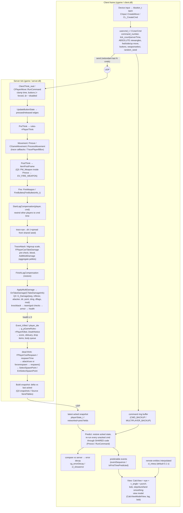

# Research: the id Tech / Source lineage as an FPS template

> Subject: QuakeWorld (`pmove.c`, client prediction), Quake III Arena (`bg_pmove.c`, `usercmd_t`,
> snapshots, `g_weapon.c`) and the Valve Source SDK 2013 (HL2DM: `CUserCmd`, `CGameMovement`,
> `CBasePlayer`, `CBaseCombatWeapon`, `CTakeDamageInfo`, `CGameRules`/`CTeamplayRules`,
> `CLagCompensationManager`, prediction tables, view punch, view model).
> Purpose: check the Krit plan (`docs/architecture.md`) against the code it cites, go deeper, and
> list what to adopt.
>
> Method: the GPL id sources and the Source SDK 2013 sources were downloaded and read directly
> (file and function names below come from those files). Valve Developer Community (VDC) pages
> returned HTTP 403 to the fetcher, so VDC claims are cross-checked against the SDK code or a
> mirror of the page. Distances are in engine units. Both engines treat 1 unit as roughly 1 inch,
> so metric values are given as `u × 0.0254 m`.

---

## 1. Overview

| Codebase | What it is | Scope useful to Krit | Source |
|---|---|---|---|
| **QuakeWorld** (1996–97) | The netcode rewrite of Quake. It introduced client-side prediction of the local player. | `QW/client/pmove.c` (the movement step), `pmovetst.c` (hull traces over a `physents[]` list), `cl_pred.c` (`CL_PredictMove`), and the `sv_phys.c` movevars | github.com/id-Software/Quake (`QW/`) |
| **Quake III Arena** (1999) | A client/server engine plus three QVM modules: `game` (server), `cgame` (client) and `ui`. The `bg_*` ("both games") files are compiled into both `game` and `cgame`. | `bg_pmove.c` (movement **and the weapon state machine**), `bg_public.h` (`pmove_t`, events, `MOD_*`), `q_shared.h` (`usercmd_t`, `playerState_t`), `g_active.c` (`ClientThink_real`), `g_weapon.c`, `g_combat.c` (`G_Damage`), `g_client.c` (spawns), `cg_predict.c`, `cg_view.c` | github.com/id-Software/Quake-III-Arena |
| **Source SDK 2013** (HL2DM / mod template) | Valve's C++ game DLLs. The `game/shared` code is compiled twice, as `CLIENT_DLL` (classes with a `C_` prefix) and `GAME_DLL`. It adds predicted weapons, lag compensation and networked/predicted field tables. | `gamemovement.cpp`, `usercmd.h`, `igamemovement.h` (`CMoveData`, `IGameMovement`), `player_command.cpp` (`CPlayerMove::RunCommand`), `basecombatweapon_shared.cpp` (`ItemPostFrame`), `takedamageinfo.h`, `gamerules.h`, `teamplay_gamerules.cpp`, `player_lagcompensation.cpp`, `prediction.cpp`, `baseviewmodel_shared.cpp`, `hl2mp/*` | github.com/ValveSoftware/source-sdk-2013 (`src/game/...`) |

These three are one lineage. Source descends from GoldSrc, which descends from Quake/QuakeWorld.
Bernier's GDC 2001 paper says Half-Life's prediction "is similar to the system used in
QuakeWorld". It also describes moving "the implementation of a weapon's firing logic into shared
code just like the player movement code". That decision is the main architectural contribution of
the lineage.

---

## 2. Structure

### 2.1 Code layout: the shared / client / server split

```
Quake III                                   Source SDK 2013
code/game/   bg_*.c  ← compiled into BOTH   src/game/shared/   *_shared.cpp, gamemovement.cpp,
             g_*.c   ← server only (game)                       usercmd.cpp, takedamageinfo.cpp,
code/cgame/  cg_*.c  ← client only                              gamerules.cpp, basecombatweapon_shared.cpp
                                            src/game/server/   player.cpp, player_command.cpp,
QuakeWorld                                                     player_lagcompensation.cpp, team.cpp
QW/client/pmove.c, pmovetst.c  ← linked     src/game/client/   prediction.cpp, in_main.cpp (CInput),
  into both qwcl and qwsv                                      c_baseplayer.cpp, view code
```

- **QW**: `pmove.c` is a pure function over the global `playermove_t pmove`, which holds player
  state, `usercmd_t cmd` and `physents[MAX_PHYSENTS]` (entry 0 is the world BSP). Collision is
  *data injection*: the caller fills in the physents, and `PM_PlayerMove` traces the hulls itself.
- **Q3**: `Pmove(pmove_t*)` takes `playerState_t *ps` (in/out) and `usercmd_t cmd`. It reaches the
  world through **function pointers** (`trace`, `pointcontents`), which are "different functions
  during game and cgame" (comment in `bg_public.h`). The P9 citation ("Quake pmove trace
  callbacks") is accurate for **Q3**. QW used a physents snapshot instead.
- **Source**: the `IGameMovement::ProcessMovement(CBasePlayer*, CMoveData*)` interface. `CMoveData`
  is a copy-in/copy-out struct (buttons, old buttons, forward/side/up move, view angles, velocity,
  origin, outputs `m_outStepHeight`, `m_outWishVel`, `m_outJumpVel`). Tracing goes through
  `CGameMovement::TracePlayerBBox` (virtual) and `IMoveHelper`. Unlike Q3, `CGameMovement` still
  reaches into `CBasePlayer` directly (`player->m_Local.m_bDucked`, `player->GetGroundEntity()`,
  `player->m_surfaceFriction`), so it is less pure than `bg_pmove`.

### 2.2 Per-command frame (server authoritative, client predicted)



Two facts about how the frame is driven change the Krit design:

1. **Movement is driven by commands, not by server frames.** Q3 `ClientThink` runs whenever a
   command arrives (unless `g_synchronousClients`). The msec value comes from
   `cmd.serverTime - ps.commandTime`. Source `RunCommand` uses a **per-player clock**
   (`m_nTickBase * TICK_INTERVAL`) and increments `m_nTickBase` for each command it runs. To stop
   speedhacks, Source throttles with `ConsumeMovementTicksForUserCmdProcessing`. In both engines,
   simulation time is a property of the *command stream*, not the world clock.
2. **Weapons run inside the command, after movement, in the same function.** In Q3,
   `PmoveSingle` calls `PM_Weapon()` after the move. In Source, `RunCommand` → `RunPostThink` →
   `PostThink` → `ItemPostFrame`. The weapon therefore sees the position and angles from *this*
   command, which keeps prediction consistent.

---

## 3. Subsystem deep-dives

### 3.1 Input (`usercmd_t` / `CUserCmd`)

- **Q3 `usercmd_t`**: `serverTime`, `int angles[3]` (absolute, 16-bit `ANGLE2SHORT`), `buttons`,
  `byte weapon`, `signed char forwardmove, rightmove, upmove` (−127..127). Jump is `upmove >= 10`,
  not a button.
- **Source `CUserCmd`**: `command_number`, `tick_count`, `QAngle viewangles` ("Player instantaneous
  view angles"), `forwardmove/sidemove/upmove` (float, in u/s), `buttons` (`IN_*` bits from
  `in_buttons.h`), `impulse`, `weaponselect` (entity index), `weaponsubtype`, `random_seed`,
  `mousedx/mousedy`, `hasbeenpredicted`. `MakeInert()` zeroes the gameplay fields.
- **Angles are absolute, not deltas.** The client integrates the mouse into `viewangles` and sends
  the result. The server can still impose a facing without fighting the client:
  - Q3 does it with `ps.delta_angles` ("add to command angles to get view direction; changed by
    spawns, rotating objects, and teleporters"). `PM_UpdateViewAngles` clamps pitch to ±16000
    short units (about ±88°) by rewriting `delta_angles`.
  - Source does it with `pl.fixangle` (`FIXANGLE_NONE/ABSOLUTE/RELATIVE`) in `RunCommand`.
- **Edges are derived in simulation, not in input.**
  - Source `CBasePlayer::UpdateButtonState` sets `m_afButtonLast = m_nButtons`,
    `m_afButtonPressed = changed & m_nButtons` and
    `m_afButtonReleased = changed & ~m_nButtons`.
  - QW and Q3 keep `oldbuttons` / `PMF_JUMP_HELD` in player state.
  - The **client latches taps**: `kbutton_t.state |= 1 + 2` ("down + impulse down"), and
    `CalcButtonBits` reports a button held for a command if it was pressed at any point during
    that command window. A tap shorter than a tick is never lost, and no edge is ever *transmitted*.
- **Gates live inside the command.** Source applies
  `ucmd->buttons |= m_afButtonForced; ucmd->buttons &= ~m_afButtonDisabled;` before anything reads
  the buttons. This is the same idea as Krit's `ActionGates`, applied at the intent layer. Q3 has a
  coarser form: `PMF_RESPAWNED` ("don't allow attack until all buttons are up") and `BUTTON_TALK`
  zeroing all movement.
- **Shared RNG seed.** Source sets `random_seed = MD5_PseudoRandom(command_number)` on the client
  and **recomputes it on the server** in `ReadUsercmd` so the client cannot choose it.
  `SetPredictionRandomSeed(cmd)` wraps each command. Q3 sends the shotgun seed in the event
  (`tent->s.eventParm = rand() & 255; // seed for spread pattern`) so cgame can redraw the same
  pellet pattern.

### 3.2 Movement / character

The structure is the same in all three. In Source `FullWalkMove`:

1. `StartGravity` (half gravity).
2. Water checks.
3. If jump is held, `CheckJumpButton`.
4. If on ground, set `vel.z = 0` and apply `Friction()`.
5. `WalkMove` or `AirMove`.
6. `CategorizePosition` (ground trace).
7. `FinishGravity` (the other half).
8. `CheckFalling`.

`WalkMove` runs `Accelerate`, then `StayOnGround` and `StepMove` / `TryPlayerMove`. `TryPlayerMove`
clips velocity against up to `MAX_CLIP_PLANES` and uses `ClipVelocity` with overbounce. Q3's
`PmoveSingle` follows the same pattern:

1. `PM_CheckDuck`
2. `PM_GroundTrace`
3. `PM_WalkMove` / `PM_AirMove` (which call `PM_StepSlideMove`)
4. `PM_GroundTrace` again
5. `PM_Weapon`
6. `PM_Footsteps`
7. `trap_SnapVector(velocity)`

**Movement constants (verified in source):**

| Parameter | QuakeWorld | Quake III | Source SDK 2013 (HL2DM) | Metric (×0.0254) |
|---|---|---|---|---|
| gravity | `sv_gravity 800` | `g_gravity` (800) | `sv_gravity 600` (HL2 `DEFAULT_GRAVITY_STRING`), 800 otherwise | 20.3 / 15.2 m/s² |
| max ground speed | `sv_maxspeed 320` | `g_speed` (320) | `sv_maxspeed 320` (cap; HL2DM class speeds are lower) | 8.13 m/s |
| ground accel | `sv_accelerate 10` | `pm_accelerate 10` | `sv_accelerate 10` | dimensionless (×wishspeed×dt) |
| **air accel** | `sv_airaccelerate 0.7` | `pm_airaccelerate 1.0` | `sv_airaccelerate 10` | dimensionless |
| **air wishspeed cap** | `30` (hard-coded in `PM_AirAccelerate`) | none (plain `PM_Accelerate`) | `GetAirSpeedCap() → 30` | 0.76 m/s |
| friction | `sv_friction 4` | `pm_friction 6` | `sv_friction 4` | 1/s |
| stopspeed | `sv_stopspeed 100` | `pm_stopspeed 100` | `sv_stopspeed 100` | 2.54 m/s |
| jump | `velocity[2] += 270` | `JUMP_VELOCITY 270` (sets, not adds) | HL2: `160` (≈21 u); else `sqrt(2·800·45)≈268.3` | 6.86 m/s (≈1.16 m apex at 800) |
| step height | (hull-based) | `STEPSIZE 18` | `sv_stepsize 18` | 0.46 m |
| walkable normal | — | `MIN_WALK_NORMAL 0.7` | `0.7` in `StepMove`/`CategorizePosition` | ≈45.6° max slope |
| hull | QW hull 1 | `{-15,-15,-24}..{15,15,32}`, duck top 16 | `{-16,-16,0}..{16,16,72}`, duck top 36 | 0.81×0.81×1.83 m / 0.91 m |
| eye height | — | `DEFAULT_VIEWHEIGHT 26` (over origin = 50 over feet), crouch `12` | `VEC_VIEW 64`, `VEC_DUCK_VIEW 28` | 1.63 m / 0.71 m |
| duck time | instant | instant | `TIME_TO_DUCK` 0.4 (HL2) or 0.2; `TIME_TO_UNDUCK 0.2` | — |
| fall damage | — | `PM_CrashLand` events | safe `580`/fatal `1024` u/s (HL2: `526.5`/`922.5`), linear `DAMAGE_FOR_FALL_SPEED = 100/(fatal−safe)` | 14.7 / 26 m/s |
| overbounce | 1.0 | `OVERCLIP 1.001` | `ClipVelocity(..., overbounce)` (1.0 ground) | — |

**The "feel" mechanics, and the exact code paths that produce them:**

- **Air-strafing / bunnyhop gain.** `AirAccelerate` caps `wishspd` at 30 for the *projection test*
  (`addspeed = wishspd - dot(vel, wishdir)`) but uses the **uncapped** `wishspeed` in
  `accelspeed = accel * wishspeed * dt`. Turning so that `wishdir` stays nearly perpendicular to
  velocity keeps `addspeed > 0` while total speed grows. QW, Source and Q3 all have this. Q3 has no
  30 cap, so it relies on a low `pm_airaccelerate 1.0` instead, which gives the slower,
  circle-jump-friendly Q3 strafe-jump. Carmack's own comment in Q3 `PM_Accelerate` keeps the
  alternative under `#else`: "proper way (avoids strafe jump maxspeed bug), but feels bad". The
  famous mechanic is therefore a *deliberate choice of acceleration model*.
- **Bhop needs no friction on the landing tick.** The jump check runs **before** friction. On a
  successful jump, Source calls `SetGroundEntity(NULL)` and Q3 sets `pml.walking = qfalse`, so
  `Friction()` is skipped for that tick. A perfectly timed re-jump therefore loses no speed.
- **No autohop by default.** `if (mv->m_nOldButtons & IN_JUMP) return false; // don't pogo stick`
  (Source and QW), and `PMF_JUMP_HELD` in Q3. Holding jump does not re-jump; the player must
  release and press again. Q3 `Pmove` re-sets `upmove = 20` between chopped sub-steps while
  `PMF_JUMP_HELD` is set.
- **Crouch-jump.** Source `FinishDuck` in the air moves the origin *up* by
  `hullSizeNormal − hullSizeCrouch` (36 u), so the legs tuck instead of the head lowering. That
  clears obstacles 36 u higher. On the ground it shifts by the `mins` difference instead. Q3 only
  lowers `maxs[2]` (32→16), so it has no leg tuck.
- **Step-up** (`StepMove`): Source tries the move twice, once flat (`TryPlayerMove`) and once
  stepped (trace up `stepsize`, move, trace down). It keeps whichever went **farther horizontally**
  and rejects the stepped result if the landing normal z is below 0.7. It reports
  `m_outStepHeight` so the client can smooth the camera. Q3 `PM_StepSlideMove` is similar, and
  cgame smooths the result with `CG_StepOffset` (`cg.stepChange` over `STEP_TIME`).
- **Ground snap**: Source `StayOnGround` traces down by the step size when walking so the player
  stays attached on downward slopes.
- **Knockback beats friction**: Q3 `G_Damage` sets `ps.pm_time` (50–200 ms) and
  `PMF_TIME_KNOCKBACK`, and `PM_Friction` skips ground friction while that flag is set. Without
  this, rocket jumps and knockback get eaten by friction.
- **HL2 single-player jump boost** (`maxClients == 1`): `CheckJumpButton` adds
  `forwardmove × 0.5` along the view forward and clamps against `Length2D`. The boost flips sign
  when `forwardmove < 0`, but the clamp only checks speed and ignores direction. That combination
  produced *accelerated back hopping* (ABH). It is a cautionary example of a feel hack inside shared movement code.

### 3.3 Camera / view

- **Aim lives on the player.** Source stores it in `pl.v_angle`, which `RunCommand` sets from
  `ucmd->viewangles`, and exposes it as `EyeAngles()`. `EyePosition()` is origin + `m_vecViewOffset`,
  and the view offset is animated by duck (`SetDuckedEyeOffset`, a spline over the duck time).
- `CBasePlayer::CalcPlayerView` adds `m_Local.m_vecPunchAngle` to the eye angles. Punch is a
  **damped spring simulated in shared movement code**:
  - `CGameMovement::DecayPunchAngle` uses `PUNCH_DAMPING 9`, `PUNCH_SPRING_CONSTANT 65`, and
    clamps to ±89/±179/±89.
  - `ViewPunch(offset)` adds `offset × 20` to the punch **velocity**.
  - **Punch also bends shots.** `GetAutoaimVector` uses `EyeAngles() + m_vecPunchAngle`, so
    HL2-era Source has a single channel that is both aim-affecting and visual. (Later CS:GO split
    it into "aim punch" and "view punch"; Krit's `AimRecoil` / `ViewKick` split follows that later
    design.)
- **Q3 keeps all view feel in cgame and purely visual.** `CG_OffsetFirstPersonView` applies:
  - a damage kick from `ps.damagePitch/damageYaw/damageCount`, latched when `ps.damageEvent`
    changes;
  - bob (`cg_bobup`, `cg_runpitch`);
  - duck smoothing (`cg.duckChange` over `DUCK_TIME`);
  - landing dip (`LAND_DEFLECT_TIME` / `LAND_RETURN_TIME`);
  - step smoothing (`CG_StepOffset`).

  The server only sends the facts: `damageEvent` is a counter, and the step/land/duck data comes
  from predicted events.
- **Remote players** are interpolated about 100 ms in the past (`cl_interp 0.1`), and the local
  player is predicted. The local view is therefore "now" while everyone else is "then". This is
  why lag compensation exists.

### 3.4 Inventory / weapons

- **Q3** is minimal. All weapon state is in `playerState_t`: `weapon`, `weaponstate`
  (`WEAPON_READY/RAISING/DROPPING/FIRING`), `weaponTime`, `ammo[MAX_WEAPONS]` and the
  `stats[STAT_WEAPONS]` bitmask. `PM_Weapon` works like this:
  1. Block fire if `PMF_RESPAWNED`, a spectator, or dead.
  2. Handle the holdable item.
  3. Decrement `weaponTime`.
  4. If `ps.weapon != cmd.weapon` and the weapon is not mid-fire, call `PM_BeginWeaponChange`.
  5. Handle the raise/drop states.
  6. If attack is held: out of ammo adds `EV_NOAMMO` and 500 ms. Otherwise decrement ammo, raise
     `EV_FIRE_WEAPON`, and do `weaponTime += addTime` (rocket 800, rail 1500, MG 100, LG 50 ms;
     `/1.3` with haste).

  **`+=` carries the remainder**, which makes the fire rate frame-independent.

  The actual tracing happens server-side in `g_weapon.c FireWeapon`, which `ClientEvents` calls
  when it sees `EV_FIRE_WEAPON`. The shared code decides *that* a shot happens; game code decides
  *what it hits*. This is the same split as Krit's weapons → `ShotRequest` → ballistics.
- **Source** has the `CBaseCombatWeapon` hierarchy (HL2DM: `CBaseCombatWeapon` →
  `CWeaponHL2MPBase` → `CBaseHL2MPCombatWeapon` → `CHL2MPMachineGun` → `CWeaponSMG1`).
  `CBasePlayer::ItemPostFrame` works like this:
  1. `CalcViewModelView`.
  2. If using something, call `ImpulseCommands`.
  3. If `curtime < m_flNextAttack`, call `ItemBusyFrame()`; otherwise call
     `GetActiveWeapon()->ItemPostFrame()`. On the client this happens only if the weapon
     `IsPredicted()`.

  `CBaseCombatWeapon::ItemPostFrame` encodes the **priority order**:
  1. `UpdateAutoFire`.
  2. `CheckReload`.
  3. `IN_ATTACK2` → `SecondaryAttack()`, which may block primary via `ShouldBlockPrimaryFire()`.
  4. `IN_ATTACK` while `m_flNextPrimaryAttack <= curtime`. An empty clip gives
     `HandleFireOnEmpty()`. Underwater checks apply. **A fresh press resets the schedule**:
     `if (m_afButtonPressed & IN_ATTACK) m_flNextPrimaryAttack = curtime`.
  5. `IN_RELOAD` (only when not mid-cycle) → `Reload()`.
  6. Nothing pressed → `ReloadOrSwitchWeapons()` (auto-switch when empty) or `WeaponIdle()`.

  **Multiple shots per tick:** `CHL2MPMachineGun::PrimaryAttack` loops
  `while (m_flNextPrimaryAttack <= curtime) { m_flNextPrimaryAttack += fireRate; iBulletsToFire++; }`.
  It then fires them all in one `FireBulletsInfo_t { m_iShots, m_vecSrc = Weapon_ShootPosition(),
  m_vecDirShooting, m_vecSpread, m_flDistance, m_iAmmoType, m_iTracerFreq }`.
  `FireBulletsInfo_t` is essentially Krit's `ShotRequest`.
- **Ammo** is stored on the player (`GetAmmoCount(ammoType)`, `RemoveAmmo`), and the clip is
  stored on the weapon (`m_iClip1/2`). Ammo types are indices into a global `CAmmoDef` table.
- **Weapon selection** goes through the command (`weaponselect` → `SelectItem`). Q3 also uses the
  command (`cmd.weapon`). The selection is **state in the command**, not an event.
- **Predicted fields** are declared per class:
  `BEGIN_PREDICTION_DATA(CBaseCombatWeapon)` with
  `DEFINE_PRED_FIELD_TOL(m_flNextPrimaryAttack, FIELD_FLOAT, FTYPEDESC_INSENDTABLE, TD_MSECTOLERANCE)`,
  `DEFINE_PRED_FIELD(m_iClip1, ...)`, `m_iState`, `m_hOwner`, view model index, and others. Each
  field states whether it is networked (`INSENDTABLE`) and what error tolerance applies.

### 3.5 Hit detection

- **The shot comes from the eye.** Q3 `CalcMuzzlePoint` is origin + `viewheight` + 14 u forward,
  `SnapVector`ed. Source uses `Weapon_ShootPosition()` = `EyePosition()`. The view-model muzzle is
  used only for tracer and muzzle-flash effects. This agrees with Krit §5.13.
- Q3 `Bullet_Fire` uses server-side `random()`/`crandom()` spread and loops up to 10 traces
  (bounce/pass-through). The shotgun uses an explicit seed (see §3.1).
- Source `FireBullets`:
  1. Trace.
  2. `TraceAttack` on the hit entity. The victim scales damage by hitgroup (`sk_player_head`,
     `sk_player_chest`, `sk_player_stomach`, `sk_player_arm`, `sk_player_leg`), spawns blood and
     calls `AddMultiDamage`.
  3. `ApplyMultiDamage` sums all pellets per target into **one** `OnTakeDamage`.
- **Lag compensation** (`player_lagcompensation.cpp`):
  - **History**: `m_PlayerTrack[MAX_PLAYERS]` is a list of `LagRecord { m_fFlags (LC_ALIVE,
    LC_ORIGIN_CHANGED, LC_ANGLES_CHANGED, LC_SIZE_CHANGED, LC_ANIMATION_CHANGED), m_vecOrigin,
    m_vecAngles, m_vecMinsPreScaled/MaxsPreScaled, m_flSimulationTime, m_layerRecords[],
    m_masterSequence }`. It is recorded every frame and pruned past `sv_maxunlag` (1.0 s).
  - **Target time**:
    - `correct = clamp(outgoing_latency + lerp, 0, sv_maxunlag)`.
    - `targettick = cmd->tick_count - lerpTicks`.
    - If that disagrees with the latency estimate by more than 0.2 s, use
      `tickcount - TIME_TO_TICKS(correct)` instead.

    This matches the VDC formula "Command Execution Time = Current Server Time − Packet Latency −
    Client View Interpolation".
  - **Backtrack**:
    - Walk the records newest to oldest.
    - **Abort if the player was dead (`!LC_ALIVE`)** or moved more than
      `sv_lagcompensation_teleport_dist` (64 u) between records, since that counts as a teleport.
    - Lerp between the two records around the target time.
    - Optionally, `sv_unlag_fixstuck` rejects positions that would be stuck.
    - Restore everything afterwards.
  - **Scoping**: `CHL2MP_Player::FireBullets` wraps *only the shot* in
    `StartLagCompensation(this, GetCurrentCommand())` / `FinishLagCompensation(this)`. The rewind
    is narrowed by `WantsLagCompensationOnEntity`:
    - skip the target if this command doesn't attack and the last shot was more than 5 commands
      ago;
    - skip it if it was not transmitted to the shooter;
    - include it if within `1.5 × MaxSpeed × sv_maxunlag`;
    - otherwise include it only if inside a 45° cone of the view.
  - Q3 vanilla has **no** lag compensation. The community "Unlagged" mod added it later. QW also
    had none.

### 3.6 Damage / health

- **Q3 `G_Damage(targ, inflictor, attacker, dir, point, damage, dflags, mod)`** runs in this order:
  1. `takedamage` check.
  2. Intermission check.
  3. Default the inflictor/attacker to the world.
  4. Movers get `use` and return.
  5. Attacker handicap.
  6. **Knockback computed and applied before the team check**: `knockback = min(damage, 200)`,
     `vel += dir · g_knockback · knockback / 200`, plus the `PMF_TIME_KNOCKBACK` timer. Teammates
     and the shooter still get pushed, so rocket jumps work even with friendly fire off.
  7. `OnSameTeam` with `!g_friendlyFire` returns.
  8. Godmode.
  9. Battlesuit.
  10. Hit counter.
  11. **Self-damage halved after knockback** ("calculated after knockback, so rocket jumping
      works").
  12. `CheckArmor`.
  13. Accumulate `client->damage_blood/armor/knockback/from` for the end-of-frame
      `P_DamageFeedback`, which packs `damagePitch/Yaw/Count` and increments `damageEvent`.
  14. Set `lasthurt_client/mod`.
  15. Subtract health.
  16. `die()` or `pain()` callbacks.

  The flags are `DAMAGE_RADIUS`, `DAMAGE_NO_ARMOR`, `DAMAGE_NO_KNOCKBACK`, `DAMAGE_NO_PROTECTION`
  and `DAMAGE_NO_TEAM_PROTECTION`. The cause enum is `meansOfDeath_t`: `MOD_SHOTGUN`,
  `MOD_ROCKET`, `MOD_ROCKET_SPLASH`, `MOD_FALLING`, `MOD_TELEFRAG`, `MOD_TRIGGER_HURT`, and others.
- **Source `CTakeDamageInfo`** has these fields: `m_hInflictor`, `m_hAttacker`, `m_hWeapon`,
  `m_flDamage`, `m_flMaxDamage`, **`m_flBaseDamage`** ("before skill level adjustments… used to
  get uniform damage forces"), `m_vecDamageForce`, `m_vecDamagePosition`,
  **`m_vecReportedPosition`** ("Position players are told damage is coming from"),
  `m_bitsDamageType` (`DMG_*` bits), `m_iDamageCustom`, `m_iAmmoType`,
  `m_iPlayerPenetrationCount`, `m_flDamageBonus` and its provider, `m_eCritType`,
  `m_bForceFriendlyFire`.

  The flow is:
  1. `TakeDamage`
  2. `OnTakeDamage`, where the rules are consulted: `FPlayerCanTakeDamage`, `AllowDamage`,
     `AdjustPlayerDamageTaken`.
  3. `OnTakeDamage_Alive`
  4. `Event_Killed`, which calls `g_pGameRules->PlayerKilled(victim, info)` and
     `DeathNotice(victim, info)`.
  5. `Event_KilledOther` on the attacker.

  The friendly-fire check runs **twice**, once in `TraceAttack` ("Prevent team damage here so
  blood doesn't appear") and once in `OnTakeDamage`.

### 3.7 Interaction (+use)

- `CBasePlayer::PlayerUse` runs in shared code, and `FindUseEntity` works as follows:
  - **One line trace forward (1024 u), then 7 hull sweeps (±16 u box, 72 u long) angled
    progressively downward** (tangents 1, 0.577, 0.364, 0.268, 0.176, −0.176, −0.268).
  - **Walk up `GetMoveParent()`** until an entity is usable, so a child collider resolves to its
    usable parent.
  - Distance is measured against the player's vertical extent, up to `PLAYER_USE_RADIUS`.
  - A sphere query is the fallback for non-solid usables.
- Usability is the object's capability bits: `FCAP_IMPULSE_USE` (fires on press),
  `FCAP_CONTINUOUS_USE` (fires every tick while held), `FCAP_ONOFF_USE` (on at press, off at
  release) and `FCAP_DIRECTIONAL_USE`. `PlayerUse` dispatches on `m_afButtonPressed` /
  `m_nButtons` / `m_afButtonReleased` against these caps.
- Q3 has no +use. Pickups are touch-based (`G_TouchTriggers`, `Touch_Item`) and **predicted**: cgame
  `CG_TouchItem` uses the shared `BG_PlayerTouchesItem` and `BG_CanItemBeGrabbed`, raises a
  predictable `EV_ITEM_PICKUP`, hides the item locally, and gives predicted ammo "so the autoswitch
  will work".

### 3.8 Game rules, teams, spawns

- **`CGameRules` is one interface with roughly 100 virtuals.** It is a singleton
  (`g_pGameRules`) and is networked through a proxy entity (`CHL2MPGameRulesProxy`). Its hooks
  include:
  - damage taxonomy: `Damage_IsTimeBased`, `Damage_ShouldGibCorpse`, `Damage_ShowOnHUD`;
  - damage policy: `FPlayerCanTakeDamage`, `AllowDamage`, `AdjustPlayerDamageTaken`,
    `FlPlayerFallDamage`, `RadiusDamage`, `GetAmmoDamage`;
  - spawning: `PlayerSpawn`, `FPlayerCanRespawn`, `FlPlayerSpawnTime`, `GetPlayerSpawnSpot`,
    `IsSpawnPointValid`;
  - death and scoring: `PlayerKilled`, `DeathNotice`, `IPointsForKill`;
  - items and weapons: `CanHavePlayerItem`, `FShouldSwitchWeapon`, `GetNextBestWeapon`,
    `WeaponShouldRespawn`, `FlWeaponRespawnTime`, `ItemShouldRespawn`, `CanHaveAmmo`,
    `DeadPlayerWeapons`, `DeadPlayerAmmo`;
  - teams: `PlayerRelationship` (`GR_NOTTEAMMATE, GR_TEAMMATE, GR_ENEMY, GR_ALLY, GR_NEUTRAL`),
    `GetTeamID`, `ChangePlayerTeam`;
  - physics, view and chat: **`ShouldCollide`**, **`GetViewVectors()`** (hull and eye sizes come
    from the rules), `DefaultFOV`, `PlayerCanHearChat`.

  The class tree is `CGameRules` → `CMultiplayRules` (`mp_fraglimit`, `mp_timelimit`) →
  `CTeamplayRules` → `CHL2MPRules`.
- **`CTeamplayRules::FPlayerCanTakeDamage`** returns false if the target is a `GR_TEAMMATE` and
  `friendlyfire == 0` and the attacker is not the target, unless `info.IsForceFriendlyFire()`.
  Self-damage stays allowed, which is the same rocket-jump rule as Q3.
- **Spawns.**
  - Q3 `SelectRandomFurthestSpawnPoint(avoidPoint, ...)`:
    1. Skip spots that `SpotWouldTelefrag`.
    2. Sort the rest by distance from `avoidPoint` (the death location).
    3. Pick uniformly at random from the **farthest half**.
    4. Raise origin z by 9.

    It falls back to the first spot. `SelectInitialSpawnPoint` prefers spots flagged `initial`.
  - HL2DM `EntSelectSpawnPoint`:
    1. Use the team classnames (`info_player_combine`, `info_player_rebel`), falling back to
       `info_player_deathmatch`.
    2. Start from a global "last spawn" cursor, advanced 1–5 random steps.
    3. Iterate until `IsSpawnPointValid`, which means no player within 128 u and the spot
       `IsTriggered`.
    4. Otherwise **telefrag everyone within `hl2mp_spawn_frag_fallback_radius`** of the first spot
       (300 `DMG_GENERIC` damage).
    5. Finally fall back to `info_player_start`.
- **Respawn.**
  - Q3: while dead, `ClientThink_real` checks `level.time > respawnTime`, then either
    `g_forcerespawn` seconds pass or attack/use is pressed, which calls `respawn()`.
  - `respawn()` calls `CopyToBodyQue` (the corpse becomes a separate entity), then `ClientSpawn`.
    `ClientSpawn` re-inits the client while preserving `persistant[]` ("stats that aren't cleared
    on death"), then sets `PMF_RESPAWNED`.

### 3.9 HUD / feedback

- **Q3 sends facts as counters and latched fields in `playerState_t`**:
  - `damageEvent` with `damagePitch/Yaw/Count` drives the damage direction indicator and the view
    kick.
  - `persistant[PERS_HITS]` changes become hit sounds, and `PERS_ATTACKEE_ARMOR` shows the target's
    remaining health and armor.
  - `persistant[PERS_ATTACKER]` names the last attacker.
  - The events ring is `eventSequence`, `events[MAX_PS_EVENTS=2]` and `eventParms[]`.
  - cgame turns these into sounds, blends and obituary lines. The obituary comes from an
    `EV_OBITUARY` temp entity with `MOD_*`.
- Source sends `DeathNotice` as a game event (`player_death`), and the HUD binds to networked
  `m_iHealth`, `m_iClip1` and ammo. `CTakeDamageInfo::m_vecReportedPosition` exists for the
  "damage came from" indicator, for example to point at a grenade's thrower rather than at the
  grenade.

### 3.10 Networking / prediction / lag comp

- **Q3 snapshots**: the server builds `snapshot_t { serverTime, ps, entities[] }` and
  delta-compresses it against the last acked snapshot, using field tables and memory comparison
  (Sanglard calls it "the most elegant part of the engine").
  - `CG_PredictPlayerState` replays **all** unacked commands from the latest snapshot every frame:
    "we simulate all unacknowledged commands each time, not just the new ones".
  - Errors are decayed over `cg_errorDecay` ms.
  - It predicts item touches and jump pads (`CG_TouchTriggerPrediction`).
- **Source** works per field and per entity:
  - `SendTable`/`RecvTable` declare what is networked. `BEGIN_PREDICTION_DATA` declares what is
    predicted, with tolerances.
  - `CPrediction` restores the last networked state, re-runs commands
    (`RunSimulation` → `RunCommand`) and stores results per command slot
    (`StorePredictionResults`). It compares against the server (`CheckError`, `cl_showerror`).
  - It **skips re-prediction when nothing differs** (`cl_pred_optimize 2`). Q3's
    "OPTIMIZE: don't re-simulate unless…" comment names the same optimization, which Q3 did not
    implement.
  - **Event suppression on replays**:
    `IPredictionSystem::SuppressEvents(!IsFirstTimePredicted())`, plus the
    `m_bFirstRunOfFunctions` flag in `CMoveData`. Sounds, effects and client-created entities run
    only the first time a command is predicted.
- **Defaults** (VDC "Source Multiplayer Networking", via mirror): a 15 ms tick (66.67 Hz),
  `cl_updaterate 20`, `cl_cmdrate 30`, `cl_interp 0.1`, at most 0.25 s of extrapolation
  (`cl_extrapolate_amount`), and 1 s of lag-comp history.
- **The trade-off Bernier names explicitly**: the low-lag player can be hit after reaching cover
  ("the hiding player is transported backward in time and is hit"). This is a deliberate *game
  design* decision in favour of the shooter.

---

## 4. Mapping to the Krit plan

| Their concept | Krit crate / type / principle | Verdict |
|---|---|---|
| `usercmd_t` / `CUserCmd` | `krit_core::CharacterIntent` (§6.1), P1 | **Agreement** on the role. **Divergence** on contents: absolute angles vs `look_delta`, sim-derived edges vs transmitted `pressed/released`, and `random_seed` / `command_number` in the cmd (§6). |
| `kbutton_t` "impulse down" latch | `krit_input` accumulation (§4, §7.2) | **Agreement** with the spirit of the §7.2 fix. The lineage latches the *held* bit rather than an edge. |
| `m_afButtonForced/Disabled` applied to cmd | `ActionGates` (P8-ish, §6.1) | **Agreement**. Krit's gates are richer (per-action and contributed). |
| `UpdateButtonState` edges in sim | `CharacterIntent.pressed/released` | **Divergence**. The lineage's approach is better for networking. |
| `pmove_t` + trace callbacks; `CMoveData` + `IGameMovement` | `krit_movement::step(state, intent, stats, &impl CollisionQuery, dt)`, P9 | **Agreement** on a pure step with an injected world. |
| `TryPlayerMove`/`StepMove`/`StayOnGround` live in game code | `krit_avian` wraps `MoveAndSlide` (§5.4, §5.15) | **Divergence**. The lineage keeps the slide algorithm in shared game code. |
| `sv_*` / `pm_*` movevars | `MovementProfile`, `CharacterController`, `MovementStats` | **Agreement**. **Gap**: no parameter list exists yet (§12). |
| `PM_Weapon` / `ItemPostFrame` | `krit_weapons` `WeaponState`, `FireRate` sub-tick accumulator | **Agreement**. The `+=` remainder and the `while` loop are Krit's accumulator. **Gap**: the priority order is not specified. |
| Weapon reads owner's `m_nButtons` directly | `ItemIntent` routed by `krit_equipment` | **Divergence**. Krit's version is cleaner (DOTS-style) and costs one tick-ordered copy. |
| `EV_FIRE_WEAPON` → `FireWeapon` (game side) | `ShotRequest` → `krit_ballistics` | **Agreement**. This is exactly P3's first seam. |
| `FireBulletsInfo_t` | `ShotRequest` | **Agreement**. Krit adds `tick`, `shot_id`, `profile`. |
| Eye-origin shots, `CalcMuzzlePoint` | `AimRay`, §5.13 boundary | **Agreement**. |
| `TraceAttack` hitgroup scaling (victim-owned `sk_player_*`) | `Hurtbox { zone, multiplier }`, applied in ballistics | **Agreement** on data ownership (on the victim); stage differs, which is fine. |
| `AddMultiDamage`/`ApplyMultiDamage` | `DamageRequest.group: Option<ShotId>` | **Agreement**. **Gap**: who aggregates (§6). |
| `CTakeDamageInfo` (inflictor/attacker/weapon) | `DamageRequest` | **Agreement**. **Gap**: no `force`, no `reported_position`, no `base_amount`. |
| `G_Damage` order (knockback before FF, self ×0.5 after) | `DamagePipelineSystems::{Validate…Resolve}`, `ExternalImpulse` from ballistics | **Agreement** that knockback is separate. **Gap**: the ordering rule needs stating. |
| `meansOfDeath_t`, `DMG_*` bits | `DamageTypeId`, `DamageFlags` | **Agreement**. |
| `die()` / `Event_Killed` → `g_pGameRules->PlayerKilled` | `Died` → `krit_match` | **Agreement** with "damage is the single source of truth for kills". |
| `CGameRules` god-object | P8, `FriendlyFirePolicy`, `TeamRelations`, `SpawnSelector`, `RespawnPolicy` | **Agreement** on querying. **Divergence** on granularity. Krit's decomposition is better for ECS. |
| `PlayerRelationship` → `GR_*` | `TeamRelations::relation(a,b) -> Relation` | **Agreement** (nearly 1:1). |
| `IsForceFriendlyFire`, `DAMAGE_NO_TEAM_PROTECTION` | `DamageFlags` | **Gap**: there is no `FORCE_FRIENDLY_FIRE` / `IGNORE_TEAM` flag yet. |
| `SelectRandomFurthestSpawnPoint`, `IsSpawnPointValid`, telefrag fallback | `SpawnSelector` trait, `SpawnPoint { team, weight }` | **Agreement**. **Gap**: occupancy check, "avoid death point", and an exhaustion fallback. |
| `PMF_RESPAWNED` (no fire until buttons up) | `ActionGates`, `Invulnerable` | **Gap**: a respawn input latch. |
| `persistant[]` vs `stats[]`; one entity re-spawned | P5 Player vs Character | **Divergence**. Krit's two entities are better. Q3's field split confirms the boundary. |
| `CopyToBodyQue` (corpse is a new entity) | `krit_match` lifecycle | **Gap**: corpse/ragdoll handoff is unspecified. |
| `m_vecPunchAngle` spring in movement, added to aim | `AimRecoil` (sim) + `ViewKick` (kamera) | **Divergence** on purpose. Krit follows the later CS:GO split, which is better. |
| `CG_OffsetFirstPersonView` (bob, land, duck, step, damage kick) | `krit_kamera` effect layers | **Agreement**. **Gap**: step-up smoothing. |
| `CalcViewModelView`, `CalcViewModelLag`, `AddViewmodelBob` (client-only, skipped in prediction) | `krit_viewmodel` | **Agreement** (P2). |
| `FindUseEntity`, `FCAP_*_USE` | `krit_interaction` `Interactor`, `Interactable { hold_duration }` | **Agreement**. **Gap**: forgiving search and move-parent walk. |
| Predicted item touch (`CG_TouchItem`) | `krit_inventory` pickups | **Gap**: prediction of pickups is unaddressed. |
| `eventSequence` / `damageEvent` counters; `IsFirstTimePredicted` | §8 cumulative counters (`WeaponFired.shot_count_total`) | **Agreement**. **Gap**: `EntityEvent` observers during rollback. |
| `CLagCompensationManager` | `krit_net` history + `RewindProvider` (core) | **Agreement**. **Gap**: the scoping rules. |
| `random_seed = MD5(command_number)`; `server_random_seed` | `SimRng::for_shot(tick, shooter, idx)` | **Agreement**, with the predictability caveat (§7). |
| Per-player `m_nTickBase` | `SimTick` resource (global) | **Divergence**, acceptable under lightyear's model (§6). |
| `trap_SnapVector` inside `PmoveSingle` | §8 determinism | **Lesson**: quantize inside the step or not at all. |

---

## 5. Where it agrees with the plan

- **P1, intent is the only input.** All three engines drive the player (and bots in Q3:
  `G_RunClient` / `SVF_BOT` run the same `ClientThink_real`) purely through `usercmd_t`. Demos,
  bots and prediction all replay commands. Source's `MakeInert()` is the "neutral intent" Krit
  needs for gates and pauses.
- **P2, sim vs presentation.**
  - Q3 is the cleanest example: `bg_*` and `g_*` never touch the view, and every view effect is in
    `cg_view.c`, driven by counters.
  - Source's `CalcViewModelView` body is `#if defined(CLIENT_DLL)`, and it skips bob and lag while
    `prediction->InPrediction()`.
  - Krit §5.12–5.14 matches this.
- **P3, intent down, facts up.** Q3 is the existence proof: the shared `PM_Weapon` emits
  `EV_FIRE_WEAPON` and server `FireWeapon` resolves it. Source's `FireBulletsInfo_t` is a literal
  shot-request struct. The *chain of calls* in Source (`FireBullets → TraceAttack →
  ApplyMultiDamage → OnTakeDamage → Event_Killed → PlayerKilled`) has exactly Krit's stage
  boundaries. It is just synchronous.
- **P4, aim belongs to the character.** This is confirmed:
  - `pl.v_angle` / `EyeAngles()` live on the player and are set by the command.
  - `CalcView` adds offsets on top.
  - `Weapon_ShootPosition()` is eye-based.
  - Q3 `ps.viewangles` lives in player state, and the cgame camera reads it.
- **P6 (indirectly).** Source's deep weapon inheritance and Q3's `switch (ps->weapon)` with
  hard-coded `addTime` are the two failure modes Krit's composition avoids. Neither lets a mod mix
  "burst" with "projectile" without new code.
- **P8, rules are queried.**
  - `g_pGameRules->FPlayerCanTakeDamage`, `PlayerRelationship`, `IsSpawnPointValid`,
    `FlPlayerFallDamage` and `ShouldCollide` are all *queried from inside other systems*. The rules
    object never drives them.
  - Krit's `TeamRelations::relation()` is `PlayerRelationship()`.
  - `FriendlyFirePolicy` is `friendlyfire` plus `FPlayerCanTakeDamage`.
- **P9, physics behind a trait.** This is true for Q3 (`pm.trace = trap_Trace` on the server,
  `CG_Trace` in cgame) and for Source (`TracePlayerBBox`, `IMoveHelper`). The plan's
  `step(state, intent, stats, &impl CollisionQuery, dt)` is `Pmove(pmove_t*)` in Rust.
- **§5.7 sub-tick fire accumulator.** Q3's `weaponTime += addTime` and HL2MP's
  `while (m_flNextPrimaryAttack <= curtime)` loop are both this, and both exist for the reason
  Krit gives (fire rate independent of frame or tick rate).
- **§5.8 "ballistics is the only stage that knows distance and zone".** Source does hitgroup
  scaling at the hit stage (`TraceAttack`), not in `OnTakeDamage`. That matches Krit.
- **§8 cumulative counters for cosmetics.** Q3 `eventSequence`, `damageEvent`, `PERS_HITS` and
  `bobCycle` are all monotonic counters that cgame diffs. This is the same pattern as
  `WeaponFired.shot_count_total`, used 25 years earlier.
- **§6.4 `Died` as the single kill fact.** Both engines route every kill through one function
  (`player_die` / `Event_Killed`), which then calls rules, score, obituary and item drop.

---

## 6. Where it runs counter, and who has the better argument

1. **Absolute view angles in the command vs Krit's `look_delta`.**
   - The lineage sends **absolute** angles. They are idempotent: a dropped, duplicated or replayed
     command cannot accumulate aim error, and the server can override facing on spawn or teleport
     through `delta_angles` / `fixangle`.
   - Krit's `CharacterIntent.look_delta` makes `ViewAngles` an integral of inputs. Rollback replay
     is fine as long as the input stream is exact, but any input that is lost or substituted
     (lightyear "repeat last input" on a miss) *permanently* changes aim. A server-forced facing
     also has to fight the client's integration.
   - **Lineage has the better argument for networking.**
   - **Recommendation**: `CharacterIntent` carries `aim: ViewAngles` (absolute, written by
     `krit_input`, which owns the integration and sensitivity), plus a sim-side
     `ViewAngleOffset` (Q3 `delta_angles`) that spawn, teleport or scripted facing writes. Keep
     `look_delta` only as an optional convenience for bots.
   - This also cleans up P4: aim stays on the character, but the *integration* moves to the input
     edge, as in every lineage client (`CInput::CreateMove`).

2. **Pressed/released edges in the intent vs derived in sim.**
   - Source and Q3 transmit only held bits, latched across the command window, and derive edges in
     sim from a stored previous mask (`m_afButtonLast`, `oldbuttons`, `PMF_JUMP_HELD`).
   - Transmitted edges double-fire on a repeated input and vanish on a dropped one. Sim-derived
     edges are a pure function of (previous state, held).
   - **Lineage is better.** Make `Buttons` (held, with tap-latching in `krit_input`) the only
     transmitted field. Add `PrevButtons` (a sim component in `krit_core`) and compute
     `pressed/released` in `KritSimSystems::Intent`. This also makes the §7.2 edge-retention
     problem disappear: a sub-tick tap is latched as held for one tick.

3. **Who owns the KCC algorithm.**
   - The plan puts the slide/step logic in `krit_avian` by wrapping `MoveAndSlide`. The lineage
     keeps `TryPlayerMove`, `ClipVelocity`, `StepMove`, `StayOnGround` and `CategorizePosition`
     in *shared game code*. Only `trace` and `pointcontents` belong to the engine.
   - Movement *feel* is set by exactly those algorithms: overbounce, the step rule "pick the farther
     horizontal result", the 0.7 normal threshold, ground snap distance, and jump-before-friction
     ordering. Leaving them in the backend means a future `krit_rapier` would feel different, and
     `MovementProfile::Quake` could not be guaranteed.
   - **Lineage is better on goals 2 and 4** (swappable backend, deterministic step). The plan has
     the better *pragmatic* argument for M1, because Avian's `MoveAndSlide` already handles
     depenetration robustly.
   - **Recommendation**: make `CollisionQuery` trace-shaped:
     - `cast_shape(shape, from, to, filter) -> TraceHit { fraction, end, normal, entity,
       start_solid, all_solid }`;
     - `contents(point|shape) -> ContentsFlags` (water, ladder, slick);
     - `depenetrate`.

     Then implement `slide_move`, `step_move` and `snap_to_ground` in `krit_movement`. Keep the
     `MoveAndSlide` wrapper as an alternative `MovementSolver` for users who prefer Avian's feel.

4. **Simulation clock: per-player `m_nTickBase` vs global `SimTick`.**
   - Source and Q3 run each player's commands on that player's own clock, asynchronously. Krit
     ticks the world in lockstep, which is what lightyear does: inputs are buffered per tick and
     the server applies the input for tick T.
   - **Krit's model is right for ECS** (systems run over all characters at once). Krit then has to
     handle the problems the lineage solved per player:
     - input arriving late (the server needs a policy: repeat last or neutral);
     - speedhack-style command floods (`sv_maxusrcmdprocessticks`, which lightyear's input buffer
       bounds anyway);
     - lag compensation needing the shooter's *command tick*, not the server tick, to rewind.
   - Put `command_tick` / `client_interp_ticks` on `ShotRequest`, or let `RewindProvider` look
     them up from the shooter, so `krit_net` can compute the Source target tick.

5. **Rules as one object vs many policies.**
   - `CGameRules` mixes damage taxonomy, hull sizes, collision filtering, chat, item respawn and
     scoring. Every mod subclasses the whole thing, and the class chain grows deep
     (`CHL2MPRules : CTeamplayRules : CMultiplayRules : CGameRules`).
   - **Krit (P8 with separate resources, traits and gates) is better.** Mods can mix them, and
     systems query only what they need.
   - The lineage does show the *full list of decisions* a rules layer has to answer. Several are
     missing from Krit (§7).

6. **View punch: one channel vs two.**
   - HL2-era Source adds `m_vecPunchAngle` to *both* the view and the shot direction
     (`GetAutoaimVector`), and simulates it in `CGameMovement::DecayPunchAngle`. That means it is
     predicted and networked (`m_Local`).
   - **Krit's split (`AimRecoil` in sim, `ViewKick` in kamera) is better**, and later Valve games
     made the same move.
   - Krit should take two details from Source: (a) represent recoil as an **additive offset** on
     top of `ViewAngles`, decayed by a damped spring in sim, so it works with absolute command
     angles (point 1); (b) `AimRay::from()` must include it.

7. **Single-entity player vs Player/Character (P5).**
   - Both engines reuse one player entity across lives. Q3 resets `stats[]` and keeps
     `persistant[]`. Source's `Spawn()` re-inits the entity in place, and Q3 clones the corpse
     (`CopyToBodyQue`).
   - Krit's split is better for ECS (despawning a body cleanly removes all life-scoped components).
   - The Q3 field split is a useful checklist for which side owns what:
     - Player: score, team, hits, last attacker, rank.
     - Character: health, armor, ammo, weapons, powerups.

8. **Intent routing to the active item.**
   - Source weapons read `pOwner->m_nButtons` and `m_afButtonPressed` directly. Krit routes
     `ItemIntent` through `krit_equipment`.
   - **Krit is better** for decoupling, and it lets non-weapon items reuse the same path.
   - It must keep Source's semantics: the weapon sees the *same tick's* edges, and a fresh press
     resets the fire schedule (`m_flNextPrimaryAttack = curtime`). Otherwise the accumulator lets a
     semi-auto "bank" shots during idle time.

---

## 7. Ideas worth adopting, and gaps in the plan

### 7.1 `krit_core`

- **Intent shape.** Recommended fields:
  - `CharacterIntent { tick, move_axis, aim: ViewAngles (absolute), buttons (held), select:
    Option<SlotSelect> }`;
  - `PrevButtons` (sim) with derived `ButtonEdges`;
  - `ViewAngleOffset` (sim-forced facing);
  - an `Intent::inert()` constructor (`MakeInert`).
- **Button forcing**: extend `ActionGates` with `forced: Buttons` / `disabled: Buttons` applied
  to the intent in `KritSimSystems::Intent`, which is Source's `m_afButtonForced/Disabled`. This
  is simpler for consumers than per-domain gate checks, and works for scripted sequences.
- **`DamageRequest` additions** (from `CTakeDamageInfo`):
  - `force: Option<Vec3>` (the knockback impulse source, kept separate from `amount`);
  - `reported_origin: Option<Vec3>` (where the HUD indicator should point);
  - `base_amount` (pre-modifier, for consistent force);
  - flags `FORCE_FRIENDLY_FIRE` and `NO_KNOCKBACK`.
- **A predicted-event rule.** Any sim-emitted `EntityEvent` (`Died`, `Landed`, `Jumped`,
  `WeaponFired`) will re-trigger observers during rollback. Add a `SimReplay` resource (or
  run-condition) that `krit_net` sets while resimulating. `krit_core`'s message/event helper then
  suppresses `EntityEvent` triggering when `SimReplay::resimulating` is set. This is Source's
  `SuppressEvents(!IsFirstTimePredicted())`. Messages and counters still update.
- **`CollisionQuery` / `SpatialQueryBackend` contents queries**: `contents(point) ->
  ContentsFlags { WATER, SLIME, LAVA, LADDER, PLAYER_CLIP, … }`. Both pmoves need
  `pointcontents` for water level (`WL_Feet/Waist/Eyes`) and ladders.

### 7.2 `krit_movement` (informs §12 "own the KCC?")

Ship `MovementProfile` presets with **explicit, named parameters** taken from the lineage
(converted at 0.0254 m/u). Suggested `MovementProfile` fields:

| Field | `Quake` (QW/Q3-ish) | `Source` (HL2DM-ish) | Notes |
|---|---|---|---|
| `gravity` | 20.3 m/s² | 15.24 (HL2) / 20.3 | |
| `max_ground_speed` | 8.13 m/s | 8.13 cap; per-state speeds below | walk/run/sprint as `MovementStats` |
| `ground_accel` | 10 | 10 | `accel × wishspeed × dt` model |
| `ground_friction` | 4 (QW) / 6 (Q3) | 4 | |
| `stop_speed` | 2.54 m/s | 2.54 m/s | friction uses `max(speed, stop_speed)` |
| `air_accel` | 0.7 (QW) / 1.0 (Q3) | 10 | |
| `air_wishspeed_cap` | 0.76 m/s (QW) / none (Q3) | 0.76 m/s | **the bhop/air-strafe knob** |
| `accel_model` | `QuakeProjection` | `QuakeProjection` | add `Proper` (Carmack's "feels bad") and `Arcade` (lerp-to-target) |
| `jump_speed` | 6.86 m/s | 4.06 m/s (HL2) | or `jump_height` and derive `sqrt(2gh)` |
| `jump_mode` | `RequireRelease` | `RequireRelease` | add `AutoHop` (hold to re-jump), `Buffered { window }` |
| `skip_friction_on_jump_tick` | true | true | false = anti-bhop |
| `step_height` | 0.46 m | 0.46 m | |
| `step_rule` | `FartherHorizontal` | `FartherHorizontal` | Source `StepMove` |
| `max_walk_slope_cos` | 0.7 | 0.7 | |
| `ground_snap_distance` | step height | step height | `StayOnGround` |
| `overbounce` | 1.001 | 1.0 | |
| `crouch_time` / `uncrouch_time` | 0 / 0 | 0.4 / 0.2 s | |
| `crouch_in_air` | `ShrinkTop` | `TuckLegs` (origin += hull delta) | **crouch-jump** knob |
| `knockback_friction_lock` | 50–200 ms by knockback | n/a | Q3 `PMF_TIME_KNOCKBACK` |
| `fall_damage` | events only | safe 14.7 m/s, fatal 26 m/s, linear | `FallDamage` plugin |
| `land_punch_threshold` | — | 8.9 m/s (350 u/s) | the threshold for presentation `Landed` effects |

Further `krit_movement` points:

- **Ordering contract**: jump check → friction (skipped if jumped) → accelerate → slide/step →
  categorize → second half-gravity → fall check. State it in `MovementSystems` doc comments so
  replacement crates can match it.
- **Output fields** like `CMoveData::m_outStepHeight` and `m_outJumpVel`: add
  `KinematicState.last_step_height` and `Landed { fall_speed }` (already planned), so
  `krit_kamera` can smooth steps.
- **Unit tests from known numbers**:
  - jump apex ≈ `v²/2g` (45.6 u at Quake values);
  - maximum ground speed converges to `max_ground_speed`;
  - strafe gain is positive with an air cap and zero with `accel_model = Proper`.
- **Avoid single-player-only feel hacks** like HL2's jump boost (ABH). If Krit ships a "jump
  boost", it must be direction-aware and capped in the velocity direction.

### 7.3 `krit_weapons`

- **Specify the per-tick priority order** (from `ItemPostFrame`):
  1. switching / busy (`m_flNextAttack` → `ItemBusyFrame`)
  2. reload completion
  3. secondary (may block primary)
  4. primary (fresh press resets schedule; empty → `DryFire` and auto-reload or switch)
  5. reload start (only when not mid-cycle)
  6. idle

  Make these public sub-sets (`WeaponSystems::{Busy, Secondary, Primary, Reload, Idle}`) so mods
  can reorder.
- **Fresh-press reset**: on a `PRIMARY` press edge, clamp the accumulator so the shot fires
  *now* and does not bank idle time. Holding continues the `+=` remainder.
- **Dry-fire throttle**: Source uses `m_flNextEmptySoundTime` (0.5 s). Put it in `WeaponState`,
  not in presentation, so it predicts.
- **`Busy` gate on the character** (`m_flNextAttack`): a character-level "can't use items until T",
  used by melee lunges, deploy and revive. `ActionGates::FIRE` with a timer component covers it.
- **Auto-switch on empty / on pickup** (`ReloadOrSwitchWeapons`, `FShouldSwitchWeapon`,
  `GetNextBestWeapon`): a `WeaponSwitchPolicy` resource in `krit_equipment`, queried P8-style.

### 7.4 `krit_ballistics` / `krit_net`

- **`ShotRequest` should carry `command_tick`** (or the shooter's input tick), so lag compensation
  can rewind to `command_tick − interp_ticks`. Use Source's rule: clamp to `max_unlag` (1 s), and
  if the claimed time differs from the latency-based estimate by more than 0.2 s, use the estimate.
- **`RewindProvider` scoping** (from `WantsLagCompensationOnEntity`): rewind only within a radius
  of `1.5 × max_speed × max_unlag`, or inside a cone around the aim. Never rewind across a death
  (`LC_ALIVE`) or a teleport (64 u ≈ 1.6 m between samples). Record hurtbox *pose* (origin,
  angles, size, animation layers), not just the root.
- **Rewind only the hit query, then restore.** Never let other systems see rewound transforms.
  In ECS terms, `RewindProvider` should return historical hurtbox shapes to the query rather than
  mutating `Transform`s, which improves on Source's move-and-restore.
- **Pellet aggregation**: decide that ballistics emits per-pellet `DamageRequest`s with `group`, and
  `krit_damage`'s `Validate` stage folds same-`(target, group)` requests before `Absorb`
  (`ApplyMultiDamage`). This matters for armor rounding, hitmarker count and "one death per
  shotgun blast".
- **Impact cosmetics vs friendly fire**: Source checks `FPlayerCanTakeDamage` in `TraceAttack` so
  no blood appears on teammates. In Krit, `ImpactEvent` (ballistics) fires before policy (damage).
  Either key flesh VFX on `DamageApplied` / `HitConfirmed` rather than `ImpactEvent`, or give
  `HitResult` a `relation: Relation` from `TeamRelations` so feedback can choose.

### 7.5 `krit_damage`

- **Ordering rule from `G_Damage`**: compute and apply knockback (`ExternalImpulse`) *before* the
  friendly-fire and invulnerability veto. Apply self-damage scaling *after* knockback. Write this
  into the `Policy` stage docs: "Policy may zero `amount` but never cancels force unless
  `NO_KNOCKBACK`".
- **Knockback mass and friction lock**: Q3 uses `kvel = dir × g_knockback × min(dmg,200) / 200`
  plus `pm_time`. `ExternalImpulse` needs a `friction_lock_secs` field, and `krit_movement` must
  honour it.
- **Per-tick damage feedback aggregation** (Q3 `P_DamageFeedback`): `krit_feedback` should
  aggregate all `DamageApplied` events in a tick into one indicator or kick per tick, not one per
  pellet.

### 7.6 `krit_match`

- **Spawn selection** (§5.11 `SpawnSelector`): ship the two lineage selectors as defaults.
  - `FurthestHalfRandom { avoid: DeathPoint | Enemies }` (Q3).
  - `RoundRobinValid` (HL2DM, with the cursor stored as a component on the team, not a global).
  - Both use an **occupancy check** (`IsSpawnPointValid`: no character within about 3.3 m) through
    `SpatialQueryBackend::overlap`.
  - Add an explicit **exhaustion policy**: `Telefrag { radius }` (send a `DamageRequest` with type
    `Telefrag` and flag `NO_PROTECTION`), `Queue`, or `Overlap`.
  - Add an `initial` flag on `SpawnPoint` for match start (`SelectInitialSpawnPoint`).
  - Spawn origin z-offset / ground snap (Q3 +9 u).
- **Respawn input latch** (`PMF_RESPAWNED`): after spawning, contribute `ActionGates::FIRE` until
  `PRIMARY` and `INTERACT` are released. This prevents a held fire button from shooting on spawn,
  and also stops "press fire to respawn" from firing immediately.
- **Respawn trigger**: `RespawnPolicy::Timer { min_delay, force_after, on_input: Buttons }`. This is
  Q3's `respawnTime` + `g_forcerespawn` + attack/use.
- **Corpse handoff** (`CopyToBodyQue`): on `Died`, lifecycle may spawn a `Corpse` entity
  (presentation or ragdoll), detached from the Character, before despawning. Specify this as a
  `CorpsePolicy` hook.
- **Item and weapon world respawn** (`WeaponShouldRespawn`, `FlWeaponRespawnTime`,
  `ItemShouldRespawn`): an `ItemRespawnPolicy` resource, which `krit_inventory`'s world pickups
  query. This is currently a gap: §5.5 has pickups but no respawn timer.

### 7.7 `krit_interaction`

- **Forgiving focus search**:
  1. Do the precise aim-ray first.
  2. Then do a few shape casts angled downward (Source: 7 hull sweeps, ±0.4 m box, 1.8 m long).
  3. Then fall back to an overlap.
  4. Walk `ChildOf` up to the first `Interactable`.

  Make it a pluggable `FocusStrategy`.
- **Use modes** from `FCAP_*_USE`: `Interactable { mode: Impulse | Continuous | Toggle(on press,
  off release) | Hold { duration } }`. Krit has `hold_duration`, so it needs `Continuous` and
  `Toggle` too, for valves, mounted guns and turret controls.

### 7.8 `krit_kamera` / `krit_viewmodel`

- **Step smoothing** (`CG_StepOffset`, Source `m_outStepHeight`): a missing effect layer. Without
  it, stairs look like teleports at a 60 Hz tick.
- **Duck eye-height smoothing**: Krit lists "crouch eye-height smoothing", which matches Source's
  sim-side `SetDuckedEyeOffset` spline. Decide whether `EyeHeight` itself is sim-smoothed (Source,
  which affects shot origin) or snaps in sim and smooths in kamera (Q3). **Recommendation**: snap
  in sim, smooth in kamera. Shots should come from the true eye.
- **View model skips cosmetics during prediction**: `CalcViewModelView` checks
  `!prediction->InPrediction()`. Krit already runs presentation only in `Update`, so this holds
  automatically.
- **Damage kick** as a kamera layer driven by `DamageApplied` aggregated per tick (Q3
  `damageEvent`), separate from weapon `ViewKick`.

---

## 8. Pitfalls and lessons

1. **Framerate-dependent physics from quantization plus variable dt.** Q3's
   `trap_SnapVector(pm->ps->velocity)` rounds velocity to integers every `PmoveSingle`, and the
   msec per step depended on client fps. The result was the well-known 125/333 fps jump-height
   advantage, fixed only by `pmove_fixed` / `pmove_msec` (clamped 8–33 ms). Lessons for Krit:
   - fixed dt only (§8 already);
   - **if `krit_net` quantizes replicated state, the same quantization must happen inside the sim
     step on both peers.** Otherwise every rollback mispredicts slightly. Q3 snapped inside shared
     code for exactly this reason.
2. **`Pmove` chops long commands** (`msec > 66` → multiple `PmoveSingle`), and clamps at 200 ms and
   1000 ms. A fixed tick removes the need, but late-input catch-up in `krit_net` must re-run whole
   ticks, never a single big-dt step.
3. **Feel lives in ordering, not constants.** Bhop depends on jump-before-friction; crouch-jump
   depends on `FinishDuck` moving the origin. Replacing `MoveAndSlide` or reordering sub-steps
   silently changes the game. Golden tests should check trajectories, not just constants.
4. **Shared code that reaches into the entity** (Source `CGameMovement` touching `player->…`)
   makes prediction errors hard to trace. Valve needed `DiffPrint`, `cl_showerror 2` and per-field
   tolerances to debug it. Krit's pure `step()` avoids this. Also ship a debug "prediction diff"
   that dumps component deltas when `krit_net` corrects.
5. **Predictable RNG enables no-spread cheats.** Seeds derived from `command_number` let cheats
   pre-compute spread and compensate. Valve later added `server_random_seed`
   (`sv_usercmd_custom_random_seed`). `SimRng::for_shot(tick, shooter, idx)` is equally
   predictable. That is acceptable (prediction needs it), but document it, and leave room for a
   server-salted seed that `krit_net` can mix in for authoritative resolution, accepting cosmetic
   mispredicts.
6. **Lag compensation paradoxes are a design choice.** Krit should expose `max_unlag` and the
   rewind policy as tunables rather than hard-code "favour the shooter".
7. **Rewind across death or teleport** produces phantom hits. Source aborts the backtrack in both
   cases. Krit's history must store `alive` and a teleport/discontinuity flag per sample.
   Movement should mark discontinuities explicitly (spawn, teleport) instead of relying on a
   distance heuristic.
8. **Effects in shared code replay N times.** Bernier calls this out ("it's important not to
   create footstep sounds, etc. multiple times as the old commands are re-run"), and Source gates
   on `IsFirstTimePredicted`. Krit's counters solve it for cosmetics, but observers on sim
   `EntityEvent`s do not (§7.1).
9. **Respawn edge cases**:
   - firing on spawn from a held button (`PMF_RESPAWNED`);
   - spawning inside another player (telefrag fallback);
   - aim snapping wrongly on spawn (`delta_angles` / `SetClientViewAngle`). With absolute command
     angles, the server *must* own the spawn-facing offset.
10. **God-object rules rot.** `CGameRules` collected HL2 single-player concerns (HEV chargers,
    skill levels, vision filters, haptics) next to MP rules. Keep Krit's policies small and
    resource-scoped. `krit_modes` should only *set* policies.
11. **Single-player feel hacks leak.** HL2's jump boost, guarded by `maxClients == 1`, became the ABH
    exploit. Any feel helper should be a separate, disableable plugin (P10), not a branch inside
    the core step.
12. **Friendly-fire veto vs cosmetics**: a veto applied only in the damage stage still shows blood
    and hit effects on teammates (Source's `TraceAttack` comment). Decide where hit cosmetics key
    off (§7.4).
13. **Knockback before veto**: if `Policy` cancels the whole request (including force), rocket jumps
    with friendly fire off break. Q3's order exists for this reason.

---

## 9. Sources

Primary code (read directly):

- id Software, *Quake* (GPL), QuakeWorld: `QW/client/pmove.c`, `pmove.h`, `pmovetst.c`,
  `cl_pred.c`, `QW/server/sv_phys.c`, `sv_user.c` —
  https://github.com/id-Software/Quake/tree/master/QW
- id Software, *Quake III Arena* (GPL): `code/game/bg_pmove.c`, `bg_public.h`, `bg_local.h`,
  `q_shared.h`, `g_active.c`, `g_weapon.c`, `g_combat.c`, `g_client.c`, `g_local.h`,
  `code/cgame/cg_predict.c`, `cg_view.c` — https://github.com/id-Software/Quake-III-Arena
- Valve, *Source SDK 2013*: `src/game/shared/gamemovement.cpp|h`, `igamemovement.h`, `usercmd.h|cpp`,
  `in_buttons.h`, `movevars_shared.cpp`, `shareddefs.h`, `takedamageinfo.h|cpp`,
  `basecombatweapon_shared.cpp|h`, `baseplayer_shared.cpp`, `baseviewmodel_shared.cpp`,
  `gamerules.h|cpp`, `multiplay_gamerules.cpp`, `teamplay_gamerules.cpp`,
  `hl2mp/hl2mp_gamerules.cpp|h`, `hl2mp/weapon_hl2mpbase_machinegun.cpp`;
  `src/game/server/player.cpp`, `player_command.cpp`, `player_lagcompensation.cpp`,
  `ilagcompensationmanager.h`, `hl2mp/hl2mp_player.cpp`; `src/game/client/prediction.cpp`,
  `in_main.cpp` — https://github.com/ValveSoftware/source-sdk-2013

Papers and articles:

- Yahn W. Bernier, "Latency Compensating Methods in Client/Server In-game Protocol Design and
  Optimization", GDC 2001 — https://www.gamedevs.org/uploads/latency-compensation-in-client-server-protocols.pdf
  (VDC copy: https://developer.valvesoftware.com/wiki/Latency_Compensating_Methods_in_Client/Server_In-game_Protocol_Design_and_Optimization;
  returned 403 to the fetcher)
- Valve Developer Community, "Source Multiplayer Networking" —
  https://developer.valvesoftware.com/wiki/Source_Multiplayer_Networking (403 to the fetcher;
  numbers taken from the mirror https://gist.github.com/CoolOppo/fe0586836de3fb2f90f9)
- Valve Developer Community, "Prediction" — https://developer.valvesoftware.com/wiki/Prediction
  (403 to the fetcher; claims here are verified against `prediction.cpp` and
  `basecombatweapon_shared.cpp` instead)
- Fabien Sanglard, "Quake 3 Source Code Review: Architecture" —
  https://fabiensanglard.net/quake3/index.php ; "Network Model" —
  https://fabiensanglard.net/quake3/network.php
- Fabien Sanglard, "Quake Engine code review: Network" —
  https://fabiensanglard.net/quakeSource/quakeSourceNetWork.php ; "Prediction" —
  https://fabiensanglard.net/quakeSource/quakeSourcePrediction.php
