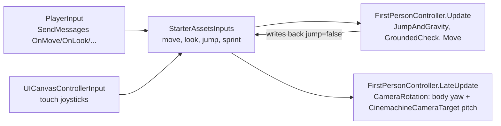
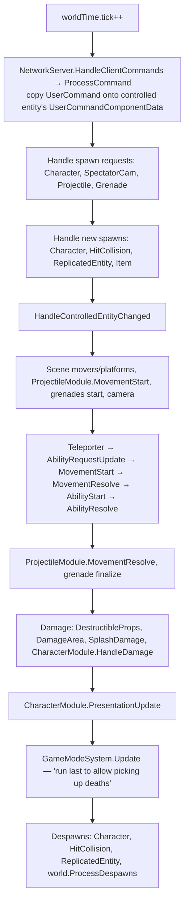

# Research: Unity FPS Microgame, Starter Assets FPC, and the 2018 FPS Sample

> Scope: three Unity FPS references built on GameObjects/MonoBehaviours, compared against
> `docs/architecture.md` (P1–P10, §3–§12). All type names below come from the source files linked
> in [Sources](#sources). Where we could not confirm something from source, we say so.

## 1. Overview

| | **FPS Microgame** ("FPS Template") | **Starter Assets – First Person** | **FPS Sample** (`Unity-Technologies/FPSSample`) |
|---|---|---|---|
| What it is | A finished, single-player, objective-based FPS for beginners on Unity Learn. Ships with enemies (hover bots, turrets), pickups, jetpack, objectives and a HUD | A small first-person character controller: move, look, jump, sprint. Built on Input System + Cinemachine | A full multiplayer arena shooter (Deathmatch, Assault), HDRP, a dedicated server, and its own netcode |
| Era / version | Unity Learn template. The current course targets 2022.3. The source we read is the 2.x-era, namespaced code (`Unity.FPS.Game`, `Unity.FPS.Gameplay`, `Unity.FPS.AI`, `Unity.FPS.UI`) | Released June 2021 for 2020.3 LTS+ (blog post). Later bundled with Unity's multiplayer samples | Unity 2018.3.8f1. **Archived**, "no longer being actively maintained" |
| Architecture | Classic MonoBehaviours. Everything runs in `Update`. A static `EventManager` bus plus `UnityAction` callbacks | Two MonoBehaviours: `StarterAssetsInputs` (an intent struct) and `FirstPersonController` | "Hybrid ECS" (in the README's words, "ECS-pattern … in hybrid mode with a lot of regular components"). Systems are updated **by hand** from game loops, with client prediction, rollback and lag compensation |
| Networking | None | None (Unity's multiplayer samples later reuse it with Netcode for GameObjects) | Custom UDP transport, delta-compressed snapshots, predicted/interpolated components, server-side rewind |
| Source | Distributed through Unity Hub/Learn. We read a community mirror (`remarkablegames/unity-fps-microgame`) | Asset Store. Official copies are in `Unity-Technologies/com.unity.multiplayer.samples.bitesize` | GitHub (needs LFS), with a `Documentation/SourceCode.md` overview |

**Why these three matter to Krit:** the Microgame is the "everything a beginner expects" feature
checklist and a set of anti-patterns for networking. Starter Assets is the reference P1 cites. FPS
Sample is the closest thing in Unity history to Krit's goals: ECS-shaped, fixed tick, predicted,
lag-compensated, with presentation split from simulation.

---

## 2. Structure

### 2.1 FPS Microgame layout

```
Assets/FPS/Scripts/
  Game/            (Unity.FPS.Game)    Actor, Events, EventManager, GameConstants,
                                       Managers/{ActorsManager, AudioManager, EventManager, GameFlowManager, ObjectiveManager}
                                       Shared/{Health, Damageable, DamageArea, Destructable, Objective, ProjectileBase, WeaponController}
  Gameplay/        (Unity.FPS.Gameplay) PlayerCharacterController, Managers/{PlayerInputHandler, PlayerWeaponsManager},
                                       ProjectileStandard, Pickup + {Ammo,Health,Weapon,Jetpack}Pickup, Jetpack,
                                       OverheatBehavior, Objectives/{ObjectiveKillEnemies, ObjectivePickupItem, ObjectiveReachPoint}
  AI/              (Unity.FPS.AI)      EnemyController, EnemyMobile, EnemyTurret, DetectionModule, NavigationModule, EnemyManager, PatrolPath
  UI/              (Unity.FPS.UI)      CrosshairManager, FeedbackFlashHUD, WeaponHUDManager, AmmoCounter, ObjectiveHUDManager, Compass, …
```

The player is **one GameObject** carrying `PlayerInputHandler`, `PlayerCharacterController`
(wrapping Unity's `CharacterController`), `PlayerWeaponsManager`, `Health`, `Actor` and `Jetpack`.
The camera is a child, and its pitch is written by the controller. Weapons are prefab instances
parented to `WeaponParentSocket` under the camera.

```mermaid
flowchart LR
    IH[PlayerInputHandler<br/>reads legacy Input each frame] --> PCC[PlayerCharacterController.Update<br/>move + yaw + camera pitch]
    IH --> PWM[PlayerWeaponsManager.Update]
    PWM -->|HandleShootInputs down/held/up| WC[WeaponController.TryShoot]
    WC -->|Instantiate at WeaponMuzzle| PS[ProjectileStandard.Update<br/>SphereCastAll per frame]
    PS -->|OnHit| DMG[Damageable.InflictDamage<br/>×DamageMultiplier, self-dmg scale]
    PS -->|AreaOfDamage| DA[DamageArea.InflictDamageInArea<br/>OverlapSphere, dedupe per Health]
    DA --> DMG
    DMG --> H[Health.TakeDamage<br/>OnDamaged / OnDie UnityActions]
    H -->|enemy OnDie| EM[EnemyManager.UnregisterEnemy] -->|EnemyKillEvent| OBJ[ObjectiveKillEnemies]
    OBJ -->|CompleteObjective| OM[ObjectiveManager] -->|AllObjectivesCompletedEvent| GFM[GameFlowManager.EndGame win]
    H -->|player OnDie| PDE[PlayerDeathEvent] --> GFM2[GameFlowManager.EndGame lose<br/>no respawn]
```



### 2.2 Starter Assets – First Person layout

```
StarterAssets/
  InputSystem/StarterAssetsInputs.cs           intent struct: move, look, jump, sprint (+ analogMovement, cursor flags)
  InputSystem/StarterAssets.inputactions       action map (Move, Look, Jump, Sprint)
  FirstPersonController/Scripts/FirstPersonController.cs
  Mobile/Scripts/CanvasInputs/UICanvasControllerInput.cs   virtual joystick → StarterAssetsInputs.MoveInput(...)
```



### 2.3 FPS Sample layout

```
Assets/Scripts/
  Game/Main/        Game, ClientGameLoop (ClientGameWorld), ServerGameLoop (ServerGameWorld), PreviewGameLoop, ThinClientGameLoop
  Game/Entity/      GameWorld (worldTime: GameTime{tick, tickRate, tickDuration}), SceneEntity
  Game/Modules/     Player/ (UserCommand, UserCommandComponentData, PlayerState, LocalPlayer)
                    Character/ (Character, CharacterPredictedData, CharacterInterpolatedData, CharacterReplicatedData,
                                CharacterMoveQuery, Behaviours/{AbilityCollection, CharBehaviour, AbilityControl,
                                Abilities/Ability_{Movement,Sprint,AutoRifle,Chaingun,GrenadeLauncher,ProjectileLauncher,Melee,RocketJump,Emote}},
                                CharBehavior_Dead, UI/{HUDCrosshair, CharacterHealthUI, IngameHUD})
                    HitCollision/ (HitCollisionHistory, HitCollisionData, HitCollisionOwnerData, RaySphereQueryReciever, SplashDamageSystem)
                    Projectile/ (ProjectileRequest, ProjectileData, ClientProjectile, Projectile systems Server/Client/Shared)
                    ReplicatedEntity/ (IReplicatedComponent, IPredictedComponent<T>, IInterpolatedComponent<T>, ReplicatedEntityFactory)
                    Presentation/ (PresentationEntity, PresentationOwnerData), Item/, Effect/ (HitscanEffect, SpatialEffect), Grenade/, Ragdoll/, SpectatorCam/
  Game/Systems/     Damage/ (DamageEvent, HealthStateData, DamageHistoryData), DamageArea/, GameMode/ (IGameMode,
                    GameModeSystemServer, GameModeDeathmatch, GameModeAssault, SpawnPoint, CapturePoint, TeamBase),
                    InputSystem, PlayerCamera/, Teleporter/, Movable/, Chat/
  Networking/       NetworkServer/Client, DeltaReader/Writer, NetworkPrediction, Compression/ (Huffman), SequenceBuffer
  Utils/            TickEventHandler, TickStateDenseBuffer, SparseTickBuffer, Primitives/ (capsule/sphere/box/ray)
```

`Documentation/SourceCode.md` describes the organisation. Game loops "handle initialization and
shutdown of required systems along with updating systems in the correct order". **Modules** group
components with their systems and may have separate server, client and preview variants. All
systems are updated by hand ("required when systems needed to be updated multiple times per frame
(as in client side prediction)").

**Server tick order** (`ServerGameWorld.ServerTickUpdate`, verbatim phase order):



**Fire → death → respawn data flow:**

```mermaid
flowchart LR
    IN[InputSystem.AccumulateInput<br/>per frame into UserCommand] -->|per tick, + last N redundant| SV[Server ProcessCommand]
    SV --> UC[UserCommandComponentData on Character]
    UC --> RA[AutoRifle_RequestActive<br/>AbilityControl.RequestActive]
    RA --> ARB[DefaultBehaviourController_Update<br/>canRunWith / canInterrupt bitmasks]
    ARB --> UP[AutoRifle_Update: PredictedState phase machine<br/>ammo, COF; RegisterQuery]
    UP -->|"Query: origin=eye, dir, radius, mask, hitCollisionTestTick=command.renderTick"| RQ[RaySphereQueryReciever<br/>env raycast batch, then rewound hit-collision sphere cast]
    RQ --> HQ[AutoRifle_HandleCollisionQuery<br/>InterpolatedState.fireTick/fireEndPos/impactType]
    HQ -->|DamageEvent.AddEvent to target buffer| DB[DynamicBuffer DamageEvent on HitCollisionOwner]
    DB --> HD[HandleDamage: HealthStateData.ApplyDamage<br/>deathTick, killedBy; DamageHistoryData on instigator; ragdoll]
    HD --> GMS[GameModeSystemServer: deathTick == tick → kill msg + IGameMode.OnPlayerKilled]
    GMS -->|after respawndelay| DESP[CharacterDespawnRequest; PlayerState.controlledEntity = Null]
    DESP -->|next tick: controlledEntity Null| SPAWN[GetRandomSpawnTransform → OnPlayerRespawn → CharacterSpawnRequest]
    HQ -.replicated.-> FX[Client TerraformerWeaponA: TickEventHandler on fireTick → HitscanEffect/SpatialEffect]
    HD -.replicated DamageHistoryData.-> HM[Client CharacterUISystems: inflictedDamage.tick > last → ShowHitMarker lethal]
```



---

## 3. Subsystem deep-dives

### 3.1 Input

**Microgame: `PlayerInputHandler`.** This is a device facade, not an intent struct. Its getters
read legacy `UnityEngine.Input` on demand: `GetMoveInput()`, `GetLookInputsHorizontal/Vertical()`,
`GetFireInputDown/Held/Released()`, `GetAimInputHeld()`, `GetSprintInputHeld()`,
`GetCrouchInputDown/Released()`, `GetReloadButtonDown()`, `GetSwitchWeaponInput()` and
`GetSelectWeaponInput()`. It handles mouse/gamepad scaling (mouse `×0.01`, stick `×Time.deltaTime`),
inversion and sensitivity. `CanProcessInput()` gates on cursor lock and
`GameFlowManager.GameIsEnding`, which is a simple "action gate". Fire-released is computed from
`m_FireInputWasHeld`, which is cached in `LateUpdate`. Consumers call these getters directly
**during their own `Update`**, so there is no single point in time where input is sampled.

**Starter Assets: `StarterAssetsInputs`.** This is a real intent struct, and it is what P1 cites.
It holds public fields `Vector2 move`, `Vector2 look`, `bool jump`, `bool sprint`, plus
`analogMovement`, `cursorLocked` and `cursorInputForLook`. Writers:
- `PlayerInput` in SendMessages mode, which calls `OnMove`/`OnLook`/`OnJump`/`OnSprint`;
- `UICanvasControllerInput`, the mobile joysticks and touch zones, which calls
  `MoveInput`/`LookInput`/`JumpInput`/`SprintInput`.

Two writers driving one controller show that the seam works. Its weaknesses are listed in §6.1.

**FPS Sample: `UserCommand`.** This is the network command and the closest match to
Krit's `CharacterIntent`.

```csharp
public struct UserCommand : IReplicatedComponent {
    public enum Button : uint { None, Jump, Boost, PrimaryFire, SecondaryFire, Reload, Melee, Use, Ability1, Ability2, Ability3 }
    public int checkTick; public int renderTick;          // renderTick = client's interpolation tick → lag-comp rewind target
    public float moveYaw; public float moveMagnitude;     // polar move, quantized on the wire
    public float lookYaw; public float lookPitch;          // ABSOLUTE angles, not deltas
    public ButtonBitField buttons;                         // held bits only; no edges
    public CharacterEmote emote;
}
```

- `InputSystem.AccumulateInput(ref UserCommand, dt)` runs every frame:
  - Buttons are **OR-accumulated**, so a tap shorter than a tick is still seen.
  - Move keeps the **max-magnitude sample** across the frames of a tick.
  - Look is **integrated into absolute `lookYaw`/`lookPitch`**, with yaw wrapped to 360 and pitch
    clamped to 0..180.
- `ClearInput` resets buttons when a new predicted tick starts (`ClientGameLoop.HandleTime` →
  `m_PlayerModule.ResetInput`).
- `UserCommandComponentData` sits on the controlled Character. It holds the current `command` plus
  `ResetCommand(tick, lookYaw, lookPitch)`. The **server uses this to force the client's look
  angles**, for example on spawn or teleport, and it is replicated.
- The client stores commands in `LocalPlayer.commandBuffer`
  (`TickStateDenseBuffer<UserCommand>`) and resends older ones. The talk write-up describes this as
  "sends the past 3 input commands alongside the current one".

### 3.2 Movement / character

- **Microgame `PlayerCharacterController`.**
  - Wraps Unity `CharacterController.Move` and runs in `Update` with `Time.deltaTime`.
  - Ground check is a `Physics.CapsuleCast`. It has slope reorientation
    (`GetDirectionReorientedOnSlope`), crouch with an overlap test before standing, sprint
    (`SprintSpeedModifier`), air acceleration, and a jump grace window
    (`k_JumpGroundingPreventionTime`).
  - **Fall damage** (`RecievesFallDamage`, `Min/MaxSpeedForFallDamage`) and **kill height**
    (`KillHeight` → `Health.Kill()`) live inside the controller, next to `AudioSource.PlayOneShot`.
  - `RotationMultiplier` reads `PlayerWeaponsManager.IsAiming`, so the controller depends on
    weapons.
  - `Jetpack` is a separate component that adds vertical acceleration and uses a fuel ratio.
- **Starter Assets `FirstPersonController`.**
  - Runs in `Update` with `Time.deltaTime`, using `CharacterController.Move`.
  - Speed lerps toward `MoveSpeed`/`SprintSpeed` scaled by `SpeedChangeRate`.
  - Has `JumpHeight`, `Gravity`, `JumpTimeout`, `FallTimeout`, and a `GroundedCheck` done with
    `Physics.CheckSphere`.
  - Has no crouch and no slope handling beyond what `CharacterController` gives.
- **FPS Sample `Ability_Movement`.**
  - Movement is an *ability* that is always active.
  - `Movement_Update` computes velocity from `UserCommand` (`lookYaw + moveYaw`, `moveMagnitude`)
    with `gameTime.tickDuration`, handles a double jump (`jumpCount < 2`), and writes
    `CharacterMoveQuery.moveQueryStart/End`.
  - `HandleMovementQueries` then resolves all queries through a proxy GameObject's
    `CharacterController`.
  - `Movement_HandleCollision` reads `moveQueryResult` back into `CharacterPredictedData.position`
    and `velocity`.
  - This **deferred query** pattern (start → resolve → read) is how they batch physics and stay
    separate from it, which is P9 in spirit.
  - State lives in `CharacterPredictedData`: `position`, `velocity`, `locoState` (Stand,
    GroundMove, Jump, DoubleJump, InAir) with `locoStartTick`, `action` with `actionStartTick`,
    `jumpCount`, `sprinting`, `cameraProfile`, and `damageTick`/`damageDirection`/`damageImpulse`.

### 3.3 Camera

- **Microgame.** The controller writes `PlayerCamera.transform.localEulerAngles` (pitch) and rotates
  the body (yaw). It also smooths camera height on crouch. `PlayerWeaponsManager` owns the FOV
  (`DefaultFov`, `AimZoomRatio` lerp) and a second `WeaponCamera` with `WeaponFovMultiplier`.
- **Starter Assets.** `CameraRotation` in `LateUpdate` keeps `_cinemachineTargetPitch` and writes it
  to `CinemachineCameraTarget.transform.localRotation`, a child of the character. Yaw is applied to
  the body. Aim state is "camera-target pitch + body yaw". Neither is a sim component.
- **FPS Sample.** Look angles live in `UserCommand`, and the Character's eye is
  `position + up*eyeHeight`. Shots use `command.lookDir`. The camera is presentation:
  `PlayerCameraSystem`, `CameraProfile { FirstPerson, Shoulder, ThirdPerson }` held in predicted
  data, and an `AnimGraph_CameraNoise`. First-person and third-person characters are **different
  prefabs**: `Character1P` for the local first-person view, and `Character` for the server and for
  third-person clients.

### 3.4 Inventory / equipment

- **Microgame `PlayerWeaponsManager`.**
  - `m_WeaponSlots[9]`; `AddWeapon(prefab)` dedupes by `SourcePrefab` and instantiates under
    `WeaponParentSocket` on `FpsWeaponLayer`.
  - `RemoveWeapon`, `SwitchWeapon(ascending)`, `SwitchToWeaponIndex(i, force)`.
  - `WeaponSwitchState { Up, Down, PutDownPrevious, PutUpNew }` with `WeaponSwitchDelay`.
  - Events: `OnSwitchedToWeapon`, `OnAddedWeapon`, `OnRemovedWeapon`.
  - On death it calls `SwitchToWeaponIndex(-1, true)` to lower the weapon.
  - Ammo is **per weapon** (`m_CurrentAmmo`, `m_CarriedPhysicalBullets`). There is no shared ammo
    pool.
- **FPS Sample.** There is no inventory. A `HeroTypeAsset` decides the character type, abilities and
  items. Weapons are **abilities** inside an `AbilityCollection` entity (a `ReplicatedEntityFactory`).
  "Items" (`ItemTypeDefinition`, `TerraformerWeaponA`, `RobotWeaponA`) are **client-side visuals
  only**. SourceCode.md: "When items are updated they read the state of the relevant abilities and
  use those to trigger the associated effects."

### 3.5 Weapons / firing

- **Microgame `WeaponController`.**
  - `WeaponShootType { Manual, Automatic, Charge }`.
  - Firing parameters: `DelayBetweenShots`, `BulletSpreadAngle`, `BulletsPerShot`, `RecoilForce`
    (view-model kick only), `AimZoomRatio`, `AimOffset`.
  - Ammo modes: `AutomaticReload` regenerates ammo (`AmmoReloadRate`, `AmmoReloadDelay`), while
    `HasPhysicalBullets` uses a clip (`ClipSize`, carried bullets, `ShellCasing` pool).
  - Charge settings: `MaxChargeDuration`, `AmmoUsedOnStartCharge`, `AmmoUsageRateWhileCharging`,
    `AutomaticReleaseOnCharged`.
  - `HandleShootInputs(down, held, up)` → `TryShoot` checks `m_LastTimeShot + DelayBetweenShots <
    Time.time`, so it fires **at most one shot per frame**, and the leftover time is lost.
  - `HandleShoot` instantiates `ProjectilePrefab` per bullet **at `WeaponMuzzle`**, in the direction
    `Vector3.Slerp(muzzle.forward, Random.insideUnitSphere, spread/180)`. It also does the muzzle
    flash, SFX and animator trigger in the same method.
  - `OverheatBehavior` handles heat visuals and sound. **AI uses the same weapon:**
    `EnemyController.TryAtack` calls `GetCurrentWeapon().HandleShootInputs(false, true, false)`.
- **FPS Sample `Ability_AutoRifle`** (the other weapons are shaped the same way).
  - `Settings : IComponentData`: `fireButton`, `reloadButton`, `damage`, `damageImpulse`,
    `roundsPerSecond`, `clipSize`, `reloadDuration`, `hitscanRadius`, `minCOF`, `maxCOF`,
    `shotCOFIncrease`, `COFDecreaseVel`.
  - `PredictedState`: `action` (Idle/Fire/Reload), `phaseStartTick`, `ammoInClip`, `COF`.
  - `InterpolatedState`: `fireTick`, `fireEndPos`, `impactType`, `impactNormal`, for remote
    cosmetics.
  - `InternalState`: `lastHitCheckTick`, `rayQueryId`.
  - Phase timing uses `worldTime.DurationSinceTick(phaseStartTick)`, so it is driven by data and
    ticks, not animation.
  - **Re-prediction guard:** `if (tick > internalState.lastHitCheckTick)`. The hit query is only
    registered the first time a tick is simulated.
  - **Spread RNG is not deterministic:** `UnityEngine.Random.Range` carries the comment
    `// TODO use tick as random seed so server and client calculates same angle for given tick`.
- **FPS Sample ability arbitration.**
  - Each ability entity has `CharBehaviour { character }` and
    `AbilityControl { behaviorState: Idle|RequestActive|Active|Cooldown, active, requestDeactivate }`.
  - `AbilityCollection.AbilityEntry { ability, canRunWith: u32, canInterrupt: u32 }` is built from
    `AbilitySetup { factory, canRunWith[], canInterruptAll, canInterrupt[] }`.
  - `DefaultBehaviourController_Update` deactivates abilities that have finished. It activates a
    requester if nothing it conflicts with is running. Otherwise it interrupts the conflicting
    ability (if allowed) or sends it a `requestDeactivate`.
  - SourceCode.md: the movement ability is always active, and only one other ability runs at a time
    (sprint, melee, shoot).

### 3.6 Hit detection

- **Microgame.**
  - All weapons fire projectiles. `ProjectileStandard.Update` moves the projectile by
    `m_Velocity * Time.deltaTime`, with optional gravity and inherited muzzle velocity.
  - It runs a `Physics.SphereCastAll` from the previous root position to the current tip.
  - `IsHitValid` skips `IgnoreHitDetection`, trigger colliders without a `Damageable`, and the
    owner's own colliders.
  - **Trajectory correction:** because the projectile spawns at the muzzle, it is nudged over
    `TrajectoryCorrectionDistance` until it lines up with the camera's centre ray. This is a
    workaround for not tracing from the eye.
- **FPS Sample.**
  - **Hit collision is separate from movement collision.** `HitCollisionHistory` (a MonoBehaviour)
    holds a separate collision-setup prefab of bone-attached capsules, spheres and boxes.
  - `HitCollisionData` stores per-entity ring buffers: `k_historyCount = 16` ticks,
    `k_maxColliderCount = 16` colliders, `TransformHistory`, and `BoundsHistory` (a broadphase
    sphere).
  - `StoreBones(..., sampleTick)` fills in every tick missed since the last sample.
    `GetHistoryIndex(tick)` **silently clamps to the latest sample** when the tick is outside the
    window.
  - `HitCollType { Undefined, Body, Head }` exists. In `Ability_AutoRifle`, damage does **not** read
    it; we did not find a headshot multiplier in the files we read.
  - `RaySphereQueryReciever` batches all queries registered this tick:
    1. one `RaycastCommand.ScheduleBatch` against the **environment** (Unity physics, not rewound),
       which shortens each query to the environment hit;
    2. a bounds broadphase at `hitCollisionTestTick`;
    3. a narrowphase on the rewound primitives. This uses their own `Primitives` / `CollisionLib`,
       not PhysX.
  - Team filtering uses `HitCollisionOwnerData.colliderFlags = 1 << teamId` and the query's
    `mask = ~(1 << character.teamId)`, so **friendly fire is excluded at the query level**.
  - Lag compensation target: the Query carries `hitCollisionTestTick = command.renderTick`, which is
    the tick the client was *rendering*. The talk write-up describes this as rewinding by "RTT +
    player's interpolation time".
- **FPS Sample projectiles.**
  - `ProjectileRequest { projectileAssetGuid, startTick, startPosition, endPosition, owner, teamId,
    collisionTestTickDelay }`. The delay is `time.tick - command.renderTick`, set in
    `Ability_ProjectileLauncher`, so **projectiles are lag-compensated for their whole flight**.
  - `ProjectileData` is replicated and carries start and end points. It is a straight-line,
    deterministic path.
  - Clients create **predicted** projectiles plus a `ClientProjectile` visual. `HandleProjectileSpawn`
    matches incoming server projectiles to predicted ones. `RemoveMispredictedProjectiles` deletes
    any that were not acknowledged in time.

### 3.7 Damage / health

- **Microgame.**
  - `Health { MaxHealth, CriticalHealthRatio, CurrentHealth, Invincible, OnDamaged(float,
    GameObject), OnHealed, OnDie }`, with `TakeDamage` (clamps and reports *actual* damage),
    `Heal`, `Kill`, and a one-shot `HandleDeath`.
  - `Damageable { DamageMultiplier, SensibilityToSelfdamage }` sits on each collider and finds
    `Health` on itself or a parent. Its `InflictDamage(damage, isExplosionDamage, source)` **skips
    the multiplier for explosions** and scales self-damage.
  - `DamageArea.InflictDamageInArea` runs `OverlapSphere`, **dedupes per `Health`**, and applies
    distance falloff from a curve. It has no occlusion test.
  - Attribution is just a `GameObject damageSource`. There are no damage types and no team check in
    the damage path. `Actor.Affiliation` is used only by AI detection.
- **FPS Sample.**
  - `DamageEvent : IBufferElementData { instigator, damage, direction, impulse }` is a
    `DynamicBuffer` on each `HitCollisionOwner`, with `InternalBufferCapacity(16)`. **When full, it
    logs and drops the damage** (the TODO says "merging smallest").
  - `HandleDamage` (server only) drains each buffer.
  - `HealthStateData { health, maxHealth, deathTick, killedBy }` is **tick-stamped death state**
    rather than an event.
  - `DamageHistoryData.inflictedDamage { tick, lethal }` sits on the *instigator* and is replicated,
    so the shooter's client can show hitmarkers.
  - `CharacterPredictedData.damageTick/damageDirection/damageImpulse` drives hit reactions.
  - On death, `RagdollStateData.ragdollActive = 1` and `collisionEnabled = 0`.
  - `CharBehavior_Dead` is an ability that takes over the character when it dies.
  - `SplashDamageSystem` handles area damage against the hit-collision history. `DamageArea` (a
    level volume) and `DestructibleProp` read the same buffer.

### 3.8 Interaction / pickups

- **Microgame.** `Pickup.OnTriggerEnter` → `OnPicked(PlayerCharacterController)`, with subclasses
  `WeaponPickup`, `AmmoPickup`, `HealthPickup` and `JetpackPickup`. Afterwards it broadcasts
  `PickupEvent` **whether or not the subclass consumed the pickup**. There is no "use" key or
  hold-to-interact.
- **Starter Assets.** None.
- **FPS Sample.** `UserCommand.Button.Use` exists. Capture points in Assault are presence-based
  volumes (`CapturePoint`, `TeamBase`). Teleporters are server/client systems. There is no generic
  interactable.

### 3.9 Match / objectives / spawns

- **Microgame.**
  - `Objective` (abstract) has `Title`, `Description`, `IsOptional`, `DelayVisible`, `IsCompleted`,
    `IsBlocking()`, and static events `OnObjectiveCreated` / `OnObjectiveCompleted`.
  - `ObjectiveManager` polls `IsBlocking()` and broadcasts `AllObjectivesCompletedEvent`.
  - `GameFlowManager` ends the game on `AllObjectivesCompletedEvent` (win) or `PlayerDeathEvent`
    (lose), then loads `WinScene`/`LoseScene`. **There is no respawn.**
  - `EnemyManager.UnregisterEnemy` broadcasts `EnemyKillEvent { Enemy, RemainingEnemyCount }`. A
    kill is defined as "unregistered", with no killer attribution.
- **FPS Sample.**
  - `IGameMode { Initialize, Shutdown, Restart, Update, OnPlayerJoin, OnPlayerRespawn(player, ref
    pos, ref rot), OnPlayerKilled(victim, killer) }`, with `NullGameMode`, `GameModeDeathmatch` and
    `GameModeAssault`. The mode is chosen with a `switch` on a config-var string.
  - `GameModeSystemServer` owns teams, `AssignTeam`, a game timer, the respawn delay
    (`game.respawndelay` config var, 10 s default), and per-team round-robin `SpawnPoint` selection.
    It also posts chat kill messages.
  - **Death detection is polling:** `healthState.health == 0 && deathTick == worldTime.tick`.
    Respawn means despawning the Character after the delay and setting
    `PlayerState.controlledEntity = Null`. The next update then sees the null and issues a
    `CharacterSpawnRequest`.
  - `PlayerState` holds `playerId`, `playerName`, `teamIndex`, `score` and `controlledEntity`. It is
    replicated. **Owner-only** fields (scoreboard/goal display, `goalString`, `goalCompletion`) sit
    in a `NetworkWriter.FieldSectionType.OnlyPredicting` section.
  - Deathmatch `OnPlayerKilled`: `killer.score++` and the team score goes up **only if the teams
    differ**.

### 3.10 UI / feedback

- **Microgame.** Each HUD script subscribes to sim callbacks or reads sim properties:
  - `FeedbackFlashHUD` uses `Health.OnDamaged` / `OnHealed` and critical-health vignettes;
  - `CrosshairManager` uses `IsPointingAtEnemy`, which is computed by a raycast in
    `PlayerWeaponsManager`;
  - `WeaponHUDManager`/`AmmoCounter` use `OnAddedWeapon` and `CurrentAmmoRatio`;
  - `ObjectiveHUDManager` uses `ObjectiveUpdateEvent`;
  - `NotificationHUDManager` uses `PickupEvent`;
  - `DisplayMessageManager` uses `DisplayMessageEvent`;
  - `Compass` and `WorldspaceHealthBar` are also driven this way.
- **FPS Sample.**
  - Presentation reads replicated state and uses **`TickEventHandler`** to detect edges:
    `Update(time, startTick)` returns true once when a newer tick stamp arrives, *and only if it is
    younger than `expirationDuration`*. This keeps stale effects from playing after a hitch or a
    late join.
  - Hitmarkers come from `DamageHistoryData.inflictedDamage.tick > lastDamageInflictedTick`
    (`CharacterUISystems` → `HUDCrosshair.ShowHitMarker(lethal)`).
  - The Effect module (`HitscanEffect`, `SpatialEffect`) is "fire and forget", pooled, and
    requested by creating request entities.

### 3.11 Networking (FPS Sample only)

- **Three component replication classes** (`ReplicatedComponent.cs`):
  - `IReplicatedComponent` is server → all and is not predicted (`HealthStateData`,
    `CharacterReplicatedData`, `ProjectileData`, `PlayerStateData`).
  - `IPredictedComponent<T>` is sent to the predicting (owning) client, rolled back and re-simulated.
    In the editor, `VerifyPrediction(ref T)` checks the result (`CharacterPredictedData`,
    `AbilityControl`, `Ability_AutoRifle.PredictedState`).
  - `IInterpolatedComponent<T>` is sent to everyone else and interpolated:
    `Interpolate(ref ctx, ref first, ref last, t)` (`CharacterInterpolatedData`,
    `Ability_AutoRifle.InterpolatedState`).
- **The `ServerEntity` marker** means "simulate this here": on the server, or on the client for
  predicted entities. Sim systems require it (`ExtraComponentRequirements = { typeof(ServerEntity) }`).
- **The client loop (`ClientGameWorld.Update`)** runs each frame:
  1. interpolate remote entities at `m_RenderTime`;
  2. **roll back** all predicted entities to the last server tick (`ReplicatedEntityModule.Rollback`);
  3. **replay** full ticks from `serverTime+1` up to `predictedTick-1` with the stored commands;
  4. **simulate the current partial tick** with a fractional `tickDuration`, skipped if it is
     under 8 ms.

  `PredictionUpdate()` is exactly the server's ability and movement subset: `AbilityRequestUpdate`
  → `MovementStart/Resolve` → `AbilityStart/Resolve`. Damage and game mode are never predicted.
- **Time control.** The client nudges `frameTimeScale` to 1.01 or 0.99 to keep its command buffer at
  `preferredBufferedCommandCount`. It hard-resets prediction time when drift goes outside
  −3/+6 ticks, and render time when it falls more than 10 ticks behind.
- **Snapshots.** Delta-compressed against a prediction from previous snapshots, then Huffman-coded
  (`NetworkCompressionModel`). The talk covers this in detail.

---

## 4. Mapping to the Krit plan

| Their concept | Krit crate / type / principle | Verdict |
|---|---|---|
| `StarterAssetsInputs {move, look, jump, sprint}` | `krit_core::CharacterIntent` (P1, §6.1) | **Agreement** in shape. Their struct is frame-rate, mutable and not tick-stamped |
| `UICanvasControllerInput` writes the same struct | "players, AI bots, replays … drive the same code" (P1) | **Agreement**. Two writers prove the seam |
| `FirstPersonController` reads `PlayerInput.currentControlScheme` | P1 "never reads devices" | **Divergence** (theirs leaks devices; Krit is right) |
| `PlayerInputHandler` getters called inside `Update` | `krit_input` writes intent once per tick | **Divergence** (Krit is right) |
| `UserCommand` (absolute `lookYaw/lookPitch`) | `CharacterIntent.look_delta` | **Divergence**. FPS Sample's choice is better for networking; see §6.2 |
| `UserCommand.renderTick` | none | **Gap**. The lag-comp rewind target has no home in the intent or `ShotRequest` |
| `UserCommandComponentData.ResetCommand(tick, yaw, pitch)` | none | **Gap**. The server needs a way to force aim (spawn, teleport) |
| Buttons OR-accumulated per tick, held bits only | `Buttons` + `pressed`/`released` edges | **Partial divergence**. Edges should be derived in sim; see §6.3 |
| `InputSystem.AccumulateInput` max-magnitude move | §7.3 "sum look deltas, keep edges" | **Agreement** with the §7 fixes, plus one more rule for the move axis |
| `PlayerState` (team, score, `controlledEntity`) / Character | P5 `Player` / `Character`, `Controls` ↔ `ControlledBy` | **Agreement** |
| `PlayerCharacterControlSystem` copies team onto character and hit-collision flags | `Team` on Player, `TeamRelations` | **Agreement**. Krit should state who propagates team to the Character |
| `CharacterPredictedData` (position, velocity, locoState, action) | `KinematicState`, `MovementState` | **Agreement** |
| `Ability_Movement` + `CharacterMoveQuery` deferred physics | `krit_movement` pure `step` + `CollisionQuery` (P9) | **Agreement** in intent. Krit's synchronous query trait is simpler |
| Look stored in command; eye = `position + up*eyeHeight` | P4 `ViewAngles` + `EyeHeight` on Character | **Agreement** |
| Microgame and Starter Assets write pitch to camera / camera target | P4, §7.4 | **Divergence** (Krit is right) |
| `AbilityCollection` / `AbilityControl` / `canRunWith` / `canInterrupt` | `ActionGates` (core), equipment switch state | **Partial**. Gates block; FPS Sample also **arbitrates and interrupts**. Worth borrowing; see §7 |
| Weapons as abilities on the character | P6, weapon entities with `ItemIntent` (§5.6–5.7) | **Divergence**. Krit is better for multi-item games, and both use entities |
| `Ability_AutoRifle.Settings` (immutable) / `PredictedState` / `InterpolatedState` / `InternalState` | §8 "state vs derived", `WeaponStats` vs `Magazine` | **Agreement**. FPS Sample adds the *interpolated* category |
| `phaseStartTick` + `DurationSinceTick` | `WeaponState`, `ReloadSpec` timings from data (§8) | **Agreement** |
| `lastHitCheckTick` re-prediction guard | §8 "no side effects" | **Gap**. Krit needs a "first time this tick is simulated" signal |
| `UnityEngine.Random` spread (with TODO) | `SimRng::for_shot` | **Krit is right**. Their TODO confirms the problem |
| Microgame `TryShoot` one shot per frame | `FireRate` sub-tick accumulator | **Krit is right** |
| Microgame projectile from muzzle + trajectory correction | §5.13 "shots trace from the eye" | **Krit is right** |
| `RaySphereQueryReciever` register → batch resolve | `ShotRequest` → `HitResult` (P3) | **Agreement**. Both are deferred, batchable stages |
| Env raycast first, then hurtboxes up to env distance | `krit_ballistics` hitscan | **Agreement**. Krit should copy the ordering explicitly |
| `HitCollisionHistory` 16-tick ring of bone primitives | `krit_net` history + `RewindProvider` (§5.8, §5.16) | **Agreement** |
| `GetHistoryIndex` silently clamps out-of-window ticks | none | **Pitfall** for `RewindProvider` to specify |
| Separate hit-collision prefab vs movement capsule | `Hurtbox` on its own layer (§6.3) | **Agreement** |
| `HitCollType {Body, Head}` | `HitZone`, `Hurtbox.multiplier` | **Agreement** |
| Microgame `Damageable.DamageMultiplier` per collider | `Hurtbox { zone, multiplier }` | **Agreement** |
| Explosion skips crit multiplier (`isExplosionDamage`) | `DamageFlags::EXPLOSIVE` | **Gap** in wording. State that zone multipliers don't apply to AoE |
| `DamageArea` dedupe per `Health` | `Explosions` plugin | **Gap**. Dedupe by `Hurtbox.owner` |
| `SensibilityToSelfdamage` | `DamageFlags::SELF` | **Gap**. Add a self-damage scale to the resistance/policy stage |
| Team mask on hit query (friendly fire at query level) | `FriendlyFirePolicy` in the damage `Policy` stage | **Divergence**. Krit's approach is better: hits still register (for feedback and penetration); only damage is gated |
| `DamageEvent` per-target `DynamicBuffer` (cap 16, drops) | `DamageRequest` `Message` | **Divergence**. Krit is better (no drops, richer payload) |
| `HealthStateData.deathTick`, `killedBy` | `LifeState`, `Died` event | **Partial**. Krit is event-first; FPS Sample's tick-stamped state survives replication. Do both |
| `DamageHistoryData.inflictedDamage{tick,lethal}` on instigator | `HitConfirmed` | **Partial**. Krit needs a replicated state form for remote clients |
| Microgame `Health.OnDamaged(trueDamage)` after clamp | `DamageApplied.to_health` | **Agreement**. Specify that the value is post-clamp |
| `Health.Invincible` | `Invulnerable { until }` | **Agreement** |
| Microgame `KillHeight` → `Health.Kill()` | none | **Gap** (out-of-world kill) |
| Microgame fall damage inside controller + SFX | `FallDamage` plugin → `DamageRequest(Fall)` | **Krit is right** |
| `IGameMode` hooks (`OnPlayerJoin/Respawn/Killed`) | P8 policies, `krit_modes` plugins, `SpawnSelector` | **Agreement** in spirit. Krit is more ECS-native |
| Respawn = despawn after delay, then spawn when `controlledEntity` is null | `RespawnPolicy::Timer`, `SpawnCharacter` (§5.11) | **Agreement** |
| Round-robin team `SpawnPoint` | `SpawnSelector` trait | **Agreement** |
| GameMode runs last "to pick up deaths" | `KritSimSystems::Rules` after `Damage` | **Agreement** |
| Spawn requests handled first, despawns last | `KritSimSystems::Lifecycle` (single, last) | **Gap**. A spawn stage at the *start* of a tick is missing |
| Movers/platforms move before characters | none | **Gap** (a moving-platform stage) |
| `PlayerState` owner-only field section | `krit_net` (later) | **Gap** / note. Some read models are owner-only |
| Replicated / Predicted / Interpolated interfaces | §8 + `krit_net` registration | **Gap**. Classify components now |
| `ServerEntity` marker = "simulate here" | `krit_net` prediction config | **Agreement**. lightyear provides this (`Predicted`) |
| Fractional current-tick prediction | fixed tick + view interpolation (P2) | **Divergence**. Krit is right for determinism |
| `TickEventHandler` (tick-stamp edge + expiry) | `WeaponFired.shot_count_total`, `PlayCue` | **Agreement**, plus an idea: add expiry |
| `InterpolatedState.fireTick` (last fire tick) | cumulative `shot_count_total` | **Krit is better**. A single tick stamp loses multiple shots between snapshots |
| Items = client-only visuals reading ability state | `krit_viewmodel` reads sim | **Agreement** (P2) |
| `Character1P` vs `Character` prefabs | `krit_viewmodel` + `CameraMode` | **Agreement** |
| Microgame static `EventManager` with reused mutable event singletons | Bevy `Message`/`EntityEvent` | **Krit is right** |
| `Actor { Affiliation, AimPoint }` + `ActorsManager` | `Team`; no aim point | **Gap**. AI/aim-assist need a targetable point |
| Microgame `Objective` (`IsOptional`, `IsBlocking`) + `ObjectiveManager` | `krit_modes` (Survival/Waves) | **Gap** for single-player campaigns |
| Microgame `AutomaticReload` (regenerating ammo), `OverheatBehavior`, `Jetpack` fuel | `AmmoSource`, `Stamina` | **Gap**: `AmmoSource::Regen`, heat, generic resource pools |
| `WeaponSwitchState {Up, Down, PutDownPrevious, PutUpNew}` | equipment `Holstering → Equipping` | **Agreement** |
| AI calls `WeaponController.HandleShootInputs(false,true,false)` | AI writes `CharacterIntent`/`ItemIntent` | **Agreement** with P1. Microgame bypasses the player input path to do it |
| Manual system update order per game loop | P10 public `SystemSet`s, `KritSimSystems` chain | **Agreement** (both make order explicit) |

---

## 5. Where it agrees with the plan

1. **P1, intent as the only input.** Starter Assets has the cleanest *shape*: `StarterAssetsInputs`
   is written by `PlayerInput` or by `UICanvasControllerInput`, and the controller reads only the
   struct. FPS Sample's `UserCommand` makes this a *network contract*:
   - the server copies it onto the controlled Character's `UserCommandComponentData` in
     `ProcessCommand`;
   - client prediction replays stored commands from `LocalPlayer.commandBuffer`;
   - all ability systems read only `UserCommandComponentData.command`.

   This is exactly §6.1. **Recommendation:** add FPS Sample `UserCommand` to P1's "Origin" column.
   It is a stronger citation than Starter Assets (see §6.1 for why Starter Assets is only
   partially valid).
2. **P2, sim/presentation split.** FPS Sample:
   - has separate server and client prefabs per replicated entity (`ReplicatedEntityRegistry`);
   - attaches presentation through `PresentationOwnerData` / `PresentationEntity`;
   - makes Items visual-only, reading ability state;
   - keeps a fire-and-forget Effect module;
   - runs `ServerTickUpdate`, where the server never touches cameras or VFX except
     `PresentationUpdate`, which only sets anim state.

   This matches §5.12–5.14 and §8 "no side effects".
3. **P3, intent down, facts up.** `UserCommand` → `AbilityControl` → `RaySphereQueryReciever.Query`
   → `QueryResult` → `DamageEvent` → `HealthStateData.deathTick` → `IGameMode.OnPlayerKilled`. It is
   the same five-stage pipeline with the same seams. Their query receiver is the `ShotRequest`/
   `HitResult` boundary in disguise: it registers in `AbilityStart` and resolves in
   `AbilityResolve`, batched as jobs.
4. **P4, aim on the character.** In FPS Sample, look angles are part of the command and the shot
   origin is `charPredictedState.position + up*eyeHeight`, never the camera or muzzle. The camera is
   a presentation system with `CameraProfile`.
5. **P5, Player ≠ Character.** `PlayerState.controlledEntity` in FPS Sample is
   `Controls(Entity)`. Score and team survive Character despawn. Respawn is "Character gone →
   spawn a new one". Character type switching (`PlayerCharacterControl.requestedCharacterType`)
   despawns and respawns the body while the Player stays.
6. **P6, composition.** FPS Sample abilities are entities built by `CharBehaviorFactory`
   ScriptableObjects. Each gets a component *set* (`Settings`, `PredictedState`, `InterpolatedState`,
   `InternalState`), and **systems select by component**. For example, `AutoRifle_Update` runs over
   `CharBehaviour + AbilityControl + Ability_AutoRifle.PredictedState + Settings`. This is
   DOTS-style marker selection, as P6 describes.
7. **P8, rules as policy.** `IGameMode` is a hook interface, and the damage, ability and movement
   code contains no mode checks. Krit's resource and plugin approach is the ECS version of the same
   idea.
8. **P9, physics behind a query.** In FPS Sample, movement uses a deferred `CharacterMoveQuery`, and
   hit detection uses its own primitive library against stored history (no physics engine). Only
   the environment raycast uses Unity physics. This supports §5.15's backend split and suggests
   `krit_ballistics` hurtbox tests can be pure math, so they don't need `SpatialQueryBackend` (see §7).
9. **§8 determinism rules.**
   - Sim state lives in components (`PredictedState` holds ammo, phase and COF).
   - Timings are data (`reloadDuration`, `roundsPerSecond`), not animation events.
   - Everything is tick-stamped (`phaseStartTick`, `locoStartTick`, `deathTick`, `damageTick`).
10. **§5.6 equipment switch.** Microgame's `WeaponSwitchState` four-state machine with
    `WeaponSwitchDelay` is the same as `Holstering → Equipping`.
11. **§5.9 hurtbox multiplier.** Microgame's per-collider `Damageable.DamageMultiplier`, which finds
    `Health` in a parent, is `Hurtbox { owner, multiplier }`.

## 6. Where it runs counter, and who has the better argument

### 6.1 Starter Assets is only a partial example of P1
- `FirstPersonController.IsCurrentDeviceMouse` reads `PlayerInput.currentControlScheme` to decide
  whether to scale look by `Time.deltaTime`. **The simulation reads the device.**
- The controller **writes back to the intent** (`_input.jump = false` when airborne) to consume the
  jump. Here the intent is shared mutable state, not a per-tick input.
- `look` is overwritten by each `OnLook` message (last write wins). This is the same
  accumulate-vs-overwrite hazard as Krit §7.3.
- Everything runs in `Update`/`LateUpdate` with `Time.deltaTime`, so there is no tick.

**Verdict:** P1 is right to cite it for the *shape* and the "many writers" seam. Krit's rules are
stricter and correct:
- device-specific scaling happens in `krit_input` before the intent is written (§5.3);
- edges are explicit;
- the intent is never mutated by its consumers.

Reword the P1 citation to "Unity Starter Assets (shape), FPS Sample `UserCommand` (tick contract)".

### 6.2 Absolute look angles (FPS Sample) vs `look_delta` (Krit). FPS Sample is better here
FPS Sample puts the client's integrated **absolute** `lookYaw`/`lookPitch` into every command.
Advantages for Krit's networking goal:
- **Loss and redundancy tolerance.** If a command is lost or repeated, a delta would drop or double
  aim. An absolute angle is idempotent. FPS Sample resends old commands, and the server may reuse
  the last one. Both are only safe because look is absolute.
- **Replay and rollback** stay exact without integrating floats over N replays. The server cannot
  drift from the client.
- **Server override** is simple: `ResetCommand(tick, yaw, pitch)` forces the client's base angle for
  spawn, teleport or death cam.

The cost is that server-side aim effects (`AimRecoil`) must be kept as a *separate additive term*,
not folded into the client's base angles. CS works this way: view angles + aim punch. Krit already
separates `AimRecoil` (P4/§6.2), so this fits.

**Recommendation (§6.1):** `CharacterIntent` should carry `look: LookIntent` where the network form
is absolute (`base_yaw`, `base_pitch`). `krit_input` integrates sensitivity-scaled deltas into it.
`krit_movement`'s Aim stage computes `ViewAngles = clamp(base) + AimRecoil`. Keep `look_delta` only
as an optional local/bot convenience. Add `ViewAnglesOverride { tick, yaw, pitch }` in core, written
by lifecycle or teleporters and read by `krit_input` to re-base. This is FPS Sample's `ResetCommand`.

### 6.3 Button edges: transmit them, or derive them? FPS Sample's way is safer
FPS Sample sends **held bits only**, OR-accumulated over the tick's frames. Abilities compare the
current state against their own predicted state (for example, Idle → Fire if held). Krit's §6.1
puts `pressed`/`released` into the intent. Over a network, an edge in a lost command is gone for
good; held bits plus redundancy recover. With rollback, edges have to be recomputed consistently
anyway.

**Better:** the wire contract is `buttons` (held, OR-accumulated). `KritSimSystems::Intent` derives
`pressed`/`released` by comparing against a `PrevButtons` component, which is predicted state. A
sub-tick tap still registers because of the OR. Keep `pressed`/`released` as *derived* fields on
`CharacterIntent` so consumers don't change. This also fixes §7.2's "edges dropped on frames with
no tick" by construction.

### 6.4 Weapons as character abilities vs weapons as item entities. Krit is better for its goals
FPS Sample fixes each hero's weapon set (`HeroTypeAsset` → abilities). That works for a
hero shooter, but it can't express pickups, drops, inventories or a flashlight. Krit's
inventory → equipment → `ItemIntent` layering (§5.5–5.7) covers immersive sims and extraction
games. **However**, FPS Sample's *arbitration* is something Krit lacks. `canRunWith`/`canInterrupt`
bitmasks plus `RequestActive → Active` decide what happens when sprint, fire, reload and melee
compete, and which one wins. Krit's `ActionGates` can only *block*. See §7.4.

### 6.5 Friendly fire at the query level vs in the damage policy. Krit is better
FPS Sample masks teammates out of the ray (`mask = ~(1 << teamId)`), so a teammate is invisible to
bullets. That breaks penetration and blocking, and it means no "hit teammate" feedback. Krit puts
`FriendlyFirePolicy` in `DamagePipelineSystems::Policy` (§5.9), so hits still resolve but damage is
gated. That is more general. Hit-time *filters* can still be offered as an option
(`ShotRequest.filter`) for games that want pass-through teammates.

### 6.6 Damage buffer per target vs a global message queue. Krit is better
A `DynamicBuffer<DamageEvent>` with capacity 16 on each target is cache-friendly and has clear
ownership, but it **drops damage** when full (FPS Sample logs an error). Its payload also lacks a
type, zone, inflictor or weapon. Bevy `Message`s don't drop. Krit's `DamageRequest` carries the
Source-style instigator ≠ inflictor ≠ weapon split (§6.3).

### 6.7 Death as tick-stamped state (FPS Sample) vs `Died` event (Krit). Use both
FPS Sample never sends a "died" event. Game mode polls `deathTick == worldTime.tick`, and clients
see `health == 0` in replicated state. For networking, **state survives where events don't**: a
late joiner, a dropped snapshot, or a rollback that re-runs the tick. Krit's `Died` `EntityEvent`
is better for local, server-side reactions and observer ergonomics. **Recommendation:**
`LifeState::Dead { at_tick, killer, cause_type }` should be the replicated, authoritative fact.
`Died` is triggered once by damage on the server or authority, and presentation keys off the state
change. The same applies to `HitConfirmed` (see §7.6).

### 6.8 Fractional-tick prediction vs strict fixed tick. Krit is better
FPS Sample simulates the *current partial tick* with a fractional `tickDuration` every frame, so the
local player moves smoothly without view interpolation. It needs a "skip if < 8 ms" hack, and
predicted state is no longer a pure function of commands at whole ticks. That is why they only
store "full" ticks for verification. Krit's P2 plus a fixed `SimTick` plus view interpolation
(`KritViewSystems::SyncFromSim` interpolating `Transform`/`ViewAngles`) keeps determinism.
Latency-wise, Krit can apply the *current frame's* look directly in presentation (camera = predicted
`ViewAngles` + unsent look accumulation). That gives FPS Sample's responsiveness without fractional
ticks. Note this in §5.12 / §7.4.

### 6.9 Microgame architecture in general. Krit is better on every axis that matters here
The Microgame reads input from many places at many times. It writes the camera from the
controller, makes fire rate depend on frame rate, uses unseeded `Random` for spread, and casts
projectiles from the muzzle with a correction hack. It also has a static global event bus that
**reuses one mutable instance per event type** (`Events.PickupEvent` is mutated and broadcast). It is
a fine beginner template and a useful *feature checklist*, but it is not an architecture to copy.

## 7. Ideas worth adopting and gaps in the plan

1. **`krit_core::intent`: absolute look plus override** (§6.2). Add `ViewAnglesOverride` and make the
   networked look absolute. This affects `krit_input`, `krit_movement` (Aim), and `krit_net`.
2. **`krit_core::intent`: held-only wire buttons, derived edges** (§6.3). Add a `PrevButtons`
   component, derive edges in `KritSimSystems::Intent`, and document OR-accumulation and
   max-magnitude move accumulation in `krit_input` (FPS Sample `InputSystem.AccumulateInput`). This
   adds to §7.2–7.3.
3. **`krit_core::combat`: rewind tick on the shot.** Add `CharacterIntent.view_tick` /
   `interp_tick`, filled by the net layer with the client's render (interpolation) tick, as
   `UserCommand.renderTick` is. Carry it as `ShotRequest.rewind_tick: Option<u32>`. Weapons copy it
   from intent and never compute it. Projectiles keep `ProjectileState.rewind_delay` (FPS Sample's
   `collisionTestTickDelay = tick − renderTick`), so each tick of flight is tested against the
   history at `now − delay`. Specify that `RewindProvider` **clamps to a maximum rewind window and
   reports the clamp**. FPS Sample clamps silently to "latest", which hides exploits and bugs.
   *(§12 candidate: the maximum rewind window and whether projectiles are rewound.)*
4. **`krit_equipment` / `krit_core::gates`: action arbitration.** Add an optional
   `ActionArbiter`: per-character entries `{ action, can_run_with: mask, can_interrupt: mask }`, with
   `RequestActive → Active` resolution in `KritSimSystems::Intent` or `Equipment`. This adds to
   `ActionGates`. It answers questions that gates leave open: does melee cancel reload? Does fire
   cancel sprint, or does sprint block fire? *(§12 candidate: gates-only vs gates + arbiter.)*
5. **`krit_ballistics`: re-simulation guard.** Add a core `SimContext { tick, is_first_simulation }`
   (or reuse lightyear's rollback state). Emitting `HitResult`/`DamageRequest` for an already-seen
   tick on a predicting client must be suppressed, or made idempotent by `ShotId`. This is FPS
   Sample's `lastHitCheckTick`. §8 covers cosmetics but not predicted *sim messages*.
6. **`krit_damage` / `krit_feedback`: tick-stamped replicated read models.** Add
   `LastDamageTaken { tick, direction, impulse }` on the victim (FPS Sample
   `CharacterPredictedData.damageTick`) and `LastDamageDealt { tick, lethal }` on the instigator
   (`DamageHistoryData`). Remote clients' hit reactions, damage indicators and hitmarkers come from
   these, not from events that may not reach them.
7. **`krit_feedback` / `krit_viewmodel`: a `TickEdge` helper with expiry.** This is
   `TickEventHandler`. Presentation fires a cue when a stamp (or Krit's cumulative counter) advances,
   **only if the stamp is younger than N ms**. Pair it with `WeaponFired.shot_count_total`. The
   counter fixes FPS Sample's "one `fireTick` per snapshot loses shots", and the expiry fixes "late
   joiner sees 30 old muzzle flashes".
8. **`krit_core::sets`: spawn at the start, despawn at the end.** FPS Sample processes spawn requests
   at the *start* of the tick (so new entities simulate that tick) and despawns at the end.
   **Recommendation:** add `KritSimSystems::Spawn` before `Intent`, or split `Lifecycle` into
   `SpawnApply` (first) and `Despawn` (last). Also consider a `Movers` set before `Movement` for
   platforms and elevators. FPS Sample runs `MoveableSystem`/`platformSystem` before character
   movement so riders see the platform's new pose.
9. **`krit_ballistics`: hitscan resolution order.** Do the world ray first, then clip the hurtbox
   test to that distance, then rewind *only hurtboxes*. Copy FPS Sample's order exactly, and keep the
   environment un-rewound. Optionally, hurtbox narrowphase can be **pure math on stored primitives**
   (`krit_net` history snapshots of capsule poses) instead of a physics-engine query. That avoids
   teleporting colliders into the past and back.
10. **`krit_ballistics::Explosions`.**
    - Dedupe by `Hurtbox.owner` (Microgame `DamageArea`).
    - Don't apply zone multipliers to `EXPLOSIVE` damage (Microgame `isExplosionDamage`).
    - Make occlusion an explicit option. Neither Unity sample does it.
11. **`krit_damage`.**
    - Add `SelfDamageScale` (Microgame `SensibilityToSelfdamage`; Quake rocket-jump games need ~0.5).
    - Report `DamageApplied` amounts **after clamping** (Microgame `trueDamageAmount`).
    - Add an `OutOfWorld` damage type, plus a `KillVolume`/`KillZ` policy in `krit_match` (Microgame
      `KillHeight`).
12. **`krit_weapons`.**
    - `AmmoSource::Regen { rate, delay }` (Microgame `AutomaticReload`).
    - An optional `Heat { per_shot, cooldown, overheat_lockout }` component (`OverheatBehavior`).
    - Charge weapons that **consume ammo while charging** (`AmmoUsageRateWhileCharging`).
    - Pellet count scaled by charge.

    These all fit P6 as optional components.
13. **`krit_movement` / `krit_stats`: generic resource pools.** Microgame's `Jetpack` fuel and Krit's
    `Stamina` are both a "drainable, regenerating pool gated by an action". A shared
    `ResourcePool { current, max, regen, regen_delay }` in core or stats would serve stamina, jetpack,
    heat and shields.
14. **`krit_core` (or a future `krit_ai`): `Targetable { aim_point_offset }`.** Microgame's
    `Actor.AimPoint` plus `Affiliation` is what AI detection and aim assist need. Krit has `Team` but
    no aim point. A crouching player's aim point moves (the Microgame updates it in
    `UpdateCharacterHeight`).
15. **`krit_modes`: an objective framework for single-player.** Use `Objective { optional, completed }`
    entities with a `Blocking` query and an `AllObjectivesComplete` fact (Microgame `Objective` /
    `ObjectiveManager`). Kill-N, reach-point and pick-up-item are thin plugins. This fills the
    "single-player campaign" row in §9, which currently says "skip krit_match".
16. **`krit_net`: classify components now.** Tag each sim component *Predicted* (owner client),
    *Interpolated* (remote clients), *Replicated-only* or *Server-only* (`InternalState`, such as a
    pending query id), following FPS Sample's three interfaces plus `[NonSerialized]` internals. Also
    tag owner-only read models (FPS Sample `FieldSectionType.OnlyPredicting`: goal text, scoreboard
    visibility). This makes M6 additive, as Goal 4 promises.
17. **`krit_match`: who copies `Team` from Player to Character.** FPS Sample needs a dedicated
    `PlayerCharacterControlSystem` to copy `teamIndex` and the name onto the Character and its
    hit-collision flags every tick. Krit should either keep `Team` only on the Player and resolve it
    through `ControlledBy`, or make lifecycle the single writer when spawning. Pick one and document
    it.

**Inputs to §12 Open questions:**
- *Inventory on Player or Character:* FPS Sample keeps loadout and abilities on the **Character**,
  with only identity, team and score on the Player. The Microgame has one entity. Both support the
  proposed default (Character, with `PersistentInventory` opt-in).
- *Definition assets:* FPS Sample's `CharBehaviorFactory` (a ScriptableObject) → entity with a
  `Settings` component copied from the asset is the "definition asset spawns components" pattern.
  It works because `Settings` is immutable and treated as derived. This supports keeping
  definitions as assets and copying them into `Default + Clone + Reflect` components.
- *Movement (ahoy vs own):* FPS Sample's movement code is small (≈350 lines in `Ability_Movement.cs`)
  because collision is outsourced to a query. A thin adapter over ahoy's `MoveAndSlide` is the same
  trade-off.

## 8. Pitfalls and lessons

1. **Unseeded RNG in predicted code.** FPS Sample shipped with `UnityEngine.Random` for spread and a
   TODO to seed it by tick. Every predicted shot's spread differs between client and server. Krit's
   `SimRng::for_shot` must be the *only* RNG reachable from sim crates. Consider a lint or a
   `#[deny]`-style check against `rand::thread_rng` in logic crates.
2. **Repeated side effects on re-prediction.** FPS Sample needed `lastHitCheckTick`. Without such a
   guard, a client that re-simulates 6 ticks per frame registers 6 hit queries.
3. **Silent clamping of rewind ticks** (`GetHistoryIndex` → latest). Make out-of-window explicit.
4. **Fixed-capacity event buffers that drop damage.** Never use a lossy channel for gameplay facts.
5. **Single `fireTick` stamp for cosmetics** loses shots between snapshots. Use cumulative counters
   (Krit already plans this), and add expiry.
6. **The same input action bound twice.** FPS Sample binds `KeyCode.E` to both `Ability2` and `Use`.
   Keep action → button mapping in data and validate for conflicts in `krit_input`.
7. **Polling for death edges** (`deathTick == tick`) is fragile if Rules ever runs on a different
   tick than Damage, or if a tick is skipped. Pair the state with an event.
8. **System ordering by comment.** FPS Sample has a TODO: "HandleCharacterDespawn … needs to be
   called before other HandleDespawn. How do we ensure this?" Krit's public `SystemSet` chain (P10)
   is the answer. Keep cross-crate ordering in sets, never in documentation.
9. **Strings and managed objects in replicated state.** `PlayerState` and `GameMode` stay
   MonoBehaviours "as we dont have good way of having strings on ECS data components". Krit: keep
   names and messages out of sim components. Use ids, with strings in presentation or lookup
   resources.
10. **Global mutable event singletons** (Microgame `Events.*` instances mutated before
    `Broadcast`) are re-entrancy bugs waiting to happen. A listener that broadcasts the same event
    type clobbers it. Bevy messages avoid this by construction.
11. **Pickup event fired even when the pickup was refused** (Microgame `Pickup.OnTriggerEnter`
    broadcasts unconditionally). Emit facts only after the effect is committed. Krit's `ItemAdded`
    should come from inventory, not from the pickup.
12. **Consumers mutating intent** (Starter Assets `_input.jump = false`). Intent must be read-only to
    sim. Edge consumption is a derived, per-tick concept.
13. **The controller reaching into weapons** (Microgame `RotationMultiplier` reads
    `PlayerWeaponsManager.IsAiming`). In Krit, ADS sensitivity belongs in `krit_input`
    (`InputSettings`) reading `AdsState`, and ADS move slowdown belongs in `krit_stats` modifiers.
    Movement must not import weapons.
14. **Muzzle-origin shots need correction hacks.** Microgame's `TrajectoryCorrectionDistance` exists
    only because shots start at the muzzle. Krit's eye-trace rule (§5.13) avoids the whole problem.
15. **Hybrid-ECS archival risk.** FPS Sample was built on a pre-1.0 Entities API (`ComponentDataProxy`,
    `GameObjectEntity`, `ComponentGroup`) and was abandoned when that API changed. Lesson for Krit:
    keep the contract surface (`krit_core`) small and stable, so engine churn (Bevy 0.19 → 0.20)
    lands in a few places.

## Sources

**FPS Sample (primary):**
- Repository and README (status, Unity 2018.3.8f1, hybrid ECS): https://github.com/Unity-Technologies/FPSSample
- Source overview: https://github.com/Unity-Technologies/FPSSample/blob/master/Documentation/SourceCode.md
- Command and input: https://github.com/Unity-Technologies/FPSSample/blob/master/Assets/Scripts/Game/Modules/Player/UserCommand.cs,
  https://github.com/Unity-Technologies/FPSSample/blob/master/Assets/Scripts/Game/Modules/Player/Components/UserCommandComponent.cs,
  https://github.com/Unity-Technologies/FPSSample/blob/master/Assets/Scripts/Game/Systems/InputSystem.cs,
  https://github.com/Unity-Technologies/FPSSample/blob/master/Assets/Scripts/Game/Modules/Player/LocalPlayer.cs
- Game loops: https://github.com/Unity-Technologies/FPSSample/blob/master/Assets/Scripts/Game/Main/ServerGameLoop.cs,
  https://github.com/Unity-Technologies/FPSSample/blob/master/Assets/Scripts/Game/Main/ClientGameLoop.cs
- Abilities: https://github.com/Unity-Technologies/FPSSample/blob/master/Assets/Scripts/Game/Modules/Character/Behaviours/AbilityCollection.cs,
  https://github.com/Unity-Technologies/FPSSample/blob/master/Assets/Scripts/Game/Modules/Character/Behaviours/AbilityOwner.cs,
  https://github.com/Unity-Technologies/FPSSample/blob/master/Assets/Scripts/Game/Modules/Character/Behaviours/CharacterBehaviours.cs,
  https://github.com/Unity-Technologies/FPSSample/blob/master/Assets/Scripts/Game/Modules/Character/Behaviours/Abilities/Ability_AutoRifle.cs,
  https://github.com/Unity-Technologies/FPSSample/blob/master/Assets/Scripts/Game/Modules/Character/Behaviours/Abilities/Ability_Movement.cs,
  https://github.com/Unity-Technologies/FPSSample/blob/master/Assets/Scripts/Game/Modules/Character/Behaviours/Abilities/Ability_ProjectileLauncher.cs
- Character state: https://github.com/Unity-Technologies/FPSSample/blob/master/Assets/Scripts/Game/Modules/Character/Components/CharacterPredicted.cs,
  https://github.com/Unity-Technologies/FPSSample/blob/master/Assets/Scripts/Game/Modules/Character/Components/CharacterInterpolated.cs,
  https://github.com/Unity-Technologies/FPSSample/blob/master/Assets/Scripts/Game/Modules/Character/Components/Character.cs,
  https://github.com/Unity-Technologies/FPSSample/blob/master/Assets/Scripts/Game/Modules/Character/CharacterMoveQuery.cs,
  https://github.com/Unity-Technologies/FPSSample/blob/master/Assets/Scripts/Game/Modules/Character/PlayerCharacterControl.cs,
  https://github.com/Unity-Technologies/FPSSample/blob/master/Assets/Scripts/Game/Modules/Character/CharacterModuleServer.cs
- Hit collision and damage: https://github.com/Unity-Technologies/FPSSample/blob/master/Assets/Scripts/Game/Modules/HitCollision/HitCollisionHistory.cs,
  https://github.com/Unity-Technologies/FPSSample/blob/master/Assets/Scripts/Game/Modules/HitCollision/HitCollisionOwner.cs,
  https://github.com/Unity-Technologies/FPSSample/blob/master/Assets/Scripts/Game/Modules/HitCollision/RaySphereQueryReciever.cs,
  https://github.com/Unity-Technologies/FPSSample/blob/master/Assets/Scripts/Game/Systems/Damage/DamageEvent.cs,
  https://github.com/Unity-Technologies/FPSSample/blob/master/Assets/Scripts/Game/Systems/Damage/HealthState.cs,
  https://github.com/Unity-Technologies/FPSSample/blob/master/Assets/Scripts/Game/Systems/Damage/DamageHistory.cs
- Projectiles: https://github.com/Unity-Technologies/FPSSample/blob/master/Assets/Scripts/Game/Modules/Projectile/ProjectileSpawnRequest.cs,
  https://github.com/Unity-Technologies/FPSSample/blob/master/Assets/Scripts/Game/Modules/Projectile/Projectile.cs,
  https://github.com/Unity-Technologies/FPSSample/blob/master/Assets/Scripts/Game/Modules/Projectile/ProjectileSystemsClient.cs
- Game mode: https://github.com/Unity-Technologies/FPSSample/blob/master/Assets/Scripts/Game/Systems/GameMode/GameModeSystemServer.cs,
  https://github.com/Unity-Technologies/FPSSample/blob/master/Assets/Scripts/Game/Systems/GameMode/Modes/GameModeDeathmatch.cs,
  https://github.com/Unity-Technologies/FPSSample/blob/master/Assets/Scripts/Game/Modules/Player/Components/PlayerState.cs
- Replication and presentation: https://github.com/Unity-Technologies/FPSSample/blob/master/Assets/Scripts/Game/Modules/ReplicatedEntity/ReplicatedComponent.cs,
  https://github.com/Unity-Technologies/FPSSample/blob/master/Assets/Scripts/Game/Modules/Presentation/PresentationOwner.cs,
  https://github.com/Unity-Technologies/FPSSample/blob/master/Assets/Scripts/Utils/TickEventHandler.cs,
  https://github.com/Unity-Technologies/FPSSample/blob/master/Assets/Scripts/Game/Modules/Item/TerraformerWeaponA/TerraformerWeaponA.cs,
  https://github.com/Unity-Technologies/FPSSample/blob/master/Assets/Scripts/Game/Modules/Character/UI/CharacterUISystems.cs
- Talk: "Deep dive into networking for Unity's FPS Sample game" (Peter Andreasen, Unite LA 2018): https://www.youtube.com/watch?v=k6JTaFE7SYI
- Talk write-up (secondary): https://fouramgames.com/blog/unity-fps-sample

**FPS Microgame:**
- Unity Learn project page: https://learn.unity.com/project/fps-template
- Source read from a community mirror (2.x-era, `Unity.FPS.*` namespaces): https://github.com/remarkablegames/unity-fps-microgame
  (in `Assets/FPS/Scripts/`: `Game/Shared/{Health,Damageable,DamageArea,ProjectileBase,WeaponController,Objective}.cs`,
  `Game/{Actor,Events}.cs`, `Game/Managers/{EventManager,ActorsManager,ObjectiveManager,GameFlowManager}.cs`,
  `Gameplay/{PlayerCharacterController,ProjectileStandard,Pickup,WeaponPickup,AmmoPickup,HealthPickup}.cs`,
  `Gameplay/Managers/{PlayerInputHandler,PlayerWeaponsManager}.cs`, `AI/{EnemyController,DetectionModule,EnemyManager}.cs`,
  `UI/{FeedbackFlashHUD,CrosshairManager}.cs`)

**Starter Assets:**
- Announcement blog (June 2021): https://unity.com/blog/games/say-hello-to-the-new-starter-asset-packages
- Asset Store listing: https://assetstore.unity.com/packages/3d/characters/first-person-third-person-character-controllers-196526
- Official copies of `StarterAssetsInputs.cs` and `UICanvasControllerInput.cs` in Unity's multiplayer samples:
  https://github.com/Unity-Technologies/com.unity.multiplayer.samples.bitesize/blob/main/Basic/ClientDriven/Assets/StarterAssets/InputSystem/StarterAssetsInputs.cs,
  https://github.com/Unity-Technologies/com.unity.multiplayer.samples.bitesize/blob/main/Basic/ClientDriven/Assets/StarterAssets/Mobile/Scripts/CanvasInputs/UICanvasControllerInput.cs
- `FirstPersonController.cs` (community copy of the package script, not an official Unity repo): https://github.com/HongYD/Shooting/blob/main/Shooting/Assets/StarterAssets/FirstPersonController/Scripts/FirstPersonController.cs

*Caveats:* Microgame and Starter Assets `FirstPersonController` source was read from community
mirrors because Unity distributes them through Hub/Asset Store. They may differ slightly from the
current package versions. Some mirrors add guards such as `if (enabled)` in `StarterAssetsInputs`,
and the official bitesize copy does not have them. The FPS Sample "missing command → reuse
`latestCommand` vs assume idle" behaviour is ambiguous: `ServerGameWorld.ProcessCommand` reuses
`client.latestCommand`, while the talk write-up says "assumed idle". We did not resolve this.
