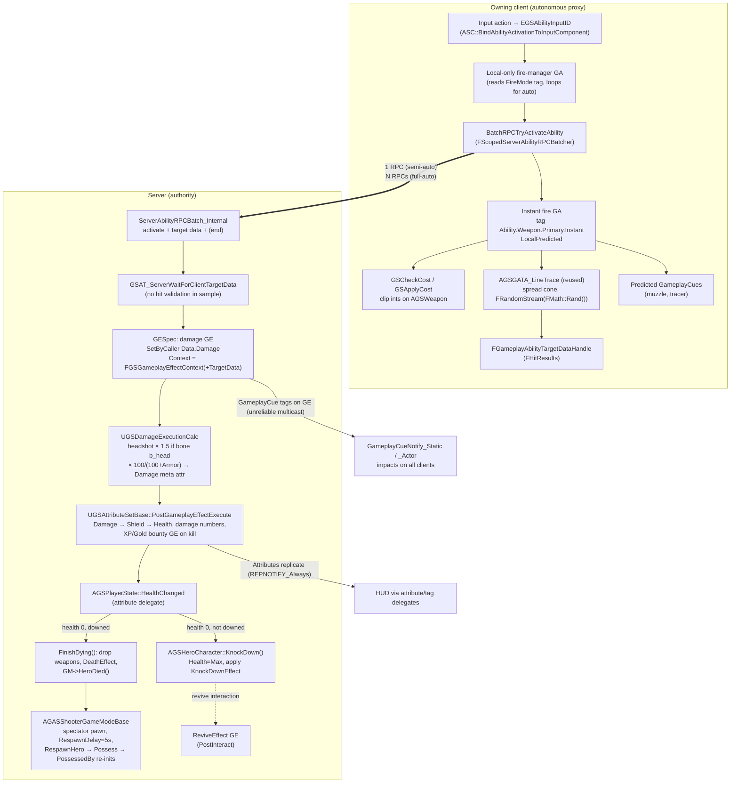

# Research: Unreal Gameplay Ability System (GAS) for shooters: GASShooter + GASDocumentation

> Subject: Epic's Gameplay Ability System plugin as used in FPS games. The primary sources are
> tranek's **GASShooter** sample and the **GASDocumentation** README that goes with it. Lyra's GAS
> usage is mentioned where it adds something. This document is research input for
> [`docs/architecture.md`](../architecture.md). P1–P10, §N and crate names refer to that plan.
>
> Conventions: class and function names are quoted from source or official docs. Where a detail lives
> only in Blueprint assets (which cannot be read as text), the document says so instead of guessing.

---

## 1. Overview

| | |
|---|---|
| **What** | GAS is Epic's general framework for *abilities* (actions), *attributes* (float stats), *effects* (stat/tag changes with a duration), *tags* (hierarchical state labels) and *cues* (cosmetics). It also covers their replication and client-side prediction. It shipped Paragon and Fortnite. |
| **GASShooter** | "An advanced FPS/TPS Sample Project for Unreal Engine 4's GameplayAbilitySystem (GAS) plugin", the "sister project to the GASDocumentation". It targets **UE 4.27** and is MIT licensed. In the author's words it is "not production-ready code but a starting point for evaluating different techniques in GAS relating to using weapons." |
| **GASDocumentation** | A community reference README (about 3.7k lines) plus a simpler TPS sample (`GDHeroCharacter` and others). Its changelog section is maintained up to UE 5.3. It quotes Epic's Dave Ratti in Q&A form, and those quotes are the main "why" source for Epic's design decisions. |
| **What GASShooter covers** | Ability batching, weapons that grant abilities, predicted weapon switching, weapon ammo, simple inventory, headshot damage, reusable TargetActors and world reticles, replicated montages on 1P+3P meshes, a subclassed `FGameplayEffectContext`, a shield that drains before health, item pickups, and a press/hold "E" interaction system (revive, weapon chest, sliding door). |
| **What it leaves out** | Predicted projectiles. The README says to look at the Unreal Tournament source instead. There are no teams, match phases, friendly fire or lag compensation. The hero has a mana pool that no ability uses. |
| **Weapons** | Rifle: hitscan, with full-auto/semi/burst fire modes, ADS and a fire-mode toggle. Rocket launcher: rocket, plus ADS lock-on with homing rockets that use persistent targets. Shotgun: hitscan pellets, ADS, and a semi/full-auto toggle. |

Sources: GASShooter README; GASDocumentation README §1–2, §4.6.15, §4.11, §5.9.

---

## 2. Structure

### 2.1 Source layout (GASShooter `Source/GASShooter/`)

```
GASShooterGameModeBase          HeroDied() → spectator → timer → RespawnHero()
Player/
  GSPlayerState                 OWNS the ASC + UGSAttributeSetBase + UGSAmmoAttributeSet
                                (Mixed replication, NetUpdateFrequency=100); HealthChanged → knockdown/death
  GSPlayerController            HUD, damage numbers, respawn countdown
Characters/
  GSCharacterBase               AvatarActor base: Die(), FinishDying(), attribute helpers
  GSCharacterMovementComponent  sprint/ADS/knocked-down speed multipliers via FSavedMove FLAG_Custom_0/1
  Heroes/GSHeroCharacter        1P/3P meshes+cameras, FGSHeroInventory, CurrentWeapon, KnockDown(),
                                IGSInteractable (revive), predicted weapon switching
  Abilities/
    GSAbilitySystemComponent    batching (ShouldDoServerAbilityRPCBatch), local cues, multi-mesh montages
    GSGameplayAbility           input binding, bSourceObjectMustEqualCurrentWeaponToActivate,
                                GSCheckCost/GSApplyCost (ammo), BatchRPCTryActivateAbility, SendTargetDataToServer
    GSDamageExecutionCalc       Damage(SetByCaller "Data.Damage") × headshot × armor mitigation
    GSGameplayEffectTypes       FGSGameplayEffectContext (+TargetData for cues)
    GSAbilityTypes              FGSGameplayEffectContainer(+Spec)
    GSGATA_Trace / _LineTrace / _SphereTrace   reusable hitscan TargetActors (spread, pellets, persistence)
    GSInteractable              IGSInteractable interface
    AttributeSets/GSAttributeSetBase   Health, MaxHealth, Shield, MaxShield, *RegenRate, Armor,
                                       MoveSpeed, Mana, Stamina, XP, Gold, bounties, meta "Damage"
    AttributeSets/GSAmmoAttributeSet   {Rifle,Rocket,Shotgun}ReserveAmmo (+Max)
    AbilityTasks/  GSAT_WaitTargetDataUsingActor, GSAT_ServerWaitForClientTargetData,
                   GSAT_WaitInteractableTarget, GSAT_PlayMontageForMeshAndWaitForEvent,
                   GSAT_WaitInputPressWithTags, GSAT_WaitChangeFOV, GSAT_WaitDelayOneFrame, …
    GSGameplayCueManager, AsyncTaskAttributeChanged, AsyncTaskGameplayTagAddedRemoved
Weapons/
  GSWeapon                      replicated actor: clip ammo ints (COND_OwnerOnly), FireMode tag,
                                Abilities[] granted on pickup, 1P/3P meshes, cached TargetActors
  GSProjectile                  server-spawned rocket
Items/Pickups/GSPickup          overlap pickup, grants AbilityClasses/EffectClasses, respawn timer
UI/                             HUD widget, HUD reticle, floating status bar, damage text
```

Most gameplay *logic* lives in Blueprint assets: the `GA_*` abilities, the `GE_*` effects and the
`GC_*` cues. These include the fire, reload, sprint, ADS, interact and revive abilities, as well as
the knockdown, death and revive effects. C++ provides the framework those assets plug into.

### 2.2 Major systems and data flow



---

## 3. Subsystem deep-dives

### 3.1 Input

- Input actions map to `EGSAbilityInputID`: `None, Confirm, Cancel, Sprint, Jump, PrimaryFire,
  SecondaryFire, AlternateFire, Reload, NextWeapon, PrevWeapon, Interact`. The binding is made with
  `UAbilitySystemComponent::BindAbilityActivationToInputComponent(…, FGameplayAbilityInputBinds("ConfirmTarget","CancelTarget","EGSAbilityInputID", Confirm, Cancel))`.
  A granted `FGameplayAbilitySpec` stores an `InputID`. Pressing that input calls `TryActivateAbility`
  or forwards `InputPressed`/`InputReleased` to an ability that is already active.
- `UGSGameplayAbility` adds three things: `AbilityInputID`; `AbilityID`, which assigns a slot without
  auto-activation; and `bActivateOnInput`, which lets an ability be bound to an input without being
  activated by it. `UGSAbilitySystemComponent::AbilityLocalInputPressed` is overridden to honour that flag.
- Generic **Confirm/Cancel** inputs drive targeting. LMB confirms the rocket lock-on and Left Ctrl
  cancels it.
- Known race: if the ASC lives on the PlayerState, the input binding has to be attempted both in
  `SetupPlayerInputComponent()` and in `OnRep_PlayerState()`, guarded by `bASCInputBound`. GASDoc
  §4.6.2 explains why.
- Movement and look axes are plain `BindAxis` calls on the character (`MoveForward`, `Turn` and so on)
  and do not go through GAS. GASDoc §4.6.1 says basic movement should not be an ability.

### 3.2 Movement / character

- `UGSCharacterMovementComponent::GetMaxSpeed()` reads the `MoveSpeed` attribute. It returns that
  value multiplied by `SprintSpeedMultiplier` (1.4), `ADSSpeedMultiplier` (0.8) or
  `KnockedDownSpeedMultiplier` (0.4). `PreAttributeChange` clamps `MoveSpeed` to [150, 1000].
- **Sprint and ADS are GAS abilities, but their effect on movement is predicted by the CMC, not by
  GAS.** The ability calls `StartSprinting()` / `StartAimDownSights()`. The CMC packs those requests
  into `FSavedMove_Character::FLAG_Custom_0/1`, and `CanCombineWith` refuses to merge saved moves
  whose flags differ. GASDoc §5.2–5.3 describes the same design for its sample. The GASDoc sprint
  ability also drains stamina through a cost GE inside a `WaitNetSync` window (§4.10.2).
- Dave Ratti, asked about predicting the removal of a movement-speed slow, says "ability system and
  precise synchronization with the character movement system is not in a good place". Epic's
  workaround was "tolerances and smoothing" (GASDoc §11.1, Q4).

### 3.3 Camera

- The hero has both a `FirstPersonCamera` and a `ThirdPersonCamera` on a `USpringArmComponent`, and
  `TogglePerspective()` switches between them (T key). On knockdown the view is forced to third
  person and then restored on revive (`bWasInFirstPersonPerspectiveWhenKnockedDown`).
- ADS FOV is changed by an ability task, `GSAT_WaitChangeFOV`, so camera presentation is driven from
  inside the ability.
- `AGSGATA_Trace` has `bTraceFromPlayerViewPoint`, `AimWithPlayerController` and
  `ClipCameraRayToAbilityRange`. In third person the camera ray chooses the aim point, and the shot
  is then traced from the weapon or pawn towards that point.

### 3.4 Inventory / equipment

- `FGSHeroInventory { TArray<AGSWeapon*> Weapons; }` lives on the **Character** and is replicated.
  The comments note it could later hold consumables, armor and keys.
- `AddWeaponToInventory` runs on the server only. If a weapon *of the same class* is already owned,
  the picked-up weapon's clip ammo becomes reserve ammo through a **dynamic instant GE**, and the
  pickup is destroyed. Otherwise the weapon is added: `SetOwningCharacter` attaches it, and
  `AddAbilities()` grants its abilities **on pickup, not on equip**, with the weapon as `SourceObject`.
- Weapon abilities set `bSourceObjectMustEqualCurrentWeaponToActivate`, so only the equipped weapon's
  abilities can activate. `SetCurrentWeapon` cancels every ability tagged `Ability.Weapon`, swaps a
  *loose* tag (`CurrentWeaponTag`, or `NoWeaponTag` when empty), rebinds HUD delegates and plays
  equip montages.
- **Predicted switching** is complex:
  - `CurrentWeapon` replicates `COND_SimulatedOnly`, so the owner's prediction is never overwritten.
  - The client calls `ServerEquipWeapon` and switches locally with `bChangedWeaponLocally=true`.
  - The server keeps a `WeaponChangingDelayReplicationTag` active for roughly a second after the equip
    montage. When the tag is removed, the server calls `ClientSyncCurrentWeapon`.
  - If a switch ability's activation fails, the client asks for `ServerSyncCurrentWeapon`.
  - `OnRep_Inventory` handles the case where the inventory arrives before `CurrentWeapon`.
- On death, `RemoveAllWeaponsFromInventory()` removes each weapon's abilities and calls
  `OnDropped(location)`, which places the weapons in a circle of radius 50 around the body as pickups.

### 3.5 Weapons / firing

- `AGSWeapon` is a replicated actor that never ticks. Its state:
  - `PrimaryClipAmmo`, `MaxPrimaryClipAmmo` and the secondary equivalents, as **plain `int32`s
    replicated `COND_OwnerOnly`**;
  - `FireMode`, which is a **gameplay tag** (`Weapon.FireMode.*`);
  - `PrimaryAmmoType`, a tag (`Weapon.Ammo.None` means no reserve);
  - `bInfiniteAmmo`;
  - cached `AGSGATA_LineTrace` / `AGSGATA_SphereTrace` target actors, spawned lazily and reused.
- **Ammo split** (GASDoc §4.4.2.3.1, "Plain Floats on the Item (Recommended)"; Fortnite and GASShooter
  both do it this way):
  - *clip* ammo is on the weapon as ints;
  - *reserve* ammo is an **attribute** in `UGSAmmoAttributeSet` on the PlayerState, one per ammo type,
    looked up with `GetReserveAmmoAttributeFromTag`;
  - reload moves reserve into the clip;
  - firing cost overrides `CheckCost` / `ApplyCost` through `GSCheckCost` / `GSApplyCost`
    (BlueprintNativeEvents), because a cost GE can only target attributes.
- **Local ammo prediction hack:**
  `AGSWeapon::PreReplication` → `DOREPLIFETIME_ACTIVE_OVERRIDE(…PrimaryClipAmmo…, !ASC->HasMatchingGameplayTag(WeaponIsFiringTag))`.
  Ammo replication is switched *off* while `Weapon.IsFiring` is present, so the server cannot
  overwrite the client's locally decremented count during automatic fire. GASDoc: "You're essentially
  doing your own local prediction here."
- The rejected alternative, an **AttributeSet on the item**, was tried in early GASShooter and dropped:
  - you can only have one instance of an AttributeSet class per ASC, so you can only own one weapon
    of each type;
  - removing a set is unsafe. Killing yourself with a rocket removed the launcher's set on the client
    before the server's ammo replication arrived, and the game crashed. (GASDoc §4.4.2.3.2)
- An **ASC on the item** is "an extreme approach … I have not personally done this nor have I seen it
  in the wild" (GASDoc §4.4.2.3.3).
- **Fire control and batching** (GASDoc §4.6.15):
  - A *local-only* manager ability reads the fire mode and calls
    `BatchRPCTryActivateAbility(handle, EndAbilityImmediately)` on an *instant* fire ability
    (`Ability.Weapon.Primary.Instant`).
  - Semi-auto: activate, `ServerSetReplicatedTargetData` and `ServerEndAbility` are packed into **one**
    RPC.
  - Full-auto/burst: the first bullet's activation and target data share one RPC, each later bullet
    sends its own `ServerSetReplicatedTargetData`, and end is sent as a separate RPC.
  - Batching must happen inside `FScopedServerAbilityRPCBatcher`, works only in C++, and activates
    only by spec handle.
  - Fortnite goes further: its weapon abilities are "special cased batched to a single
    fortnite-specific RPC".
- **Fire rate.** Cooldown GEs are not used for weapons. Removing a GE cannot be predicted, so
  "players with high latencies have a lower rate of fire". Fortnite "does its own bookkeeping for
  weapon firing rates" (GASDoc §4.5.15.3; §11.1 Q7).
- **Spread** lives in the *TargetActor*, `AGSGATA_Trace`:
  - `BaseSpread`;
  - `AimingSpreadMod`, applied while the aiming tag is present;
  - `TargetingSpreadIncrement` per shot, capped at `TargetingSpreadMax`;
  - `ResetSpread()`;
  - the cone direction is drawn with `FRandomStream(FMath::Rand()).VRandCone(...)`, using a fresh
    random seed per shot on whichever machine produces the target data.
- `NumberOfTraces` gives shotgun pellets. `MaxHitResultsPerTrace` gives penetration-like multi-hit.
  `bUsePersistentHitResults` keeps lock-on targets until confirm or cancel.

### 3.6 Hit detection

- **TargetActor + TargetData.** A `WaitTargetData`-style task spawns or reuses an
  `AGameplayAbilityTargetActor`. The target actor traces and broadcasts an
  `FGameplayAbilityTargetDataHandle`, which is a polymorphic array of `FGameplayAbilityTargetData`
  wrapping `FHitResult`s.
- Confirmation modes are `Instant`, `UserConfirmed`, `Custom` and `CustomMulti`. Non-instant modes
  trace on `Tick()`. GASShooter writes its own `GSAT_WaitTargetDataUsingActor` so that the actor is not
  destroyed after every shot, which the stock `WaitTargetData` does (GASDoc §4.11.2).
- **Who produces the hit.**
  - With `ShouldProduceTargetDataOnServer == false` (GASShooter hitscan), the *client* traces and
    sends hit results with `CallServerSetReplicatedTargetData`.
    `GSAT_ServerWaitForClientTargetData` on the server simply accepts them:
    `ConsumeClientReplicatedTargetData` is followed by broadcast. The sample does **no server-side
    validation and no lag compensation**. GASDoc only says "you may want to do validation on the
    server … to prevent cheating".
  - With `true`, the client sends a generic confirm event and the server traces for itself, which can
    mispredict for the owner.
- `FGameplayTargetDataFilter` / `FilterPassesForActor` filter out self or classes.
- **Lyra's refinement** (official docs): `ULyraGameplayAbility_RangedWeapon` traces a firing cone. The
  "targeting data is network predicted and sent to the server, where it's validated and confirmed by
  the `ULyraWeaponStateComponent`", after which `OnRangedWeaponTargetDataReady` applies effects.
- **Headshots** use the bone name in the `FHitResult`. The damage `ExecCalc` checks
  `Hit->BoneName == "b_head"` and the asset tag `Effect.Damage.CanHeadShot`. So **the zone is resolved
  during damage, not during hit detection**.

### 3.7 Damage / health

- `UGSAttributeSetBase` (on the PlayerState) holds `Health/MaxHealth/HealthRegenRate`,
  `Shield/MaxShield/ShieldRegenRate`, `Armor`, `MoveSpeed`, `Mana*`, `Stamina*`, `CharacterLevel`,
  `XP`, `XPBounty`, `Gold`, `GoldBounty`, and the **meta attribute `Damage`**, which is not replicated.
- Every attribute is an `FGameplayAttributeData` with a **BaseValue and a CurrentValue**.
  - Instant and periodic GEs change BaseValue.
  - Duration and Infinite GEs add modifiers that only change CurrentValue.
  - Aggregation (`FAggregatorModChannel::EvaluateWithBase`) is
    `((Base + ΣAdd) * Mul) / Div`, where `Mul` is **1 + Σ(mᵢ − 1)**. That means *additive
    multipliers*: two ×1.5 give ×2, and two ×0.5 give ×0. The formula was designed for Paragon.
    `Override` takes the last applied.
  - Per-attribute qualifiers such as `MostNegativeMod_AllPositiveMods` keep only the worst slow and
    every buff (GASDoc §4.4.7, §4.5.4.1).
- Pipeline:
  1. The damage GE carries `SetByCaller` `Data.Damage`.
  2. `UGSDamageExecutionCalc` captures `Damage` (source, snapshotted) and `Armor` (target, live), adds
     the SetByCaller value, multiplies by `HeadShotMultiplier` (1.5) when the bone is `b_head`, adds
     the `Effect.Damage.HeadShot` dynamic tag to the spec, applies `× 100/(100+Armor)`, and writes an
     additive output to `Damage`.
  3. `PostGameplayEffectExecute` subtracts `Damage` from `Shield` first and the remainder from
     `Health`, clamps, calls `PC->ShowDamageNumber(...)` with the headshot tag, and on a kill builds a
     **dynamic GE** that awards XP/Gold to the source.
- ExecCalcs "can not be predicted" and only run on the server. Epic's Paragon and Fortnite "do not
  predict damage", and GASDoc strongly advises against predicting death (§4.10).
- **Death is not decided in the damage path.** `AGSPlayerState::HealthChanged`, a delegate on the
  attribute value, sees health ≤ 0 and calls one of two things:
  - `KnockDown()` the first time. This cancels all abilities, removes effects tagged
    `EffectRemoveOnDeathTag`, applies `KnockDownEffect`, then **sets Health back to MaxHealth and
    Shield to 0**. The downed state reuses Health as its bleed-out pool. Draining it is presumably
    done by the BP knockdown GE, which this research did not verify.
  - `FinishDying()` on the second depletion while `State.KnockedDown` is present.
- `KnockDownTagChanged` drives local cosmetics (`GameplayCue.Hero.KnockedDown` / `.Revived`).
- Regen (`*RegenRate`) is applied by Blueprint GEs, presumably periodic or infinite, also unverified.
- GASDoc's sample uses a non-replicated **loose tag** `State.Dead` so that owning clients react
  immediately. GASShooter applies a `DeathEffect` GE and removes Dead-tagged effects on possession.

### 3.8 Interaction (press/hold, revive)

- The `IGSInteractable` interface:
  - `IsAvailableForInteraction(Component)` and `GetInteractionDuration(Component)`, both evaluated per
    `UPrimitiveComponent` so one actor can have several interactable zones;
  - `GetPreInteractSyncType` / `GetPostInteractSyncType`, each returning `bShouldSync` plus
    `EAbilityTaskNetSyncType::{OnlyServerWait, OnlyClientWait, BothWait}`;
  - `PreInteract` (when the hold starts), `PostInteract` (when it completes) and `CancelInteraction`;
  - `GetTargetCancelInteractionDelegate`, plus `Register/UnregisterInteracter` and
    `InteractableCancelInteraction`, so the *target* can abort, for example when the downed player dies.
- Focus: `GSAT_WaitInteractableTarget` line-traces on a **timer** (defaults: `MaxRange=200`,
  `TimerPeriod=0.1`) and fires `FoundNewInteractableTarget` / `LostInteractableTarget`. The HUD prompt
  and progress go through `AGSPlayerState::ShowInteractionPrompt` / `StartInteractionTimer`.
- `bCannotActivateWhileInteracting` on `UGSGameplayAbility` blocks other abilities by counting
  `InteractingTag` vs `InteractingRemovalTag`.
- **Revive:**
  - A hero is available while it has `State.KnockedDown` and no `InteractingTag`, so there is one
    reviver at a time.
  - Duration is `ReviveDuration`.
  - The sync type is `OnlyClientWait`, so the reviver's timer stays in step with the downed player's
    animation; the comment explains "we can't locally predict an ability run on another player".
  - `PreInteract` (server) activates `Ability.Revive` on the *downed* player's ASC.
  - `PostInteract` (server) applies `ReviveEffect`.
  - `CancelInteraction` cancels `Ability.Revive`.
- A design note in the interface: grant needed abilities in `PreInteract` "to hide the time needed to
  replicate the AbilitySpec inside the time needed to interact".

### 3.9 Match / spawns / respawn

- `AGASShooterGameModeBase::HeroDied(Controller)` spawns an `ASpectatorPawn` at the body, possesses
  it, starts a `RespawnDelay` (5 s) timer and calls `PC->SetRespawnCountdown`.
- `RespawnHero` spawns a fresh `BP_HeroCharacter`. Players go to `FindPlayerStart` and AI to an actor
  *named* `"EnemyHeroSpawn"`. The spectator pawn is destroyed and the controller possesses the new hero.
- `AGSHeroCharacter::PossessedBy` (server) points at the PlayerState's ASC, calls
  `InitAbilityActorInfo(PS, this)`, then `InitializeAttributes()`, `AddStartupEffects()` and
  `AddCharacterAbilities()`. If the Dead tag is present it refills Health, Mana, Stamina and Shield,
  then removes effects that grant `State.Dead`.
- **The ASC, attributes and active effects survive respawn** because they live on the PlayerState.
  The body and inventory do not.
- `GSPickup` has `RestrictedPickupTags` (Dead, KnockedDown), `AbilityClasses` / `EffectClasses` to
  grant, and `bCanRespawn` / `RespawnTime`.
- There are no teams, phases, score or friendly fire. Lyra adds experiences, teams and a friendly-fire
  check inside `ULyraDamageExecution`.

### 3.10 UI / feedback

- The HUD binds to `ASC::GetGameplayAttributeValueChangeDelegate` and tag events through
  `AsyncTaskAttributeChanged` and `AsyncTaskGameplayTagAddedRemoved`, which are Blueprint async nodes.
- Damage numbers are pushed from `PostGameplayEffectExecute` to the instigator's controller and
  include a headshot tag.
- `AGameplayAbilityWorldReticle` actors (UMG in a `WidgetComponent`) mark lock-on targets, and
  `UGSHUDReticle` provides per-weapon crosshairs.
- **GameplayCues** (GASDoc §4.8):
  - Tags under `GameplayCue.*` are routed by `UGameplayCueManager` to `GameplayCueNotify_Static`
    (one-shot `Execute`, no instance) or `GameplayCueNotify_Actor` (instanced, with `OnActive`,
    `WhileActive` and `Removed`).
  - A GE-triggered cue is *reliable through state*: simulated proxies reliably get `WhileActive`/`OnRemove`.
    Executed cues are *always unreliable* multicast RPCs, capped at two of the same cue per net update.
  - Use `OnActive` for one-shots that late joiners may miss and `WhileActive` for ongoing effects that
    late joiners must see.
  - Prefer **local cues** (`ExecuteGameplayCueLocal`) for impacts. The shotgun's eight pellet impacts
    are packed into **one** RPC by putting all hit data in `FGSGameplayEffectContext::TargetData`
    (about 500 bytes). GASDoc says a seed or compact encoding would be better.
  - `GSAnimNotify_PlaySoundForPerspective` picks a 1P or 3P sound variant.

### 3.11 Networking / prediction

- **Ownership:**
  - ASC on the **PlayerState** (Owner = PlayerState, Avatar = Character) for anything that respawns.
  - ASC on the **actor itself** for AI, props and buildings.
  - Epic: "Anything that does respawn should have the Owner and Avatar be different so that the
    Ability System Component does not need to be saved off / recreated / restored after a respawn."
  - Downsides: "PlayerStates are always relevant", and their default `NetUpdateFrequency` is so low
    that GASShooter raises it to 100.
- **Replication modes:** `Full` for single player; `Mixed` for player-controlled actors (GEs to the
  owner only, tags and cues to everyone); `Minimal` for AI. Fortnite does not replicate the ASC to
  simulated proxies at all and pushes a "proxy" struct with a subset of attributes and a bitmask of
  tags on the pawn (§11.1 Q3).
- **Prediction keys:**
  - The client creates an activation `FPredictionKey`, sends it with `ServerTryActivateAbility` and
    tags every predicted GE and cue with it.
  - The server applies the same key, and the key "bounces" back through `ReplicatedPredictionKeyMap`.
  - The client then removes its predicted copies. Any that lack a server twin were mispredicted.
  - A key is valid only for one atomic window. Latent continuations need `WaitNetSync` or input tasks
    that open a new scoped window.
  - **Predicted:** activation, triggered events, GE application (modifiers, *not* ExecCalcs), tags,
    cues, montages, CMC movement.
  - **Not predicted:** GE removal and periodic GE ticks.
  - Predicted instant GEs act as infinite GEs until reconciled, which can cause a visible
    "blip"/double application for other targets (§4.10).
- **Activation flow (LocalPredicted):** the client runs `CanActivateAbility` (tags, cost, cooldown),
  then `CallServerTryActivateAbility(key)`, then `ActivateAbility`. The server runs its own
  `CanActivateAbility`, then sends `ClientActivateAbilitySucceed` or `ClientActivateAbilityFailed`
  (which undoes the prediction).
- **Shared randomness:** seed from the activation prediction key, which is deterministic but identical
  every match, or send a seed in an event payload, which is hackable (§5.5). GASShooter's spread does
  *neither*. It uses `FMath::Rand()` on the producing machine.
- **Future:** Epic intends to "rewrite/remove the Ability System's prediction keys and replace them
  with Network Prediction constructs", and has said fully rollback-able `UGameplayAbility` logic
  "would still take more work". GAS can run on the fixed-rate async physics thread "eventually"
  (§11.1.2).

---

## 4. Mapping to the Krit plan

| GAS / GASShooter concept | Krit crate / type / principle | Verdict |
|---|---|---|
| ASC on PlayerState (Owner) vs Character (Avatar) | P5 `Player`/`Character`, `Controls` ↔ `ControlledBy` (§5.1) | **Agreement** on the split. **Divergence** on where vitals live: Krit puts `Health` on the Character. |
| Attributes `BaseValue`/`CurrentValue` + modifier aggregation | P7, `krit_stats` `Modifier { op: Add\|Mul\|Override, priority }` (§5.2) | **Agreement** in principle. **Gap**: the aggregation formula and stacking policy are not specified. |
| "BaseValue is not Max": separate `MaxHealth` attribute; instant GEs mutate Base | `HealthStats` (derived) vs `Health` (state) | **Gap**: the plan never states the *resource vs stat* distinction. |
| `AggregatorEvaluateMetaData` (`MostNegativeMod_AllPositiveMods`) | `krit_stats` recompute | **Gap**: per-stat aggregation policies. |
| Tag-conditional modifiers (`SourceTags`/`TargetTags`, `OngoingTagRequirements`) | `krit_stats` | **Gap**: conditional modifiers (while ADS, while crouched). |
| GameplayEffect Duration/Infinite/Periodic, stacking, immunity | `Modifiers` on "status effect" source entity (§5.2), `Invulnerable` (§5.9) | **Gap**: no status-effect lifecycle (duration, period, stacking, removal on death). |
| Meta attribute `Damage` + `PostGameplayEffectExecute` | `DamageRequest` → `DamagePipelineSystems` (§5.9) | **Agreement** in intent ("how much" vs "what happens"). Krit's ordered pipeline is **better**. |
| `GameplayEffectExecutionCalculation` (armor, headshot, crit, lifesteal) | `DamagePipelineSystems::{Resist, Absorb}` | **Agreement**. ExecCalc is one monolith; Krit splits it into stages. |
| Headshot multiplier in ExecCalc from `FHitResult.BoneName` | Zone multiplier applied in `krit_ballistics` (§6.3) | **Divergence**: see §6.4 below. |
| `SetByCaller` `Data.Damage` | `DamageRequest.amount` | **Agreement**. |
| `FGameplayEffectContext` (instigator, effect causer, hit result, target data) | `DamageRequest { instigator, inflictor, weapon, point, direction, group }` | **Agreement**. Krit is flatter and typed. |
| Original instigator ASC is on the PlayerState, so credit survives the attacker's death | `DamageRequest.instigator: "the Character (or Player)"` | **Gap**: credit should resolve to the Player. |
| Death decided in `AGSPlayerState::HealthChanged` (attribute delegate) | "Damage is the single source of truth for kills"; `Died` (§5.9) | **Divergence**. Krit is **better**. |
| Knockdown reuses Health; `State.KnockedDown` tag | `LifeState::Downed { bleedout }` | **Agreement** on the feature. Krit's explicit state is **better**. |
| Gameplay tags as universal state vocabulary with counts; `ActivationBlockedTags`, `BlockAbilitiesWithTag`, `CancelAbilitiesWithTag` | `ActionGates` bitflags, reset each tick and ORed by providers (§6.1) | **Partial agreement** on blocking. **Gap**: cancellation and extensibility. |
| Lyra `ULyraAbilityTagRelationshipMapping` (data table of block/cancel/require) | none | **Gap**, worth adopting (see §7). |
| GameplayAbility as the unit of every action (fire, reload, ADS, sprint, interact, switch) | Per-domain state machines: `WeaponState`, `MovementState`, switch FSM, interaction hold | **Divergence** by design. Krit is **better** for ECS and rollback. |
| AbilityTasks (latent, delegate-driven) | Tick-driven state in components (§8) | **Divergence**. Krit is **better**: latent tasks cannot be rolled back. |
| Abilities granted by weapon on pickup, gated by `bSourceObjectMustEqualCurrentWeaponToActivate` | `ItemIntent` routed only to `ActiveItem` (§5.6) | **Agreement** in effect. Krit is structurally simpler. |
| Input → `EGSAbilityInputID` → ASC; generic Confirm/Cancel | P1 `CharacterIntent { buttons, pressed, released }` | **Agreement**. **Gap**: there is no generic CONFIRM/CANCEL for targeting modes. |
| Sprint/ADS = ability + CMC saved-move flags | `Buttons::SPRINT/SECONDARY` in intent → movement / `AdsState` | **Agreement**, and Krit's design is the simpler one. |
| Clip ammo as plain ints on the weapon; reserve as attributes per ammo-type tag | `Magazine` (weapon state), `AmmoPool` keyed by ammo type, `AmmoProvider` (§5.5, §6.5) | **Strong agreement**. |
| `PreReplication` disables ammo replication while `Weapon.IsFiring` | §8 rollback rules + `krit_net` prediction | **Divergence**. Krit's rollback is the principled fix. |
| Duplicate weapon pickup turns into reserve ammo | `PickupRequest` / inventory | **Gap**: there is no duplicate-pickup policy. |
| FireMode as tag; alternate ability cycles it | `FireMode` + `FireModeSelector` | **Agreement**. |
| No cooldown GE for weapons (Fortnite uses its own bookkeeping) | `FireRate` + sub-tick accumulator in components | **Strong agreement**. |
| Ability batching (activation + target data + end in 1 RPC) | Per-tick input replication (`krit_net`, lightyear) | **Agreement** in outcome. Batching is not needed under input replication. |
| Spread/bloom in the TargetActor; `FMath::Rand()` seed per shot | `SpreadModel` in weapons; cone sampled in ballistics with `SimRng::for_shot` (§5.1, §5.8) | **Divergence**. Krit is **better** because it is deterministic and reproducible on the server. |
| Client-produced hit TargetData accepted by the server (no validation) | Ballistics resolves on server; `RewindProvider` lag compensation (§5.8, §5.16) | **Divergence**. Krit is **better** for PvP. **Gap**: an optional client-reported mode. |
| Lyra `ULyraWeaponStateComponent` (unconfirmed vs confirmed hit markers) | `HitConfirmed` (§6.4) | **Gap**: there is no predicted, unconfirmed hitmarker path. |
| Persistent targets / lock-on reticles (`bUsePersistentHitResults`) | weapons "never trace rays" (§5.7) | **Gap / contradiction**: pre-fire targeting has no home. |
| `bTraceFromPlayerViewPoint`, `ClipCameraRayToAbilityRange` (3P aim convergence) | P4 `AimRay` from eye; `CameraMode::ThirdPerson` (§5.12) | **Gap**: 3P aim convergence. |
| GameplayCues: Execute (one-shot) vs Add/WhileActive/Remove (stateful); local cues; unreliable | `krit_feedback` `PlayCue { id, at }`, cumulative counters (§5.14, §8) | **Agreement** on cosmetics being separate (P2). **Gap**: stateful/looping cues. |
| Cue batching for pellets through the effect context | `DamageRequest.group: ShotId`, `HitResult.shot_id` | **Agreement**. |
| Prediction keys (predict minimum; undo side effects) | Full rollback (lightyear); movement and weapons predicted, rest authoritative (§5.16) | **Agreement** on *what* to predict. **Divergence** on mechanism; Krit's is more general. |
| Don't predict damage or death | `krit_damage` server-authoritative | **Strong agreement**. |
| Replication modes Mixed/Minimal; Fortnite proxy struct | `krit_net` registration | **Gap**: owner-only vs everyone replication tiers. |
| `IGSInteractable` (availability, duration, pre/post, sync type, target-side cancel) | `krit_interaction` `Interactable { prompt_key, hold_duration, conditions }`, `InteractStarted/Completed/Cancelled` (§5.10) | **Agreement**. **Gaps**: dynamic availability, exclusivity, target-side cancel, sub-zones. |
| Revive: PreInteract runs ability on downed, PostInteract applies ReviveEffect | `InteractCompleted` → `ReviveRequest` → `Revived` (§5.9–5.10) | **Agreement**. |
| `GSPickup` restrictions + respawn timer | `Pickup` fragment (§5.5) | **Gap**: pickup restrictions and pickup respawn. |
| GameMode HeroDied → spectator → timer → RespawnHero; possession re-inits stats | `krit_match` `RespawnPolicy::Timer`, `SpawnCharacter`, `GrantLoadout`, `CameraMode::DeathCam/Spectate` | **Agreement**. |
| `EffectRemoveOnDeathTag` removes effects at death or knockdown | none | **Gap**: what happens to modifiers and status effects on death. |
| Drop all weapons on death (circle placement) | `DropOnDeath` observer on `Died` (§5.5) | **Agreement**. |
| `ActivateFail*` tags and `showdebug abilitysystem` | none | **Gap**: debug and explain-why tooling. |

---

## 5. Where it agrees with the plan

1. **P5, persistent player vs disposable body.** GAS's Owner/Avatar split exists so that respawning
   does not require "saved off / recreated / restored" state. That is exactly why Krit separates
   `Player` and `Character`. GASShooter's respawn shows the payoff: a new Character is possessed and
   `PossessedBy` just re-points at the persistent ASC.
2. **P7, stats are base plus modifiers and base data is never mutated.** This is GAS's
   `BaseValue`/`CurrentValue` model. Duration and Infinite effects add modifiers that are removed
   later, and derived attributes recompute automatically when their inputs change (GASDoc §4.3.5).
   Krit's `Stat<T>` recompute-on-change follows the same pattern.
3. **P3 and §5.9, separate "how much" from "what it does to me".** GASDoc's main reason for the meta
   `Damage` attribute is that "our Gameplay Effects and Execution Calculations don't need to know how
   the Target handles the damage". This is the `DamageRequest` → pipeline seam. Shield-before-health
   in `PostGameplayEffectExecute` is Krit's `Absorb` stage.
4. **§6.3, `DamageRequest` carries context.** `FGameplayEffectContext` carries instigator, effect
   causer, hit result and source object. `SetByCaller` carries magnitude. This matches
   `instigator ≠ inflictor ≠ weapon` and `amount`. GASShooter subclasses the context to carry
   multi-hit `TargetData` for shotgun cues, which matches Krit's `group: Option<ShotId>`.
5. **P6, ammo is not a stat.** Epic's own guidance (GASDoc §4.4.2.3) says to keep clip ammo as plain
   values on the item and pool shared reserve by type. Both attribute-based alternatives failed in
   practice (one set per class, crash on removal). This validates `Magazine` (state on the weapon)
   plus `AmmoPool` keyed by ammo type behind `AmmoProvider` (§6.5). It also validates §8's rule that
   *state* and *derived* data are kept separate.
6. **§5.7, fire rate as component bookkeeping.** Epic admits that cooldown GEs cannot be predicted,
   which penalises high-latency players, and that Fortnite "does its own bookkeeping for weapon firing
   rates". Krit's `FireRate` sub-tick accumulator is that bookkeeping, and rollback-safe as well.
7. **§5.16, what to predict.** Epic's position is "predict the minimum amount of stuff you can get
   away with", and Paragon and Fortnite "do not predict damage" or death. Krit predicts movement and
   weapons and keeps damage, death and match flow server-authoritative.
8. **P1, intent-driven movement modifiers.** Even inside GAS, sprint and ADS speed only predict
   correctly because they travel in the CMC's saved-move flags, which are effectively an input
   command. GAS's own movement integration is described by Epic as "not in a good place". Krit's
   `CharacterIntent.buttons` already provides this without any second system.
9. **P2 and §8, cosmetics are separate and replay-safe.** GameplayCues are explicitly "non-gameplay"
   and "should be considered unreliable … unsuited for anything that directly affects gameplay". That
   is P2. The "redo" problem in `GameplayPrediction.h` (avoid replaying predicted side effects that
   the server also replicates) is what Krit's cumulative `WeaponFired.shot_count_total` counter solves.
10. **§5.6, weapons talk only through the holder.** GASShooter grants weapon abilities to the
    *holder's* ASC with the weapon as `SourceObject`, and lets them activate only while that weapon is
    current. Krit's `ItemIntent` routing to `ActiveItem` gets the same "only the held item acts"
    behaviour with no grant/ungrant replication.
11. **§5.10, interaction is generic and revive is an adapter.** `IGSInteractable` serves revive,
    chests and doors through one press/hold ability. Revive is implemented *on the target*:
    `PostInteract` applies `ReviveEffect`. This matches "revives (`ReviveRequest`) … are tiny observer
    adapters".
12. **§5.11, respawn flow.** Death leads to a spectator/death cam, then a timer, then spawn at a
    chosen start, then stats re-initialized and loadout granted. This is `Died` → `RespawnPolicy::Timer`
    → `SpawnCharacter` → `GrantLoadout`, with `CameraMode::DeathCam`.
13. **§5.5, drop on death.** `RemoveAllWeaponsFromInventory` → `OnDropped` matches the `DropOnDeath`
    observer.

---

## 6. Where it runs counter, and who has the better argument

### 6.1 "Everything is an ability" vs per-domain state machines

GAS models fire, reload, ADS, sprint, weapon switch, interact, revive and jump as `UGameplayAbility`
objects. These are stateful UObjects with latent `AbilityTask`s, delegates and per-activation
instancing policies. Krit models the same behaviours as tick-driven state machines in components
(`WeaponState`, `MovementState`, `EquipmentSlots`, hold progress).

**Krit is better for its goals.**
- Latent tasks and delegates cannot be serialized or re-simulated.
- Epic says fully rollback-able ability logic "would still take more work", possibly a restricted
  `UGameplayAbility` subclass "or only Ability Tasks that are marked as rollback-friendly".
- §8 forbids hidden state outside components for exactly this reason.

**What Krit gives up:**
- a single *generic* layer where designers can add a new action and declare how it blocks or cancels
  others through data;
- free activation-failure reasons.

Section 7 recovers both without abilities.

### 6.2 Where vitals live: PlayerState vs Character

GAS puts *all* attributes, Health included, on the PlayerState so that the ASC does not need to be
rebuilt. GASShooter then refills Health, Mana, Stamina and Shield on every respawn, so Health
persistence buys nothing. What does need to persist is XP, gold, reserve ammo and buffs that survive
death. The cost is real: PlayerStates are always relevant, need a raised `NetUpdateFrequency`, and
create an ASC-init race on clients (`OnRep_PlayerState` vs `SetupPlayerInputComponent`).

**Krit is better.** In ECS, adding components to a new entity costs nothing, so there is nothing to
save. Life-bound vitals (`Health`, `Shield`, `LifeState`) belong on the Character, and
run-persistent progression belongs on the Player. Krit inherits a *related* problem, though: a perk
on the Player has to modify stats computed on the Character (see §7.2).

### 6.3 Who decides death

GASShooter splits the death logic three ways:
- the AttributeSet computes damage, shows numbers and pays a bounty when health reaches 0;
- the PlayerState's health delegate decides knockdown or death;
- the Character runs `KnockDown`/`FinishDying`, which calls the GameMode.

Bounty payment uses `TargetCharacter->IsAlive()` checks *before* the PlayerState has reacted. Kill
logic is therefore spread across three classes that are connected by delegates with no defined order.

**Krit is better.** `DamagePipelineSystems::Resolve` is the single, ordered place, and `Died` is the
only fact. This is a direct lesson for anyone tempted to compute death in an `Observer` on
`Changed<Health>`: don't.

### 6.4 Zone multiplier: hit stage vs damage stage

GASShooter applies the headshot multiplier inside the damage ExecCalc from `FHitResult.BoneName`.
Krit applies `Hurtbox.multiplier` in ballistics and passes `zone` in `DamageRequest`.

**Both have a case.**
- Krit's placement keeps per-hurtbox data next to the hurtbox, and lets games without `krit_damage`
  (paintball) score headshots.
- GAS's placement lets the *target* decide what a head hit means. A helmet perk, armor per zone or a
  boss that is immune to headshots all belong to the target.

**Recommendation:** keep Krit's split. Document that ballistics applies only *geometric* zone
multipliers and that `Resist` may apply *target-side* per-zone modifiers using `DamageRequest.zone`.
Add `DamageFlags::HEADSHOT` at the hit stage, as GASShooter tags `Effect.Damage.HeadShot` for damage
numbers.

### 6.5 Client-reported hits vs server-resolved hits

In GASShooter the client traces with a random seed the server never sees, sends `FHitResult`s, and
the server applies damage without checking them. Lyra adds validation in `ULyraWeaponStateComponent`.

**Krit's deterministic `SimRng::for_shot` with server-side resolution and `RewindProvider` is better
for PvP.** It is reproducible and harder to cheat. The GAS approach is simpler, needs no hitbox
history, and gives the shooter perfect hit registration, which suits co-op and PvE.

Krit should make this a **policy** rather than a hard assumption (§7.6).

### 6.6 Prediction mechanism

GAS predicts side effects under a prediction key and undoes them when the key returns. GE removal,
periodic effects and ExecCalcs cannot be predicted, which forces workarounds:
- add an inverse GE to "predict" a removal;
- the `PreReplication` ammo hack;
- a COND_SimulatedOnly `CurrentWeapon` plus manual sync RPCs for weapon switching.

Krit relies on rollback and resimulation of plain components. **Krit is better for its stated goals.**
Every one of those GAS workarounds disappears when `Magazine`, `EquipmentSlots` and `FireRate`
accumulators are just predicted state. The cost is CPU for resimulation, and the discipline in §8
becomes mandatory. Epic itself plans to replace prediction keys with Network Prediction constructs.

### 6.7 Cosmetics as replicated RPCs vs derived from state

GameplayCues are triggered from simulation and sent as (unreliable) multicast RPCs. Stateful cues are
recovered for late joiners through `WhileActive`.

Krit derives cosmetics from replicated state and counters. This is better under rollback: there are
no RPCs to retract, and a late joiner just reads state. GAS's `OnActive` vs `WhileActive` distinction
is still a valuable *concept* that Krit should name explicitly (§7.5).

### 6.8 Abilities granted at runtime

Granting abilities, for example on pickup, replicates a spec to the owner. The ability cannot be
predicted until that spec has arrived, which is why GASShooter grants in `PreInteract` "to hide the
time needed to replicate the AbilitySpec". Krit has no grants: behaviour is the presence of
components, replicated like any other state. **Krit is better.**

---

## 7. Ideas worth adopting / gaps in the plan

Each item names the Krit crate affected. Items marked **§12** are proposed as new open questions.

### 7.1 `krit_stats`: specify the aggregation formula *now*

GAS's additive-multiplier formula (`1 + Σ(mᵢ−1)`) surprises everyone. Two ×0.5 slows give ×0, and
the fix needs an engine change (GASDoc §4.5.4.1). Pin down Krit's formula in §5.2:

- **Ops:** `AddBase` (pre-multiply), `MulAdditive` (summed "increased" percentages), `MulProduct`
  (multiplied "more" factors), `AddFinal` (post-multiply flat), `Override` (highest `priority` wins,
  ties broken by insertion order), and `Clamp { min, max }`.
- **Formula:** `((base + ΣAddBase) × (1 + ΣMulAdditive) × ΠMulProduct + ΣAddFinal)`, then Override,
  then Clamp. Document it with tests.
- **Per-stat aggregation policy** (GAS `AggregatorEvaluateMetaData`): `All` (default),
  `MostNegativeAndAllPositive` (Paragon slows), `HighestOnly`. Store it on the stat's registration.
- **Determinism:** summation order must not depend on query iteration order. Sort sources by
  `(priority, source Entity bits)` or by a stable `ModifierId` before folding, because float addition
  is not associative. This matters for rollback checksums.

### 7.2 `krit_stats` / `krit_core`: resources vs stats, and Player→Character forwarding

- **Resources vs stats.** GASDoc warns that beginners confuse `BaseValue` with a maximum, and
  `AdjustAttributeForMaxChange` (proportional rescale of Health when MaxHealth changes) is boilerplate
  in both samples. Add a rule to §5.2: *stats* (MaxHealth, MoveSpeed, FireRate) are derived and
  read-only, while *resources* (Health, Shield, Stamina, Magazine) are mutable state bounded by a stat.
  Provide a `Resource { current }` helper plus a `MaxChangePolicy::{KeepRatio, KeepCurrentClamped}`
  that runs when the bounding stat is recomputed.
- **Player-level modifier sources.** A perk or progression buff lives on the Player, but its stats are
  computed on whichever Character the Player controls. Specify that `ModifierSourceOf(Player)` applies
  to the Player's current `Controls` target, and is re-targeted on respawn.

### 7.3 `krit_stats` (or a new `krit_effects`): a status-effect lifecycle **§12**

GameplayEffects bring a lot that Krit currently has no home for:
- Duration and Infinite lifetimes;
- Periodic ticks (DoT, regen);
- stacking (per source or per target, with refresh and expiry policies);
- granted gates or tags;
- application requirements and immunity;
- "remove effects with tag X";
- conditional enable/disable (`OngoingTagRequirements`).

Proposal: a status effect is an **entity** with these components:
- `ModifierSourceOf(target)` + `Modifiers`;
- `EffectLifetime { remaining_ticks }` (tick-based, not seconds);
- optional `Periodic { period_ticks, next_tick, payload }`, whose payload emits a `DamageRequest` or
  `HealRequest`;
- `Stacking { key, policy, count, max }`;
- `GrantsGates(ActionGates)`;
- `EffectTags`;
- removal markers `RemoveOnDeath` / `RemoveOnRespawn`. This mirrors GASShooter's
  `EffectRemoveOnDeathTag`, which runs on both knockdown and death.

All of it is plain predicted state, so rollback handles predicted *removal*, something GAS still
cannot do. Existing pieces that become instances of this pattern: spawn protection (`Invulnerable`),
stun, flashbang, burning, the Shield regen delay, and ADS slowdown.

**Open question:** extend `krit_stats` with lifetimes, or ship a separate `krit_effects` crate?

### 7.4 `krit_core` gates: add *cancel* and *data-driven relationships* **§12**

`ActionGates` covers GAS's `ActivationBlockedTags` / `BlockAbilitiesWithTag`, and its
reset-and-OR-each-tick design already handles multiple sources (GAS needs tag *counts* for that). Two
things are missing:

1. **Cancellation.** GAS `CancelAbilitiesWithTag`: starting ADS cancels sprint, sprinting cancels
   reload, taking damage cancels a revive. A gate only prevents *starting* an action. Add an edge
   channel, for example an `ActionCancels` bitflag written the same way and consumed by each domain
   in its own set ("if `RELOAD` is cancelled this tick, abort `Reloading`").
2. **A relationship table.** Lyra's `ULyraAbilityTagRelationshipMapping` is a data asset of
   (when X is active → block Y, cancel Z, require W). A `GateRules` resource or asset in core,
   evaluated in `KritSimSystems::Intent`, would let a game define "ADS blocks sprint", "sprint cancels
   ADS" or "downed blocks everything except crawl" as data instead of scattered `ActionGates`
   writes in each crate. This also answers P8 for action interplay.

Also:
- make `ActionGates` **extensible**: reserve high bits for game-defined gates, or use a registered
  `GateId` set, because GAS's strength is that tags are open-ended;
- add **gate provenance** in debug builds ("FIRE blocked by: krit_equipment(Switching)"), the
  equivalent of `Activation.Fail.BlockedByTags` and `showdebug abilitysystem`.

### 7.5 `krit_feedback`: one-shot vs stateful cues, hierarchical cue ids

Adopt the GameplayCue vocabulary in an ECS-native, rollback-safe form:
- **`CueId`** is a hierarchical, interned id (`impact.bullet.metal`, `hero.knocked_down`), so
  presentation can bind by prefix, the way `GameplayCue.*` tags route to notifies.
- **One-shot cues** (GAS `Execute`/`OnActive`) are derived from cumulative counters or
  `ImpactEvent`s. Late joiners may miss them.
- **Stateful cues** (GAS `WhileActive`/`Removed`) are derived from the *presence* of components
  (`LifeState::Downed`, a burning status effect, `MovementState::Sprint`). They are recomputed every
  frame, so they are correct for late joiners and across rollback.
- Add **perspective** to cue dispatch (`Viewer::{Owner1P, Other3P}`), as
  `GSAnimNotify_PlaySoundForPerspective` does for 1P and 3P sound variants.
- **Pellet batching** is already handled by `ShotId` grouping. For network bandwidth, `krit_net` can
  send the shot seed instead of hits, since `SimRng::for_shot` is deterministic. GASDoc itself names
  this as the better option than sending ~500 B of hit results.

### 7.6 `krit_ballistics` / `krit_net`: hit-authority policy **§12**

Make the GAS/Lyra model available as an option instead of excluding it:
`HitAuthority::{ServerResolve (default, uses RewindProvider), ClientReported { validator }}`.
- In `ClientReported` mode the predicting client's `HitResult`s are sent and the server runs a
  `HitValidator` hook (distance, line of sight, rate, angle against the server's `SimRng` cone).
- Co-op/PvE games get perfect hit registration with no hitbox history.
- PvP games keep server authority.

Either way, **add an unconfirmed-hit path to `krit_feedback`**, following Lyra's
`ULyraWeaponStateComponent`:
- show a predicted hitmarker from the local `HitResult`;
- upgrade it on `HitConfirmed`;
- quietly drop it if no confirmation arrives within a short window.

### 7.7 `krit_damage`: credit and context fixes

- **Credit resolves to the Player.** GAS's original-instigator ASC lives on the PlayerState, so credit
  survives the attacker's death or despawn while a rocket is in flight. Make
  `DamageRequest.instigator` the **Player**, and add `instigator_character: Option<Entity>` for
  direction indicators. Then `Died.killer` stays valid after the attacker's body has despawned.
- **Snapshot vs live.** GAS captures each attribute either at spec creation (snapshot) or at
  application (live). Krit's `ShotRequest` carries only `Handle<BallisticProfile>`. Attachment or perk
  modifiers to damage, range or penetration in `WeaponStats` would then be lost, or read
  *after the weapon was dropped*, by the time a projectile lands. Add a snapshotted
  `ShotStats { damage_mult, range_mult, penetration, … }` to `ShotRequest`, stored on projectile
  entities.
- **`HitConfirmed` is too thin for GASShooter-style damage numbers.** Add `amount`, `flags`
  (HEADSHOT, SHIELD_BREAK, KILL) and `to_shield` / `to_health`.
- Bounty/XP-on-kill stays out of `krit_damage`; consumers of `Died` own it. GASShooter's
  dynamic-GE-from-AttributeSet bounty is the anti-pattern.

### 7.8 `krit_weapons` / `krit_core`: pre-fire targeting has no home **§12**

The rocket launcher's lock-on (persistent targets, world reticles), aim assist, and the
interaction focus trace all need *spatial queries before any shot exists*. §5.7 says weapons "never
trace rays". Options:
- (a) a read-only `TargetingQuery` (through `SpatialQueryBackend`) that weapons may use for
  *acquisition only*, while hit resolution stays in ballistics;
- (b) a small `krit_targeting` stage (`KritSimSystems::Aim` or a new `Targeting` set) that writes a
  `TargetLock { target, progress }` component. Weapons read it, and
  `ProjectileSpec.homing_target: Option<Entity>` carries it.

Option (b) keeps the "weapons never trace" rule.

Also add generic `CONFIRM` / `CANCEL` buttons to `Buttons` (GAS's Confirm/Cancel inputs), so
targeting modes such as "hold secondary to lock, primary to fire, Ctrl to cancel" do not need special
intents.

### 7.9 `krit_kamera` / `krit_core` aim: third-person convergence

GASShooter switches between 1P and 3P on the same character, and its trace actor aims through
`AimWithPlayerController` plus `ClipCameraRayToAbilityRange`. With P4, the eye ray and the 3P camera
ray differ, so a 3P crosshair lies. Add an optional, simulation-side `AimConvergence` mode. The
*character's* `ViewAngles` stay authoritative, and ballistics corrects the eye→target ray against a
camera-equivalent ray built from `ViewAngles` plus a configured 3P offset. That keeps it deterministic
and headless-safe, with no read of the camera `Transform`.

### 7.10 `krit_interaction`: features GASShooter needed

- **Dynamic availability and duration.** `IsAvailableForInteraction` / `GetInteractionDuration`
  depend on target state (only downed heroes can be revived). Make `conditions` a query, or add an
  `InteractableEnabled` component maintained by owning crates, and allow `hold_duration` to come from a
  stat such as a revive-speed perk.
- **Exclusivity.** One reviver at a time (`InteractingTag`). Add `Interactable.max_interactors` and an
  `Interactors` relationship.
- **Target-side cancel.** A reviver or downed player dies, or a door gets locked. Cancel the hold
  whenever the interactable becomes unavailable *or* either party loses `INTERACT`, and emit
  `InteractCancelled { reason }`.
- **Sub-zones.** An interactable per child entity (GAS passes a `UPrimitiveComponent`). This already
  falls out of Krit's entity model; document it.
- **Pre/Post hooks.** GASShooter's `PreInteract` (start an animation on the target) and `PostInteract`
  map to `InteractStarted` / `InteractCompleted`. Its `NetSyncType` exists only because of latency and
  is not needed under rollback.
- **Focus cadence.** GASShooter traces every 0.1 s, not every frame. A `focus_period_ticks` setting on
  `Interactor` is a cheap optimization.

### 7.11 `krit_inventory`: pickup policies

- **`DuplicatePickupPolicy::{ConvertToReserveAmmo, Ignore, AllowDuplicate, Replace}`.** GASShooter
  converts a duplicate weapon's clip ammo into reserve.
- `Pickup` restrictions: GASShooter's `RestrictedPickupTags` (Dead, KnockedDown) map to a gate
  (`ActionGates::PICKUP`) or to `LifeState`.
- **Respawning pickups** (`bCanRespawn`, `RespawnTime`) are arena staples. Add a `PickupSpawner`, in
  `krit_match` (it is a rule) or in `krit_inventory`. Effect pickups (health or armor packs) should
  send `HealRequest` or apply a status effect, not become inventory items.

### 7.12 `krit_net`: replication tiers

GAS `Mixed` mode sends full effect and modifier detail to the *owner* only, and tags plus cues to
everyone. Fortnite goes further with a pawn-side proxy holding a subset of attributes and a tag
bitmask. For Krit:
- replicate **modifier-source state** (status effects, attachments) to the owner, who needs it to
  re-derive predicted stats;
- replicate to proxies only what their presentation and interpolation need (`LifeState`, a gate or
  status bitmask, `Health` as a read model).

Keep heavy state off the always-relevant `Player` entity, the lesson from "PlayerStates are always
relevant".

### 7.13 §12 open question: where inventory lives by default

The architecture doc is inconsistent: §5.5 says `Inventory` is "on the **Player**", while §12 proposes
the Character. GASShooter's split suggests separating by *kind*:
- **items carried on the body** (weapons, attachments) go on the Character and drop on death;
- **account- or run-level pools** (reserve ammo in GASShooter's PlayerState AttributeSet; currency;
  XP) go on the Player.

Recommend keeping the §12 proposal (Character default, `PersistentInventory` opt-in), allowing
`AmmoPool` to sit on either entity, and having `AmmoProvider` resolve Character first and then
Player.

---

## 8. Pitfalls / lessons

- **Complexity cost.** GASShooter needs a custom ASC, ability base class, effect context, globals,
  cue manager, target actors, about nine ability tasks, async BP nodes, and per-weapon BP abilities
  and effects before a gun fires. GASDoc lists "lack of boilerplate templates, multiplayer examples,
  and documentation" among GAS's current issues. Krit's lesson: keep each domain's happy path a
  handful of components.
- **Prediction holes have gameplay consequences.** Cooldowns that cannot be predicted mean lower
  fire rate at high ping. GE removal that cannot be predicted causes movement-speed snaps. Predicted
  instant GEs on other targets "blip". Each needs a hack: inverse GEs, `PreReplication` overrides,
  custom bookkeeping.
- **Init and ownership races.** ASC on PlayerState means `InitAbilityActorInfo` is called in both
  `PossessedBy` (server) and `OnRep_PlayerState` (client), and the input binding is tried in two
  places. Forgetting the client init gives "Can't activate LocalOnly or LocalPredicted ability … when
  not local". Krit avoids this as long as the Character's components are complete at spawn
  (required components, BSN templates) and do not depend on the arrival order of another replicated
  entity.
- **Additive multipliers** (two ×0.5 slows give 0) and the undocumented value-range rules come from a
  Paragon-specific design that leaked into a general system.
- **Clamping happens in several places.** `PreAttributeChange` clamps only the *queried* value, so
  MMCs and ExecCalcs "need to implement clamping again" (§4.4.5). Krit should clamp once, in the stat
  fold (`Clamp` op).
- **`SetByCaller` misses fail at runtime** and return 0, which breaks `Divide`. Typed fields on
  messages (`DamageRequest.amount`) avoid this class of bug.
- **Removing AttributeSets at runtime can crash** when a client removes the set before the server's
  replication arrives, which happened with the rocket-launcher suicide. The general lesson for
  `krit_net`: despawning or removing a component on the predicting client before the authoritative
  update arrives must be safe. `MapEntities`, plus treating unknown entities as no-ops, should hold.
- **Client-authoritative hits with non-reproducible randomness** (GASShooter's `FMath::Rand()` seed)
  are fine for a sample and unacceptable for PvP.
- **Tick-heavy targeting.** The README warns that TargetActors with persistent hits, and reticles,
  "do a lot of code on Tick()". Spawning and destroying a target actor per shot is "great for
  prototyping" but bad for automatic weapons, which is why GASShooter reuses them. In ECS the same
  warning applies to any per-shot entity churn.
- **Cue RPC budget.** At most two identical cue RPCs per net update, so impact-heavy weapons must
  batch or use local cues. Derived cosmetics avoid this entirely.
- **AbilityTask cap.** There is a hard-coded global maximum of 1000 concurrent `AbilityTask`s (GASDoc
  §4.7.1). This is an example of a global hidden limit that ECS should not reproduce.
- **"Server respects remote ability cancellation" and "Replicate Input Directly"** are tempting
  checkboxes that GASDoc advises against. The lesson is that there should be one input path (intents)
  and one authority rule.
- **Physics/tick decoupling.** Epic: "There are no plans to decouple rendering frame rate and game
  thread tick frame rate". Their fixed-tick path is the async physics thread. Krit's fixed-tick-first
  design (§4, §8) avoids a problem that GAS projects are stuck with.

---

## 9. Sources

Primary:
- GASShooter repository and README: https://github.com/tranek/GASShooter
- GASShooter source used in this document (master), under `https://github.com/tranek/GASShooter/blob/master/Source/GASShooter/`:
  - `Public/Weapons/GSWeapon.h`, `Private/Weapons/GSWeapon.cpp`
  - `Public/Characters/Heroes/GSHeroCharacter.h`, `Private/Characters/Heroes/GSHeroCharacter.cpp`
  - `Private/Player/GSPlayerState.cpp`
  - `GASShooterGameModeBase.cpp`
  - `Private/Characters/Abilities/AttributeSets/GSAttributeSetBase.cpp`
  - `Public/Characters/Abilities/AttributeSets/GSAmmoAttributeSet.h`
  - `Private/Characters/Abilities/GSDamageExecutionCalc.cpp`
  - `Public/Characters/Abilities/GSGameplayAbility.h`, `Private/Characters/Abilities/GSGameplayAbility.cpp`
  - `Public/Characters/Abilities/GSAbilitySystemComponent.h`
  - `Public/Characters/Abilities/GSGATA_Trace.h`, `Private/Characters/Abilities/GSGATA_Trace.cpp`
  - `Public/Characters/Abilities/GSGameplayEffectTypes.h`, `Public/Characters/Abilities/GSAbilityTypes.h`
  - `Public/Characters/Abilities/GSInteractable.h`
  - `Private/Characters/Abilities/AbilityTasks/GSAT_ServerWaitForClientTargetData.cpp`
  - `Public/Characters/Abilities/AbilityTasks/GSAT_WaitInteractableTarget.h`
  - `Private/Characters/GSCharacterMovementComponent.cpp`
  - `Public/Items/Pickups/GSPickup.h`
  - `GASShooter.h` (`EGSAbilityInputID`)
- GASDocumentation README (sections cited inline as §x.y): https://github.com/tranek/GASDocumentation
  - Ability batching: https://github.com/tranek/GASDocumentation#concepts-ga-batching
  - Item attributes (weapon ammo): https://github.com/tranek/GASDocumentation#concepts-as-design-itemattributes
  - Target actors: https://github.com/tranek/GASDocumentation#concepts-targeting-actors
  - Prediction: https://github.com/tranek/GASDocumentation#concepts-p
  - Dave Ratti Q&A (Epic): https://github.com/tranek/GASDocumentation#resources-daveratti
- Epic, Abilities in Lyra: https://dev.epicgames.com/documentation/en-us/unreal-engine/abilities-in-lyra-in-unreal-engine
- Epic, Gameplay Effects (UE5): https://dev.epicgames.com/documentation/en-us/unreal-engine/gameplay-effects-for-the-gameplay-ability-system-in-unreal-engine
- Epic API, `UGameplayEffectComponent` (UE 5.3+; GE behaviour moved into optional components): https://dev.epicgames.com/documentation/unreal-engine/API/Plugins/GameplayAbilities/UGameplayEffectComponent

Secondary:
- x157, "LyraStarterGame Health and Damage System" (`ULyraHealthSet`, `ULyraHealthComponent`, `OnOutOfHealth`, `ULyraGameplayAbility_Death`): https://x157.github.io/UE5/LyraStarterGame/Health-and-Damage/
- Bobby Liu, "Introduction to gameplay effect components": https://bobby-liu.medium.com/unreal-gameplay-effect-just-got-better-introduction-to-gameplay-effect-components-d5c498b1d149

Not verified (Blueprint-only assets, not readable as text): exact `GA_*` / `GE_*` asset names, the
knockdown bleed-out GE's period and magnitude, how regen GEs are configured, and the reload ability's
reserve→clip transfer details.
