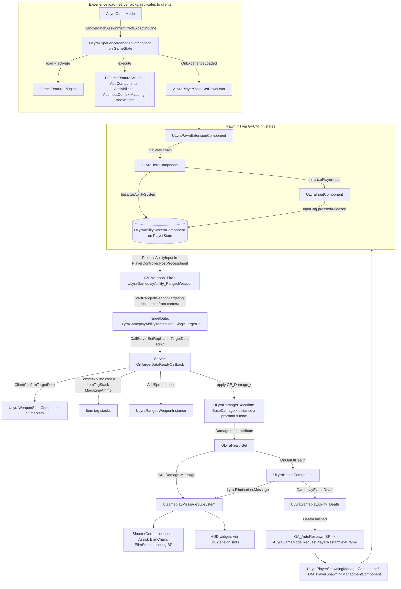

# Research: Unreal Engine 5 — Lyra Starter Game

> Subject: Epic's Lyra Starter Game, compared with `docs/architecture.md` (the Krit crate plan).
> Primary source: the Lyra C++ in `EpicGames/UnrealEngine`, branch `release`
> (`Samples/Games/Lyra/`, engine **5.8.3**, last Lyra commit 2026-09-04). You need a linked Epic
> account to read this repository. Class and function names below were checked against that source
> unless marked *(BP, unverified)*, which means the thing lives in Blueprint/asset content we could
> not read as text.

---

## 1. Overview

- **What it is.** Lyra is Epic's "living sample", described in the source README as *"a
  bootstrapping game for Unreal Engine… shows how we build scalable games around the engine's core
  technology"*. It ships a third-person, networked shooter (Elimination/TDM, Control Point) and a
  top-down "Arena" mode. Both modes run on one game-agnostic core module (`LyraGame`), and each mode
  is delivered as a separate **Game Feature Plugin** (`ShooterCore`, `ShooterMaps`, `TopDownArena`,
  `ShooterExplorer`, `ShooterTests`).
- **Scope.** It covers:
  - initialization: data-driven "Experiences", modular pawn initialization;
  - gameplay: GAS for every action (fire, reload, ADS, dash, death, respawn, game phases),
    inventory, equipment and weapons;
  - presentation: CommonUI front end, HUD extension slots, camera-mode stack, context effects
    (surface VFX/SFX), accolades, settings, replays;
  - networking: replication graph, Iris fragments, bots.
- **Not an FPS core.** Lyra is *third-person*, and its camera system has no first-person mode. Hit
  detection is client-authoritative and has no lag compensation (see §4.6). Movement is the stock
  `UCharacterMovementComponent` (CMC) with small extensions.
- **Versions.** Lyra first shipped with UE 5.0 (2022) and is updated with each engine release.
  Epic's docs page currently targets UE 5.8.

Source links: Epic docs hub [1]; abilities [2]; inventory/equipment [3]; Modular Gameplay / GFCM [4][5];
community deep-dive by X157 [6]; GASDocumentation (tranek) [7]; forum thread on Lyra hit
validation [8].

---

## 2. Structure

### 2.1 Module / plugin layout (`Samples/Games/Lyra`)

```
Source/LyraGame/                 core game module (game-agnostic "framework" layer)
  AbilitySystem/                 ULyraAbilitySystemComponent, ULyraGameplayAbility, ULyraAbilitySet,
                                 ULyraAbilityTagRelationshipMapping, Attributes/ (ULyraHealthSet,
                                 ULyraCombatSet), Executions/ (ULyraDamageExecution, ULyraHealExecution),
                                 Phases/ (ULyraGamePhaseSubsystem, ULyraGamePhaseAbility),
                                 FLyraGameplayEffectContext, ULyraGlobalAbilitySystem
  Character/                     ALyraCharacter, ULyraPawnExtensionComponent, ULyraHeroComponent,
                                 ULyraHealthComponent, ULyraPawnData, ULyraCharacterMovementComponent
  Camera/                        ULyraCameraComponent, ULyraCameraMode(+Stack), ULyraCameraMode_ThirdPerson
  Equipment/                     ULyraEquipmentDefinition/Instance/ManagerComponent, ULyraQuickBarComponent,
                                 ULyraGameplayAbility_FromEquipment, ULyraPickupDefinition
  Inventory/                     ULyraInventoryItemDefinition/Instance/ManagerComponent, InventoryFragment_*
  Weapons/                       ULyraWeaponInstance, ULyraRangedWeaponInstance,
                                 ULyraGameplayAbility_RangedWeapon, ULyraWeaponStateComponent
  GameModes/                     ALyraGameMode, ALyraGameState, ULyraExperienceDefinition,
                                 ULyraExperienceActionSet, ULyraExperienceManagerComponent,
                                 ULyraUserFacingExperienceDefinition, ULyraBotCreationComponent
  GameFeatures/                  GameFeatureAction_AddAbilities / AddInputBinding /
                                 AddInputContextMapping / AddWidget / AddGameplayCuePath …
  Input/                         ULyraInputConfig, ULyraInputComponent, ULyraAimSensitivityData, modifiers
  Interaction/                   IInteractableTarget, FInteractionOption, ULyraGameplayAbility_Interact, tasks
  Messages/                      FLyraVerbMessage, FLyraVerbMessageReplication, UGameplayMessageProcessor
  Player/                        ALyraPlayerController, ALyraPlayerState, ULyraPlayerSpawningManagerComponent,
                                 ALyraPlayerStart, ALyraPlayerBotController
  Teams/                         ULyraTeamSubsystem, ALyraTeamInfoBase (Public/Private), ILyraTeamAgentInterface,
                                 ULyraTeamCreationComponent, ULyraTeamDisplayAsset
  System/                        FGameplayTagStackContainer, ULyraAssetManager, ULyraReplicationGraph
  Feedback/                      ContextEffects/, NumberPops/
Plugins/
  ModularGameplayActors          AModularCharacter/PlayerState/… that register with GFCM
  GameplayMessageRouter          UGameplayMessageSubsystem (tag-channel pub/sub)
  UIExtension                    UUIExtensionSubsystem (tag-addressed HUD slots)
  CommonGame / CommonUser        UPrimaryGameLayout (layer stacks), online user/session glue
  GameFeatures/ShooterCore       shooter rules: accolades, Elim chain/streak/assist processors,
                                 TDM spawn selection, aim assist, control points, all the BP abilities
  GameFeatures/ShooterMaps, TopDownArena, ShooterExplorer, ShooterTests
```

`UGameFrameworkComponentManager` (GFCM) and the Game Features subsystem are **engine** plugins
(ModularGameplay, GameFeatures), not Lyra code [4][5].

### 2.2 Major systems and data flow



---

## 3. Core framework concepts

### 3.1 Experiences and Game Features

- **`ULyraExperienceDefinition`** (`UPrimaryDataAsset`, `Const`) is the gameplay configuration for a
  session. Its fields:
  - `GameFeaturesToEnable: TArray<FString>`;
  - `DefaultPawnData: ULyraPawnData`;
  - `Actions: TArray<UGameFeatureAction>` (instanced);
  - `ActionSets: TArray<ULyraExperienceActionSet>`.
- **`ULyraExperienceActionSet`** is a reusable bundle of `Actions` plus `GameFeaturesToEnable`, and
  is composed into experiences. Examples: a shared "shooter HUD" set and a shared "shooter input"
  set.
- **`ULyraUserFacingExperienceDefinition`** is the front-end description used by the menu: map,
  experience, player count.
- **Who picks the experience.** `ALyraGameMode::HandleMatchAssignmentIfNotExpectingOne` resolves it
  in this precedence order: matchmaking assignment → URL option → developer settings (PIE) → command
  line → `ALyraWorldSettings` → dedicated-server default → default asset.
- **`ULyraExperienceManagerComponent`** is a `UGameStateComponent`. It replicates `CurrentExperience`
  and runs a load state machine:

  ```
  ELyraExperienceLoadState: Unloaded → Loading → LoadingGameFeatures
      → LoadingChaosTestingDelay → ExecutingActions → Loaded → Deactivating
  ```

  It exposes `CallOrRegister_OnExperienceLoaded_{HighPriority,(normal),LowPriority}`. These are
  three ordered "ready" buckets, Lyra's substitute for system ordering.
- **Game Feature Actions** inject behaviour into actors by class. Lyra adds
  `GameFeatureAction_AddAbilities` (`FGameFeatureAbilitiesEntry { ActorClass, GrantedAbilities,
  GrantedAttributes, GrantedAbilitySets }`), `_AddInputBinding`, `_AddInputContextMapping`,
  `_AddWidget` (`FLyraHUDLayoutRequest { LayoutClass, LayerID }`, `FLyraHUDElementEntry
  { WidgetClass, SlotID }`) and `_AddGameplayCuePath`. The engine provides `AddComponents`.
- **How the injection works.** Actions register with GFCM through `AddExtensionHandler(ActorClass,
  delegate)` and react to `NAME_ExtensionAdded` / `NAME_ExtensionRemoved` (and Lyra's own
  `ALyraPlayerState::NAME_LyraAbilityReady`). Deactivating the experience removes everything that
  was granted.

### 3.2 Modular Gameplay / GameFrameworkComponentManager

- **What GFCM is.** A `UGameInstanceSubsystem` [5]. Actors opt in by calling
  `AddReceiver`/`RemoveReceiver`, which Lyra does in `AModularCharacter`, `AModularPlayerState` and
  the other modular actors. Game Features can then add components to any receiver by class.
- **Init-state framework.** GFCM also runs a per-actor **init-state** framework through
  `IGameFrameworkInitStateInterface`. Each "feature" (component) declares a name and implements:
  - `CanChangeInitState`;
  - `HandleChangeInitState`;
  - `OnActorInitStateChanged`;
  - `CheckDefaultInitialization`.
- **The four states** (Lyra native tags):

  | State tag | Meaning (tag comment) |
  |---|---|
  | `InitState.Spawned` | "Actor/component has initially spawned and can be extended" |
  | `InitState.DataAvailable` | "All required data has been loaded/replicated and is ready for initialization" |
  | `InitState.DataInitialized` | "The available data has been initialized … but it is not ready for full gameplay" |
  | `InitState.GameplayReady` | "fully ready for active gameplay" |

- **`ULyraPawnExtensionComponent`** (feature `"PawnExtension"`) is the coordinator:
  - Spawned→DataAvailable needs `PawnData`, plus a Controller if the pawn has authority or is
    locally controlled.
  - DataAvailable→DataInitialized needs `Manager->HaveAllFeaturesReachedInitState(Pawn,
    DataAvailable)`, so it waits for **every** other feature on the pawn.
- **`ULyraHeroComponent`** (feature `"Hero"`) handles player-only setup:
  - DataAvailable needs a `ALyraPlayerState`, a controller paired with that PlayerState (unless
    simulated proxy), and an InputComponent + LocalPlayer when locally controlled by a human.
  - On DataInitialized it calls `PawnExtComp->InitializeAbilitySystem(PS->GetLyraAbilitySystemComponent(),
    PS)`, binds input from `PawnData->InputConfig`, and binds the camera-mode delegate.
- **Why it exists.** Ordering depends on network arrival. The PlayerState, Controller, PawnData and
  Pawn replicate in any order, so every component polls `CheckDefaultInitialization()` whenever any
  dependency changes.

### 3.3 PawnData, PlayerState vs Pawn

- **`ULyraPawnData`** (`Const` data asset) defines a pawn type: `PawnClass`, `AbilitySets[]`,
  `TagRelationshipMapping`, `InputConfig`, `DefaultCameraMode`. It is stored on
  `ALyraPlayerState::PawnData` (`ReplicatedUsing=OnRep_PawnData`) and pushed into the pawn's
  extension component.
- **`ALyraPlayerState`** owns everything that must survive the body:
  - the `ULyraAbilitySystemComponent` (replication mode **Mixed**, `SetNetUpdateFrequency(100)`);
  - **`ULyraHealthSet` and `ULyraCombatSet`**;
  - team id;
  - `StatTags` (`FGameplayTagStackContainer` for score: `ShooterGame.Score.Eliminations`,
    `ShooterGame.Score.Deaths`, `ShooterGame.Score.Assists`).
- **What the Pawn holds.** The Pawn (`ALyraCharacter`) is just the *avatar*. It holds
  `ULyraPawnExtensionComponent`, `ULyraHealthComponent`, `ULyraCameraComponent` and the
  `ULyraEquipmentManagerComponent` (a `UPawnComponent`).
- **What the Controller holds.** The Controller holds `ULyraQuickBarComponent`, the
  `ULyraWeaponStateComponent` (both `UControllerComponent`) and, by convention, the
  `ULyraInventoryManagerComponent`. X157 documents that this makes inventory visible only to the
  server and the owning client [6].
- **Consequence of the health set living on the PlayerState.** Health is re-based on every respawn
  in `ULyraHealthComponent::InitializeWithAbilitySystem`:
  `SetNumericAttributeBase(Health, MaxHealth)`, commented *"TEMP: Reset attributes to default
  values. Eventually this will be driven by a spread sheet."*

### 3.4 Gameplay Tags and the Gameplay Message Subsystem

- **Tags are the universal key** across the game:
  - input (`InputTag.Weapon.Fire`, `InputTag.Weapon.ADS`, `InputTag.Weapon.Reload`, `InputTag.Jump`…);
  - ability types (`Ability.Type.Action.WeaponFire`, `Ability.Type.StatusChange.Death`);
  - failure reasons (`Ability.ActivateFail.Cost/Cooldown/TagsBlocked/IsDead/ActivationGroup`);
  - status (`Status.Death.Dying/Dead`, `Status.Crouching`, `Gameplay.MovementStopped`,
    `Gameplay.DamageImmunity`);
  - item stats (`Lyra.ShooterGame.Weapon.MagazineAmmo/MagazineSize/SpareAmmo`);
  - phases (`ShooterGame.GamePhase.Warmup/Playing/PostGame`);
  - HUD slots (`HUD.Slot.Reticle`, `HUD.Slot.EliminationFeed`…);
  - physical-material zones (`Gameplay.Zone.WeakSpot`).
- **`UGameplayMessageSubsystem`** (plugin `GameplayMessageRouter`) is a world-local pub/sub bus:
  - `BroadcastMessage<T>(FGameplayTag Channel, const T&)`;
  - `RegisterListener<T>(Channel, callback, EGameplayMessageMatch::{ExactMatch, PartialMatch})`;
  - the payload is any `USTRUCT`;
  - it does **not** replicate.
- **`FLyraVerbMessage`** is the standard payload: `{ Verb, Instigator, Target, InstigatorTags,
  TargetTags, ContextTags, Magnitude }`. Server-side facts reach clients through
  `ALyraGameState::MulticastMessageToClients` / `MulticastReliableMessageToClients`, and
  `FLyraVerbMessageReplication` (a FastArray) exists for state-like messages.
- **`UGameplayMessageProcessor`** is a base class for server-side "rule" listeners. ShooterCore
  ships three:
  - `UAssistProcessor` accumulates damage per victim per instigator, emits `Lyra.Assist.Message`
    on elimination, and has no time window;
  - `UElimChainProcessor`;
  - `UElimStreakProcessor`.

---

## 4. Subsystem deep-dives

### 4.1 Input

- **`ULyraInputConfig`** (data asset) holds two lists of `FLyraInputAction { InputAction, InputTag }`:
  - `NativeInputActions` are bound manually to C++ handlers in `ULyraHeroComponent::InitializePlayerInput`.
    The tags are `InputTag.Move` → `Input_Move`, `InputTag.Look.Mouse`/`Look.Stick` →
    `Input_LookMouse`/`Input_LookStick`, `InputTag.Crouch` and `InputTag.AutoRun`. These handlers
    call `AddMovementInput` and `AddControllerYawInput`/`AddControllerPitchInput` directly, so
    movement and look **do not go through GAS**.
  - `AbilityInputActions` are bound generically through `ULyraInputComponent::BindAbilityActions`,
    which routes to `Input_AbilityInputTagPressed/Released(FGameplayTag)` →
    `ULyraAbilitySystemComponent::AbilityInputTagPressed/Released`.
- **The ASC buffers input.** It collects `InputPressedSpecHandles`, `InputReleasedSpecHandles` and
  `InputHeldSpecHandles` by matching each ability spec's **dynamic source tag**, which `ULyraAbilitySet`
  sets from `FLyraAbilitySet_GameplayAbility::InputTag`. The buffer is drained once per *frame* in
  `ALyraPlayerController::PostProcessInput` → `ProcessAbilityInput(DeltaTime, bGamePaused)`:
  - held + `WhileInputActive` → activate;
  - pressed + `OnInputTriggered` → activate;
  - pressed while active → `AbilitySpecInputPressed`;
  - released → `AbilitySpecInputReleased`;
  - everything is cleared if `Gameplay.AbilityInputBlocked` is present.
- **Input contexts come from content.** Mapping contexts are added by `GameFeatureAction_AddInputContextMapping`
  and by `PawnData`. Equipment can push extra `ULyraInputConfig`s through `AddAdditionalInputConfig`.
  `RemoveAdditionalInputConfig` is literally `//@TODO: Implement me!`.
- **Extras.** `ULyraAimSensitivityData` and `ULyraInputModifiers` (gamepad sensitivity, dead zones,
  aim inversion driven by settings), and ShooterCore's `UAimAssistInputModifier` +
  `UAimAssistTargetManagerComponent`, an *input-side* aim assist.

### 4.2 Movement / character

- **Movement is the stock CMC.** `ALyraCharacter` derives from `AModularCharacter`, and
  `ULyraCharacterMovementComponent` extends `UCharacterMovementComponent` (CMC) with:
  - `GetGroundInfo()` (cached ground trace);
  - `GetMaxSpeed()` / `GetDeltaRotation()` returning 0 when the ASC has `Gameplay.MovementStopped`.
    This is a tag-based **gate**, like Krit's `ActionGates`.
- **Prediction and replication.** Prediction and reconciliation are CMC's saved-move system. Lyra
  adds `FLyraReplicatedAcceleration` (compressed acceleration for simulated proxies' animation) and
  `FSharedRepMovement` + `FastSharedReplication` (an unreliable multicast fast path used with the
  replication graph).
- **Crouch and jump.** Crouch is a native input that sets `Status.Crouching`. Jump is an ability,
  `ULyraGameplayAbility_Jump`. Dash is an ability (BP).

### 4.3 Camera

- **The camera is a weighted stack.** `ULyraCameraComponent` owns a `ULyraCameraModeStack`.
  - Each frame it asks `DetermineCameraModeDelegate` (bound by HeroComponent) which mode should be
    on top.
  - The answer is the ability override (`ULyraGameplayAbility::SetCameraMode`, used for ADS and
    death cams) if one is set, otherwise `PawnData->DefaultCameraMode`.
  - `PushCameraMode` blends the new top mode in over `BlendTime` with `ELyraCameraModeBlendFunction`.
    `EvaluateStack` produces a weighted `FLyraCameraModeView` (location, rotation, control rotation,
    FOV).
- **Mode data.** `ULyraCameraMode` carries `FieldOfView`, `ViewPitchMin/Max`, `BlendTime`,
  `BlendFunction` and a `CameraTypeTag`.
- **Provided modes.** `ULyraCameraMode_ThirdPerson` (curve-driven offsets, penetration-avoidance
  feelers), and the top-down mode in the TopDownArena plugin. There is **no first-person mode**.
- **Simulation reads camera state.** `ULyraRangedWeaponInstance::UpdateMultipliers` reads
  `CameraComponent->GetBlendInfo()` and uses the blend weight of a mode tagged
  `Lyra.Weapon.SteadyAimingCamera` as the **ADS alpha for spread**. Gameplay accuracy therefore
  depends on presentation state (see §7).

### 4.4 Inventory / equipment

There are three layers, and each splits a *definition* (immutable CDO/asset) from an *instance*
(replicated UObject).

| Layer | Definition | Instance | Manager (owner) | Replication |
|---|---|---|---|---|
| Inventory | `ULyraInventoryItemDefinition { DisplayName, Fragments[] }` | `ULyraInventoryItemInstance { ItemDef, StatTags: FGameplayTagStackContainer }` | `ULyraInventoryManagerComponent` (Controller) | FastArray `FLyraInventoryList`; owner-only [3] |
| Quick bar | n/a | `Slots: TArray<ItemInstance>` (`NumSlots = 3`), `ActiveSlotIndex` | `ULyraQuickBarComponent` (Controller) | `SetActiveSlotIndex` is a `Server, Reliable` RPC |
| Equipment | `ULyraEquipmentDefinition { InstanceType, AbilitySetsToGrant[], ActorsToSpawn[{ActorToSpawn, AttachSocket, AttachTransform}] }` | `ULyraEquipmentInstance { Instigator(=item instance), SpawnedActors }` → `ULyraWeaponInstance` → `ULyraRangedWeaponInstance` | `ULyraEquipmentManagerComponent` (Pawn) | FastArray `FLyraEquipmentList` of `FLyraAppliedEquipmentEntry`; replicates to everyone |

- **Fragments.** `ULyraInventoryItemFragment` subclasses with `OnInstanceCreated(Instance)`:
  - `UInventoryFragment_EquippableItem { EquipmentDefinition }` is the bridge to equipment;
  - `UInventoryFragment_SetStats { InitialItemStats: TMap<Tag,int32> }` seeds magazine/spare ammo
    into the item's tag stacks;
  - `UInventoryFragment_QuickBarIcon`, `UInventoryFragment_PickupIcon` and
    `InventoryFragment_ReticleConfig` (ShooterCore) are UI data.
- **Equip flow** (all server-authoritative):
  1. The QuickBar reads the active slot's `EquippableItem` fragment.
  2. It calls `EquipmentManager->EquipItem(EquipmentDefinition)` (a `BlueprintAuthorityOnly`
     function).
  3. The equipment manager creates the instance, grants `AbilitySetsToGrant` to the ASC and keeps
     the `FLyraAbilitySet_GrantedHandles` for removal.
  4. It spawns and attaches actors and calls `OnEquipped()`.
- **Abilities granted by equipment.** These derive from `ULyraGameplayAbility_FromEquipment`, which
  can fetch `GetAssociatedEquipment()` / `GetAssociatedItem()` through the ability spec's
  `SourceObject`.
- **Ammo and pickups.** Ammo is **not a component or attribute**. It is integer tag stacks on the
  *item instance*, consumed by `ULyraAbilityCost_ItemTagStack { Quantity, Tag, FailureTag }` as an
  `AdditionalCost` of the fire ability. Reload and auto-reload are BP abilities that move stacks
  from `SpareAmmo` to `MagazineAmmo`. `GameplayEvent.ReloadDone` exists as a tag; *(BP,
  unverified)* it appears to be sent from the reload montage. Pickups (`ULyraPickupDefinition`,
  `IPickupable`, `ALyraWorldCollectable`) grant item definitions.
- **Known gaps** (X157 [6]): stacking is not fully supported, there is no inventory-full condition,
  and picking up creates new instances instead of merging stacks.

### 4.5 Weapons / firing

- **Fire is an ability.** `GA_Weapon_Fire` (BP) derives from `ULyraGameplayAbility_RangedWeapon`.
  Variants `GA_Weapon_Fire_Pistol`, `_Rifle_Auto` and `_Shotgun` [6] differ in activation policy
  (`OnInputTriggered` vs `WhileInputActive`) and in BP timer/loop logic for automatic fire. **Fire
  rate lives in BP ability timing, not in data on the weapon** *(BP, unverified in detail)*.
- **Activation rules.** Every `ULyraGameplayAbility` has:
  - `ActivationPolicy`: `OnInputTriggered`, `WhileInputActive`, `OnSpawn`;
  - `ActivationGroup`: `Independent`, `Exclusive_Replaceable`, `Exclusive_Blocking`. The ASC counts
    these per group (`ActivationGroupCounts`) so, for example, an emote is replaced by firing;
  - `AdditionalCosts: TArray<ULyraAbilityCost>`;
  - optional `ActiveCameraMode`.

  `ULyraAbilityTagRelationshipMapping` (on PawnData) adds data-driven block, cancel, required and
  blocked tags per ability tag. The ASC applies it in `ApplyAbilityBlockAndCancelTags`.
- **`ULyraRangedWeaponInstance`** (also an `ILyraAbilitySourceInterface`) is the **spread/heat
  model**:
  - `HeatToHeatPerShotCurve`, `HeatToCoolDownPerSecondCurve` and `HeatToSpreadCurve` are three
    `FRuntimeFloatCurve`s keyed on `CurrentHeat`. The heat range is the union of the curves' X
    ranges, and the spread range is `HeatToSpreadCurve`'s Y range.
  - `AddSpread()` (on fire) adds `HeatPerShot(heat)` and re-evaluates spread.
  - `UpdateSpread(dt)` cools heat at `CoolDown(heat)` once `TimeSince(LastFireTime) >
    SpreadRecoveryCooldownDelay`.
  - **Player multipliers** are each `FInterpTo`-smoothed and multiplied together:
    `SpreadAngleMultiplier_Aiming` (scaled by the camera blend alpha), `_StandingStill` (feathered
    between `StandingStillSpeedThreshold` and `+StandingStillToMovingSpeedRange`), `_Crouching` and
    `_JumpingOrFalling`.
  - **First-shot accuracy.** `bAllowFirstShotAccuracy` gives a 0 multiplier when both heat and all
    multipliers are at minimum.
  - `SpreadExponent` biases samples toward the centre through
    `VRandConeNormalDistribution(dir, halfAngle, exponent)`, which computes
    `FromCenter = FRand()^Exponent`.
  - Per-shot config: `BulletsPerCartridge` (pellets), `MaxDamageRange`, `BulletTraceSweepRadius`.
  - **Damage modifiers live on the weapon:** `DistanceDamageFalloff` (curve), and
    `MaterialDamageMultiplier: TMap<GameplayTag, float>` matched against
    `UPhysicalMaterialWithTags::Tags` (headshots via `Gameplay.Zone.WeakSpot`).
- **Ticking.** `ULyraWeaponStateComponent::TickComponent` (on the Controller) calls `Tick` on the
  equipped ranged weapon every *frame*.
- **What Lyra does not have:** recoil patterns or aim punch, burst mode, chambering or bolt-action
  as data, projectile ballistics in C++ (grenades are BP actors), penetration, and ricochet.

### 4.6 Hit detection and hit confirmation

- **Targeting** (`ULyraGameplayAbility_RangedWeapon::StartRangedWeaponTargeting`), run on the
  *locally controlled* client or on a listen-server host:
  1. `PerformLocalTargeting` builds `FRangedWeaponFiringInput` from
     `GetTargetingTransform(Pawn, ELyraAbilityTargetingSource::CameraTowardsFocus)`. The other
     options are `PawnForward`, `PawnTowardsFocus`, `WeaponForward`, `WeaponTowardsFocus` and
     `Custom`, so the **trace starts at the camera**.
  2. `TraceBulletsInCartridge` runs one cone-sampled trace per pellet, using `FMath::FRand`, which
     is not seeded or shared with the server. `DoSingleBulletTrace` tries a line trace, then a sweep
     with `BulletTraceSweepRadius` if no pawn was hit. `FindFirstPawnHitResult` prefers pawn hits.
  3. Hits become `FLyraGameplayAbilityTargetData_SingleTargetHit { HitResult, CartridgeID,
     bHitReplaced }`. `CartridgeID = FMath::Rand()` groups pellets, and is carried into
     `FLyraGameplayEffectContext::CartridgeID`.
  4. `WeaponStateComponent->AddUnconfirmedServerSideHitMarkers(...)` records hit markers.
- **Server side.** `OnTargetDataReadyCallback`:
  - opens `FScopedPredictionWindow`; a non-authority client calls
    `CallServerSetReplicatedTargetData` to ship its hits;
  - on the server, `bIsTargetDataValid = true` is **hard-coded**. The server immediately sends
    `ClientConfirmTargetData(UniqueId, bSuccess, HitReplaces)`, so the client's
    `ULyraWeaponStateComponent` turns confirmed markers into `LastWeaponDamageScreenLocations` for
    the hit-marker widget;
  - `CommitAbility` (checks and pays the ammo cost), then `WeaponData->AddSpread()`, then the BP
    `OnRangedWeaponTargetDataReady` applies damage GEs and GameplayCues.
- **Net result: client-authoritative hits, no server re-trace, no lag compensation.** The forum
  consensus [8] is *"not exactly wrong, but simplified/incomplete"*: validation defaults to true,
  `bHitReplaced` is never set, and an Epic engineer reportedly called the targeting
  `FScopedPredictionWindow` useless. Nothing in the Lyra source references rewind or lag
  compensation (we grepped for it).

### 4.7 Damage / health / death

- **Attribute sets.** Lyra uses GAS attribute sets, with **meta-attributes** as the damage door:
  - `ULyraHealthSet`: `Health`, `MaxHealth`, plus meta-attributes `Damage` and `Healing`
    (server-only, never replicated as state);
  - `ULyraCombatSet`: `BaseDamage`, `BaseHeal` (source-side).
- **`ULyraDamageExecution`** (`UGameplayEffectExecutionCalculation`, `#if WITH_SERVER_CODE` only):
  1. Captures source `BaseDamage` (snapshot).
  2. Gets the hit from `FLyraGameplayEffectContext` (`HitResult`, origin, `AbilitySourceObject`,
     `CartridgeID`).
  3. Computes `DamageInteractionAllowedMultiplier = TeamSubsystem->CanCauseDamage(Causer, HitActor) ? 1 : 0`.
  4. Computes distance from the context origin, falling back to the causer's location.
  5. `DistanceAttenuation = AbilitySource->GetDistanceAttenuation(dist)` and
     `PhysicalMaterialAttenuation = AbilitySource->GetPhysicalMaterialAttenuation(physmat)`. The
     ability source is the weapon instance.
  6. Outputs `+Damage = max(Base × dist × physmat × team, 0)`.
- **`ULyraHealthSet::PreGameplayEffectExecute`** zeroes damage if the target has
  `Gameplay.DamageImmunity` (unless the effect carries `Gameplay.Damage.SelfDestruct`) or
  `Cheat.GodMode`.
- **`ULyraHealthSet::PostGameplayEffectExecute`**:
  - broadcasts `FLyraVerbMessage` on `Lyra.Damage.Message`;
  - converts `Damage` into `-Health` with a clamp, and `Healing` into `+Health`;
  - fires `OnHealthChanged`, `OnMaxHealthChanged` and `OnOutOfHealth`, guarded by `bOutOfHealth`.
- **`ULyraHealthComponent`** (pawn) bridges the attribute set to gameplay:
  - It holds `ELyraDeathState { NotDead, DeathStarted, DeathFinished }` (replicated) and the tags
    `Status.Death.Dying/Dead`.
  - On `OnOutOfHealth` (server only) it sends `GameplayEvent.Death` into the ASC inside a
    `FScopedPredictionWindow`, and broadcasts `Lyra.Elimination.Message`.
  - Assist computation is left as a TODO here; it is done by ShooterCore's `UAssistProcessor`.
- **Death and respawn.** `ULyraGameplayAbility_Death` is triggered by that event. It cancels other
  abilities (except those tagged `Ability.Behavior.SurvivesDeath`) and calls `StartDeath` /
  `FinishDeath`. Respawn is a passive BP ability, `GA_AutoRespawn` (tags
  `Ability.Type.Passive.AutoRespawn`, `Ability.Respawn.Duration.Message`), which after a delay calls
  `ALyraGameMode::RequestPlayerRestartNextFrame(Controller, bForceReset)`. `GameplayEvent.RequestReset`
  / `ULyraGameplayAbility_Reset` handle instant replacement.
- **Prediction.** Damage is **never predicted**. This follows Epic guidance: executions cannot be
  predicted, and predicting death is discouraged [7].

### 4.8 Interaction

- **Targets.** `IInteractableTarget::GatherInteractionOptions(FInteractionQuery, FInteractionOptionBuilder&)`
  returns `FInteractionOption` records:

  ```
  { InteractableTarget, Text, SubText, InteractionAbilityToGrant,
    TargetAbilitySystem, TargetInteractionAbilityHandle, InteractionWidgetClass }
  ```

- **Detection.** `ULyraGameplayAbility_Interact` (an `OnSpawn` passive) runs
  `UAbilityTask_GrantNearbyInteraction`, which pre-grants the target's interaction ability as you
  approach so its activation can be predicted. It also runs
  `UAbilityTask_WaitForInteractableTargets_SingleLineTrace` for focus.
- **Activation and hold-to-use.** Activation is a gameplay event (`Ability.Interaction.Activate`)
  against the granted ability. Hold-to-use progress is broadcast as `FLyraInteractionDurationMessage`.

### 4.9 Match: game mode, phases, teams, spawns

- **Game phases.** **`ULyraGamePhaseSubsystem`** (`UWorldSubsystem`) treats phases as a tag tree.
  Each phase is a `ULyraGamePhaseAbility { GamePhaseTag }` activated on the GameState's ASC.
  - Starting a phase ends any active phase that is **not an ancestor** of it. For example,
    `Game.Playing` and `Game.Playing.Warmup` can coexist, but siblings cannot.
  - Observers use `WhenPhaseStartsOrIsActive(Tag, EPhaseTagMatchType::{ExactMatch,PartialMatch}, cb)`
    and `WhenPhaseEnds`. All of these are `BlueprintAuthorityOnly`; clients learn about phases
    through replicated tags and messages.
  - The phase tags are `ShooterGame.GamePhase.Warmup`, `.MatchBeginCountdown`, `.Playing` and
    `.PostGame`.
- **Teams.** **`ULyraTeamSubsystem`** (`UWorldSubsystem`):
  - `FindTeamFromObject`;
  - `CompareTeams(A, B) -> ELyraTeamComparison { OnSameTeam, DifferentTeams, InvalidArgument }`;
  - `CanCauseDamage(Instigator, Target, bAllowDamageToSelf = true)`. This **hard-codes "no friendly
    fire"**, and allows damage to team-less actors that have an ASC (marked `@TODO temporary`);
  - `AddTeamTagStack` for team score.

  Teams are `ALyraTeamPublicInfo`/`ALyraTeamPrivateInfo` actors with a `ULyraTeamDisplayAsset`
  (colours), created by `ULyraTeamCreationComponent` on the GameState (added by the experience).
  Agents implement `ILyraTeamAgentInterface`.
- **Spawns.** **`ULyraPlayerSpawningManagerComponent`** (`UGameStateComponent`) chooses among
  `ALyraPlayerStart`s, which have claim and occupancy logic. Modes override
  `OnChoosePlayerStart(Controller, Starts)` and `OnFinishRestartPlayer`. ShooterCore's
  `UTDM_PlayerSpawningManagmentComponent` picks the start farthest from enemy pawns, falling back to
  claimed starts.
- **Scoring, bots and modes.** Scoring is in BP: an elimination-message listener writes
  `ShooterGame.Score.*` tag stacks on PlayerStates and `Lyra.ShooterGame.TDM.TeamScore` on teams
  *(BP, unverified)*. `ULyraBotCreationComponent` fills slots with bots. Mode logic is otherwise
  experience-specific GameState components added by Game Feature actions; there is no `if mode`
  code in core.

### 4.10 UI / feedback

- **Layout and slots.** `UPrimaryGameLayout` (CommonGame) is the root widget, with named layer
  stacks (`UI.Layer.Game/GameMenu/Menu/Modal`) filled through `PushWidgetToLayerStackAsync`.
  **`UUIExtensionSubsystem`** gives the HUD **tag-addressed slots**:
  - layouts declare `UUIExtensionPointWidget`s for tags such as `HUD.Slot.Reticle`,
    `HUD.Slot.EliminationFeed`, `HUD.Slot.TeamScore`, `HUD.Slot.Equipment`, `HUD.Slot.ModeStatus`
    and `HUD.Slot.TopAccolades`;
  - features register into them with `RegisterExtensionAsWidget(ForContext)` or
    `RegisterExtensionAsData`, usually through `GameFeatureAction_AddWidget`.
- **Feeds and accolades.** Kill feed (`Lyra.AddNotification.KillFeed`) and accolades
  (`ULyraAccoladeDefinition`, `Lyra.ShooterGame.Accolade.EliminationChain.2x…`) are message-driven.
- **Hit feedback.** Hit markers come from `ULyraWeaponStateComponent`'s confirmed list. Damage
  numbers use `Feedback/NumberPops`. Surface impacts use `Feedback/ContextEffects`
  (`ULyraContextEffectsLibrary`, tag-matched by physical material).
- **Widgets pull data.** Widgets read GAS attributes and tag stacks, or listen on the message bus.
  There is no intermediate HUD read-model layer.

### 4.11 Networking / replication / prediction

- **Authority and ownership.**
  - Server-authoritative ASC on the PlayerState, in `Mixed` mode: GEs go to the owner only; tags and
    cues go to everyone.
  - Equipment and inventory use FastArray (`FFastArraySerializer`) lists. Item and equipment
    instances are replicated subobjects (`IsSupportedForNetworking`, `RegisterReplicationFragments`
    for Iris).
  - `ULyraReplicationGraph` handles relevancy and spatialization, with the `FSharedRepMovement`
    fast path.
- **What is predicted:**
  - movement, through CMC saved moves;
  - ability activation, through GAS prediction keys;
  - cosmetic GameplayCues;
  - **hit results, which are effectively client-authoritative** rather than predicted (§4.6).
- **What is server-only:** damage, death, ammo commit (`CommitAbility` runs on both sides; the
  server's result is authoritative), phase, score and spawn.
- **No determinism and no rollback beyond GAS prediction keys.** Everything ticks on the variable
  frame `DeltaTime`: spread `FInterpTo`, heat cooldown and `ProcessAbilityInput`. Randomness uses the
  global `FMath::FRand`.

---

## 5. Mapping to the Krit plan

| Lyra concept | Krit crate / type / principle | Verdict |
|---|---|---|
| `ULyraExperienceDefinition` + `ActionSets` + GameFeatures | `krit_fps` feature flags + `KritFpsPlugins` + `LoadoutDefinition` (§5.17, §10) | **Partial agreement.** Same "compose a game from plugins" goal. Krit composes at compile time / `App` build. Lyra composes per session at runtime. **Gap:** no runtime "mode bundle" asset. |
| GFCM `AddExtensionHandler` / `AddComponents` by actor class | Bevy `#[require]`, `register_required_components_with`, observers on `Add` | **Agreement** (Bevy gives this natively and more cheaply). |
| Init-state chain (Spawned → DataAvailable → DataInitialized → GameplayReady) | none (spawn is synchronous in ECS) | **Gap (minor).** Needed once `krit_net` replicates Player/Character separately: a "Character ready" marker. |
| `ALyraPlayerState` (ASC, health, score, team) vs `ALyraCharacter` avatar | P5 `Player` / `Character` + `Controls` ↔ `ControlledBy` (§5.1) | **Agreement on split; divergence on where health lives.** Lyra puts Health on the PlayerState; Krit puts it on the Character (`krit_damage`). |
| `ULyraPawnData` | Character archetype: `MovementProfile` + input context + `CameraMode` + granted items | **Gap.** No single "character archetype" asset in the plan. |
| `ULyraInputConfig` NativeInputActions → direct `AddMovementInput` | P1 `CharacterIntent` (§6.1) | **Divergence.** Lyra feeds CMC directly. Krit's intent component is better for bots, replay and rollback. |
| AbilityInputActions → `InputTag` → ASC pressed/held/released buffers | `Buttons` pressed/held/released edges → `ItemIntent` routing (§5.6, §6.1) | **Agreement in shape** (edge buffers drained once per step). Krit drains per *tick*, Lyra per *frame*. |
| `ActivationPolicy` (`OnInputTriggered` / `WhileInputActive`) | `FireMode::{Semi, Auto}` in `krit_weapons` | **Agreement** (Krit puts it on the weapon as data, not on the ability class). |
| `ActivationGroup` + `ULyraAbilityTagRelationshipMapping` (block/cancel) | `ActionGates` (§5.1 gates, §6.1) | **Partial.** Gates cover "block". **Gap:** no "cancel X when Y starts" (reload cancelled by sprint, emote cancelled by fire) or "replaceable exclusive" concept. |
| `Gameplay.MovementStopped`, `Gameplay.AbilityInputBlocked` tags | `ActionGates::{MOVE, FIRE, …}` | **Agreement.** Krit's bitflags are cheaper; Lyra's are open-ended. |
| `ULyraInventoryItemDefinition` + fragments | `krit_inventory::ItemDefinition` + fragment components (§5.5) | **Agreement** (Krit explicitly cites Lyra). |
| `ULyraEquipmentDefinition { InstanceType, AbilitySetsToGrant, ActorsToSpawn }` | `krit_equipment` + `Equippable { slot }` + `ViewSocket` parenting + `Modifiers` | **Agreement.** "Grant ability set on equip" ≈ Krit's input context push + stat modifiers on equip. |
| `ULyraQuickBarComponent` (3 slots, Controller) | `EquipmentSlots` (Character) + `InventorySlots` layout | **Agreement** (Krit's is richer). |
| Inventory on Controller | §12 open question (Player vs Character) | **Informs §12.** Lyra's choice shows the cost: AI or teammate inventories are invisible to other clients [6]. |
| Ammo as `GameplayTagStack` on item instance + `ULyraAbilityCost_ItemTagStack` | `Magazine` component + `AmmoPool` + `AmmoProvider` trait (§6.5) | **Divergence (Krit better):** typed components, testable, no stringly tags. Lyra's *cost object* idea is still worth taking (see §8). |
| `ULyraRangedWeaponInstance` heat curves | `SpreadModel` "Lyra-style heat curves" (§5.7) | **Agreement** (already planned). Lyra fills in the details: three curves, recovery delay, exponent, first-shot accuracy, per-stance multipliers. |
| Spread ADS multiplier read from camera blend weight | P2, `AdsState` (0..1) in `krit_weapons` | **Divergence (Krit better).** Lyra's sim reads presentation. |
| `FMath::FRand` cone sampling | `SimRng::for_shot` (§5.1, §8) | **Divergence (Krit better).** Deterministic and server-reproducible. |
| `ELyraAbilityTargetingSource::CameraTowardsFocus` | P4 `AimRay` from `ViewAngles` + `EyeHeight` | **Agreement in intent** (trace from the eye). Lyra uses the *camera*; Krit uses sim aim state (better for server and bots). |
| Ranged ability does trace + ammo + spread + damage in one class | P3 pipeline `ShotRequest` → `HitResult` → `DamageRequest` | **Divergence (Krit better for swapability).** Lyra fuses firing and resolution in one ability. |
| `FLyraGameplayAbilityTargetData_SingleTargetHit` + `CartridgeID` | `HitResult { shot_id }`, `DamageRequest.group` | **Agreement** (pellet grouping id). |
| `ULyraWeaponStateComponent` unconfirmed → confirmed hit markers | `HitConfirmed` (§5.9) → `krit_feedback::HitmarkerQueue` | **Agreement.** **Gap:** client-predicted *unconfirmed* markers keyed by shot id. |
| Client-authoritative hits, no lag comp | `RewindProvider` + `krit_net` history (§5.8, §5.16) | **Divergence (Krit better).** |
| `ULyraDamageExecution`: distance falloff + physmat multiplier in *damage* stage via `ILyraAbilitySourceInterface` | Falloff + zone multiplier in *ballistics* (§6.3) | **Divergence.** Both are defensible (§7.3). |
| Team check inside damage execution (`CanCauseDamage`) | `DamagePipelineSystems::Policy` + `FriendlyFirePolicy` + `TeamRelations` | **Agreement in placement; Krit better** (policy is configurable; Lyra hard-codes no-FF). |
| `ULyraHealthSet` meta-attributes `Damage` / `Healing` | `DamageRequest` / `HealRequest` messages | **Agreement.** Both use one door for every damage source. |
| `Gameplay.DamageImmunity`, `Cheat.GodMode` in `PreGameplayEffectExecute` | `DamagePipelineSystems::Validate` + `Invulnerable` | **Agreement.** |
| `OnOutOfHealth` → `GameplayEvent.Death` + `Lyra.Elimination.Message` | `Died` EntityEvent + Message (§4.1, §6.4) | **Agreement** (dual channel: per-entity hook + global bus). |
| `ELyraDeathState { NotDead, DeathStarted, DeathFinished }` | `LifeState { Alive, Downed, Dead }` | **Partial.** **Gap:** Krit lacks a "dying" (death-sequence) sub-state separate from "dead / ready to clean up". |
| `UAssistProcessor` from damage messages | `DamageLedger` in `krit_damage`, `Died.assisters` | **Agreement in outcome; divergence in placement.** Krit's is better: one source of truth, testable. |
| `ULyraGamePhaseSubsystem` (hierarchical tag phases) | `MatchPhase` `States` + `SubStates` (§5.11) | **Agreement** (nesting = SubStates). Lyra's "end non-ancestor phases" rule is a good spec for our transitions. |
| `ULyraTeamSubsystem::CompareTeams` | `TeamRelations::relation(a, b)` | **Agreement** (Krit adds `Neutral`, `Self_`). |
| `ULyraPlayerSpawningManagerComponent::OnChoosePlayerStart` | `SpawnSelector` trait (§5.11) | **Agreement.** TDM "farthest from enemies" = one of our listed selectors. |
| `GA_AutoRespawn` → `RequestPlayerRestartNextFrame` | `RespawnPolicy` + `SpawnCharacter` (§6.6) | **Agreement** (Krit's is data, not an ability). |
| Camera mode stack with weighted blend | `krit_kamera::CameraMode` (§5.12) | **Partial.** **Gap:** Krit lists modes but has no blending stack or ability/item override. |
| `UGameplayMessageSubsystem` (tag-channel, untyped-by-channel bus) | `Message` / `EntityEvent` (§4.1) | **Agreement in role.** Bevy's typed messages are strictly better (§7.5). |
| `UUIExtensionSubsystem` slots | `krit_feedback` read models, "does not draw UI" (§5.14) | **Different layer**, compatible. **Gap:** an optional slot/extension registry might help modes contribute HUD widgets. |
| GameplayCues (cosmetic, replicated unreliably) | `PlayCue { id, at }` + cumulative counters (§5.14, §8) | **Agreement.** Krit's counter approach is more replay-safe. |
| `ULyraInteraction*` (options gathered from target, ability granted by proximity) | `krit_interaction` `Interactable` + `InteractionFocus` (§5.10) | **Agreement.** Lyra adds *multiple options per target* (a gap for us). |
| Aim assist as an input modifier (`UAimAssistInputModifier`) | nothing | **Gap** (would live in `krit_input` or a sibling crate, outside sim). |
| `FGameplayTagStackContainer` (generic tag→count, replicated) | `krit_stats` modifiers / Score components | **Divergence.** Krit uses typed components. |
| GAS attributes with aggregator (base + mods) | P7 `krit_stats` | **Agreement** (Krit cites GAS as origin). |

---

## 6. Where it agrees with the plan

1. **P5, the Player/Character split.** Lyra's PlayerState-owns-persistent-state pattern is
   explicitly Krit's origin. Score lives on the PlayerState (`ShooterGame.Score.*` tag stacks), and
   team id lives on the PlayerState with a mirror (`MyTeamID`) on the character. Identity is on the
   persistent entity, and the body is replaceable, which matches §5.1 `Controls` ↔ `ControlledBy`.
2. **P7, stats as base plus modifiers.** GAS attributes keep `BaseValue` and `CurrentValue`, with
   aggregated modifiers from active GEs. Lyra never mutates the definition assets either:
   `ULyraPawnData`, `ULyraInventoryItemDefinition` and `ULyraEquipmentDefinition` are all `Const`.
   This matches `krit_stats` (§5.2) and the derived-vs-state split in §8.
3. **P8, rules as queried policies.** Team damage rules are a subsystem query (`CanCauseDamage`),
   spawn choice is an overridable component (`OnChoosePlayerStart`), and phases are a queryable
   subsystem (`IsPhaseActive`). Core Lyra contains no mode `if`s; ShooterCore and TopDownArena add
   behaviour by injecting components and abilities. This is the `krit_modes`-on-`krit_match`
   relationship (§5.11).
4. **P3, a single damage door and a dual-channel death fact.** All damage passes through one
   meta-attribute (`Damage`) and one place (`ULyraHealthSet::PostGameplayEffectExecute`). That
   matches §6.3 "any → damage: `DamageRequest`" and the §5.9 statement that damage is the single
   source of truth for kills. Death is both a per-actor event (`GameplayEvent.Death`, like `On<Died>`)
   and a global bus message (`Lyra.Elimination.Message`, like a `Message`), which is exactly §4.1's
   "keep the two in sync".
5. **P6, composition via fragments.** Item fragments (`UInventoryFragment_EquippableItem`,
   `UInventoryFragment_SetStats`…) give items optional capabilities without subclassing. §5.5
   already adopts this.
6. **Inventory → equipment layering.** Equipment knows about inventory instances through
   `Instigator`; inventory knows nothing of equipment except the fragment pointing to an
   `EquipmentDefinition`. This is the allowed `krit_equipment → krit_inventory` edge in §3.1.
7. **Equipment works for non-weapons.** `ULyraEquipmentInstance` is generic, and weapons are a
   subclass. This matches §5.6's flashlight/medkit point.
8. **Gates.** `Gameplay.MovementStopped` (read by the CMC), `Gameplay.AbilityInputBlocked` (read by
   the ASC) and `Ability.ActivateFail.IsDead` are "domains contribute blocks, consumers query".
   This is `ActionGates` (§5.1).
9. **Server-only damage, no damage prediction.** Lyra does not predict damage or death (GAS
   executions cannot be predicted [7]). This supports the plan's "everything else server
   authoritative" (§5.16), with only movement and weapons predicted.
10. **Hierarchical phases.** `ULyraGamePhaseSubsystem` = Bevy `States` + `SubStates` (§5.11). The
    "start a phase, end every non-ancestor" rule matches what SubStates give us for free.
11. **Cosmetics separated from gameplay.** GameplayCues are a separate, unreliable, cosmetic
    channel. This supports P2 and the §8 "no side effects in sim" rule.

---

## 7. Where it runs counter

### 7.1 Simulation reads the camera (violates P2 and P4)

- **The problem.** Lyra traces shots from `CameraTowardsFocus`, and scales spread by the **camera
  mode blend weight** (`GetBlendInfo` → `Lyra.Weapon.SteadyAimingCamera`). On a dedicated server
  the camera component still evaluates, but its result depends on frame timing. Bots and replays
  aim through `ControlRotation`.
- **Verdict: Krit is right.** `ViewAngles` + `EyeHeight` on the character, and `AdsState` in
  `krit_weapons`, give the same feel and are tick-deterministic. Krit should still let a
  third-person game use a camera-towards-focus *aim correction*. One way is an optional `AimTarget`
  point that a presentation system writes into intent, which treats aim convergence as an
  intent-level input, as Lyra's `PawnTowardsFocus` does.

### 7.2 Firing and hit resolution fused in one ability (contradicts P3)

- **The problem.** `ULyraGameplayAbility_RangedWeapon` does all of the following in one class:
  targeting, tracing, hit-marker bookkeeping, server RPC, ammo commit, adding spread, and (in BP)
  damage application. It also calls into `ULyraWeaponStateComponent` on the Controller. Replacing
  hitscan with projectiles means a different ability. For Lyra's grenades this is a BP actor that
  doesn't share the trace code.
- **Verdict: Krit is right** for a library whose stated goal is replaceable stages
  (`ShotRequest`/`HitResult`/`DamageRequest`). GAS's strength, which is arbitrary per-ability BP
  logic, matters less in Rust/ECS, where systems over marker components already give per-weapon
  behaviour (P6).

### 7.3 Where range falloff and zone multipliers are applied

- **What Lyra does.** Lyra applies distance falloff and physical-material (headshot) multipliers
  in **`ULyraDamageExecution`**, i.e. the damage stage. It asks the *ability source* (the weapon
  instance, via `ILyraAbilitySourceInterface`) for the curves, and gets the distance from
  `EffectContext.Origin` → `HitResult.ImpactPoint`. Krit (§6.3) applies them in **ballistics**,
  "the only stage that knows distance".
- **Lyra's argument.** Lyra's argument is that the hit context travels with the damage. Every
  damage source, explosions included, gets falloff through one execution, and a target-side
  modifier can see the raw base damage.
- **Krit's argument.** Krit's argument is that `krit_damage` must not need weapon data. Lyra solves
  the same problem with a trait object, the ability source interface, which Krit would have to
  express as an `Entity` lookup into weapon components. That re-couples damage to weapons.
- **Verdict: keep Krit's placement.** But carry what Lyra carries: `DamageRequest` should keep
  `distance` and the *unmodified* `base_amount` alongside `amount`. Armor or perks that care about
  range ("damage reduction beyond 30 m") or about base damage can then work in `Resist`/`Policy`
  without recomputing. (See §8.)

### 7.4 Health on the PlayerState

- **What Lyra does.** Health and Combat sets live on the PlayerState's ASC, so health has to be
  reset on every spawn (the "TEMP" comment). The PlayerState is always relevant and needs a high
  `NetUpdateFrequency` (100). GASDocumentation notes that Fortnite works around this by proxying
  attributes onto the Pawn for simulated proxies [7].
- **Verdict: Krit's choice is better** for an FPS where the body is the thing that gets hurt.
  `Health` goes on the Character (§5.9), and per-player persistence (perks, loadout) goes on the
  Player as *modifier sources* targeting whichever Character the player currently controls. This
  avoids the reset hack and relevancy cost. Lyra's choice only pays off when the ASC must outlive
  the pawn for *abilities*, which Krit does not model.

### 7.5 Frame-based, non-deterministic simulation (contradicts §8)

- **The problem.**
  - `ProcessAbilityInput` runs in `PlayerController::PostProcessInput`, once per frame.
  - Weapon spread and heat tick from `ULyraWeaponStateComponent::TickComponent(DeltaTime)`.
  - Multipliers use `FInterpTo(…, DeltaSeconds, rate)`.
  - Cone sampling uses `FMath::FRand`, and `CartridgeID = FMath::Rand()`.
  - Fire cadence lives in BP timers *(BP, unverified)*.
- **Consequences.** None of this replays identically. The server can't recompute the client's
  spread, so it can't validate shots even in principle.
- **Verdict: Krit is right.** Fixed tick, `SimRng::for_shot`, and state in components are
  prerequisites for the server-side validation Lyra lacks. Lyra's approach is fine for a
  client-authoritative sample.

### 7.6 Client-authoritative hits, no lag compensation

- **The problem.** The server accepts client target data (`bIsTargetDataValid = true`), and
  `bHitReplaced` is never set [8]. Lyra has no rewind.
- **Verdict: Krit's planned approach is better** (server re-trace with `RewindProvider`, §5.8,
  §5.16). We should still keep Lyra's *confirmation protocol* (unconfirmed markers keyed by shot
  id, then a server confirm or replace) as the client-side UX layer on top. See §8.

### 7.7 Stringly-typed everything (Gameplay Tags as data model)

- **What Lyra does.** Ammo, score, team score, item stats, phases, input routing, ability
  categories and HUD slots are all `FGameplayTag`. This is very flexible for designers and
  hot-loadable through Game Features, but none of it is type-checked. For example, a typo in
  `Lyra.ShooterGame.Weapon.MagazineAmmo` silently gives 0 ammo.
  `UGameplayMessageSubsystem` checks payload struct types only at runtime.
- **Verdict.** Krit's typed components and Messages are better in Rust. Where we need open-ended
  ids (damage types, stat ids, hit zones, cue ids), §5.1/§5.2 already plan interned ids
  (`DamageTypeId`, `StatId`). Keep those hierarchical-capable only if a real need appears.

### 7.8 Experiences at runtime vs features at compile time

- **What Lyra does.** Lyra can switch the whole rule set (abilities, components, HUD, input) per
  session without restarting, and can load content (GFPs) on demand.
- **What Krit does.** Krit's facade uses Cargo features plus `PluginGroup`, so the rule set is
  fixed when the `App` is built.
- **Verdict.** Neither is wrong. Bevy can't hot-add plugins safely mid-run, but it *can* switch
  rule sets with States and run conditions. This is a real gap for "one binary hosts TDM and CTF
  from a menu" (see §8, item 1).

---

## 8. Ideas worth adopting / gaps in the plan

1. **`ModeDefinition` / "experience" as data plus run conditions** (`krit_match`, `krit_modes`,
   `krit_fps`). Add a `MatchExperience` asset or resource:

   ```
   { rules: MatchRules, default_archetype: Handle<CharacterArchetype>,
     loadout: Handle<LoadoutDefinition>, spawn_selector, respawn_policy,
     ff_policy, phases: [...], enabled_modes: [ModeId] }
   ```

   Every `krit_modes` plugin is *installed* at build time but runs only
   `.run_if(mode_active::<Ctf>)`. This gives Lyra's per-session switching without runtime plugin
   loading. It answers "how do I host several modes in one server" before anyone asks.
2. **`CharacterArchetype` (≈ `ULyraPawnData`)** (`krit_core` type, consumed by `krit_match`
   lifecycle). One asset bundles: movement profile, default camera mode, an input-context id
   (resolved by `krit_input`, so core doesn't import BEI), granted items/loadout, health stats, and
   hurtbox layout. `SpawnCharacter` then takes `archetype` instead of only `loadout`. This is cheap
   and makes "Quake preset vs tactical preset" a single swap.
3. **A cancel/replace relation, not only block** (`krit_core::gates`, used by weapons, equipment
   and movement). Lyra's `ActivationGroup` and `TagRelationshipMapping` show that FPS actions need
   **cancel** semantics: sprint cancels reload, fire cancels emote, equip cancels ADS. `ActionGates`
   only blocks. Proposal:
   - an `ActionCancels` bitflags component, contributed like gates;
   - consumers check it in their state machines (`WeaponState::Reloading` → `Idle` when
     `CANCEL_RELOAD` is set);
   - a data table, `GateRelations { when: Action, blocks: Gates, cancels: Gates }`, on the
     archetype (item 2) gives the Lyra mapping without tags.
4. **Spread model details to copy exactly** (`krit_weapons::SpreadModel`). Copy these parameters:
   - three heat curves (`heat→spread`, `heat→heat_per_shot`, `heat→cooldown_rate`);
   - `recovery_delay`;
   - `spread_exponent` (centre bias);
   - `first_shot_accuracy` (only when heat *and* every multiplier is at minimum);
   - stance multipliers (`standing_still` with a speed feather band, `crouching`, `airborne`, `ads`),
     each smoothed toward its target.

   Two Krit-specific changes:
   - Smoothing must use fixed-dt exponential decay per tick, not `FInterpTo` on frame dt.
   - The inputs must be `MovementSpreadFactor`/`KinematicState` and `AdsState`, never the camera.

   Curves: use a small `Curve` type (piecewise-linear `Vec<(f32, f32)>`) in `krit_core` or
   `krit_stats` so it is `Reflect` + RON friendly. Lyra's `FRuntimeFloatCurve` equivalent is
   something every crate (falloff, heat, recoil) wants.
5. **Carry hit context in `DamageRequest`** (`krit_core::combat`). Add `base_amount`, `distance`
   and `source_origin: Option<Vec3>`, plus `surface: Option<SurfaceMaterialId>`. Then a game can
   move falloff into a custom `DamagePipelineSystems::Resist` stage (Lyra's placement) without
   touching ballistics. That keeps both camps happy (§7.3).
6. **Hit-confirmation protocol** (`krit_feedback` + `krit_net`). Copy Lyra's
   `ULyraWeaponStateComponent` flow:
   1. The client records *unconfirmed* markers per `ShotId` from its predicted `HitResult`s.
   2. The server answers `HitConfirmed { shot_id, confirmed: bool, replaced: SmallVec<u8> }`.
   3. Only confirmed markers render (or unconfirmed ones render dim).

   Today §5.9 only has the server→shooter `HitConfirmed`. Add the unconfirmed queue keyed by
   `ShotId` to `krit_feedback::HitmarkerQueue`.
7. **Ability-cost-like `AmmoCost` on the fire path** (`krit_weapons`). Lyra's `ULyraAbilityCost`
   objects (`ItemTagStack`, `InventoryItem`, `PlayerTagStack`) keep "what does a shot cost" as
   data: ammo, energy, health, a charge. Generalize `AmmoSource` to `ShotCost` (`Magazine(n)`,
   `Pool { ammo_type, n }`, `Stat { stat_id, n }`, `Custom(id)`), checked before and paid at commit
   in `WeaponSystems::FireControl`. This covers energy weapons, overheat-only weapons and
   blood-magic guns without new crates.
8. **Death sequence state** (`krit_damage::LifeState`). Split into `Alive`, `Downed`, `Dying
   { until }` and `Dead`, like Lyra's `DeathStarted`/`DeathFinished`. Match/lifecycle then despawns
   on `Dead`, and death cams and ragdolls own the `Dying` window. Add `Ability.Behavior.SurvivesDeath`
   as a component, `SurvivesDeath`, that stops items or effects being cancelled on death (for
   example a dead-man's grenade).
9. **Camera mode stack with blending and overrides** (`krit_kamera`). Replace the single
   `CameraMode` enum with a `CameraModeStack` component: `Vec<(ModeId, weight, blend_time,
   blend_fn)>`. The top mode is chosen by priority from (a) item or state overrides (ADS, death,
   spectate) and (b) the archetype default. This is still presentation-only; it just reads
   `AdsState` and `LifeState`.
10. **Phase observers that fire if already active** (`krit_match`). Lyra's
    `WhenPhaseStartsOrIsActive` avoids the classic "late joiner/late plugin missed `OnEnter`" bug.
    In Bevy, add a run condition `phase_active(MatchPhase::InRound)`, and document that systems
    which set up state must use it (or `in_state`), not only `OnEnter`.
11. **Ordered "ready" buckets → explicit startup sets** (`krit_core`). Lyra needs
    `OnExperienceLoaded_HighPriority/normal/LowPriority` because it has no scheduler. Krit's
    equivalent is a `KritStartupSystems::{LoadDefinitions, BuildRules, SpawnPlayers}` chain in
    `OnEnter(match-ready)`. Add it next to `KritSimSystems`.
12. **Network "Character ready" marker** (`krit_core`, `krit_net`). Lyra's init-state chain exists
    because Player, Controller, PawnData and Pawn arrive out of order. Under replicon or lightyear,
    our `Player` and `Character` can arrive separately as well. Add a `CharacterReady` marker,
    inserted when `Controls` is resolved, the archetype is loaded and required components are
    present. Gate client-side input binding and HUD setup on it.
13. **Interaction options** (`krit_interaction`). Lyra lets one target expose *several* options
    (`FInteractionOption[]`, e.g. "Open" / "Lock"), each with its own prompt, duration and handler.
    Change `Interactable { prompt_key, hold_duration }` to `InteractOptions(SmallVec<InteractOption>)`
    with an option index in `InteractStarted/Completed`. Lyra also *pre-grants* interaction
    abilities to nearby players so activation can be predicted. For Krit, just make interaction
    progress predicted state (a component on the interactor).
14. **Assists with a time window, in `krit_damage`** (already `DamageLedger`). Lyra's
    `UAssistProcessor` has no decay and no minimum damage. Make `DamageLedger` entries carry `tick`
    and let `AssistPolicy { window_ticks, min_damage }` be a resource. Streaks and chains
    (`ElimStreakProcessor`, `ElimChainProcessor`) are tiny `krit_modes`/`krit_feedback` observers
    on `Died`; ship them as examples.
15. **HUD slot registry (optional)** (`krit_feedback`, `ui_example` feature). Lyra's
    `UUIExtensionSubsystem` (tag slot → widget, with priority and context player) is what lets a
    mode plugin add "team score" or "objective" widgets without editing the HUD. A UI-agnostic
    `HudSlots` resource (`SlotId → Vec<(priority, Entity|Handle)>`) would serve bevy_ui and egui
    integrations alike.
16. **Aim assist** (new `krit_input` plugin `KritAimAssist`, or a separate crate). Lyra does it as
    an *input modifier* (slowdown and pull applied to look delta before it becomes intent). That
    keeps it outside the simulation, which is P1-compatible. It needs a read-only target query
    (`AimAssistTarget` component plus a spatial query), so place it in a crate that may depend on
    `krit_core::physics`.
17. **§12 Open questions informed:**
    - *Where inventory lives:* Lyra's Controller placement (owner-only replication) was a pain
      point for AI and teammates [6]. This supports the proposal of **Character by default,
      `PersistentInventory` opt-in**. Replication visibility should be a `krit_net` policy, not a
      consequence of which entity holds the component.
    - *Definition assets:* Lyra keeps definitions `Const`, separates definition from instance
      everywhere, and seeds instance state from fragments (`SetStats.OnInstanceCreated`). For Krit
      this means definition assets stay immutable handles, and spawning an item entity copies
      `Default` state components from the definition. That works with RON assets now and with BSN
      templates later.

---

## 9. Pitfalls / lessons

- **Complexity tax.** The consensus (X157's Pros/Cons [6], forums) is that Lyra *"is complex and
  will take time to learn"*. It requires GAS, CommonUI, Enhanced Input and ModularGameplay all at
  once. Every feature crosses about five classes plus BP plus data assets. Krit should keep each
  crate understandable in isolation, which the one-hard-rule dependency graph does.
- **Init-order fragility.** The init-state chain is powerful but hard to debug: components poll
  `CheckDefaultInitialization` from many callbacks, and a missing dependency stalls the chain
  silently. ECS avoids most of this, but lesson 12 in §8 still applies for networked spawns.
- **Ordering by priority buckets.** `HighPriority`/`normal`/`LowPriority` delegates are a symptom
  of having no scheduler. Bevy's public `SystemSet`s (P10) are the better answer. Do not create
  "priority" event hooks.
- **Many TODOs left in the sample.** Examples:
  - `RemoveAdditionalInputConfig` is unimplemented;
  - "TEMP" health reset;
  - assist and damage-type TODOs;
  - `CanCauseDamage` "temporary" team-less rule;
  - a hard-coded `bIsTargetDataValid`.

  Treat Lyra as a *pattern catalogue*, not a reference implementation of FPS netcode.
- **Hit validation is the classic trap** [8]. Client-authoritative hits plus no rewind is fine for
  a demo and exploitable in production. Retrofitting validation needs deterministic spread and a
  shared RNG seed, which Lyra lacks.
- **The camera leaks into gameplay** (ADS spread, trace origin). Third-person camera-to-muzzle
  mismatch is a known problem (shooting around corners); see the forum discussion [8].
- **Ammo as tag stacks is opaque.** It is hard to see in a debugger or test, easy to typo, and
  needs a separate UI path. Prefer typed components.
- **GAS prediction limits** [7]:
  - GE removal is not predicted, so cooldowns implemented as GEs give high-ping players lower fire
    rates. Fortnite uses custom bookkeeping instead.
  - Executions are not predicted.
  - Predicting death is discouraged.

  Lesson for `krit_net`: keep fire-rate state (`FireRate` accumulator, `WeaponState`) as plain
  predicted components, never as "effects with duration" that need server-side removal.
- **Always-relevant PlayerState cost.** Putting replicated gameplay state on the PlayerState scales
  poorly with player count (Fortnite proxies attributes onto pawns) [7]. Keep high-churn state on
  the Character.
- **Per-session runtime composition is a large engineering investment.** Experiences need async
  asset and plugin loading, activation, deactivation and full undo of every action. Krit should get
  most of the value with run conditions (item 1 in §8) and not attempt plugin hot-loading.

---

## 10. Sources

1. Epic — *Lyra Sample Game in Unreal Engine* (UE 5.8 docs hub):
   https://dev.epicgames.com/documentation/en-us/unreal-engine/lyra-sample-game-in-unreal-engine
2. Epic — *Abilities in Lyra*: https://dev.epicgames.com/documentation/unreal-engine/abilities-in-lyra-in-unreal-engine
3. Epic — *Lyra Inventory and Equipment*: https://dev.epicgames.com/documentation/unreal-engine/lyra-inventory-and-equipment-in-unreal-engine
4. Epic — *Game Features and Modular Gameplay*: https://dev.epicgames.com/documentation/unreal-engine/game-features-and-modular-gameplay-in-unreal-engine
5. Epic — *Game Framework Component Manager*: https://dev.epicgames.com/documentation/unreal-engine/game-framework-component-manager-in-unreal-engine
6. X157 — *LyraStarterGame* dev notes (index, Pros-and-Cons, Weapons, Inventory, Health-and-Damage):
   https://x157.github.io/UE5/LyraStarterGame/ ,
   https://x157.github.io/UE5/LyraStarterGame/Pros-and-Cons ,
   https://x157.github.io/UE5/LyraStarterGame/Weapons/ ,
   https://x157.github.io/UE5/LyraStarterGame/Inventory/ ,
   https://x157.github.io/UE5/LyraStarterGame/Health-and-Damage/
7. tranek — *GASDocumentation* (ASC on PlayerState, replication modes, §4.10 Prediction):
   https://github.com/tranek/GASDocumentation
8. Epic forums — *Is Lyra doing bullet hit detection incorrectly/incompletely?*:
   https://forums.unrealengine.com/t/is-lyra-doing-bullet-hit-detection-incorrectly-incompletely/1665779
9. SnapNet — *Performing Lag Compensation in Unreal Engine 5* (context on what Lyra omits):
   https://snapnet.dev/blog/performing-lag-compensation-in-unreal-engine-5/
10. Primary source code (Epic-account-gated), `EpicGames/UnrealEngine@release`, `Samples/Games/Lyra/`.
    Files read include:
    - `Source/LyraGame/GameModes/LyraExperience{Definition,ActionSet,ManagerComponent}.h`,
      `GameModes/LyraGameMode.cpp`;
    - `Character/LyraPawnData.h`, `Character/LyraPawnExtensionComponent.cpp`,
      `Character/LyraHeroComponent.cpp`, `Character/LyraHealthComponent.{h,cpp}`,
      `Character/LyraCharacter.h`, `Character/LyraCharacterMovementComponent.{h,cpp}`;
    - `AbilitySystem/LyraAbilitySystemComponent.{h,cpp}`, `AbilitySystem/Abilities/LyraGameplayAbility.h`,
      `AbilitySystem/LyraAbilitySet.h`, `AbilitySystem/LyraAbilityTagRelationshipMapping.h`,
      `AbilitySystem/Attributes/LyraHealthSet.cpp`, `AbilitySystem/Executions/LyraDamageExecution.cpp`,
      `AbilitySystem/Phases/LyraGamePhase{Subsystem,Ability}.h`;
    - `Weapons/LyraRangedWeaponInstance.{h,cpp}`, `Weapons/LyraGameplayAbility_RangedWeapon.{h,cpp}`,
      `Weapons/LyraWeaponStateComponent.{h,cpp}`;
    - `Equipment/LyraEquipment{Definition,Instance,ManagerComponent}.h`, `Equipment/LyraQuickBarComponent.h`;
    - `Inventory/LyraInventoryItemDefinition.h`, `Inventory/InventoryFragment_*.h`, `System/GameplayTagStack.h`;
    - `Input/LyraInputConfig.h`;
    - `Teams/LyraTeamSubsystem.{h,cpp}`, `Player/LyraPlayerSpawningManagerComponent.h`,
      `Player/LyraPlayerState.cpp`;
    - `Camera/LyraCameraMode.h`;
    - `Messages/LyraVerbMessage*.h`, `Interaction/*.h`, `GameFeatures/GameFeatureAction_Add{Abilities,Widget}.h`,
      `LyraGameplayTags.cpp`;
    - `Plugins/GameplayMessageRouter/.../GameplayMessageSubsystem.h`,
      `Plugins/UIExtension/Source/Public/UIExtensionSystem.h`,
      `Plugins/CommonGame/Source/Public/PrimaryGameLayout.h`;
    - `Plugins/GameFeatures/ShooterCore/Source/ShooterCoreRuntime/{Private/TDM_PlayerSpawningManagmentComponent.cpp,
      Private/MessageProcessors/AssistProcessor.cpp}`;
    - `Config/DefaultGameplayTags.ini`, `Plugins/GameFeatures/ShooterCore/Config/Tags/ShooterCoreTags.ini`.
