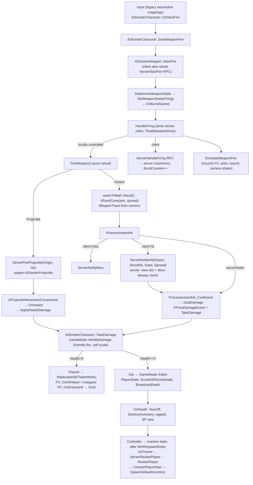
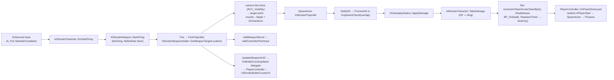

# Research: Unreal ShooterGame (UE4) and the UE5 First Person template (incl. the 5.6 "Arena Shooter" variant)

> Subject: Epic's two "canonical" first-person shooter samples, compared against
> [`docs/architecture.md`](../architecture.md) (principles P1–P10, crate map §3, contracts §6,
> determinism rules §8, open questions §12).
>
> Method: the ShooterGame analysis is based on a reading of the C++ source (UE 4.25-era mirror,
> `Copyright 1998-2017 Epic Games`). The UE5 template analysis is based on the C++ that the 5.6
> template generates (two independent public projects created from the template were compared,
> and the files carry `Copyright Epic Games, Inc.`), plus Epic's template documentation. Wherever a
> claim is inferred and not read in source, the text says so.

---

## 1. Overview

### 1.1 ShooterGame (UE4)

- **What:** Epic's networked multiplayer FPS sample. It shipped from UE 4.0 through **4.27**
  and was the reference "how to build a networked shooter in C++" project for the UE4 era. It
  was never ported to UE5; Lyra (UE 5.0+) replaced it as the networked sample. (Lyra is covered
  in other research notes; this one deliberately stops at ShooterGame.)
- **Scope:** Free-for-all and team deathmatch, two weapon archetypes (instant-hit rifle and
  rocket launcher), health and ammo pickups, bots (behaviour tree), Slate HUD and menus,
  scoreboard, killfeed, chat, split-screen, online sessions, replays (demo spectator),
  leaderboards and achievements. Roughly 90 C++ files; about two thirds of the code is
  *not* gameplay (menus, online, platform glue).
- **Source:** Epic distributed it through the Launcher's Learn tab. Its GitHub copy sits behind the
  Epic org's private access. Public mirrors exist, for example `Noesis/UE4-ShooterGame`, which was
  used for this note.
- **Official docs:** "Shooter Game" in the UE 4.27 docs (Resources › Sample Games). The page
  describes the weapon state machine and the instant-hit verification flow.

### 1.2 UE5 First Person template (5.0 → 5.6+)

- **5.0–5.5 ("classic" FP template):** a deliberately tiny project. It has a character with a
  first-person arms mesh and camera, a rifle on the floor with a `UTP_PickUpComponent`, a
  `UTP_WeaponComponent` that spawns a physics-only projectile, and Enhanced Input (from 5.1). It
  has **no damage, health, ammo, reload, teams, HUD logic or networking.**
- **5.6 (verified): template "Variants".** The FP template ships a base `Lvl_FirstPerson` plus two
  variants: **Arena Shooter** (`Variant_Shooter`, `Lvl_Shooter`) and **Survival Horror**
  (`Variant_Horror`, `Lvl_Horror`). Epic's docs describe the Shooter variant as having weapon
  pickups (pistol, rifle, grenade launcher), several bullet types, AI opponents driven by
  StateTree and EQS, an ammo UI and an arena map. The C++ version generates
  `Source/<Proj>/Variant_Shooter/{ShooterCharacter, ShooterWeapon, ShooterWeaponHolder,
  ShooterProjectile, ShooterPickup, ShooterGameMode, ShooterPlayerController, ShooterUI,
  ShooterBulletCounterUI, AI/ShooterNPC, AI/ShooterAIController, AI/ShooterStateTreeUtility,
  AI/EnvQueryContext_Target}`.
- **Note on naming:** the 5.6 variant **reuses ShooterGame's class names** (`AShooterCharacter`,
  `AShooterWeapon`, `AShooterProjectile`, `AShooterPickup`, `AShooterGameMode`), but the code is
  new, much smaller and **single-player only**. Do not confuse the two.
- **Version drift observed:** the two template-generated projects differ. In the older one,
  `AShooterCharacter::TakeDamage` just calls `Destroy()` at 0 HP, and `AShooterProjectile` only
  applies an impulse. In the newer one there is `MaxHP`, `Die()`, a `RespawnTime` timer, an
  `OnDamaged` delegate, `bExplodeOnHit` + `ExplosionCheck` (radial overlap) and
  `DeferredDestructionTime`. This note describes the newer one and flags the difference where it
  matters. The exact engine point release of each is **unverified** (likely a 5.6.x/5.7 revision).
- **First-person rendering:** UE 5.5 added `EFirstPersonPrimitiveType`
  (`FirstPerson` / `WorldSpaceRepresentation`) on primitives, plus
  `bEnableFirstPersonFieldOfView` / `FirstPersonFieldOfView` (70°) and
  `bEnableFirstPersonScale` / `FirstPersonScale` (0.6) on `UCameraComponent`. This was
  experimental in 5.5 and beta in 5.6. The template uses it to stop arms and weapons clipping
  into walls without a second camera.

---

## 2. Structure

### 2.1 ShooterGame module layout

```
Source/ShooterGame/
├── Public|Private/Player/     AShooterCharacter, UShooterCharacterMovement, AShooterPlayerController,
│                              AShooterPlayerCameraManager, AShooterSpectatorPawn, AShooterDemoSpectator,
│                              UShooterCheatManager, UShooterLocalPlayer, UShooterPersistentUser
├── Weapons/                   AShooterWeapon (abstract) ─┬─ AShooterWeapon_Instant
│                                                         └─ AShooterWeapon_Projectile → spawns AShooterProjectile
│                              UShooterDamageType (: UDamageType)
├── Pickups/                   AShooterPickup ─┬─ AShooterPickup_Health
│                                              └─ AShooterPickup_Ammo
├── Online/                    AShooterGameMode ─┬─ AShooterGame_FreeForAll
│                                                ├─ AShooterGame_TeamDeathMatch
│                                                └─ AShooterGame_Menu
│                              AShooterGameState, AShooterPlayerState, AShooterGameSession
├── Bots/                      AShooterAIController, AShooterBot, BTTask_FindPickup,
│                              BTTask_FindPointNearEnemy, BTDecorator_HasLoSTo
├── Effects/                   AShooterImpactEffect (per EShooterPhysMaterialType), AShooterExplosionEffect
├── UI/                        AShooterHUD (Canvas), Slate widgets (scoreboard, chat, menus)
├── ShooterTeamStart.h         AShooterTeamStart : APlayerStart { SpawnTeam, bNotForPlayers, bNotForBots }
└── ShooterTypes.h             EShooterMatchState, FTakeHitInfo, FDecalData, surface types, etc.
```

### 2.2 UE5.6 FP template + Shooter variant layout

```
Source/<Proj>/
├── <Proj>Character            ACharacter: FirstPersonMesh (arms, OnlyOwnerSee, FirstPersonPrimitiveType=FirstPerson),
│                              FirstPersonCameraComponent (attached to "head" socket, bUsePawnControlRotation),
│                              GetMesh() = 3P body (OwnerNoSee, WorldSpaceRepresentation);
│                              DoMove/DoAim/DoJumpStart/DoJumpEnd virtual "intent" entry points
├── <Proj>PlayerController     adds DefaultMappingContexts to UEnhancedInputLocalPlayerSubsystem
├── <Proj>CameraManager        APlayerCameraManager; only sets ViewPitchMin/Max (-70/80)
├── <Proj>GameMode
├── Variant_Shooter/
│   ├── ShooterWeaponHolder    IShooterWeaponHolder interface (owner ↔ weapon contract)
│   ├── ShooterCharacter       : <Proj>Character, IShooterWeaponHolder; HP, TeamByte, OwnedWeapons, CurrentWeapon
│   ├── ShooterWeapon          AActor; 1P + 3P meshes; MagazineSize, RefireRate, bFullAuto, AimVariance,
│   │                          FiringRecoil, ProjectileClass, AI noise params
│   ├── ShooterProjectile      sphere + UProjectileMovementComponent; HitDamage, HitDamageType,
│   │                          bExplodeOnHit/ExplosionRadius, PhysicsForce, bDamageOwner, AI noise
│   ├── ShooterPickup          sphere overlap; FDataTableRowHandle WeaponType → FWeaponTableRow{StaticMesh, WeaponToSpawn}
│   ├── ShooterGameMode        TMap<uint8, int32> TeamScores; creates UShooterUI
│   ├── ShooterPlayerController respawn on pawn OnDestroyed at random APlayerStart; bullet-counter UI
│   ├── ShooterUI / ShooterBulletCounterUI   UUserWidget with BP_ events
│   └── AI/                    AShooterNPC (: <Proj>Character, IShooterWeaponHolder), AShooterAIController,
│                              StateTree utility tasks, EQS context
└── Variant_Horror/            HorrorCharacter (sprint + stamina), HorrorGameMode, HorrorPlayerController, HorrorUI
```

### 2.3 ShooterGame data flow: input → fire → hit → damage → death → respawn



### 2.4 UE5.6 Shooter variant data flow



---

## 3. Subsystem deep-dives

### 3.1 Input

**ShooterGame** uses the legacy `UInputComponent` axis and action mappings, bound in
`AShooterCharacter::SetupPlayerInputComponent` to `MoveForward/MoveRight/MoveUp`,
`TurnAtRate/LookUpAtRate` (gamepad, scaled by `BaseTurnRate`) and
`OnStartFire/OnStopFire/OnStartTargeting/OnNextWeapon/OnReload/OnStartJump/OnStartRunning(Toggle)`.
The pawn handles input directly. There is no intent struct: handlers call gameplay functions
straight away (`StartWeaponFire`, `SetTargeting`, `SetRunning`). AI drives the same
*functions* (`AShooterAIController` calls `StartWeaponFire`/`StopWeaponFire`), but not the same
input path.

**UE5 FP template**:
- `A<Proj>PlayerController::SetupInputComponent` adds each `UInputMappingContext` in
  `DefaultMappingContexts` to the `UEnhancedInputLocalPlayerSubsystem` at priority 0.
- The character binds `UInputAction`s with `ETriggerEvent::Started/Completed/Triggered`. Jump
  uses Started/Completed, move and look use Triggered, and `MouseLookAction` is separate from
  `LookAction`.
- **Every handler forwards to a `virtual` `BlueprintCallable` "Do" function**: `DoMove(Right,
  Forward)`, `DoAim(Yaw, Pitch)`, `DoJumpStart/End`, `DoStartFiring/StopFiring/SwitchWeapon`.
  The comments say these exist so that "controls or UI interfaces" (touch, on-screen sticks) can
  drive the character. This is a lightweight version of our P1 seam, but it is a function call
  rather than state, so it is neither recorded nor replayable.
- **5.1–5.5:** `UTP_WeaponComponent::AttachWeapon` pushes its own `FireMappingContext` at
  **priority 1** and binds `FireAction → Fire`, then removes the context in `EndPlay`. Items owning
  their input context is the pattern our §5.3 boundary describes ("items push their own input
  contexts on equip … in an input-side observer"). In 5.0 the weapon instead subscribed to a
  character `OnUseItem` delegate.
- **5.6 Shooter:** fire and switch actions are bound on `AShooterCharacter`, not on the weapon.
  The weapon is input-agnostic.

### 3.2 Movement / character

- Both samples use `ACharacter` + `UCharacterMovementComponent` (CMC): a capsule kinematic
  controller with walking, falling, swimming, flying and custom modes, root motion, and
  **networked client prediction built in**.
- **CMC prediction (engine, not sample):**
  1. The autonomous proxy runs `ReplicateMoveToServer` each tick. It builds an
     `FSavedMove_Character` (acceleration, start/end location, velocity, flags), queues it in
     `FNetworkPredictionData_Client_Character::SavedMoves`, combines similar moves and sends an
     unreliable `ServerMove` RPC.
  2. The server re-simulates with `MoveAutonomous`, compares positions against
     `MAXPOSITIONERRORSQUARED`, and replies with `ClientAckGoodMove` or `ClientAdjustPosition`.
  3. On a correction the client rewinds and replays the unacked saved moves.
  4. Simulated proxies interpolate (`ReplicatedMovement` + network smoothing).
  5. Custom abilities are meant to be added by subclassing `FSavedMove_Character` and using the
     compressed flags (`FLAG_Custom_0..3`), so they ride inside `ServerMove`, *not* through
     separate RPCs. Epic's docs say this explicitly.
- **ShooterGame's `UShooterCharacterMovement`** overrides only `GetMaxSpeed()`, multiplying by
  `TargetingSpeedModifier` / `RunningSpeedModifier`. **Sprint and ADS state are sent with
  separate reliable RPCs (`ServerSetRunning`, `ServerSetTargeting`) and replicated as `bWantsToRun` /
  `bIsTargeting`, not through saved-move flags.** The source has no `FSavedMove` subclass. So
  when sprint toggles, client and server disagree on max speed for about one RTT, which causes
  position corrections. The community widely calls this a known anti-pattern, and it is exactly
  the case Epic's own CMC docs warn about.
- **UE5 template:** the base character only tweaks CMC values (`AirControl = 0.5`,
  `BrakingDecelerationFalling = 1500`, capsule 34×96). The Horror variant adds sprint and stamina
  (in Blueprint/C++, single-player). No CMC subclass.

### 3.3 Camera

- **ShooterGame:** `AShooterPlayerCameraManager::UpdateCamera`:
  - interpolates `DefaultFOV` between `NormalFOV = 90` and `TargetingFOV = 60` with
    `FInterpTo(…, 20)` while `IsTargeting()`;
  - pitch is clamped to ±87;
  - after `Super::UpdateCamera` it calls `AShooterCharacter::OnCameraUpdate(CameraLocation,
    CameraRotation)`, which **re-positions the 1P arms mesh** so it pitches with the camera around
    the eye. This is a matrix dance using the default subobject's relative transform.

  The camera itself is the pawn's eye view (`APawn::CalcCamera` / `GetActorEyesViewPoint`). There
  is no camera component. Fire camera shake comes from `FireCameraShake` through
  `ClientStartCameraShake` in `SimulateWeaponFire`.
- **Aim source:** the weapon asks `PlayerController->GetPlayerViewPoint` (the **camera**) for aim
  direction and trace start. Bots use `AIController->GetControlRotation()`, and other cases use
  `Pawn::GetBaseAimRotation()`. So in ShooterGame **aim comes from the camera / control
  rotation**. Control rotation lives on the Controller, not the Pawn. It is the "view angles"
  equivalent, replicated to the server through `ServerMove` (`ClientRoll/ClientYawPitch`) and
  exposed as `RemoteViewPitch` for simulated proxies.
- **`GetCameraDamageStartLocation`:** it projects the camera position forward onto the plane of
  the pawn (`Start + AimDir * ((PawnLoc - CamLoc) | AimDir)`), so a trace from a third-person or
  offset camera cannot hit things *behind* the shooter. This small trick is worth knowing even for
  first person.
- **UE5 template:**
  - `UCameraComponent` is attached to the arms mesh's `head` socket with
    `bUsePawnControlRotation = true`;
  - first-person FOV and scale apply only to `FirstPerson`-tagged primitives (§1.2);
  - `A<Proj>CameraManager` only clamps pitch (-70/80);
  - in the 5.6 Shooter variant, `GetWeaponTargetLocation()` line-traces **from the camera
    component** (`ECC_Visibility`, `MaxAimDistance = 10000`), and the projectile is launched from
    the 1P muzzle socket toward that point ("converge on crosshair").

### 3.4 1P / 3P meshes

**ShooterGame:**
- The character has `Mesh1P` (arms, `bOnlyOwnerSee`) and `GetMesh()` (full body,
  `bOwnerNoSee`). `UpdatePawnMeshes()` flips those flags and `VisibilityBasedAnimTickOption` when
  switching to third person (on death, or `IsFirstPerson()` false).
- **Each weapon actor has `Mesh1P` and `Mesh3P`.** For the locally controlled pawn both are
  attached, to `PawnMesh1p` and `PawnMesh3p` at `WeaponAttachPoint`, and visibility flags decide
  which one renders. Remote pawns attach only the 3P mesh.
- Muzzle FX are spawned twice on the local pawn (`MuzzlePSC` only-owner-see on 1P,
  `MuzzlePSCSecondary` owner-no-see on 3P), which keeps split-screen correct.
- `FWeaponAnim { Pawn1P, Pawn3P }` pairs montages. `PlayWeaponAnimation` picks one by
  `IsFirstPerson()`.
- **Timing is coupled to animation:** `OnEquip` uses the montage length as the equip duration
  (failsafe 0.5 s), and `StartReload` uses the reload montage length (failsafe
  `NoAnimReloadDuration`) with the ammo transfer at `AnimDuration - 0.1 s`. On a dedicated server
  with no montage loaded, durations fall back to the failsafe values. This is exactly the hazard
  our §8 rule ("timings come from data, never from animation callbacks") exists to prevent.

**UE5.6:** same 1P/3P duality.
- Character: `FirstPersonMesh` (`FirstPerson` primitive type) plus `GetMesh()`
  (`WorldSpaceRepresentation`, `OwnerNoSee`).
- Weapon: `FirstPersonMesh` + `ThirdPersonMesh`, attached to `HandGrip_R` on each.
- On activation the weapon swaps **anim instance classes** on both character meshes
  (`FirstPersonAnimInstanceClass`, `ThirdPersonAnimInstanceClass`). This is the per-weapon
  animation layer approach (Lyra uses linked anim layers; this is the simpler version).

### 3.5 Inventory / equipment

**ShooterGame:**
- `AShooterCharacter::Inventory` (`TArray<AShooterWeapon*>`, replicated) is filled on the server
  by `SpawnDefaultInventory()` from `DefaultInventoryClasses`.
- `CurrentWeapon` uses `ReplicatedUsing=OnRep_CurrentWeapon`.
- `EquipWeapon` → (`ServerEquipWeapon` RPC if client) → `SetCurrentWeapon(New, Last)` →
  `Last->OnUnEquip()` (instant, no holster time) → `New->OnEquip(Last)` (montage-timed) →
  `OnEquipFinished` → auto-reload if empty.
- `OnEnterInventory/OnLeaveInventory` set the weapon's `MyPawn`, Owner and Instigator. The comment
  in `SetCurrentWeapon` notes that replication order between `CurrentWeapon` and `MyPawn` is not
  guaranteed, so it re-sets `MyPawn`. This is a classic actor-replication ordering hazard.
- **Inventory lives on the Pawn**, so it is destroyed on death (`DestroyInventory()` in
  `OnDeath`) and re-granted on respawn. Nothing persists across lives.
- Next/prev weapon only. There are no slots.

**UE5.6:**
- `OwnedWeapons` (`TArray<AShooterWeapon*>`) and `CurrentWeapon` on the character.
- `AddWeaponClass` spawns the weapon (owner = character) only if it is not already owned, then
  activates it.
- `DoSwitchWeapon` cycles through the list. `ActivateWeapon`/`DeactivateWeapon` just hide or show
  the weapon and call back into the holder. There is no equip time.
- Weapons destroy themselves when their owner is destroyed (`OnOwnerDestroyed`).
- **`IShooterWeaponHolder` is the most interesting design element.** The weapon talks to its
  owner only through this interface: `AttachWeaponMeshes`, `PlayFiringMontage`,
  `AddWeaponRecoil`, `UpdateWeaponHUD`, `GetWeaponTargetLocation`, `AddWeaponClass`,
  `OnWeaponActivated/Deactivated` and `OnSemiWeaponRefire`. The same weapon class therefore works
  for the player (`AShooterCharacter`) and for AI (`AShooterNPC`). The NPC's
  `GetWeaponTargetLocation` aims at its target with variance and a vertical offset.

### 3.6 Weapons / firing

**ShooterGame `AShooterWeapon` (abstract `AActor`):**
- **State:** `EWeaponState::{Idle, Firing, Reloading, Equipping}`. The state is *not* set
  directly. It is **derived** in `DetermineWeaponState()` from the flags `bIsEquipped`,
  `bPendingEquip`, `bPendingReload` and `bWantsToFire` plus `CanFire()` / `CanReload()`.
  `SetWeaponState` fires `OnBurstStarted` / `OnBurstFinished` on the edges into and out of
  `Firing`. This "derive state from wants + gates" approach is clean and maps well onto ECS.
- **"Burst" means a continuous trigger hold, not a burst fire mode.** ShooterGame has **no
  semi/burst/auto selector**. Every weapon is automatic, with `TimeBetweenShots` acting as the
  refire. `OnBurstStarted` delays the first shot when `LastFireTime + TimeBetweenShots > now`, so
  spamming the trigger cannot exceed the rate of fire. `HandleFiring` re-arms itself with a
  **timer** (`TimerHandle_HandleFiring`). `BurstCounter` is the number of shots in the current
  hold; it is replicated `COND_SkipOwner` so remote clients drive cosmetics from `OnRep_BurstCounter`.
- **Ammo:**
  - `FWeaponData { bInfiniteAmmo, bInfiniteClip, MaxAmmo, AmmoPerClip, InitialClips,
    TimeBetweenShots, NoAnimReloadDuration }`;
  - `CurrentAmmo` (total, *including* the clip) and `CurrentAmmoInClip`, both `COND_OwnerOnly`;
  - ammo lives on the **weapon**. There is no shared pool, and `EAmmoType {EBullet, ERocket}`
    exists only for stats.
  - `UseAmmo` decrements, and `ReloadWeapon` moves `min(clip space, reserve)`.
  - `GiveAmmo` (from pickups) clamps to `MaxAmmo` and calls `ClientStartReload` if the clip is
    empty.
  - Cheats (`HasInfiniteAmmo/Clip`) consult the PlayerController.
- **Prediction model:**
  - The owning client runs `HandleFiring` locally, which runs `FireWeapon`, decrements ammo and
    increments `BurstCounter` immediately.
  - It also sends `ServerHandleFiring` (reliable) on every shot. The server runs `HandleFiring`
    and, if `CurrentAmmoInClip > 0 && CanFire()`, decrements its own ammo.
  - Ammo therefore runs in parallel on both sides, and the server's value replicates to the owner.
    There is no shot-sequence reconciliation: if the counts diverge, the server value simply
    overwrites.
  - `ServerStartFire/StopFire/StartReload/StopReload` RPCs mirror the edge transitions. Their
    `_Validate` functions all `return true`.
- **Spread (Instant only):**
  - `FInstantWeaponData { WeaponSpread = 5°, TargetingSpreadMod = 0.25, FiringSpreadIncrement = 1,
    FiringSpreadMax = 10, WeaponRange, HitDamage, DamageType, ClientSideHitLeeway = 200,
    AllowedViewDotHitDir = 0.8 }`;
  - `GetCurrentSpread = (WeaponSpread + CurrentFiringSpread) * (targeting ? mod : 1)`;
  - bloom grows per shot and **resets to 0 in `OnBurstFinished`**, with no decay curve;
  - there is no movement-based spread and no recoil (only a cosmetic camera shake).
- **Projectile weapon (`AShooterWeapon_Projectile`):**
  - `FireWeapon` traces from the camera to find the crosshair target, then re-aims from the
    **muzzle** to that point;
  - if the muzzle is inside a wall (aim/muzzle dot < 0, or a 150 cm trace back along the barrel
    is blocked), it spawns the rocket at the crosshair impact point instead (an anti-"shoot
    through wall" fix);
  - it then sends `ServerFireProjectile(Origin, ShootDir)`. **The rocket exists only on the
    server.** The client sees it after replication, with no predicted projectile;
  - `FProjectileWeaponData { ProjectileClass, ProjectileLife, ExplosionDamage, ExplosionRadius,
    DamageType }` is copied into the projectile via `ApplyWeaponConfig` in its
    `PostInitializeComponents`.

**UE5.6 `AShooterWeapon`:**
- Config: `MagazineSize`, `RefireRate`, `bFullAuto`, `AimVariance` (random unit vector × variance
  added to the target point), `FiringRecoil` (`AddControllerPitchInput`, which mutates aim
  directly), `MuzzleSocketName`, `MuzzleOffset` and AI noise.
- **Every weapon fires an `AShooterProjectile`**: rifle, pistol and grenade launcher. There is
  no hitscan at all.
- **Reload is instant and free**: when `CurrentBullets <= 0` it resets to `MagazineSize`. There
  is no reserve ammo and no reload state.
- **Refire is timer-based.** Semi-auto weapons notify the holder through `OnSemiWeaponRefire`.
- **Probable bug (as read):** in `StartFiring`, when `TimeSinceLastShot <= RefireRate` and the
  weapon is full-auto, the next shot is scheduled after `TimeSinceLastShot` rather than
  `RefireRate - TimeSinceLastShot`. A tap during cooldown can therefore fire early or late.
  Semi-auto taps during cooldown are dropped.

### 3.7 Hit detection

**ShooterGame instant-hit flow ("client-side hit detection with server verification"):**
1. **The client** picks `RandomSeed = FMath::Rand()`, builds an `FRandomStream`, and calls
   `VRandCone(AimDir, half-spread)`. It traces from the camera (adjusted start) along the
   `COLLISION_WEAPON` channel, which returns the physical material.
2. `ProcessInstantHit`, as a remote client:
   - if it hit an actor that the server controls, or a blocking world hit, it sends
     **`ServerNotifyHit(FHitResult Impact, FVector_NetQuantizeNormal ShootDir, int32 RandomSeed,
     float ReticleSpread)`**;
   - on a miss it sends `ServerNotifyMiss(ShootDir, Seed, Spread)`;
   - it then runs `ProcessInstantHit_Confirmed` locally for FX. `ShouldDealDamage` blocks damage
     on the client except against torn-off or locally authoritative actors.
3. **Server verification (`ServerNotifyHit_Implementation`):**
   - **View check.** It accepts if `dot(InstigatorViewRotation, normalize(Impact - Muzzle)) >
     AllowedViewDotHitDir - |sin(ReticleSpread)|`. With the default 0.8, that is roughly a 37°
     cone plus the spread.
   - **State check.** The weapon must not be `Idle`.
   - **World hit (no actor), or a static/stationary root.** The server trusts the client because
     "they don't move and the hit usually doesn't have significant gameplay implications".
   - **Moving actor.** The impact point must lie within the actor's **component bounding box,
     scaled by `ClientSideHitLeeway`**, with a minimum half-extent of 20 cm.
   - **No re-trace and no rewind.** The server never traces the shot itself and never rewinds
     the victim.
4. **The seed is used for cosmetics, not for validation.** The server stores `HitNotify {Origin,
   RandomSeed, ReticleSpread}`, replicated `COND_SkipOwner`. Other clients run
   `SimulateInstantHit`, which regenerates the same cone direction from the seed and re-traces
   locally to place tracers and impacts. The server does **not** regenerate the direction from
   the seed to check that `ShootDir` is honest. The seed is a bandwidth trick, not a security
   measure.
5. **Known vulnerability (vorixo / Devtricks):** `ClientSideHitLeeway = 200` scales the target's
   bounding box 200×, which effectively covers the whole map. A cheat that teleports remote
   players locally can land valid kills from anywhere within the view cone. The suggested
   quick fix is to clamp the leeway to about 2. The proper fix is **server-side rewind of the
   victim's capsule or hitboxes** and a check against that. Because many shipped games copied
   ShooterGame, the hole spread to them.
6. **Projectiles** are server-authoritative: an `AShooterProjectile` sphere (r = 5) with
   `UProjectileMovementComponent` (2000 u/s, gravity 0). `OnProjectileStop → OnImpact → Explode →
   UGameplayStatics::ApplyRadialDamage`. `bExploded` replicates, and clients run
   `OnRep_Exploded`, which re-traces to find a surface for the explosion FX.

**UE5.6:**
- Projectile hits use `AActor::NotifyHit` on the projectile's collision sphere.
- Single-target projectiles call `ProcessHit`. `bExplodeOnHit` projectiles instead do
  `OverlapMultiByObjectType` (Pawn / WorldDynamic / PhysicsBody) within `ExplosionRadius`. Each
  actor is damaged once, the instigator is skipped unless `bDamageOwner`, and there is **no
  occlusion check and no falloff**.
- Physics impulse goes to simulating components.
- There are no hit zones, headshots or validation, because the template is single-player only.

### 3.8 Damage / health

- **Engine API (both samples):** `AActor::TakeDamage(float Damage, const FDamageEvent&,
  AController* EventInstigator, AActor* DamageCauser)`.
  - `FDamageEvent` has the subclasses `FPointDamageEvent` (`HitInfo`, `ShotDirection`) and
    `FRadialDamageEvent`, identified by `GetTypeID()`.
  - `DamageTypeClass` is a `TSubclassOf<UDamageType>`. The *class's default object* is the
    "damage type" (a flyweight with `bCausedByWorld`, `DamageImpulse`, `bRadialDamageVelChange`,
    `DamageFalloff`, …).
  - Helpers: `UGameplayStatics::ApplyDamage`, `ApplyPointDamage` and `ApplyRadialDamage`
    (with falloff and a visibility trace).
  - **Instigator (`AController`) vs causer (`AActor`: weapon or projectile)** is the same split
    as our `instigator` vs `inflictor`.
- **ShooterGame `AShooterCharacter::TakeDamage`:**
  1. god mode returns 0;
  2. already dead returns 0;
  3. **`AShooterGameMode::ModifyDamage`**: friendly fire through the virtual `CanDealDamage(
     InstigatorPS, VictimPS)` (FFA returns true; TDM allows only self or different team), and
     self damage × `DamageSelfScale`;
  4. `Super::TakeDamage` (engine: broadcasts `OnTakeAnyDamage`, `OnTakePointDamage`, …);
  5. `Health -= ActualDamage`;
  6. at 0 or below, `Die(...)`; otherwise `PlayHit(...)`;
  7. `MakeNoise` for AI hearing.
- `Health` is a plain replicated float, with `GetMaxHealth()` read from the CDO. There is no
  armor, no shields, no hit zones and no headshot multiplier.
- **`UShooterDamageType : UDamageType`** adds only presentation data: `KillIcon` (killfeed),
  `HitForceFeedback` and `KilledForceFeedback`. Damage types are **classes used as tags with
  attached cosmetic data**, which matches our `DamageTypeId` plus a definition table.
- **Death:**
  - `Die` → `CanDie` (authority, not already dying, not leaving the map) →
    `GetDamageInstigator(Killer, DamageType)`, which falls back to `LastHitBy` for environmental
    deaths so the last attacker gets credit for a lava kill → `GameMode::Killed(Killer, Victim,
    Pawn, DamageType)` → `OnDeath`;
  - `OnDeath`: `TearOff()` (stops replication, so clients own the ragdoll), `ReplicateHit(...,
    bKilled = true)`, `DestroyInventory`, switch to the 3P mesh, ragdoll and `SetLifeSpan`.
- **Hit replication:** `FTakeHitInfo { ActualDamage, DamageTypeClass, PawnInstigator,
  DamageCauser, DamageEventClassID, bKilled, EnsureReplicationByte, + point/radial event payloads }`
  is a replicated property (`OnRep_LastTakeHitInfo`). It carries a **rolling counter to force
  re-replication of identical hits** and has a timeout (`LastTakeHitTimeTimeout`) so late joiners
  don't replay stale hits. Simulated clients play hit reactions and death from this struct.
- **Feedback routing:**
  - `PlayHit` → victim `AShooterPlayerController::OnHitTaken` → `AShooterHUD::NotifyWeaponHit`
    (directional damage indicator);
  - the instigator gets `OnEnemyHit` → `AShooterHUD::NotifyEnemyHit` (hitmarker);
  - `ApplyDamageMomentum` applies knockback.
- **UE5.6:** `CurrentHP` (and `MaxHP` in the newer revision) on the character.
  - `TakeDamage` subtracts the damage. At 0 HP it calls `Die()`: deactivate the weapon,
    `GameMode->IncrementTeamScore(TeamByte)`, `StopMovementImmediately`, `DisableInput`,
    `BP_OnDeath`, then a `RespawnTimer` → `Destroy()`.
  - **There is no friendly-fire policy in the C++ path** (as read). `TeamByte` is used for
    scoring and by AI.
  - Note that `IncrementTeamScore` is called with the *victim's* `TeamByte`, so the score is
    effectively "deaths suffered by team N" and the UI presumably displays it as the other team's
    points. This is inferred and not verified in the UMG asset.

### 3.9 Interaction

- Neither sample has a use/interact system. Pickups are **touch-to-collect via overlap**.
- **ShooterGame `AShooterPickup`:**
  - capsule `COLLISION_PICKUP`, overlapping pawns;
  - `NotifyActorBeginOverlap` → `PickupOnTouch` → virtual `CanBePickedUp` / `GivePickupTo`;
  - `bIsActive` replicates and drives FX via `OnRep_IsActive`;
  - respawns after `RespawnTime = 10 s`;
  - **`RespawnPickup` re-checks pawns already overlapping**, so a player standing on the spot
    gets it immediately;
  - subclasses: `AShooterPickup_Health` and `AShooterPickup_Ammo` (`WeaponType` class,
    `AmmoClips`). Ammo is only accepted if the pawn owns that weapon class and is below
    `MaxAmmo`.
  - Pickups register in `AShooterGameMode::LevelPickups` so bots can find them
    (`BTTask_FindPickup`).
- **UE5.6 `AShooterPickup`:**
  - sphere overlap;
  - `FDataTableRowHandle WeaponType` → `FWeaponTableRow { StaticMesh, WeaponToSpawn }`, which is
    data-driven pickup definitions. The mesh is set in `OnConstruction` for editor preview;
  - grants with `IShooterWeaponHolder::AddWeaponClass`;
  - respawns after 4 s through `BP_OnRespawn` / `FinishRespawn`, a two-phase respawn that lets
    Blueprint play an effect before collision returns.

### 3.10 Match / game mode / teams / spawns

**ShooterGame:**
- **Mode hierarchy:**
  - `AShooterGameMode : AGameMode` holds `WarmupTime`, `RoundTime`, `TimeBetweenMatches`,
    `KillScore`, `DeathScore`, `DamageSelfScale`, `MaxBots` and `MinRespawnDelay = 5`;
  - `AShooterGame_FreeForAll` tracks the winner by score;
  - `AShooterGame_TeamDeathMatch` uses `NumTeams = 2` and `bDelayedStart`.

  This is the **inheritance-per-mode** design.
- **Match state:**
  - the engine `AGameMode` has the `MatchState` FName set: `EnteringMap`, `WaitingToStart`,
    `InProgress`, `WaitingPostMatch` and `LeavingMap`;
  - ShooterGame adds a 1 Hz `DefaultTimer` (looping, scaled by time dilation) that counts down
    `AShooterGameState::RemainingTime` and moves warmup → `StartMatch`, round end →
    `FinishMatch` (`DetermineMatchWinner`, `GameHasEnded`, `TurnOff` all pawns) and post-match →
    `RestartGame`;
  - `EShooterMatchState {Warmup, Playing, Won, Lost}` is a HUD-side enum.
- **Teams:**
  - `AShooterPlayerState::TeamNumber` (replicated, `OnRep_TeamColor` updates material
    parameters);
  - TDM `ChooseTeam` picks the least-populated team, breaking ties randomly;
  - this happens in `PostLogin` *before* `Super` so spawn selection sees the team;
  - bots get a team in `InitBot`;
  - `AShooterCharacter::IsEnemyFor(Controller)` compares teams.
- **Scoring:**
  - `GameMode::Killed` → `KillerPS->ScoreKill(VictimPS, KillScore)` + `InformAboutKill`
    (reliable client RPC to the killer) and `VictimPS->ScoreDeath` + `BroadcastDeath`
    (reliable multicast, which feeds the killfeed via `AShooterHUD::ShowDeathMessage`);
  - `AShooterGameState::TeamScores` is updated by `ScorePoints`;
  - the PlayerState also counts `NumBulletsFired` and `NumRocketsFired` (incremented in
    `UseAmmo`) for stats and achievements.
- **Spawning:** `ChoosePlayerStart_Implementation` iterates every `APlayerStart`:
  - the PIE "play from here" start wins outright;
  - otherwise a start must pass `IsSpawnpointAllowed` (`AShooterTeamStart` only, with
    `bNotForBots` / `bNotForPlayers`; TDM also requires `SpawnTeam == team`);
  - starts are then sorted into **preferred** (no character capsule overlapping the start) and
    **fallback**, and one is picked at random from the preferred list, else from the fallback
    list.
  - There is **no enemy-distance or line-of-sight scoring**. Lyra later added that.
- **Respawn:** engine flow. When the pawn dies, `APlayerController::PawnPendingDestroy` puts the
  controller in the `Inactive` state (engine; UnFreeze timer). `AShooterPlayerController::UnFreeze` runs after
  `MinRespawnDelay` and calls `ServerRestartPlayer`, which leads to `GameMode::RestartPlayer`,
  then `ChoosePlayerStart`, then a new pawn and `SpawnDefaultInventory`.
- **Persistence:** the **PlayerState survives** pawn death (score, team, name). With seamless
  travel, `CopyProperties` carries it across maps. **The Pawn is disposable.** This is the
  canonical Player/Character split (our P5).

**UE5.6:**
- `AShooterGameMode : AGameModeBase` (no `AGameMode` match states) keeps
  `TMap<uint8, int32> TeamScores` and creates the `UShooterUI` widget in `BeginPlay`. That makes
  the GameMode responsible for UI, which is single-player only.
- Respawn is done by the **PlayerController**:
  1. `OnPossess` binds `OnDestroyed`;
  2. `OnPawnDestroyed` picks a **random `APlayerStart`** with no filtering;
  3. it calls `SpawnActor<AShooterCharacter>(CharacterClass)`, then `Possess`.
- There is no PlayerState usage, no phases and no match end.

### 3.11 UI / feedback

- **ShooterGame:** `AShooterHUD : AHUD` draws everything immediately on `UCanvas` in `DrawHUD`:
  `DrawWeaponHUD` (clip icons from the weapon's `FCanvasIcon`s), `DrawHealth`, `DrawCrosshair`
  (spread-scaled from `GetCurrentFiringSpreadPercentage`, plus a separate aiming crosshair),
  `DrawHitIndicator` (8 directions, `EShooterHudPosition`), `DrawDeathMessages`, `DrawKills`
  and `DrawMatchTimerAndPosition`. The scoreboard, chat and menus are Slate widgets.
  - **HUD data is pulled** each frame straight from the pawn, weapon and PlayerState.
  - **Events are pushed** through PlayerController methods (`NotifyWeaponHit`,
    `NotifyEnemyHit`, `NotifyOutOfAmmo`, `ShowDeathMessage`).
  - The weapon class owns its own HUD icons (`PrimaryIcon`, `Crosshair[5]`, …), which mixes
    presentation data into the simulation actor.
- **UE5.6:** UMG `UUserWidget`s with `BlueprintImplementableEvent` hooks (`BP_UpdateBulletCounter`,
  `BP_UpdateScore`, `BP_Damaged`). Data is **pushed through multicast delegates**
  (`FBulletCountUpdatedDelegate OnBulletCountUpdated`, `FDamagedDelegate OnDamaged`) that the
  PlayerController subscribes to on possess. That is cleaner: the HUD only reads.

### 3.12 Networking

**ShooterGame** is a full client-server sample built on Unreal's actor replication and RPCs.
- **Authority:** the server decides health, ammo (in the end), spawns, score and projectiles.
- **Owner prediction:**
  - movement through CMC saved moves;
  - weapon fire is "run locally and tell the server": local FX, local ammo and local traces;
  - the server trusts the client's hit within tolerances.
- **Cosmetic replication:** done through counters and structs, not RPCs:
  - `BurstCounter` (`COND_SkipOwner`);
  - `HitNotify` with the seed (`COND_SkipOwner`);
  - `bPendingReload` (`COND_SkipOwner`);
  - `LastTakeHitInfo` with its rolling byte;
  - `bExploded`.
- **Relevancy and bandwidth:**
  - `bNetUseOwnerRelevancy` on weapons;
  - `COND_OwnerOnly` ammo;
  - `IsReplicationPausedForConnection` plus `BuildPauseReplicationCheckPoints`, which pauses a
    pawn's replication to connections that can't see it (a basic anti-wallhack and bandwidth
    measure).
- **What it lacks:**
  - lag compensation or rewind;
  - deterministic simulation (timers + `FMath::Rand()`);
  - fixed-tick weapons (everything runs on `FTimerManager` with variable delta);
  - weapon-state reconciliation (client and server run independent timers and can drift).

**UE5.6 template:** no networking. Weapons and projectiles do not replicate, the UI is created by
GameMode for player 0, and there are no RPCs.

---

## 4. Mapping to the Krit plan

| Their concept | Krit crate / type / principle | Verdict |
|---|---|---|
| `AShooterPlayerState` (team, score, kills, deaths) survives; `AShooterCharacter` is disposable | `krit_core` `Player` / `Character` + `Controls`; P5 | **Agreement** |
| `APlayerController::ControlRotation` (aim lives on the controller, replicated through ServerMove) | `ViewAngles` on the Character; P4 | **Partial divergence.** Both keep aim off the camera. Unreal puts it on the controller, while we put it on the body, which is fine because bots and net write the Character too. |
| Weapon reads aim from `GetPlayerViewPoint` (**camera**) | P4 ("aim belongs to the character, not the camera") | **Divergence.** Theirs couples camera effects to the shot; ours is better. |
| `DoMove` / `DoAim` / `DoStartFiring` virtual entry points | `CharacterIntent`; P1 | **Agreement in spirit**, but theirs are calls, not state. There is no replay or rollback. |
| `UTP_WeaponComponent` pushes `FireMappingContext` (priority 1) on attach | §5.3 "items push their own input contexts on equip" | **Agreement**, a direct precedent |
| CMC + `FSavedMove_Character` + `ServerMove` / `ClientAdjustPosition` | `krit_movement` pure `step()` + `krit_net` prediction; §8 | **Agreement** on the model (input-replay prediction). The sprint flag via RPC in ShooterGame is the anti-pattern our `CharacterIntent.buttons` avoids. |
| `UShooterCharacterMovement::GetMaxSpeed` × targeting / running modifiers | `MovementStats` through `krit_stats`; P7 | **Agreement** (modifier on base; theirs is hard-coded multiplication) |
| `AShooterWeapon` → `_Instant` / `_Projectile` inheritance | `Hitscan` / `Projectile` markers, `BallisticProfile`; P6 | **Divergence**, and P6 cites ShooterGame as the counter-example |
| `FireWeapon()` traces and deals damage inside the weapon | weapons → `ShotRequest` → ballistics; §5.7 boundary | **Divergence.** Theirs fuses three stages. |
| `EWeaponState {Idle, Firing, Reloading, Equipping}` derived by `DetermineWeaponState()` from wants + gates | `WeaponState` + `ActionGates`; §5.7 | **Agreement** with the derive-from-wants idea. Our state set is richer, and equipping is in `krit_equipment`. |
| `TimeBetweenShots` via `FTimerManager` refire | `FireRate` + sub-tick accumulator; §8 | **Divergence.** Timers are variable-step and not rollback-safe. |
| `BurstCounter` replicated → `OnRep` → cosmetics | `WeaponFired { shot_count_total }`; §8 | **Agreement.** Same idea, but ours is cumulative (theirs resets to 0 on burst end, which loses information). |
| `FWeaponData.AmmoPerClip / MaxAmmo / InitialClips`, ammo on the weapon | `Magazine`, `AmmoSource::{Internal, OwnerPool}`, `AmmoProvider` | **Agreement** (`Internal`) plus a gap they don't cover (shared pools) |
| Reload duration = montage length; ammo commit at `len - 0.1 s` | `ReloadSpec` with a data commit point; §8 "timings from data" | **Divergence.** Ours is better (headless-safe). |
| `FRandomStream(RandomSeed)` + `VRandCone`; seed sent to the server and replicated for FX | `SimRng::for_shot(tick, shooter, idx)` | **Agreement.** Ours derives the seed instead of sending it, so it can also be *verified*. |
| `ServerNotifyHit` (client-authoritative hit, bbox leeway) | `RewindProvider` + server re-trace in `krit_ballistics` / `krit_net` | **Divergence.** Theirs is the known-vulnerable design. |
| `GetCameraDamageStartLocation` (trace from eye, projected to pawn plane) | `AimRay` from eye; §5.13 "shots trace from the eye" | **Agreement** |
| Projectile weapon: camera trace → re-aim from muzzle → anti-wall spawn | `ShotRequest.muzzle: Option<Vec3>` cosmetic only | **Gap.** We have no rule for projectiles spawned at the muzzle vs the eye (§6 below). |
| `TakeDamage(Damage, FDamageEvent, EventInstigator, DamageCauser)` | `DamageRequest { instigator, inflictor, weapon, damage_type, point, direction }` | **Agreement** (same attacker/causer split) |
| `FPointDamageEvent` / `FRadialDamageEvent` subclasses | `DamageFlags::EXPLOSIVE`, `point`, `direction` | **Agreement**, flattened into one struct, which is better for ECS |
| `UDamageType` CDO as type tag + cosmetic data (`KillIcon`) | `DamageTypeId` + definition | **Agreement** |
| `GameMode::ModifyDamage` → `CanDealDamage` (FF), `DamageSelfScale` | `DamagePipelineSystems::Policy` + `FriendlyFirePolicy` + `TeamRelations`; P8 | **Agreement.** Theirs uses virtual overrides per mode, ours uses policy resources. |
| `GetDamageInstigator` / `LastHitBy` (credit environmental kills to the last attacker) | `DamageLedger`, `Died.killer` | **Gap.** The rule is not stated in our plan. |
| `Die` → `GameMode::Killed` (scoring) | `Died` → `krit_match`; "damage → match not allowed" | **Divergence.** Their pawn calls the game mode directly; our `Died` event is better. |
| `FTakeHitInfo` replicated with a rolling byte + timeout | `DamageApplied` / `Died` messages + `krit_net` | **Gap.** Our §8 cumulative-counter rule should cover "last hit taken". |
| `AShooterGameMode` subclasses per mode (FFA, TDM) | `krit_modes` feature plugins; P8 | **Divergence.** Ours is better (composition). |
| `AGameMode::MatchState` + 1 Hz `DefaultTimer` countdown | `MatchPhase` `States` / `SubStates`, `MatchRules` | **Agreement** on phases; **divergence** on the timer (theirs is not tick-based) |
| `ChoosePlayerStart`: allowed (team, bot/player filter) → preferred (not overlapped) → random | `SpawnPoint { team, weight }` + `SpawnSelector` trait | **Agreement**, and theirs gives a concrete default algorithm |
| `AShooterTeamStart { SpawnTeam, bNotForPlayers, bNotForBots }` | `SpawnPoint { team, weight }` | **Gap (minor).** We have no bot/player filter. |
| `ChooseTeam`: least populated, random tie-break | `Teams` / roster in `krit_match` | **Agreement**, which gives a default |
| `MinRespawnDelay`, then `RestartPlayer` | `RespawnPolicy::Timer` | **Agreement** |
| Inventory on the Pawn, destroyed on death; `SpawnDefaultInventory` | `Inventory` on Character by default (§12) + `GrantLoadout` | **Agreement** with the §12 proposal |
| `IShooterWeaponHolder` interface (weapon ↔ owner) | weapon reads owner via `Owner` + core components; `ItemIntent` | **Agreement in purpose**, but theirs is a callback interface, while ours is data and relationships |
| Pickup: overlap, `CanBePickedUp` / `GivePickupTo`, respawn timer, re-check overlaps on respawn | `krit_inventory` `PickupRequest` from overlap or interaction | **Agreement**, plus one lesson (re-check overlap) |
| Pickup row in a `UDataTable` (`FWeaponTableRow`) | `ItemDefinition` / `WeaponDefinition` assets | **Agreement** |
| 1P / 3P meshes on both character and weapon; `bOnlyOwnerSee` / `bOwnerNoSee`; FP render type with its own FOV and scale | `krit_viewmodel` (separate camera + RenderLayers, own FOV) | **Agreement** on the goal; mechanism differs (one camera + per-primitive FOV vs two cameras) |
| Camera manager FOV lerp for targeting | `FovController` (ADS FOV × `AdsState`) | **Agreement** |
| `FireCameraShake` from weapon; `FiringRecoil` → `AddControllerPitchInput` (5.6) | `ViewKick` (visual) vs `AimRecoil` (aim); §6.2 | **Agreement** that the channels exist; their 5.6 recoil mutates input, while ours is a separate additive state |
| HUD reads pawn / weapon each frame; weapon owns HUD icons | `krit_feedback` read models; P2 | **Divergence** (presentation data inside the simulation actor); the 5.6 delegates are closer to ours |
| `HitNotify`, `PlayHit` → `NotifyEnemyHit` (hitmarker), `NotifyWeaponHit` (direction indicator) | `HitConfirmed`, `DamageIndicators` | **Agreement** |
| `MakeNoise` on damage / shot (AI hearing) | `NoiseEvent` (movement only) | **Gap.** Weapons and impacts should also emit `NoiseEvent`. |
| `IsReplicationPausedForConnection` (per-connection visibility culling) | `krit_net` | **Gap** (later; relevance/interest management is not in the plan) |

---

## 5. Where it agrees with the plan

1. **Player vs Character (P5).** ShooterGame is the textbook case. `AShooterPlayerState` holds
   team, score, kills, deaths and stats and survives death and seamless travel (`CopyProperties`).
   `AShooterCharacter` is torn off, ragdolled and destroyed, and a new one is spawned by
   `RestartPlayer`. Our `Player` / `Character` + `Controls` relationship is the ECS version of
   this.
2. **Aim is not the camera's transform (P4), partially.** Unreal's control rotation lives on the
   Controller and is replicated through `ServerMove`, and the camera *follows* it
   (`bUsePawnControlRotation`). Bots set control rotation and fire through the same weapon code.
   The camera manager only adds FOV. This confirms that aim is simulation state the camera reads.
   (ShooterGame then breaks this by reading `GetPlayerViewPoint`; see §6.)
3. **Intent as the shared entry point (P1).** The UE5 template's `DoMove/DoAim/DoJump*/DoStartFiring`
   virtuals exist so that UI or touch can drive the same path as devices. The weapon is driven by
   the AI (`AShooterNPC::StartShooting`) and the player through the same `StartFiring`. The
   Krit version (§6.1 `CharacterIntent`) goes further by making the intent *data*.
4. **Item-owned input contexts (§5.3).** `UTP_WeaponComponent::AttachWeapon` adds
   `FireMappingContext` at priority 1 and removes it in `EndPlay`. This is exactly our
   "items push their own input contexts on equip" rule, and it validates keeping BEI context
   management in `krit_input` reacting to `Equipped`.
5. **Weapon state derived from wants and gates (§5.7, `ActionGates` in §6.1).**
   `DetermineWeaponState()` recomputes `Idle/Firing/Reloading/Equipping` from `bWantsToFire`,
   `bPendingReload`, `bPendingEquip`, `bIsEquipped` and `MyPawn->CanFire()` (a gate). In ECS this
   becomes "reset gates, OR in blocks, derive state", which is our `ActionGates` pattern.
6. **Cumulative counters for cosmetics (§8).** `BurstCounter` → `OnRep_BurstCounter` →
   `SimulateWeaponFire` is the ancestor of the DOTS `shot_count_total` pattern we adopted.
   `FTakeHitInfo::EnsureReplicationByte` is the same trick for hits.
7. **Seeded spread (`SimRng`, §5.1).** `FRandomStream(RandomSeed)` + `VRandCone`, with the seed
   carried in the shot and replicated for FX, is the same idea as `SimRng::for_shot`. Ours
   derives the seed from `(tick, shooter, index)` instead of transmitting `FMath::Rand()`, which
   also allows the server to *re-derive and verify* the direction.
8. **Damage attribution (§6.3).** `TakeDamage(…, EventInstigator, DamageCauser)` with
   `FPointDamageEvent { HitInfo, ShotDirection }` and the `UDamageType` class matches
   `DamageRequest { instigator, inflictor, weapon, damage_type, point, direction }` one-to-one.
   Our flat struct + `DamageFlags` is a cleaner ECS encoding of their event-subclass hierarchy.
9. **Damage policy is the game mode's job (P8, §5.9 `Policy` stage).** ShooterGame routes all
   damage through `AShooterGameMode::ModifyDamage` → `CanDealDamage`. TDM overrides it for
   friendly fire, and FFA doesn't. Our `DamagePipelineSystems::Policy` +
   `FriendlyFirePolicy` / `TeamRelations` is the same seam without virtual dispatch.
10. **Spawn selection as an overridable policy (§5.11 `SpawnSelector`).**
    `ChoosePlayerStart` → `IsSpawnpointAllowed` / `IsSpawnpointPreferred` are virtual hooks that TDM
    overrides. They split cleanly into filter and score stages.
11. **Eye-origin traces (§5.13).** Instant-hit traces from the camera / eye
    (`GetCameraDamageStartLocation`), never from the muzzle. The muzzle is used for FX (trails,
    muzzle flash), as in our rule.
12. **1P / 3P duality (§5.13).** Every character *and every weapon* has two meshes with owner
    visibility flags. UE 5.5+ adds a dedicated FP FOV and scale for the 1P set. This confirms that
    `krit_viewmodel` must model a per-item view model *and* a world model, and that "third-person ↔
    first-person mesh visibility" is a core responsibility, not an afterthought.
13. **Ammo on the weapon by default (`AmmoSource::Internal`).** Both samples store ammo on the
    weapon. The 5.6 template has no reserve at all. This supports our fallback "weapons fall back
    to `Magazine`-only when nothing is installed" (§6.5).
14. **Inventory on the body (§12 open question).** ShooterGame destroys inventory on death and
    re-grants it on spawn. That is the arena-shooter default and supports the §12 proposal
    (Character by default, `PersistentInventory` opt-in).

---

## 6. Where it runs counter

1. **Inheritance per weapon type and per mode (vs P6, P8).**
   - `AShooterWeapon` → `_Instant` / `_Projectile` hard-wires "how it hits" into the class. A
     shotgun, a hitscan-plus-explosive weapon, or a rifle with a grenade-launcher attachment does
     not fit the hierarchy.
   - `AShooterGame_FreeForAll` / `_TeamDeathMatch` subclass the game mode, so CTF-on-teams requires
     another subclass or copy-paste.
   - **We have the better argument.** In ECS, markers + profiles compose freely, and P6 explicitly
     cites this hierarchy as the counter-example.
   - In fairness, ShooterGame's hierarchy is *small and readable*. The cost appears only past
     about five weapon types.
2. **Weapon fuses firing, hit resolution and damage (vs §5.7–5.9 boundaries).**
   `AShooterWeapon_Instant::FireWeapon` traces, `ProcessInstantHit` validates, and `DealDamage`
   calls `TakeDamage`, all inside one class. There is no seam to swap hit resolution (for
   penetration or lag compensation) without subclassing the weapon. **We are right** to split
   `ShotRequest` → `HitResult` → `DamageRequest`. ShooterGame's simplicity buys "read one file to
   understand shooting", which our docs should make up for with a single pipeline diagram.
3. **Aim read from the camera (vs P4).** `GetAdjustedAim()` uses `PlayerController->
   GetPlayerViewPoint()`, which is camera-manager output. Camera shake, modifiers or a
   third-person camera therefore all change the shot. The 5.6 template traces from
   `FirstPersonCameraComponent` too. On a dedicated server this works only because the server's
   `GetPlayerViewPoint` falls back to control rotation and the pawn's eyes. **We are right.**
   `AimRay::from(Transform, ViewAngles, EyeHeight)` makes server, bot and client identical.
4. **Client-authoritative hits with an unsafe tolerance (vs `RewindProvider`).**
   `ServerNotifyHit` trusts the client's `FHitResult`. It checks only a view-cone dot and a
   bounding box scaled by `ClientSideHitLeeway = 200`, which covers the map. **We are right** to
   plan a server re-trace against rewound hurtboxes. It is still worth keeping their *cheap
   sanity checks* (view-cone, weapon state, rate of fire) as an extra validation layer before
   the rewind trace.
5. **Timers and wall-clock time instead of fixed ticks (vs §8).**
   - Refire, equip, reload and respawn all use `FTimerManager` with `GetWorld()->GetTimeSeconds()`.
   - `FMath::Rand()` seeds spread, and `FMath::RandHelper` picks spawns and team tie-breaks.
   - Client and server run independent timers. This is fine for Unreal's "trust then correct"
     model, but cannot be rolled back or replayed.
   - **For our goals (deterministic fixed tick, rollback-ready) we are right.** Their model is a
     reasonable choice for *non-rollback* netcode, and `krit_net` could support a
     "replicon-only, no rollback" mode where the same trade-off is acceptable.
6. **Gameplay timings from animation length (vs §8 "timings from data").** Equip duration =
   equip montage length, reload = reload montage length, and the ammo commit happens 0.1 s
   before the end. A headless server falls back to `NoAnimReloadDuration` (1.0 s) and 0.5 s
   equip, which can differ from the client's montage length. **We are right.** `ReloadSpec` with
   a data commit point. Presentation can scale animation play rate to match.
7. **Sprint / ADS replicated by RPC, not in the move (vs §6.1 intent).** `ServerSetRunning` and
   `ServerSetTargeting` are reliable RPCs outside `ServerMove`, so the speed modifier applies at
   different times on client and server, which causes corrections. **We are right**: `SPRINT` and
   `SECONDARY` are `CharacterIntent.buttons`, so they are tick-stamped with the movement input.
   (Epic's own CMC docs agree with us.)
8. **Pawn calls the game mode on death (vs "damage → match not allowed").** `Die()` calls
   `GetAuthGameMode<AShooterGameMode>()->Killed(...)`. The 5.6 `Die()` calls
   `IncrementTeamScore`. This is a hard dependency from health to scoring. **We are right**:
   `Died` is a fact, and match observes it.
9. **Presentation data on simulation objects (vs P2).**
   - `AShooterWeapon` holds `FCanvasIcon` crosshairs, sounds, muzzle FX and force feedback.
   - `UShooterDamageType` holds `KillIcon`.
   - The weapon calls `PlayWeaponSound` / `ClientStartCameraShake` from fire code.

   Unreal's `NM_DedicatedServer` checks (`if (GetNetMode() != NM_DedicatedServer)
   SimulateWeaponFire()`) are scattered throughout to keep the server headless. **We are right**
   to keep definitions split into sim data and a separate cosmetic table keyed by the same id. A
   *single authoring asset* that contains both is still convenient for designers, so it is
   acceptable as long as the sim crate ignores the cosmetic fields.
10. **Bloom resets on trigger release, with no decay curve.** `CurrentFiringSpread = 0` in
    `OnBurstFinished`. Tap-firing therefore gets perfect accuracy at any cadence, which is a known
    design weakness. Our `SpreadModel` with decay is the better approach.
11. **Projectiles are not predicted.** ShooterGame's rocket is server-only. The firing client sees
    its own rocket one RTT late. This is acceptable for a slow rocket but bad for fast or
    hitscan-like projectiles. Our plan does not yet say how projectiles are predicted (see §7).

---

## 7. Ideas worth adopting / gaps in the plan

1. **`krit_ballistics`: projectile launch-point rule (gap).** Adopt ShooterGame's
   `AShooterWeapon_Projectile::FireWeapon` logic as the default `ProjectileSpawnPolicy`:
   1. trace from `AimRay` to find the aim point;
   2. if the muzzle-to-aim-point direction has dot ≥ 0.5 with the aim direction *and* a short
      barrel trace (eye → muzzle) is clear, launch from the muzzle toward the aim point;
   3. otherwise launch from the eye.

   Without this, rockets spawned at a cosmetic muzzle explode in walls the player isn't looking
   at. Because `muzzle` is presentation-only in `ShotRequest`, a **sim-side muzzle offset**
   (`WeaponStats.muzzle_offset: Vec3` relative to the eye) is needed so the server and the
   headless sim agree. Record this in §6.3.
2. **`krit_ballistics` / `krit_net`: layered hit validation.** Even with rewind, keep
   ShooterGame's cheap pre-checks as a public `HitValidation` system set before the rewind trace:
   - view-cone dot ≥ threshold (with spread);
   - weapon in a firing state;
   - shot rate ≤ `FireRate`;
   - and, new, **re-derive the spread direction from `SimRng::for_shot` and reject a mismatching
     `ShootDir`**, which ShooterGame could have done but didn't.

   Ship it with a **clamped leeway**, and write the vorixo exploit into the docs as a regression
   test ("bbox leeway must be ≤ 2×").
3. **`krit_damage`: "last attacker gets the environmental kill" (gap).** Port
   `GetDamageInstigator` / `LastHitBy`: when `DamageRequest.instigator` is `None` (fall, kill-zone,
   environment), `Resolve` assigns `Died.killer` from the `DamageLedger` if a hostile hit happened
   within N seconds. This should be a policy (`EnvironmentalKillCredit { window }`), not a constant.
4. **`krit_damage`: self-damage scale.** `DamageSelfScale` is a real arena-shooter need (rocket
   jumping). Add `SelfDamagePolicy { scale }` next to `FriendlyFirePolicy` in core, applied in
   `Policy`.
5. **`krit_match`: concrete default `SpawnSelector`.** Ship ShooterGame's algorithm as the
   simplest built-in, `SpawnSelector::FilterThenPreferUnoccupied`:
   1. **filter**: team match, plus a new `SpawnPoint.allowed: SpawnAllow::{Any, PlayersOnly,
      BotsOnly}` from `AShooterTeamStart`;
   2. **prefer**: no character capsule overlap, using `SpatialQueryBackend::overlap`;
   3. **pick at random** using a **sim-seeded RNG** (`SimRng` keyed by tick + player), not a global
      RNG.

   Then offer "farthest from enemies" and "weighted" as the next selectors. Splitting `filter`
   and `score` into two trait methods matches their `IsSpawnpointAllowed` / `IsSpawnpointPreferred`.
6. **`krit_match`: team auto-balance default.** `ChooseTeam` (least populated, random tie-break,
   decided *before* spawn selection) should be the default `TeamAssigner`. Note the ordering
   requirement in §6.6: the team is assigned before `SpawnCharacter` is emitted.
7. **`krit_inventory`: re-check overlaps on pickup respawn.** `RespawnPickup` immediately
   re-evaluates pawns already standing on the pickup. Overlap-start events alone miss them. The
   same applies to the 5.6 two-phase respawn (`BP_OnRespawn` → `FinishRespawn`): model
   `PickupState::{Active, Cooldown { until_tick }, Respawning { until_tick }}` with data timings.
8. **`krit_inventory`: ammo pickups need a "can accept" predicate.** `AShooterPickup_Ammo::
   CanBePickedUp` refuses when the pawn lacks the weapon or is full, so the pickup is not
   consumed. `PickupRequest` should get a `PickupDenied { reason }` response, and pickups should
   stay active when denied.
9. **`krit_equipment` / §5.7: equip auto-reload.** `OnEquipFinished` auto-starts a reload if the
   magazine is empty, and `HandleFiring` auto-reloads on an empty trigger pull. Add
   `ReloadSpec.auto_reload: { on_empty_trigger, on_equip_if_empty, after_last_shot }` flags.
   These are common feel defaults and should not be hard-coded.
10. **`krit_weapons`: first-shot delay under spam.** `OnBurstStarted` delays the first shot if
    `LastFireTime + TimeBetweenShots > now`, so re-pressing cannot exceed the rate of fire. Our
    `FireRate` accumulator must persist `last_shot_tick` across trigger releases rather than
    resetting on release, and it should not allow "banking" shots. A unit test for "spam
    semi-auto at 2× RPM fires at most RPM" catches the bug that the 5.6 template appears to
    have in `StartFiring`.
11. **`krit_weapons` / `krit_viewmodel`: the holder-interface lesson.** `IShooterWeaponHolder`
    shows exactly which things a weapon needs from its owner: aim point, recoil sink, HUD sink,
    anim sink, mesh attach, and activation callbacks. In Krit these map to
    - core components (`AimRay`, `AimRecoil`);
    - events (`WeaponFired`, `AmmoChanged` → feedback; `Equipped` → viewmodel / anim).

    Listing this mapping in §6.5 documents the weapon ↔ holder contract for people coming from
    Unreal.
12. **`krit_viewmodel`: per-weapon anim layer swap.** The 5.6 template sets per-weapon
    `FirstPersonAnimInstanceClass` / `ThirdPersonAnimInstanceClass` on activation. Krit's
    `ViewModel` definition should carry both a 1P and a 3P animation set, chosen on
    `ActiveItemChanged`.
13. **`krit_viewmodel`: single-camera first-person rendering option.** UE 5.5+ renders view-model
    primitives with their own FOV and scale from one camera, which avoids a second camera,
    separate shadows and broken lighting on arms. Bevy's two-camera `RenderLayers` approach (our
    §5.13) loses shadows *cast by* and *onto* the view model. Note it as an open
    rendering-research item; there is no Bevy equivalent today (unverified).
14. **`krit_feedback`: replicated "last hit taken" read model.** `FTakeHitInfo` with a rolling
    byte and a staleness timeout is the right shape for a *networked* damage-indicator feed:
    remote and late-join clients need "most recent hit", not every hit. Add
    `LastDamageTaken { amount, type, instigator, direction, tick, seq }` as a replicated component
    that `krit_damage` writes in `Resolve`. `krit_net` replicates it, and feedback consumes `seq`
    changes. This also gives non-networked games a simple pull API.
15. **`krit_core`: `NoiseEvent` for weapons and impacts (gap).** ShooterGame calls `MakeNoise` on
    damage, and the 5.6 weapon and projectile have `ShotLoudness`, `ShotNoiseRange` and
    `ShotNoiseTag`. Move `NoiseEvent { at, loudness, range, tag, instigator }` from
    `krit_movement` into `krit_core` and emit it from weapons (shot), ballistics (impact,
    explosion) and movement (footsteps). AI perception is a first-class consumer, which matters
    for horror and stealth goals (§1.3).
16. **`krit_ballistics`: explosion occlusion and falloff are not optional.** The 5.6 template's
    `ExplosionCheck` does an overlap with no occlusion and no falloff, which damages through
    walls. Our `ExplosionSpec` should make occlusion and falloff the default, with
    `occlusion: None` as the explicit opt-out.
17. **`krit_damage`: "tear off on death" equivalent.** ShooterGame calls `TearOff()` on death so
    clients own the ragdoll locally. In Krit terms, a `Died` character should leave the
    replicated or predicted set (`krit_net` marks it non-predicted) and keep only cosmetic
    presentation. Document this in §5.16 as "dead bodies are presentation".
18. **Open question §12 (inventory location):** both samples confirm *Character-owned inventory,
    destroyed on death, re-granted by the mode* as the arena default. ShooterGame's Ammo and
    Health pickups are *per-life*. Keep the proposal.
19. **Open question §12 (definition assets):** the 5.6 template uses `UDataTable` rows
    (`FWeaponTableRow`) for pickups → weapon class, while ShooterGame used class defaults
    (`EditDefaultsOnly` structs). The move toward tables and rows (and Lyra's data assets)
    supports shipping RON definition assets behind the `assets` feature.

---

## 8. Pitfalls / lessons

- **Copy-paste propagation.** ShooterGame was "the" reference, and its `ServerNotifyHit` leeway
  bug shipped in many games. Reference code becomes production code, so Krit's defaults must be
  *safe*, not just illustrative. Tolerances should be clamped and the unsafe ones documented.
- **Replication ordering hazards.** `SetCurrentWeapon` has to re-assert `MyPawn` because
  `CurrentWeapon` can replicate before the weapon's `MyPawn`. Actor-per-weapon designs suffer
  from cross-actor ordering. ECS with relationships and `MapEntities` (§5) has the analogous
  hazard: a relationship target may not exist yet on the client. `krit_net` needs a rule for it
  (defer until the entity is mapped).
- **`_Validate` returning `true` everywhere.** All of ShooterGame's server RPCs have `_Validate
  { return true; }`, so the validation scaffolding exists and is unused. Lesson: validation must
  live in the pipeline (a system set), not in an optional callback.
- **`NM_DedicatedServer` branches everywhere.** `SimulateWeaponFire`, `SpawnTrailEffect` and
  `SpawnImpactEffects` each guard against running on the server. This is the cost of mixing
  presentation into simulation actors, and P2 removes it structurally.
- **Montage-driven timing diverges headless.** The server can't play montages it hasn't loaded,
  so failsafe durations differ from client durations. The result is reload desync and
  "rubber-band" ammo.
- **Spread that resets on release** rewards macro tap-firing.
- **Sprint by RPC** causes CMC corrections. Epic's own docs warn against it.
- **Volume of non-gameplay code.** Most of ShooterGame is menus, online subsystems, split-screen,
  platform events (see the `Online::GetEventsInterface()` block inside `AShooterPickup_Ammo::
  GivePickupTo`) and Slate. Gameplay is entangled with platform telemetry. Krit's tier rules
  (§3.2) and P2 keep this out of logic crates.
- **UE5 template minimalism is a trap for networked games.** The 5.6 Shooter variant looks
  complete (pickups, AI, teams, UI), but it is single-player only:
  - the UI is created by GameMode for player 0;
  - weapons do not replicate;
  - reload is instant and free;
  - every weapon is a physics projectile;
  - explosions ignore walls;
  - respawn is a random `APlayerStart` from the PlayerController.

  It is a good *teaching* artifact for composition (the holder interface) and data tables, but
  it is not a networking reference.
- **Probable template bugs (as read; worth tests in Krit):**
  - the full-auto `StartFiring` re-schedule uses `TimeSinceLastShot` instead of the remaining
    cooldown;
  - in ShooterGame TDM, `DetermineMatchWinner` initialises `int32 BestScore = MAX_uint32`, which
    becomes -1 as an int32, and then compares `BestScore < TeamScore`. It works only because of
    that wraparound.
- **Inheritance cost curve.** ShooterGame's three-class weapon hierarchy is ideal for teaching
  and becomes limiting as soon as fire modes, attachments, or hybrid ballistics appear (Lyra
  moved to GAS abilities plus data-driven weapon instances for this reason).

---

## 9. Sources

- ShooterGame source (UE 4.25 mirror, Epic copyright 1998-2017): <https://github.com/Noesis/UE4-ShooterGame>.
  The files read were `Source/ShooterGame/{Public,Private}/Weapons/ShooterWeapon*.{h,cpp}`,
  `ShooterProjectile.cpp`, `ShooterDamageType.h`, `Player/ShooterCharacter.{h,cpp}`,
  `Player/ShooterCharacterMovement.cpp`, `Player/ShooterPlayerCameraManager.cpp`,
  `Online/ShooterGameMode.cpp`, `Online/ShooterGame_TeamDeathMatch.cpp`,
  `Online/ShooterPlayerState.h`, `Pickups/ShooterPickup*.cpp`, `UI/ShooterHUD.h` and
  `ShooterTypes.h`.
- Header reference (Noesis mirror): <https://github.com/Noesis/UE4-ShooterGame/blob/master/Source/ShooterGame/Public/Weapons/ShooterWeapon_Instant.h>
- UE 4.27 docs, "Shooter Game" sample page: <https://docs.unrealengine.com/4.27/en-US/Resources/SampleGames/ShooterGame> (403 to automated fetch; contents known from the source)
- vorixo, "The ShooterGame vulnerability that was spread to many games" (Devtricks): <https://vorixo.github.io/devtricks/shootergame-vulnerability/>
- Epic, "First Person Template in Unreal Engine" (variants, folders, levels): <https://dev.epicgames.com/documentation/en-us/unreal-engine/first-person-template-in-unreal-engine>
- Epic news, "Updated game templates for Unreal Engine 5.6": <https://www.unrealengine.com/news/updated-game-templates-for-unreal-engine-5-6available-now>
- UE 5.6 template-generated C++ (`Variant_Shooter/*`, base character/controller/camera manager), two independent projects compared:
  - <https://github.com/MinerOrg/Miner/tree/HEAD/Source/Miner> (earlier revision)
  - <https://github.com/SteveWLaw/DungeonEscape/tree/HEAD/Variant_Shooter> (later revision with `Die()`/respawn/explosions)
- UE 5.0–5.5 FP template `UTP_WeaponComponent` / projectile (template-generated):
  - <https://github.com/MilkyEngineer/Multithreading_UnrealFestGC24/blob/HEAD/Source/SaveGame/Private/TP_WeaponComponent.cpp> (`AddMappingContext(FireMappingContext, 1)`, `GripPoint`, `SetHasRifle`)
  - <https://github.com/vela-games/circleci-ue5-game/tree/HEAD/Source/FirstPersonGame> (5.0-era `OnUseItem`, projectile 3000 u/s, 3 s lifespan, impulse-only)
- Epic, "Understanding Networked Movement in the Character Movement Component": <https://dev.epicgames.com/documentation/en-us/unreal-engine/understanding-networked-movement-in-the-character-movement-component-for-unreal-engine>
- `EFirstPersonPrimitiveType` (Python API 5.5): <https://dev.epicgames.com/documentation/en-us/unreal-engine/python-api/class/FirstPersonPrimitiveType?application_version=5.5>
- Forum, "How to use First Person Rendering 5.5 new experimental feature?": <https://forums.unrealengine.com/t/how-to-use-first-person-rendering-5-5-new-experimental-feature/2122644>
- Blueprint API, "Set First Person Primitive Type": <https://dev.epicgames.com/documentation/en-us/unreal-engine/BlueprintAPI/Rendering/SetFirstPersonPrimitiveType>
